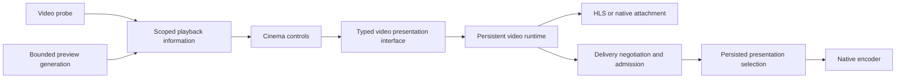
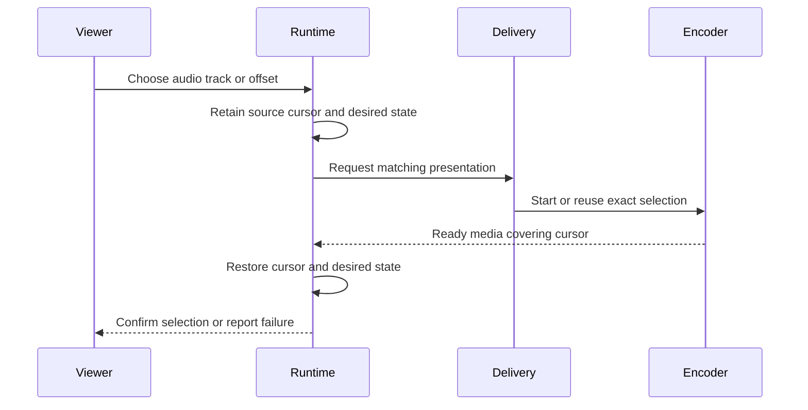
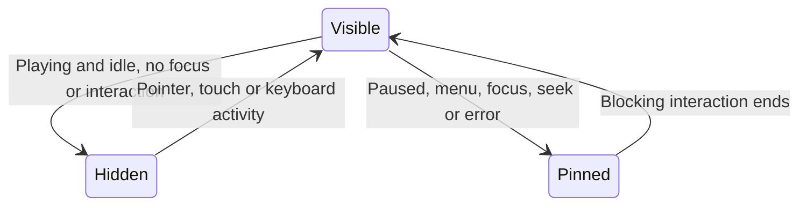

# Cinema Video Player - Plan

## Goal Capsule

**Objective:** Viewers can comfortably watch, navigate and correct the timing of their movies through a player that belongs in Baander.

**Means:** A quiet cinema layout with NowPlaying-inspired controls and functional media choices.

**Authority:** The user's requested features and scope additions govern product behavior; `ui/DESIGN.md` and project rules govern implementation. No product blockers remain. Backend and transcoder additions required for these features are included.

---

## Product Contract

### Summary

Replace the basic movie overlay with a cinema player. Keep transport controls easy to reach, reveal detailed choices on demand, and supply the backend media capabilities those choices require.

### Problem Frame

The current movie overlay exposes transport, volume and seeking but lacks the track and navigation controls needed to watch varied video sources. Its persistent playback runtime is already responsible for local and remote playback; the redesign must preserve that ownership.

### Requirements

#### Viewing and interaction

- R1. Use a quiet cinema layout with Baander's theme, typography and shared controls, taking visual cues from NowPlaying.
- R2. Hide controls during uninterrupted playback and reveal them on interaction; retain controls while paused, focused, showing a menu, seeking or reporting an error.
- R3. Provide play/pause, stop, skip backward/forward, mute, bounded volume, source-time seeking, elapsed/remaining time and fullscreen.
- R4. Make every control keyboard accessible with visible focus, labels and discoverable shortcuts; closing returns focus to the launching control.
- R5. Preserve playback destinations, transfer and recovery behavior, connection-loss feedback and destination-scoped close semantics.

#### Media choices and navigation

- R6. Offer automatic and available manual video quality choices with truthful selected/current quality feedback.
- R7. Offer available audio tracks with understandable language/title labels and preserve position and play/pause state when switching.
- R8. Offer supported subtitle tracks and Off, preserving the choice through seeks and delivery renewal.
- R9. Show source chapters on the timeline and in a navigable list, with the current chapter identified.
- R10. Show a timestamp and actual video preview when hovering or scrubbing the timeline; absent or pending previews must not block seeking.
- R11. Build missing backend and transcoder support for R6–R10, including authorized media metadata and preview delivery.

#### Timing correction

- R12. Let viewers move audio earlier or later independently of video, show the signed offset and reset it to zero.
- R13. Let viewers move subtitles earlier or later independently of audio, show the signed offset and reset it to zero.
- R14. Retain timing adjustments across seeks, quality changes, track changes and delivery renewal for the current movie; reset them when a different movie is selected.
- R15. Explain unsupported controls and failed changes without falsely indicating success or losing the useful playback cursor.

### Key Decisions

- Quiet cinema layout governs R1–R4. (session-settled: user-directed — chosen over always-visible controls and a persistent information panel: the user selected controls that recede during watching.)
- Missing backend/transcoder capabilities and both timing offsets are part of the delivery, as explicitly requested by the user.
- Positive timing offsets mean later playback/display; negative offsets mean earlier. Labels use both words and milliseconds to remove ambiguity.
- Keep picture-in-picture disabled under the existing coordinated-playback policy; fullscreen is included.

### Acceptance Examples

- AE1. **Covers R1–R5.** A viewer starts a movie, lets controls fade, then presses a transport shortcut or tabs into controls. Controls return, focus remains visible, and the existing playback session stays in charge.
- AE2. **Covers R6–R8, R14–R15.** A paused movie at 20 minutes changes quality, language or subtitles without resetting its cursor or beginning playback. Only choices supported by the current delivery are represented as available.
- AE3. **Covers R9–R11.** Hovering over the timeline reveals the corresponding preview and chapter; choosing a chapter seeks to its source position. A movie without chapters still has a useful seek control.
- AE4. **Covers R12–R14.** A viewer delays audio by 250 ms and advances subtitles by 500 ms. The corrections remain after a seek, and each Reset restores only its own offset.
- AE5. **Covers R4, R15.** At a narrow viewport and with a long title, all actions remain reachable by touch and keyboard. A failed track change reports the error and retains recoverable playback state.

### Scope Boundaries

Web movie playback and its required backend/transcoder paths are in scope. React Native, Essentia, unrelated catalog redesign, picture-in-picture, subtitle editing and general watch-party redesign are outside this work.

### Sources

- `ui/web/src/features/catalog/components/MoviePlayerOverlay.tsx`: current controls and scoped close.
- `ui/web/src/features/catalog/components/VideoPlaybackRuntime.tsx`: persistent media ownership.
- `ui/web/src/features/player/components/NowPlayingBar.tsx` and `ui/DESIGN.md`: design reference.
- `ui/web/src/features/catalog/hooks/hls-playback.ts` and `subtitle-selection.ts`: existing attachment and subtitle behavior.
- `src/Transcode/Infrastructure/Auth/AuthorizedPlayback.php`: rendition admission.
- `src/Transcode/Domain/ValueObject/VideoProbeResult.php`: current probe and default audio selection.

---

## Planning Contract

### Key Technical Decisions

- KTD1. Keep `VideoPlaybackRuntime` and `useBaanderPlayer` as media owners; publish typed presentation choices and commands through `video-presentation-store`. The overlay consumes this interface rather than creating a second player. Implements R1–R8 and R14.
- KTD2. Extend the existing HLS attachment to expose automatic/manual level selection and native text tracks. Retain quality by stable rendition attributes and subtitle choice by source key across attachments. Native HLS exposes only choices its actual browser interface can control. Implements R6, R8, R15.
- KTD3. Add selected absolute audio stream index and signed `audioOffsetMs` to delivery negotiation, admission and persisted presentation selection. Include both in presentation identity and force encoding for a nonzero audio offset. Derive audio ordinal, profile and manifest language from the selected stream. Implements R7, R11, R12.
- KTD4. Express audio correction on the source clock in `SegmentEncoder`, reading sufficient preceding audio for positive delay and retaining selected-video endpoint padding/trimming. Preserve cursor, paused state and chosen settings when replacing a delivery. Implements R7, R12, R14–R15.
- KTD5. Apply subtitle correction in a separate cue-timing adapter using immutable original cue times; reconcile late cues and restore original times during disposal. Do not replace the existing stale-cue repair. Implements R8, R13–R14.
- KTD6. Accept finite integer timing offsets from −10000 to +10000 milliseconds, with 100 ms Earlier/Later controls and independent Reset. Settings belong to the current mounted movie and survive attachment replacement. Implements R12–R14.
- KTD7. Add chapter extraction to existing video probing and persist it in the existing probe document. Expose source-normalized chapters and audio/subtitle metadata through a scoped playback-information API. Existing records lacking the chapter field are eligible for reprobe. Implements R7–R9, R11.
- KTD8. Generate bounded thumbnail contact sheets using the existing native-execution lifecycle, cache by source identity, and publish atomically. Authorized metadata supplies source timestamps and image crop coordinates; authorized binary delivery checks the same library scope as the video. The information endpoint requests preparation through a deduplicated command routed to an admitted media consumer; that worker owns native execution, cancellation and publication. HTTP handlers only request work or read its result. Generation is bounded and never launched per hover. Implements R10–R11.
- KTD9. Session transport commands remain on `requestPlayback`. Presentation controls apply only to a matching local media owner; remote destinations show an explanatory unavailable state until their protocol supports those presentation commands. Existing destination controls remain usable. Implements R5, R15.

### High-Level Technical Design

These sketches describe responsibility and ordering; exact helper boundaries follow the source during implementation.

### Assumptions and Risks

- Chapter and thumbnail availability depends on a reachable source; missing data leaves ordinary seeking usable.
- Audio correction can require preparation of a new presentation. The UI must distinguish pending and accepted settings and fence stale responses.
- Existing source-end restore, completed HLS delivery, capability renewal and multi-destination fencing remain regression boundaries.
- No new PostgreSQL columns are expected. Changes to existing selection serialization require round-trip and identity tests; any necessary SQL or mapping change receives PostgreSQL specialist review.
- Thumbnail limits must bound dimensions, total image count, execution duration and retained cache data. The implementation chooses concrete limits against existing helper capacity and records them in tests and developer documentation.

---

## Implementation Units

### U1. Scoped video information and timeline previews

**Requirements:** R7–R11; KTD7–KTD8.

**Owned area:** Catalog video information API, chapter probe support, preview helper/cache and binary delivery, associated backend tests. Coordinate shared probe value object changes with U2 before editing.

**Approach:** Extend `FFprobeArguments`, `VideoProbeResult` and discovery refresh rules for chapters. Add an application port and scoped controller/resource for playback information. Reuse source metadata authorization and native helper execution for bounded contact-sheet preparation and safe image delivery; no source paths enter the response.

**Test scenarios:** Chapters normalize nonzero source timestamps and ignore invalid ranges; no chapters is valid. Unauthorized video/image access fails. Concurrent requests share generation, partial files are never served, source identity changes invalidate previews, and failed generation leaves seeking available.

### U2. Audio-language selection and source-time correction

**Requirements:** R7, R11–R12, R14–R15; KTD3–KTD4, KTD6.

**Owned area:** Media delivery request/decision, transcode signing/admission/commands, presentation identity/selection, subscriber and encoder audio mapping, associated backend/native tests. U1 owns chapter parsing; coordinate any shared value-object edits.

**Approach:** Carry source index and offset through all admission and restore paths. Validate the requested index against discovered audio streams. Use persisted selection for encoding, profile selection and manifest labels. Preserve the same source-time correction for initial playback and seeks.

**Test scenarios:** Invalid/absent audio index, no-audio source, exact identity reuse, distinct identities for changed track/offset, positive/negative offsets at zero and nonzero seek, selected-language manifest, duration endpoint, and serialization round trips. Measure generated media timing in the native suite rather than relying on argv assertions alone.

### U3. Typed runtime controls and subtitle timing

**Requirements:** R6–R8, R12–R15; KTD1–KTD6, KTD9.

**Owned area:** `useBaanderPlayer`, HLS/native attachment helpers, subtitle helpers, `VideoPlaybackRuntime`, presentation store and their tests.

**Dependencies:** Agree request/resource shape with U1/U2; lead owns generated API client regeneration.

**Approach:** Publish choices, active selections, pending state and scoped commands. Preserve settings across attachment renewal, replace audio delivery with source position and pause state retained, and reject stale callbacks. Add independent subtitle cue offsets without cumulative drift.

**Test scenarios:** Manual/Auto quality, disappearing renditions, subtitle Off/source keys, asynchronous cue arrival, positive/negative timing, seek and renewal retention, movie reset, failed/superseded audio change, unmount cleanup, remote ownership changes and existing completed-source restore.

### U4. Cinema controls and accessible navigation

**Requirements:** R1–R10, R12–R15; KTD1, KTD6, KTD9.

**Owned area:** `MoviePlayerOverlay`, new cinema control/settings/timeline components and component tests. Consume the U3 interface; do not edit its media lifecycle.

**Approach:** Build a responsive flat themed console using shared Button, Slider, Tooltip, Dialog and menu primitives. Add chapter marks/list, authenticated preview loading, timing controls, keyboard shortcuts, fullscreen, fade/pin behavior and focus restoration. Preserve existing gesture cancellation and close semantics.

**Test scenarios:** Pointer/keyboard seek commits once, cancellation commits nothing, controls never hide with focus/menu/error, keyboard shortcuts ignore editable/menu targets, fullscreen failure is reported, unavailable features are explained, narrow/long-title layout works, offsets reset independently, and close restores focus only after the scoped stop succeeds.

### U5. Integrated verification and documentation

**Requirements:** R1–R15, AE1–AE5.

**Owned area:** Generated OpenAPI/client output, relevant developer guide, `CONCEPTS.md`, `ROADMAP.md`, browser fixtures/specs and integration corrections.

**Approach:** Integrate units, simplify each completed phase, run the authoritative gates and real-browser scenarios, apply justified code-review findings, and record delivered scope with exact evidence in the roadmap. Local commits only; no push is authorized.

**Test scenarios:** Real movie with multiple audio tracks, subtitles, chapters and visible timing markers; paused seek after offset changes; quality switch and signed URL renewal; absent metadata; disconnected/remote destination; desktop and narrow viewports; keyboard-only operation.

---

## Verification Contract

- Frontend: targeted Vitest runtime/overlay suites, web typecheck, lint and production build, using the repository's Yarn tooling.
- Backend: affected Catalog, Media and Transcode unit/integration suites in the CI image; relevant architecture/static gates and coding-style checks.
- Native media: generated fixtures prove selected audio and measured positive/negative offsets after startup and nonzero seek, plus bounded thumbnail output and chapter timestamps.
- Browser: start the isolated preview through the development guide, pass its URL explicitly as `E2E_BASE_URL`, refresh workers after worker changes, and exercise the real movie endpoint flow. Existing source-end and destination ownership scenarios remain required.
- Contracts: regenerate OpenAPI/client output using the repository process and verify schema/request agreement.
- Documentation: apply `prose-fix`, check the diff and record evidence inline in tracked documents. Unavailable checks remain explicitly open and cannot be represented as passing.

---

## Definition of Done

All requested controls operate on real available media capabilities. Backend/transcoder gaps required by the UI are implemented. Timing corrections remain correct through seeks and attachment changes. Focus, keyboard, narrow-screen and error behavior satisfy the acceptance examples. Relevant checks pass, independent review findings are resolved, and `ROADMAP.md` records delivered items with verification evidence. Work is committed locally on the plan's feature branch without a push.
