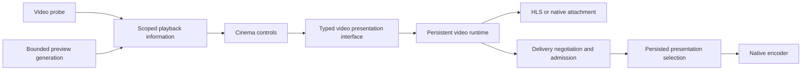
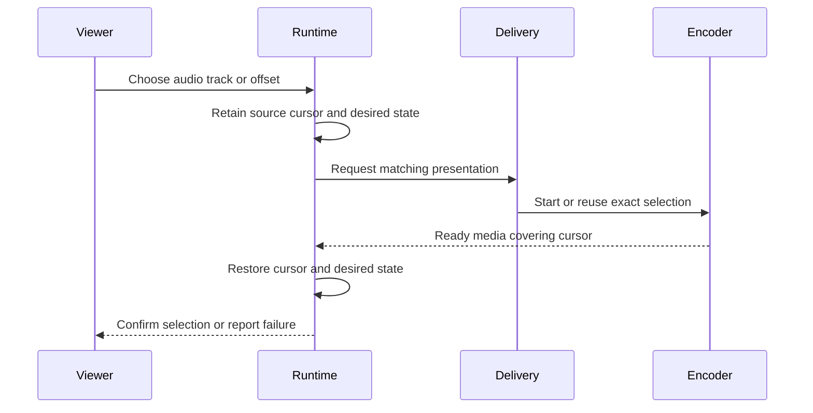
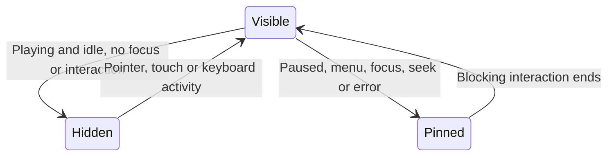
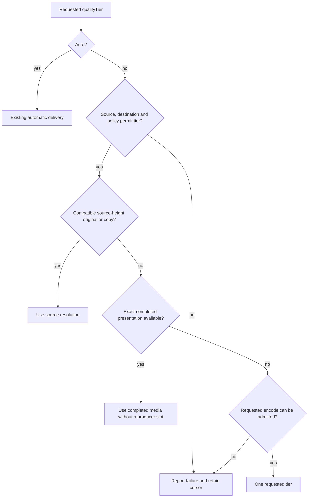
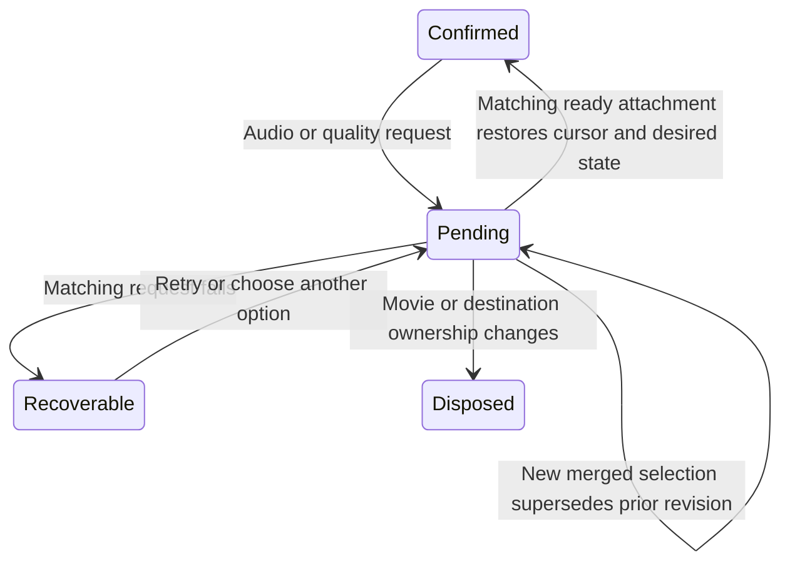

# Cinema Video Player - Plan

## Goal Capsule

**Objective:** Viewers can comfortably watch, navigate and correct the timing of their movies through a player that belongs in Baander.

**Means:** A quiet cinema layout with NowPlaying-inspired controls and functional media choices.

**Execution profile:** Extend the existing feature branch in local implementation units; the lead owns integration, checks and commits. No push is authorized.

**Authority:** The user's requested features and scope additions govern product behavior; `ui/DESIGN.md` and project rules govern implementation. No product blockers remain. Backend and transcoder additions required for these features are included.

---

## Product Contract

### Summary

Replace the basic movie overlay with a cinema player. Keep transport controls easy to reach, reveal detailed choices on demand, and supply the backend media capabilities those choices require.

### Problem Frame

The current movie overlay exposes transport, volume and seeking but lacks the track and navigation controls needed to watch varied video sources. Its persistent playback runtime is already responsible for local and remote playback; the redesign must preserve that ownership.

### Requirements

#### Viewing and interaction

- R1. Use a quiet cinema layout with Baander's theme, typography and shared controls, taking visual cues from NowPlaying.
- R2. Hide controls during uninterrupted playback and reveal them on interaction; retain controls while paused, focused, showing a menu, seeking or reporting an error.
- R3. Provide play/pause, stop, skip backward/forward, mute, bounded volume, source-time seeking, elapsed/remaining time and fullscreen.
- R4. Make every control keyboard accessible with visible focus, labels and discoverable shortcuts; closing returns focus to the launching control.
- R5. Preserve playback destinations, transfer and recovery behavior, connection-loss feedback and destination-scoped close semantics.

#### Media choices and navigation

- R6. Offer automatic and available manual video quality choices with truthful selected/current quality feedback.
- R7. Offer available audio tracks with understandable language/title labels and preserve position and play/pause state when switching.
- R8. Offer supported subtitle tracks and Off, preserving the choice through seeks and delivery renewal.
- R9. Show source chapters on the timeline and in a navigable list, with the current chapter identified.
- R10. Show a timestamp and actual video preview when hovering or scrubbing the timeline; absent or pending previews must not block seeking.
- R11. Build missing backend and transcoder support for R6–R10, including authorized media metadata and preview delivery.

#### Timing correction

- R12. Let viewers move audio earlier or later independently of video, show the signed offset and reset it to zero.
- R13. Let viewers move subtitles earlier or later independently of audio, show the signed offset and reset it to zero.
- R14. Retain timing adjustments across seeks, quality changes, track changes and delivery renewal for the current movie; reset them when a different movie is selected.
- R15. Explain unsupported controls and failed changes without falsely indicating success or losing the useful playback cursor.

#### Manual quality across delivery modes

- R16. Manual quality selection works from original-file, copy, encoded and native-browser playback whenever a supported resolution is available.
- R17. Offer source-qualified resolution tiers without upscaling, subject to destination support and quality policy; Auto retains ordinary automatic delivery selection.
- R18. A quality change preserves source position, desired play/pause state, selected audio language, audio offset, subtitle choice and subtitle offset for the current movie.
- R19. Distinguish requested, pending and confirmed quality; a failed or superseded change retains recoverable playback and cannot replace a newer choice or another destination's playback.

#### Viewport fit

- R20. Fit video to the available player area at every selected resolution, in windowed and fullscreen playback. Preserve the source aspect ratio without cropping; lower-resolution media scales for display without changing the requested encoding tier.

#### Directors navigation

- R21. Directors navigation opens a paginated, searchable directory backed by persisted director credits from movie metadata. Each director opens their accessible movies. Support multiple directors per movie, stable director identity and truthful loading, empty, missing and error states; expose only directors, movies and counts within the viewer's authorized libraries. Static director routes and movie identifier routes remain unambiguous.

#### Local environment configuration

- R22. Keep the checkout's `.env` local and ignored by Git, source snapshots and Docker build contexts. Preserve the existing local file when removing it from tracking. Fresh checkouts and images use the tracked `.env.example` defaults; image builds never copy private checkout values.

#### Frontend build warnings

- R23. Remove the ineffective path-validation dynamic import and native configuration warning without changing validation ownership or application behavior. Assess oversized chunks against actual package boundaries; retain truthful size warnings rather than suppressing them, dropping media capabilities or adding arbitrary fragments.

**Product Contract preservation:** R1–R15 remain unchanged. R16–R19 clarify the user's follow-up, “we should support manual quality selection,” across delivery modes. R20 records the further request that video fit the screen at every resolution. R21 records the user's choice to build real director browsing, including persistence and enrichment, after the Directors navigation defect was identified.

### Key Decisions

- Quiet cinema layout governs R1–R4. (session-settled: user-directed — chosen over always-visible controls and a persistent information panel: the user selected controls that recede during watching.)
- Missing backend/transcoder capabilities and both timing offsets are part of the delivery, as explicitly requested by the user.
- Positive timing offsets mean later playback/display; negative offsets mean earlier. Labels use both words and milliseconds to remove ambiguity.
- Keep picture-in-picture disabled under the existing coordinated-playback policy; fullscreen is included.

### Acceptance Examples

- AE1. **Covers R1–R5.** A viewer starts a movie, lets controls fade, then presses a transport shortcut or tabs into controls. Controls return, focus remains visible, and the existing playback session stays in charge.
- AE2. **Covers R6–R8, R14–R15.** A paused movie at 20 minutes changes quality, language or subtitles without resetting its cursor or beginning playback. Manual quality choices reflect source and quality-policy eligibility, filtered by destination capabilities; admission checks availability when selected. Audio and subtitle choices remain limited to supported tracks.
- AE3. **Covers R9–R11.** Hovering over the timeline reveals the corresponding preview and chapter; choosing a chapter seeks to its source position. A movie without chapters still has a useful seek control.
- AE4. **Covers R12–R14.** A viewer delays audio by 250 ms and advances subtitles by 500 ms. The corrections remain after a seek, and each Reset restores only its own offset.
- AE5. **Covers R4, R15.** At a narrow viewport and with a long title, all actions remain reachable by touch and keyboard. A failed track change reports the error and retains recoverable playback state.
- AE6. **Covers R6, R14–R19.** A paused 720p original or copy presentation at 20 minutes changes to 480p and then 360p, with the decoded video at the selected resolution. Returning to Auto restores ordinary delivery selection while retaining the cursor and media settings.
- AE7. **Covers R17, R19.** A source below the smallest supported tier offers Auto with an explanation; a denied or failed quality request does not claim success or discard the useful playback position.
- AE8. **Covers R20.** A viewer selects 720p, 480p, 360p and Auto in desktop, narrow and fullscreen playback. Each picture fills the available area as far as its aspect ratio allows, without cropping or changing the selected encoding tier.
- AE9. **Covers R21.** A viewer follows Directors from the movie sidebar, searches and pages through the directory, then opens a director's movies and an existing movie detail page. A co-directed movie appears under each credited director. A director credited only on inaccessible movies is absent, including from counts and direct lookup. Failed or repeated enrichment preserves valid credits without creating duplicate directors.
- AE10. **Covers R22.** A fresh checkout without `.env` can prepare its configuration from `.env.example` and build an application image. An ignored `.env` containing synthetic private values enters neither a source snapshot nor a Docker context, and changing it does not change the snapshot digest. The image receives only the tracked example defaults; the developer's local file remains intact.
- AE11. **Covers R23.** A production build no longer reports the library API's ineffective dynamic import or the configuration's CommonJS directory variable. Path validation still rejects stale results after reset, a newer attempt or authorization change. Remaining size warnings are reported with their measured sizes and package constraints; warning thresholds and media features remain unchanged.

### Scope Boundaries

Web movie playback, its required backend/transcoder paths, director persistence, metadata enrichment and browsing, local environment exclusions with reproducible build defaults, and bounded frontend build-warning corrections are in scope. React Native, Essentia, unrelated catalog redesign, picture-in-picture, subtitle editing and general watch-party redesign are outside this work.

### Sources

- `ui/web/src/features/catalog/components/MoviePlayerOverlay.tsx`: current controls and scoped close.
- `ui/web/src/features/catalog/components/VideoPlaybackRuntime.tsx`: persistent media ownership.
- `ui/web/src/features/player/components/NowPlayingBar.tsx` and `ui/DESIGN.md`: design reference.
- `ui/web/src/features/catalog/hooks/hls-playback.ts` and `subtitle-selection.ts`: existing attachment and subtitle behavior.
- `src/Transcode/Infrastructure/Auth/AuthorizedPlayback.php`: rendition admission.
- `src/Transcode/Domain/ValueObject/VideoProbeResult.php`: current probe and default audio selection.

---

## Planning Contract

### Key Technical Decisions

- KTD1. Keep `VideoPlaybackRuntime` and `useBaanderPlayer` as media owners; publish typed presentation choices and commands through `video-presentation-store`. The overlay consumes this interface rather than creating a second player. Implements R1–R8 and R14.
- KTD2. Extend the existing HLS attachment to expose current rendition information and native text tracks. Manual quality uses delivery negotiation under KTD10–KTD13, including native HLS and original-file attachments. Retain subtitle choice by source key across attachments. Implements R6, R8, R15–R19.
- KTD3. Add selected absolute audio stream index and signed `audioOffsetMs` to delivery negotiation, admission and persisted presentation selection. Include both in presentation identity and force encoding for a nonzero audio offset. Derive audio ordinal, profile and manifest language from the selected stream. Implements R7, R11, R12.
- KTD4. Express audio correction on the source clock in `SegmentEncoder`, reading sufficient preceding audio for positive delay and retaining selected-video endpoint padding/trimming. Preserve cursor, paused state and chosen settings when replacing a delivery. Implements R7, R12, R14–R15.
- KTD5. Apply subtitle correction in a separate cue-timing adapter using immutable original cue times; reconcile late cues and restore original times during disposal. Do not replace the existing stale-cue repair. Implements R8, R13–R14.
- KTD6. Accept finite integer timing offsets from −10000 to +10000 milliseconds, with 100 ms Earlier/Later controls and independent Reset. Settings belong to the current mounted movie and survive attachment replacement. Implements R12–R14.
- KTD7. Add chapter extraction to existing video probing and persist it in the existing probe document. Expose source-normalized chapters and audio/subtitle metadata through a scoped playback-information API. Existing records lacking the chapter field are eligible for reprobe. Implements R7–R9, R11.
- KTD8. Generate bounded thumbnail contact sheets using the existing native-execution lifecycle, cache by source identity, and publish atomically. Authorized metadata supplies source timestamps and image crop coordinates; authorized binary delivery checks the same library scope as the video. The information endpoint requests preparation through a deduplicated command routed to an admitted media consumer; that worker owns native execution, cancellation and publication. HTTP handlers only request work or read its result. Generation is bounded and never launched per hover. Implements R10–R11.
- KTD9. Session transport commands remain on `requestPlayback`. Presentation controls apply only to a matching local media owner; remote destinations show an explanatory unavailable state until their protocol supports those presentation commands. Existing destination controls remain usable. Implements R5, R15.

- KTD10. Add optional `qualityTier` to delivery negotiation and stream signing/admission, using existing `QualityTier` identifiers: `360p`, `480p`, `720p`, `1080p`, `1440p`, `4K`. Absent or null means Auto; the UI labels `4K` as `2160p / 4K`. Normalize existing aliases through `QualityTier`, reject invalid values, and carry the accepted tier through audio changes, seeks, signed URL refresh and expired-delivery restarts. Reuse existing tier identity and profile filtering rather than introducing another resolution model. Implements R16–R18.
- KTD11. For manual admission, require the requested tier to fit the known source dimensions, destination capabilities and applicable quality policy. Original/copy can satisfy a source-height match when otherwise compatible; completed artifacts must match the requested tier and presentation selection exactly. Otherwise admit only the requested encode tier. Check reusable completed media before requiring a producer slot; capacity or policy failure remains an explicit failure rather than a fallback to another tier. Auto retains its existing direct/copy/ABR admission behavior. Implements R16–R17, R19.
- KTD12. Extend scoped playback information with `qualityChoices`, containing canonical tier id, display label and nominal dimensions. A Media application port supplies source/QoL eligibility using existing profiles and policy; Catalog does not import Transcode domain types. The runtime filters those choices against destination capabilities. Execution and completed-media availability are rechecked at admission; transient slot occupancy does not determine metadata choices. Unknown source dimensions or a source below all supported tiers yield no manual choices and an explanatory unavailable state. Published HLS levels report current output, not the complete choice catalog. Implements R6, R16–R17, R19.
- KTD13. Make quality selection asynchronous and use one merged audio/quality presentation selection with a shared transition revision. Confirm only a ready replacement that still owns the movie and destination; retain the previous confirmed selection until then. Reuse the audio replacement cursor/pause restoration and fence every completion, failure and cleanup against newer transitions. Keep requested quality separate from decoded current quality, with pending state exposed to the settings control. Implements R14–R19.
- KTD14. Give the persistent video host definite bounds within the available cinema area, and make its video fill those bounds with block layout and aspect-preserving containment. `MoviePlayerOverlay` currently centers an auto-sized host, while `useBaanderPlayer` sets percentage video dimensions; the host therefore allows intrinsic media resolution to determine display size. Bound the host from the overlay, allowing flex children to shrink on both axes; adjust runtime or video styles only where needed. Preserve the existing host, video element and runtime ownership. Display scaling does not alter encoded pixels or relax R17's no-upscaling rule for tier admission. Implements R20.
- KTD15. Persist Catalog-owned directors and movie director credits using stable local UUID/PublicId identity, deduplicating imported people by TMDB person ID rather than name. A movie may have several directors, and one director may credit several movies. A focused director port/repository owns linked records and scoped queries without expanding the Movie aggregate or creating a general person framework. Normal metadata enrichment fills missing director credits; forced enrichment replaces the set, including a successful empty result. Persist the movie metadata and accepted credit update atomically; repeated imports reuse identity, and missing or failed credits preserve the stored set. Add the missing movie dispatch/consumer path to the existing metadata sync so existing movies can acquire credits through real enrichment rather than a fabricated SQL backfill. Implements R21.
- KTD16. Expose scoped director list, detail and movie-list queries through Catalog application contracts and explicit resources: `/api/movies/directors`, `/api/movies/directors/{publicId}` and `/api/movies/directors/{publicId}/movies`. Reuse the existing pagination envelope, bounded page/limit validation and query conventions. Director list membership, detail visibility and movie counts derive from accessible source movies; an inaccessible director answers not found. Preserve existing movie authorization and constrain identifier routes to the established public-ID format. Implements R21.
- KTD17. Register explicit web routes for `/movies/directors` and `/movies/directors/:publicId`, preserving the sidebar entry and valid movie detail route. Reuse the paginated grid, shared movie cards and existing loading/error primitives. Show the persisted name, optional profile image and accessible movie count; do not invent biographies or provider fields. Search and paging use URL state, resetting the page when the query changes. Implements R21.
- KTD18. Make `.env.example` the tracked base template and exclude root `.env` before source snapshot copying or hashing and from Docker context transfer. Preserve tracked `.env.dev` and `.env.test` defaults and their existing loading semantics. After each source-bearing Docker stage copies the repository, materialize its image-local `.env` from `.env.example` before Composer or application startup. Host installation retains the explicit template-copy step before Composer; no alternate dotenv lookup scheme is introduced. The lead removes only the Git index entry after verifying that the local file is preserved. Implements R22.
- KTD19. Import the already-eager library `validatePath` function statically and retain attempt/authorization checks and cleanup. Use `import.meta.dirname` for the Vite configuration's filesystem paths on the existing Node 24 runtime. Keep the existing application and media chunk graph: HLS's public full-feature entry is one self-contained module, Three is already loaded on visualizer activation, and a route/vendor split needs separately measured cache/load benefit plus production-graph smoke coverage. No warning threshold, private dependency entry, light media build or warning filter is introduced. Implements R23.

### High-Level Technical Design

These sketches describe responsibility and ordering; exact helper boundaries follow the source during implementation.

Manual admission follows the existing delivery modes with an explicit requested tier:

### Sources and rationale for manual quality

- `src/Media/Application/Service/DeliveryCompatibility.php` and `src/Media/Application/DTO/DeliveryDestination.php` currently treat maximum dimensions as ceilings. They do not express exact quality intent, so an explicit tier is required to prevent original-file bypass and smaller-artifact substitution.
- `src/Transcode/Domain/Service/QualityLadder.php` already defines six tiers, including 480p. `src/Transcode/Infrastructure/Auth/AuthorizedPlayback.php` currently admits only 360p, 720p and 1080p in its automatic ladder. Manual admission reuses the canonical tiers without broadening Auto.
- `ui/web/src/features/catalog/hooks/hls-playback.ts` and `native-playback.ts` publish attachment capabilities. `ui/web/src/features/catalog/hooks/useBaanderPlayer.ts` currently implements quality as a local HLS level change. These paths cannot negotiate a new resolution for original/copy or native HLS playback.
- `src/Catalog/Infrastructure/VideoPlaybackInformationService.php` already supplies authorized tracks, chapters and previews. Adding source-qualified quality choices there keeps the existing scoped information path.

### Assumptions and Risks

- Chapter and thumbnail availability depends on a reachable source; missing data leaves ordinary seeking usable.
- Audio correction can require preparation of a new presentation. The UI must distinguish pending and accepted settings and fence stale responses.
- Existing source-end restore, completed HLS delivery, capability renewal and multi-destination fencing remain regression boundaries.
- Manual quality adds no PostgreSQL columns or migration. Existing owned-job tier identity remains authoritative.
- A quality option can become unavailable between discovery and admission; the failure path preserves the prior confirmed selection and useful source cursor under R19.
- Manual-quality selection uses existing persistence without new PostgreSQL columns. Changes to selection serialization require round-trip and identity tests. Director persistence adds the mapped tables and migration in U10; all affected SQL and mappings receive PostgreSQL specialist review.
- Thumbnail limits must bound dimensions, total image count, execution duration and retained cache data. The implementation chooses concrete limits against existing helper capacity and records them in tests and developer documentation.

---

## Implementation Units

### U1. Scoped video information and timeline previews

**Requirements:** R7–R11; KTD7–KTD8.

**Owned area:** Catalog video information API, chapter probe support, preview helper/cache and binary delivery, associated backend tests. Coordinate shared probe value object changes with U2 before editing.

**Approach:** Extend `FFprobeArguments`, `VideoProbeResult` and discovery refresh rules for chapters. Add an application port and scoped controller/resource for playback information. Reuse source metadata authorization and native helper execution for bounded contact-sheet preparation and safe image delivery; no source paths enter the response.

**Test scenarios:** Chapters normalize nonzero source timestamps and ignore invalid ranges; no chapters is valid. Unauthorized video/image access fails. Concurrent requests share generation, partial files are never served, source identity changes invalidate previews, and failed generation leaves seeking available.

### U2. Audio-language selection and source-time correction

**Requirements:** R7, R11–R12, R14–R15; KTD3–KTD4, KTD6.

**Owned area:** Media delivery request/decision, transcode signing/admission/commands, presentation identity/selection, subscriber and encoder audio mapping, associated backend/native tests. U1 owns chapter parsing; coordinate any shared value-object edits.

**Approach:** Carry source index and offset through all admission and restore paths. Validate the requested index against discovered audio streams. Use persisted selection for encoding, profile selection and manifest labels. Preserve the same source-time correction for initial playback and seeks.

**Test scenarios:** Invalid/absent audio index, no-audio source, exact identity reuse, distinct identities for changed track/offset, positive/negative offsets at zero and nonzero seek, selected-language manifest, duration endpoint, and serialization round trips. Measure generated media timing in the native suite rather than relying on argv assertions alone.

### U3. Typed runtime controls and subtitle timing

**Requirements:** R6–R8, R12–R15; KTD1–KTD6, KTD9.

**Owned area:** `useBaanderPlayer`, HLS/native attachment helpers, subtitle helpers, `VideoPlaybackRuntime`, presentation store and their tests.

**Dependencies:** Agree request/resource shape with U1/U2; lead owns generated API client regeneration.

**Approach:** Publish choices, active selections, pending state and scoped commands. Preserve settings across attachment renewal, replace audio delivery with source position and pause state retained, and reject stale callbacks. Add independent subtitle cue offsets without cumulative drift.

**Test scenarios:** Manual/Auto quality, disappearing renditions, subtitle Off/source keys, asynchronous cue arrival, positive/negative timing, seek and renewal retention, movie reset, failed/superseded audio change, unmount cleanup, remote ownership changes and existing completed-source restore.

### U4. Cinema controls and accessible navigation

**Requirements:** R1–R10, R12–R15; KTD1, KTD6, KTD9.

**Owned area:** `MoviePlayerOverlay`, new cinema control/settings/timeline components and component tests. Consume the U3 interface; do not edit its media lifecycle.

**Approach:** Build a responsive flat themed console using shared Button, Slider, Tooltip, Dialog and menu primitives. Add chapter marks/list, authenticated preview loading, timing controls, keyboard shortcuts, fullscreen, fade/pin behavior and focus restoration. Preserve existing gesture cancellation and close semantics.

**Test scenarios:** Pointer/keyboard seek commits once, cancellation commits nothing, controls never hide with focus/menu/error, keyboard shortcuts ignore editable/menu targets, fullscreen failure is reported, unavailable features are explained, narrow/long-title layout works, offsets reset independently, and close restores focus only after the scoped stop succeeds.

### U5. Integrated verification and documentation

**Requirements:** R1–R15, AE1–AE5.

**Owned area:** Generated OpenAPI/client output, relevant developer guide, `CONCEPTS.md`, `ROADMAP.md`, browser fixtures/specs and integration corrections.

**Approach:** Integrate units, simplify each completed phase, run the authoritative gates and real-browser scenarios, apply justified code-review findings, and record delivered scope with exact evidence in the roadmap. Local commits only; no push is authorized.

**Test scenarios:** Real movie with multiple audio tracks, subtitles, chapters and visible timing markers; paused seek after offset changes; quality switch and signed URL renewal; absent metadata; disconnected/remote destination; desktop and narrow viewports; keyboard-only operation.

**Verified integration defects:** Register playback-information queries with a five-second sampled live policy so filesystem preview completion refreshes the UI; expire thumbnail queue claims before checking capacity and preserve the state of existing claims when the queue is full; generate the authorized preview client with binary response handling. The associated descriptor, queue and generated-client tests verify these corrections. The fullscreen browser assertion checks the document element, which contains the dialog and its portaled menus. Keep the movie detail page mounted behind the player so its launching button remains available for focus restoration after close. Browser checks verify the native source cursor after paused seeks.

### U6. Exact quality admission and scoped choices

**Goal:** Make a canonical manual tier an enforceable delivery choice across original, copy, cached and encoded media.

**Requirements:** R6, R11, R16–R19; KTD10–KTD12.

**Dependencies:** Existing U1–U5 contracts; U6 owns the added API field and quality-choice shape.

**Files:** `src/Media/Interface/Request/DeliveryRequest.php`, `src/Media/Application/DTO/DeliveryDestination.php`, `src/Media/Application/Service/DeliveryCompatibility.php`, affected Media negotiation handlers and ports, `src/Transcode/Interface/Controller/StreamSigningController.php`, `src/Transcode/Application/Port/PlaybackPortInterface.php`, `src/Transcode/Infrastructure/Auth/AuthorizedPlayback.php`, `src/Catalog/Infrastructure/VideoPlaybackInformationService.php`, `src/Catalog/Interface/Resource/VideoPlaybackInformationResource.php`; tests in `tests/Unit/Media/DeliveryCompatibilityTest.php`, `tests/Unit/Transcode/Infrastructure/Auth/AuthorizedPlaybackTest.php`, `tests/Unit/Transcode/Interface/Controller/StreamSigningSecurityTest.php` and `tests/Unit/Catalog/Infrastructure/VideoPlaybackInformationServiceTest.php`.

**Approach:** Extend existing request mapping and ports under KTD10, then reuse tier/profile filtering and completed-presentation compatibility under KTD11. Add the Media-owned choice provider and expose its scalar DTO through playback information under KTD12. Keep quality policy enforced at admission as well as discovery.

**Test scenarios:**

- A compatible 720p source requested at 480p cannot return the original or a 360p artifact; the matching encode admits only 480p.
- A source-height 720p request retains compatible original/copy delivery, while audio changes and offsets still select the required presentation.
- Eligible 480p, 1440p and 4K sources expose/admit their canonical tiers; unknown/subminimum dimensions and oversized tiers never upscale.
- Exact completed media remains usable without an encoder slot; absent matching media on a remux-only deployment fails clearly.
- Invalid tokens, destination limits and QoL denial fail without substituting a different quality; Auto preserves its prior behavior.
- Signing, refresh and restart retain the accepted tier and existing authorization, client ownership and presentation selection.
- Scoped information excludes unauthorized sources and supplies policy-filtered choices independently of currently published renditions.

**Verification:** Run affected Media/Catalog/Transcode suites in the CI image, PHPStan, Deptrac and relevant coding-style gates. Regenerate OpenAPI/client contracts before U7 integration.

**Verified integration defects:** Fixed-tier encoding must reject a governor allocation for a different tier; otherwise the job encodes a more expensive tier than its allocation describes. An already-admitted sole rendition must remain in its HLS/DASH manifest when the live budget changes. Completed presentation lookup must include audio correction and source-height copy output when testing an exact manual choice. Manifest audio metadata for a job without an explicit selection must follow the source's declared default track, while an explicit no-audio selection remains silent. Focused regressions reproduce these paths before their corrections. Auto also attempted to admit a secondary rendition on a deployment with only one video encoder slot; the admission ladder now caps its tier count at the configured video encoder slots. Three added regressions cover that capacity boundary; the affected CI suite passes 45 tests with 268 assertions after the correction.

### U7. Runtime quality transitions and settings feedback

**Goal:** Apply manual quality through the persistent runtime while retaining the viewer's playback state.

**Requirements:** R6, R14–R19; AE2, AE6–AE7; KTD10, KTD12–KTD13.

**Dependencies:** U6 owns API contracts; generated client integration belongs to the lead.

**Files:** `ui/web/src/features/catalog/hooks/useBaanderPlayer.ts`, `hls-playback.ts`, `native-playback.ts`, `ui/web/src/features/catalog/components/VideoPlaybackRuntime.tsx`, `CinemaSettings.tsx`, `ui/web/src/features/catalog/stores/video-presentation-store.ts`; existing runtime/store tests and `ui/web/src/features/catalog/hooks/__tests__/useBaanderPlayer.test.ts`, `ui/web/tests/features/catalog/hooks/useBaanderPlayer.test.ts` and `ui/web/src/features/catalog/components/__tests__/MoviePlayerOverlay.test.tsx`.

**Approach:** Replace attachment-only selection with KTD13's shared presentation transition. Feed the menu from scoped quality choices under KTD12, show Auto/manual accepted selection separately from pending/current output, and catch asynchronous failures in the existing feedback surface. Recheck local ownership before starting and after completing the operation.

Runtime observations must use the protected source cursor during replacement and restoration, then resume reporting the advancing media clock after restoration clears. This applies to the session's canonical position as well as the visible timeline.

**Test scenarios:**

- Covers AE2/AE6. Switching a paused original or copy from 720p to 480p retains source cursor, pause, selected language, both offsets and subtitle choice; Auto uses ordinary negotiation again.
- Hold cancellation or signing during a replacement at a nonzero source cursor while the native media clock resets to zero. Runtime observations retain the source cursor throughout the wait; after restoration completes, observations follow native playback advancement. The real cinema scenario verifies that the paused session snapshot and native cursor both remain at the requested source position after a quality change.
- Native HLS negotiates a selected tier without relying on browser HLS-level control; HLS.js reports decoded current quality separately from the accepted request.
- Overlapping audio and quality changes merge settings, and the latest revision wins when responses finish out of order.
- Seek, URL renewal and expired-delivery restart retain manual tier; selecting another movie resets it.
- Covers AE7. Failed preparation preserves recoverable cursor and confirmed settings; unknown/subminimum sources show Auto and an explanation.
- Movie close, remote destination transfer and local ownership loss prevent stale completions or cleanup from mutating another owner's playback.

**Verification:** Run affected Vitest runtime/settings/store suites, typecheck, lint and web production build.

**Verified review defects:** A failed first signing leaves no snapshot for the ordinary refresh loop, so recovery must explicitly restart the accepted presentation. Audio-track and timing gestures must merge the pending companion value. Selectors must show the pending choice so viewers can reverse it to the accepted Auto or default audio setting. Repeated 100 ms timing gestures must accumulate against the pending offset rather than the last accepted value. An overlapping change must preserve running intent while the first replacement has no snapshot. The shared delivery adapter must forward `qualityTier`; transport-level regressions cover every canonical value because hook mocks alone cannot verify the request body.

The cinema browser scenario also observed a paused session snapshot at zero while the native timeline remained at ten seconds after selecting 480p. In `useBaanderPlayer`, `cursor()` protects replacement and restoration positions, but `observe()` reads the raw media clock after the old attachment is released. The coordinator publishes those observations every ten seconds, and `ListeningSession.observePlayback` accepts their position. Reuse the protected cursor for observations; a regression holds replacement preparation across the native clock reset and checks both the protected position and subsequent native advancement.

Replacing only the browser attachment leaves the previous server presentation holding producer capacity. Any known session handle must retire successfully before admitting a replacement or recovering the accepted presentation. Copy negotiation returns its admitted session identifier for cleanup even if later signing fails. Failed cancellation retains the accepted settings and cursor; the existing one-second poll retries the same handle through the serialized mutation queue, with a five-second timeout per request. Newer intent and ownership loss fence those retries. Quiesce drains pending changes and rejects unconfirmed cancellation, preventing handoff from overtaking a late cancellation. The runtime regressions cover old-session cancellation failure, candidate cleanup failure, cancellation failure across successive intents and handoff ordering, including a single available producer slot.

**Separate work — owner-close cleanup after a lost admission response:** The baseline `af378474` already aborted an in-flight start request and discarded a late response when ownership ended. A newly admitted session whose handle the player never receives can therefore remain until server expiry. This requires a server-scoped cancellation protocol and remains separate from manual presentation switching: cancelling the former owner's whole group after ownership loss could cancel its successor. Evidence is the baseline and current `useBaanderPlayer.ts` start/cleanup paths; the corrected manual-switch regressions cover known handles.

### U8. Real resolution proof and delivery record

**Goal:** Verify that manual selection changes decoded media across delivery modes and record the delivered scope.

**Requirements:** R6, R14–R19; AE2, AE6–AE7.

**Dependencies:** U6–U7; lead owns fixtures, generated contracts, shared integration checks and documentation.

**Files:** `tests/Fixtures/Playback/video-fixture.php`, `ui/web/tests/e2e/playback-destinations/cinema-player.spec.ts`, `ui/web/tests/e2e/playback-destinations/video-delivery.spec.ts`; generated API client/OpenAPI artifacts; `ROADMAP.md`, existing player developer documentation and `CONCEPTS.md`, including the manual video quality definition.

**Approach:** Add an optional 1280×720 owned-video fixture while preserving existing small fixtures. Exercise original and copy transitions through real admission, then use the cinema scenario to verify selected media settings. Apply phase simplification and final code review, and record exact completed gates in the roadmap.

**Test scenarios:**

- Covers AE6. For both original and copy 720p delivery, pause after a nonzero seek, select 480p then 360p, and assert request tier, decoded `videoHeight`, source cursor and pause. Auto returns to the ordinary 720p source path.
- Covers AE2. The cinema fixture retains selected audio, audio offset, subtitle choice and subtitle offset through quality replacement and renewal.
- Covers AE5/AE7. Keyboard focus remains usable during pending/error feedback, and a failed change preserves recovery state.

**Verification:** Run browser checks against the explicit isolated preview URL after refreshing workers, affected authoritative suites/static gates, and `git diff --check`. Record new evidence separately from the U1–U5 receipt below; do not treat historical counts as verification of U6–U8.

### U9. Resolution-independent viewport fit

**Goal:** Keep the picture fitted to the cinema area through resolution changes, resizing and fullscreen transitions.

**Requirements:** R20; AE8; KTD14.

**Dependencies:** U7–U8 provide the manual-quality transition and browser fixture; the sizing change remains local to the existing player.

**Files:** `ui/web/src/features/catalog/components/MoviePlayerOverlay.tsx`; `ui/web/src/features/catalog/components/VideoPlaybackRuntime.tsx` and `ui/web/src/features/catalog/hooks/useBaanderPlayer.ts` only if needed for host/video styles; `ui/web/tests/e2e/playback-destinations/cinema-player.spec.ts` and `ui/web/tests/e2e/playback-destinations/video-delivery.spec.ts`; `ROADMAP.md` for delivery evidence.

**Approach:** Establish the cinema area as the host's containing block and size the existing host to its bounds; position the host within that area if needed. Use zero minimum sizes on relevant flex children and aspect-preserving containment on the block video element. Keep transport, presentation transitions and the persistent media element intact. Fit is display behavior and does not renegotiate quality.

**Test scenarios:** Verify 720p, 480p, 360p and Auto at desktop and narrow viewports, then in fullscreen. Measure the cinema area's, host's and video's actual element rectangles after media restoration and resizing; assert that the host/video box fills the available area and that the picture fits within it at the decoded media's aspect ratio without cropping or overflow. Check the contain behavior with differing source and viewport aspect ratios. Keep decoded resolution assertions separate from display geometry, retain the selected tier through resizing/fullscreen, and retain the existing source-position and pause checks.

**Verification:** Extend the real-browser scenarios against the explicit isolated preview URL. Run focused lint, web typecheck and `git diff --check`; add component coverage only if a behavioral change beyond sizing requires it. Record the viewport-fit observations and completed gates in the roadmap separately from earlier receipts.

### U10. Director persistence, enrichment and scoped queries

**Goal:** Populate real director credits and serve a scoped directory and each director's movies.

**Requirements:** R21; AE9; KTD15–KTD16.

**Ownership:** PostgreSQL backend specialist owns Catalog/Metadata source, migration and backend tests. The lead owns shared container configuration, Messenger routing and generated API contracts.

**Files:** New Catalog director input/read-model, application port/service, domain repository and Doctrine repository/entity files; `src/Catalog/Interface/Controller/MovieDirectorController.php`, `src/Catalog/Interface/Resource/DirectorResource.php`, existing `MovieController.php`; Metadata `TmdbMovieDto.php`, `TmdbAdapter.php`, `MovieMetadataEnricher.php`, `EnrichmentResult.php`, `SyncLibraryHandler.php`, new `SyncMovieMessage.php` and `SyncMovieHandler.php`; additive `migrations/Version20261121143000.php`; focused Metadata DTO/enricher/sync-handler/provider-destination tests, `tests/Integration/MessengerJsonDeliveryTest.php`, `tests/Unit/Catalog/Interface/Controller/MovieRoutesTest.php` and real-PostgreSQL director repository/controller tests; optional director data in `tests/Fixtures/Playback/video-fixture.php`. Discover current paths within these modules before writing; no Movie aggregate/state rewrite is required.

**Verified defects:** The real Symfony attribute matcher resolves `/api/movies/directors` to movie show, whose public-ID parser rejects the navigation slug. TMDB crew extraction already identifies directors, but `MovieMetadataEnricher` drops them and has no registered callers. Existing library metadata sync traverses albums and songs, so merely persisting credits inside that unused enricher would leave the directory empty. The enricher also title-searches despite an existing TMDB identity and redirects a conflicting result to another local movie. Activating that path without correcting identity selection could update the wrong movie and its credits.

**Approach:** Add mapped director and movie-credit tables, stable local identity, a unique TMDB person identifier, unique movie/director pairs, named foreign keys and a reverse lookup index. Follow the PostgreSQL skill and database naming rules; preserve local data and verify both a fresh schema and an upgrade containing existing movies. Resolve concurrent imports to one person identity and commit movie metadata plus credit changes together through the existing application transaction contract. Reuse existing movie hydration for paginated results rather than exposing Doctrine entities through application ports.

Preserve TMDB person IDs, names and optional profile URLs in explicit director input values. Distinguish credits absent or failed from an authoritative empty list. Wire movie dispatch and its asynchronous handler into the existing metadata-sync use case, propagating force and retaining cancellation checkpoints and job behavior. Both existing admin and CLI sync entry points must reach that same use case; add no separate director-only sync mechanism. No stored director data exists to backfill in SQL.

Fetch an already-identified movie by its assigned TMDB ID; search by title only when the movie lacks that identity. A search result belonging to another local movie must report a conflict without redirecting the requested movie's metadata or credit write. Distinguish a permanent no-match from a transient enrichment failure so the new movie consumer acknowledges no-match and exposes retryable failures through the established job/message behavior, without changing existing album/song consumer semantics. The TMDB adapter currently collapses transport, decoding and unsuccessful HTTP responses into empty results; retain genuine not-found behavior and bounded rate-limit retry while propagating sanitized failures to the movie enricher. Preserve destination validation and credential-safe logging, and audit existing callers before altering the adapter's error contract.

Expose paginated/searchable list and director-movie queries plus scoped detail using the normal response envelope. Director output contains local `publicId`, `name`, `tmdbId`, nullable `profileUrl` and accessible `movieCount`; movie output reuses `MovieResource`. Every membership/count/movie query applies the existing Catalog library read scope before paging/counting, and inaccessible detail answers not found. Constrain movie and director identifier routes while preserving static list routes and valid movie mutations.

**Test scenarios:** Verify successful multi-director import, same-person reuse across movies, distinct people with the same name, concurrent imports, atomic rollback, repeat enrichment, normal fill-missing, forced replacement and successful empty removal, and preservation after missing or failed credits. Cover authoritative existing-ID lookup and a conflicting title-search match, proving neither movie receives an unintended write. Execute the real movie metadata-sync path from library dispatch through its consumer, including no-match acknowledgement, transient failure retry and force propagation. Use disposable PostgreSQL to verify persistence/reload, uniqueness, foreign-key cleanup, existing-movie upgrade, scoped counts, search and page boundaries, and no access through direct director lookup or movie listing. Use the actual Symfony route loader/matcher to cover static director list/detail/movies, valid movie GET/PATCH/DELETE and rejection of non-ID tokens from identifier routes. Add optional run-owned director fixture data spanning more than one page, return its stable identifiers in the fixture manifest, and remove only that run's records during cleanup.

**Verification:** Run affected Catalog/Metadata suites in the CI image, migration/schema checks, PHPStan, Deptrac and applicable style gates. Verify actual container resolution, route registration and async routing. The lead regenerates OpenAPI/client output before U11 integration. Record exact evidence separately from earlier cinema receipts.

**Verified integration efficiency defects:** `DirectorService` currently hydrates each filmography movie through an individual visible lookup, followed by video-link queries in `MovieRepository`; a fifty-movie page therefore adds at least one hundred queries. Add scoped batch movie and video-link hydration, retaining result order and resource fields. `SyncLibraryHandler` also hydrates the entire library's movies and video links only to dispatch their identifiers. Add bounded identifier-only iteration through the movie application/repository contracts, preserving dispatch order and cancellation checks. Backend integration owns the necessary contract extensions and regressions that verify bounded query/allocation behavior; existing proof tests remain unchanged.

**Verified deployment configuration defect:** The TMDB token must pass `packages/baander-core/src/EnvironmentVariable.php`, `src/Shared/Infrastructure/Worker/DeploymentRuntimeEnvironment.php`, the production worker filter in `packages/baander-deployment/src/Presets/Renderer.php` and the isolated worker allowlist in `packages/baander-dev-environment/src/Worker/WorkerDeployment.php`. An optional empty template value does not supply credentials. The associated environment-validation and worker-filter regressions reproduce rejection or stripping before the configuration correction; final evidence belongs with the delivered configuration checks.

**Verified metadata review defects:** `SyncMovieHandler` loads a movie before its provider requests. Saving that stale aggregate through the general movie path can remove a video attached while the lookup was in flight and overwrite concurrently changed non-metadata fields. Add a metadata-only save through the existing movie application/repository contracts, preserving current video links and unrelated movie columns. Resolve the complete available genre set through the existing batch import identity-locking method inside the same transaction; per-name find/create can collide when parallel movie syncs discover the same missing genre. The PostgreSQL specialist owns these persistence corrections and actual-enricher regressions using a second connection to attach a video, change a title and contend for a shared genre during lookup. Preserve the existing atomic rollback proof. The pre-fix PostgreSQL run reproduces one lock-wait error and two failures across four tests with sixteen assertions; the rollback case passes. These are reproduced defects, not completed correction gates.

### U11. Director directory and director movie pages

**Goal:** Make the existing Directors sidebar entry open real directory and movie views.

**Requirements:** R21; AE9; KTD16–KTD17.

**Dependencies:** U10 owns the API/resource shape; the lead owns generated contracts. Frontend implementation can begin after that interface is agreed and reviewed.

**Ownership and files:** Frontend worker owns `ui/web/src/features/catalog/pages/DirectorsPage.tsx`, `DirectorDetailPage.tsx`, `ui/web/src/features/catalog/components/DirectorGridItem.tsx`, their focused tests and `ui/web/src/features/layout/routes.tsx`. Preserve the existing sidebar entry. The lead owns `ui/web/tests/features/layout/routes.test.tsx`, real-browser integration, `CONCEPTS.md`, `ROADMAP.md` and relevant operator/developer documentation; the backend fixture addition remains with U10.

**Approach:** Add static directory and director-detail routes before the movie-detail fallback. Render real name/profile/count cards as links using the existing paginated grid. Submit search through shared input/button controls, storing query and page in the URL and resetting the page when search changes. Render the director's movies through shared movie cards and existing movie resource adapters. Provide skeletons, query-aware empty states, retryable errors, a missing-director view and navigation back to Directors. Optional portraits use the existing external-image convention; missing images receive the established fallback. No biography, cast browser or manual director editing is included.

**Test scenarios:** Verify directory search/page URL state, page reset, genuine empty results, failed query retry, optional image fallback and accessible links. Verify detail counts, existing movie navigation, missing/failed detail states and paging of a director's movies. Route tests prove that Directors navigation invokes director queries and never requests movie details for the literal navigation slug. In the isolated preview, browse persisted fixture directors and a co-directed movie through the real API; test a second library scope to confirm hidden movies and counts remain absent.

**Verification:** Run focused page/route suites, full web typecheck and lint, production build, real-browser navigation and `git diff --check`. Apply phase simplification and final code review. Document how the existing metadata sync populates credits, add the agreed director vocabulary to the concepts glossary, and record delivered scope with exact gates in the roadmap.

**Verified browsing review defects:** Both director views render an out-of-range empty page as if no results exist, hiding pagination even when the response has a positive total. Recover the URL to the last available page while retaining the query, and distinguish that case from genuine empty results. Director cards must carry their originating directory pathname and search state so Back returns to the same filtered page; direct detail visits retain the normal directory fallback. Preserve scroll and focus through the existing navigation lifecycle where feasible, keeping that correction local to director browsing. Use the prescribed destructive error text and shared ghost Retry button while retaining muted empty states. A refetch error accompanied by valid cached results must not consume the one-shot directory focus/scroll restoration before a successful load; guard that state and retain the corresponding retry dependency. Navigation regressions reproduce four failures before correction; final focused checks must cover recovery on both pages, directory return state and retry behavior. These corrections leave the existing API contract unchanged.

---

### U12. Private local environment and reproducible build defaults

**Goal:** Ignore local environment values without breaking fresh-checkout or image setup.

**Requirements:** R22; AE10; KTD18.

**Ownership and files:** Environment worker owns `.gitignore`, `.dockerignore`, `.env.example`, `packages/baander-images/src/Build/Source.php`, `packages/baander-images/tests/DevelopmentBuildTest.php`, `packages/baander-dev-qualification/src/Fixtures/DockerContext.php` and the root `Dockerfile`. A bounded qualification worker owns host-checkout archive preparation in that package's Worker, Messaging and Web fixture modules and its focused tests. The documentation owner updates the existing installation/configuration guidance. The lead alone removes `.env` from the Git index; no worker edits or deletes the local file, stages changes or commits.

**Verified defects:** `Source::snapshotWorktree()` currently substitutes tracked `HEAD:.env`, and its regression expects that tracked template. Docker ignores local variants but admits root `.env` to each whole-tree copy in production, CI and dev-runtime. Qualification host-checkout staging also explicitly archives `.env` in worker, messaging and web paths, bypassing the root Docker ignore and failing when a fresh checkout lacks the file. Symfony's loaders require a physical base file and do not use `.env.example` automatically. Backend CI source snapshots mounted over `APP_HOME` also hide the image-generated `.env`; those runtimes must materialize the safe example defaults before boot without reading private values or changing the snapshot digest. The installation guide already prescribes copying the example before Composer, but incorrectly says local `.env` is baked into images.

**Approach:** Add the root ignore rules and reject root `.env` before snapshot reads, copy and hashing, even while it remains in the index during this change. Remove its tracked-HEAD special case while retaining existing environment-variant handling. Complete the example with the missing safe authentication, encoder, lyrics and telemetry defaults derived only from tracked templates or code; keep provider credentials empty and preserve the added TMDB entry. Disable optional telemetry export by default with an empty endpoint. Materialize `.env.example` as the image's `.env` in every source-bearing target before dependent build steps, retaining ownership suitable for the application user. Keep Docker context qualification synthetic and independent of the developer's private values.

Host-based qualification staging must likewise derive its fixture `.env` from `.env.example` without reading the checkout's local `.env`. Reuse one bounded archive-preparation mechanism across those fixture paths and preserve their existing staged dependencies, file modes and extraction behavior. Do not mutate the checkout to prepare an archive. Update installation guidance so build defaults and supported runtime overrides are distinct; local `.env` edits no longer configure image-baked worker settings.

**Test scenarios:** Prove a snapshot from a fresh fixture without `.env` preserves `.env.example`, and dirty ignored or still-indexed root `.env` is absent and digest-independent. Verify example edits do change the digest. Qualify Docker context transfer with distinct synthetic local/example markers, confirm local `.env` is absent and the image-local base file comes from the example, and preserve existing local-variant exclusions and tracked test defaults. Exercise real host-staging archive creation/extraction with synthetic private/example markers and no local `.env`, including the worker fixture-image path. Verify the fresh configuration boots with the documented template-copy setup. Confirm Git ignores root `.env`; the lead checks index removal separately without exposing its contents or deleting the file.

**Verification:** Run focused image-source tooling tests, Docker context qualification, touched tooling formatting, relevant tooling policy/static checks and `git diff --check`. A full application image rebuild is not required for this bounded template-copy change if the context/materialization smoke verifies the same mechanism. Document the defaults and exact completed checks; do not treat index removal as completed until the lead performs it.

### U13. Spec parameter attributes with unchanged API export

**Goal:** Replace the deprecated parameter attributes in the two movie controllers with the user's exact requested `OpenApi\Spec\Parameter` class while preserving the generated API contract.

**Current status — superseded bridge:** The user rejected the deprecated serializer, context and annotation classes introduced by the implemented adapter, overriding the earlier approval of its legacy boundary. The scope, approach and checks below record the superseded design and do not authorize its continuation. Replacement follows the reviewed [Native Spec OpenAPI plan](2026-11-21-1517-refactor-native-spec-openapi-plan.md), which owns the native pipeline, migration scope and verification. Its implementation remains separate work. The historical export proof below does not establish acceptance of that replacement.

**Original requirements and authority (historical):** The user's explicit parameter-class request extends U10's controller work. Preserve all parameter names, locations, descriptions, required flags, defaults, limits and schemas, along with existing operations, responses and model references. No application-facing API behavior changes.

**Superseded implementation scope:** Backend worker owned `src/Catalog/Interface/Controller/MovieDirectorController.php`, `src/Catalog/Interface/Controller/MovieController.php`, new `src/Shared/Infrastructure/OpenApi/SpecParameterRouteDescriber.php`, focused reflection/describer/export tests and its explicit service tag in `config/services.yaml`. The lead owned generated OpenAPI/client artifacts and final shared gates. That scope excluded dependency upgrades, broad attribute migration, application-defined deprecated subclasses, deprecation suppression and unrelated service configuration changes.

**Verified integration constraint:** The installed swagger-php 7 Spec parameter requires a Spec schema. Nesting it inside the existing legacy operation does not preserve it, and the installed Nelmio 5.13.2 generator does not consume Spec operations. Its generator contract is hard-typed to the legacy path, so a replacement builder configuration cannot safely mix the two models. A direct namespace substitution would silently remove parameters from the exported contract. Nelmio's legacy annotations pipeline and the official serializer are themselves deprecated upstream; the original bridge retained that integration boundary, which the user's later correction rejects. These facts come from the installed Spec parameter, legacy operation/generator, serializer and Nelmio route describer sources.

**Superseded approach (historical):** Move the eight director parameters and six movie parameters to standalone method attributes imported as the exact `OpenApi\Spec\Parameter` class, using a Spec schema alias for their nested schemas. Keep the existing legacy operations, responses and Nelmio model references. Add one narrowly scoped integration adapter implementing Nelmio's public `RouteDescriberInterface`, with an explicit `nelmio_api_doc.route_describer` service tag at priority zero so it runs before the existing negative-priority describers.

The adapter reads method-level Spec parameter attributes without mutating them. Compile their parameter representation with the official `OpenApi30Compiler` through an ephemeral `Specification` and operation, then use swagger-php's official `Serializer` to deserialize that compiled representation into the legacy parameter type required at Nelmio's external integration boundary. Do not implement a field-by-field mapper or a parallel schema model. Apply the resulting parameters only to the route's intended HTTP operations, preserve declared order, avoid duplicates by parameter identity and leave methods without Spec parameters unchanged. Existing model registration and operation/response discovery remain with Nelmio.

**Historical test scenarios:** The replacement must prove that its introduced integration code no longer uses the rejected deprecated classes. Reflection proves all fourteen migrated attributes instantiate the exact requested Spec class with Spec schemas. An actual container-backed Nelmio export preserves every parameter field and ordering for the affected routes, their response/model references and component schemas, with no duplicate parameters or accidental methods. Cover multiple methods and repeated parameter identities at the integration boundary. A legacy control route without Spec attributes remains unchanged. Compare the full normalized OpenAPI export before and after the migration, rather than relying on isolated attribute serialization; generated client output must remain equivalent.

**Historical verification:** Capture the pre-change export as a comparison baseline outside the tracked tree. Run focused reflection/describer and actual API export tests in the CI image, syntax/style checks for touched PHP, PHPStan and Deptrac. The lead regenerates OpenAPI and client artifacts and checks semantic equality of the complete schemas and generated contracts. Run phase simplification and focused code review before delivery; do not infer export compatibility from successful reflection or compilation alone.

---

### U14. Bounded frontend warning cleanup

**Goal:** Remove misleading import/configuration warnings and explain genuine size constraints without changing runtime features.

**Requirements:** R23; AE11; KTD19.

**Ownership and files:** Warning worker owns `ui/web/src/features/library/hooks/use-path-validation.ts` and `ui/web/vite.config.ts`; `ui/web/tests/features/library/library-lifecycle.test.tsx` supplies existing proof coverage and changes only if required by a verified behavioral gap. The lead owns final build scheduling, preview restoration, shared gates and commits. Player/director logic, generated API output, React Native and backend changes are excluded.

**Verified evidence:** The current production build reports `INEFFECTIVE_DYNAMIC_IMPORT` because `library-api.ts` is imported both dynamically by the validation hook and statically by the library screens/hooks. Native configuration loading warns about `__dirname` in the ESM configuration. Baseline minified JS sizes are app 2322.86 kB, HLS 578.15 kB and Three 742.80 kB. Installed Vite 8.3.5 uses Rolldown 1.2.16; HLS 1.7.4 exports one import-free `dist/hls.mjs`, while Three 0.187 exports renderer/core modules and remains lazy at `visualizer/renderers/particle.ts`. The web route table eagerly imports its screens.

**Approach:** Replace only the ineffective loader boundary and the CommonJS path variable. Preserve validation reset, attempt revision, authorization ownership, error and unmount behavior. Existing literal import paths remain analyzable. Node's [ESM documentation](https://nodejs.org/download/release/v24.22.1/docs/api/esm.html#importmetadirname) defines the supported directory property. Rolldown's [code-splitting API](https://rolldown.rs/reference/OutputOptions.codeSplitting) and [manual splitting guide](https://rolldown.rs/in-depth/manual-code-splitting) support semantic groups for measured cache optimization, but configuration cannot subdivide the single HLS module. Keep size warnings visible and record the final measurements rather than claiming the two-file correction solves bundle size.

**Separate work:** A semantic app/vendor or route split remains a distinct optimization because it changes the emitted chunk graph and needs a measured benefit plus production startup/auth/lazy-media smoke coverage. It is not needed to correct the ineffective import or native ESM warning. Any such expansion requires lead coordination before editing route or chunking files; do not replace HLS with a capability-reduced or private source build.

**Test scenarios:** Run the existing library lifecycle regressions for reset/new-request/authorization ownership and cleanup, plus typecheck and scoped lint. Build after the lead's active source-served browser run ends; confirm both named warnings disappear, service-worker output and aliases resolve, and unchanged size warnings remain explicit. Smoke the emitted production entry's startup/login view in an isolated local browser/server with mocked API traffic, checking startup and module-loading errors. No new lazy chunk boundary is introduced, so this smoke does not replace or repeat the lead's player/director scenarios.

**Verification:** Preserve before/after warning and chunk-size evidence, apply bounded simplification and code review, and record exact checks in the roadmap. Do not write source/configuration or rebuild `public/.vite` while the lead's browser run is active. After the final build, freeze the source and tell the lead to restore source-served preview assets before any later source-module browser checks.

---

## Verification Contract

- Frontend: targeted Vitest runtime/overlay suites, web typecheck, lint and production build, using the repository's Yarn tooling.
- Backend: affected Catalog, Media and Transcode unit/integration suites in the CI image; relevant architecture/static gates and coding-style checks.
- Directors: real-PostgreSQL migration and scoped query coverage, TMDB credit preservation/replacement and actual movie-sync dispatch/consumer coverage; generated-contract and real-browser directory-to-movie navigation checks.
- Native media: generated fixtures prove selected audio and measured positive/negative offsets after startup and nonzero seek, plus bounded thumbnail output and chapter timestamps.
- Browser: start the isolated preview through the development guide, pass its URL explicitly as `E2E_BASE_URL`, refresh workers after worker changes, and exercise the real movie endpoint flow. Existing source-end and destination ownership scenarios remain required.
- Viewport fit: compare actual player, host and video geometry at each manual tier and Auto across desktop, narrow and fullscreen playback; verify aspect-preserving containment independently of encoded resolution.
- Contracts: regenerate OpenAPI/client output using the repository process and verify schema/request agreement.
- Documentation: apply `prose-fix`, check the diff and record evidence inline in tracked documents. Unavailable checks remain explicitly open and cannot be represented as passing.

---

## Definition of Done

All requested controls operate on real available media capabilities. Backend/transcoder gaps required by the UI are implemented. Timing corrections and canonical source position remain correct through seeks and attachment changes. Video fits the available player area at every resolution without cropping or changing the requested encoding tier. Director metadata is persisted through working enrichment, and directory/detail/movie views respect library access. Focus, keyboard, narrow-screen and error behavior satisfy the acceptance examples. Relevant checks pass, independent review findings are resolved, and `ROADMAP.md` records delivered items with verification evidence. Work is committed locally on the plan's feature branch without a push.

## Implementation evidence

U1–U5 are implemented and verified. The CI image passes 146 audio/delivery tests with 8,128
assertions and 172 metadata/preview tests with 881 assertions; the final preview
queue rerun passes six tests with 35 assertions. PHPStan and Deptrac report no
errors or violations. The full web suite passes 3,757 tests in 309 files, with two
additional page-focus regressions passing separately. Typecheck, lint and the
production build pass; lint retains 12 existing warnings.

The real cinema browser scenario verifies selected audio, quality and subtitles,
preview JPEG decoding, actual cue timing, paused native-source seeks, independent
resets, fullscreen, narrow layout and returned focus. Review findings for queue
expiry, binary client handling, live preview refresh and launcher lifetime are
fixed and covered by regression tests. The completed full review and both focused
follow-ups have no unresolved findings. The final browser regression run passes
all three original/copy delivery and destination-transfer checks. Delivery is
recorded in `ROADMAP.md`; the implementation and formatting rules are saved as
local commits on `feat/cinema-video-player`, with no push.

Manual-quality and viewport-fit checkpoint on 2026-11-21: the CI backend baseline
passes 479 tests with 4,059 assertions across 33 files. The full web suite passes
3,808 tests in 311 files; both player-hook suites pass 300 tests after the recovery
corrections, and the delivery transport suite passes 31 tests. Final PHPStan checks
all 4,047 files in the CI image with no errors, and Deptrac reports no violations,
warnings or errors. Full web lint reports
no errors and 12 existing warnings; typecheck passes. The production build passes
after the viewport-fit change, and all ten focused overlay tests pass. After the
Auto admission correction, the affected CI suite passes 45 tests with 268
assertions; these overlap the backend baseline. Scoped viewport-fit lint passes
with no errors.

The existing persistent host now has definite bounds within the cinema area, and
the video uses aspect-preserving containment. Display fit does not alter the
requested encoding tier. The one-slot manual-quality browser run passes from both
original and copy delivery, checking decoded 720p, 480p and 360p media and return
to Auto, source cursor and pause retention, and actual display geometry at desktop
and portrait sizes and in fullscreen. Both original/copy delivery browser checks
also pass. The historical U1–U5 evidence above applies to its earlier checkpoint.

The broader cinema scenario exposed a zero source-cursor report while replacement
reset the native clock. Retaining the protected cursor fixes both regression
cases; the final 300-test hook rerun, typecheck and lint pass. A later cinema
rerun could not complete because an unrelated paused media producer held the sole
video slot. Fixture cleanup completed with no survivors; that producer was left
untouched. After restoration of the ordinary eight-slot profile, all six original
player browser scenarios pass. The handoff needs concurrent producers and did not
pass with one slot; the earlier one-slot replacement and viewport-fit proof remains
valid.

Director checkpoint on 2026-11-21: the CI image passes 213 backend tests with
1,346 assertions across 15 files: 123 ordinary tests with 616 assertions, 48 native
tests with 72 assertions, and stack selections of 28 tests with 394 assertions and
14 tests with 264 assertions. These checks cover real Catalog column types,
indexes and foreign keys, idempotency, rollback, concurrent identity reuse, forced
empty replacement and detached credit cleanup. The actual library dispatch,
message codec, movie consumer and persistence path pass together. A 50-movie
filmography page hydrates in four queries, and a movie identity page takes one
query for sync dispatch. The final query-proof rerun passes three tests with 125
assertions after test-only corrections; these overlap the 213-test baseline and
add one assertion.

The 43-test, 66-assertion runtime-environment suite is included in that backend
result. Separate preset worker filters pass three tests with seven assertions,
and preview worker filters pass two tests with five assertions. All three added
token regressions failed before the correction. The additive migration has
applied to the isolated preview, whose ordinary eight-slot profile and environment
are restored. No user token was configured or provider bulk fetch started.

All 99 focused frontend tests and typecheck pass. Generated director directory,
detail and movie hooks refresh through a library-scoped sampled live policy every
30 seconds while visible and after catalog hints. Coordinator coverage verifies
counts, names, details and movie results after the interval, hidden-view pause and
resume, and unmount. Existing movie capture cannot report credit-only changes;
this policy does not claim a new backend event producer. The full web checkpoint
passes 3,828 tests in 313 files before the later cached-data/error restoration
guard, and the production build passed with the player
and director pages included. PHPStan passed all 4,068 files before the separate
Spec parameter integration. Static gates, review and browser acceptance were still
pending at that intermediate checkpoint; their completed results are recorded
below, separately from the superseded parameter bridge.

Local-environment checkpoint: source snapshot tests pass 15 tests with 66
assertions, and backend CI bootstrap passes both tests with 18 assertions after
reproducing the missing-base-file failure. Safe archive/workflow checks pass
36 tests with 190 assertions, with two POSIX-dependent cases skipped; the
subsequent real-archive check passes one test with 15 assertions. Synthetic Docker
context qualification verifies 37 excluded and 31 preserved files plus the safe
image-local `.env`; fresh-template Dotenv boot passes. Touched formatting,
tooling PHPStan, source policy and whitespace checks pass. All five
simplification lenses and focused correctness/adversarial review report no
findings. No full application or host fixture-image rebuild was run; the bounded
checks qualify the changed context and staging mechanisms. The local `.env` is
removed from the Git index and matches the ignore rule; its SHA-256 checksum,
inode, permissions and size are unchanged. The environment change is saved in
local commit `cd1b02c0`. The isolated preview is ready after the safe-template
build, with the existing local file retained.

Director navigation and Spec parameter follow-up: all 26 focused navigation,
live-update and route tests in three files pass, including the four red-to-green navigation
regressions, detail search retaining its directory origin, and subsequent live
updates preserving newly chosen scroll and focus positions. The final UI
simplification pass reviewed 131 executable lines against its 250-line cutoff
and found no further changes. The later cached-data/error restoration regression
also passes after the guard. The post-guard production build, typecheck and scoped
lint pass; full web lint reported no errors and 12 existing warnings at its
checkpoint.

The following parameter-bridge proof is superseded as an acceptance checkpoint:
the user subsequently rejected the deprecated types introduced by its adapter.
It records historical verification and does not establish the replacement design
or its acceptance.

The actual Nelmio export was structurally equal to the pre-parameter-migration
baseline across 279 paths and 172 component schemas. All fourteen standalone
parameter attributes in the two named controllers instantiate the exact Spec
parameter class with Spec schemas; regenerated Orval client output is
byte-identical. Five host tests pass with 54 assertions. All five simplification
lenses report no actionable findings. The real export and reflection proofs do
not replace final CI, static gates or code review.

The broader schema test's existing JSON-only assumption omitted the timeline
preview JPEG route. Its exact binary exception is now classified alongside the
existing image/stream exceptions, without changing the API. The affected final CI run passes 51 tests with 2,748
assertions across ten files: nine ordinary tests with 87 assertions and stack
selections of 34 tests with 2,503 assertions and eight tests with 158 assertions.
These overlap the 213-test baseline, covering actual OpenAPI export, metadata
races, rollback, genre identity and scoped queries. Final PHPStan passes all
4,073 files, and Deptrac reports no violations, warnings or errors. The original
five director review findings are resolved; seven bounded follow-up passes report
no findings. That review preceded the user's rejection of the adapter's deprecated
boundary. The native export and its verification are recorded in the
[roadmap](../../ROADMAP.md#native-openapi-export).
Runtime acceptance for the player and director features is complete: all six original player browser
scenarios pass in one explicit run, and director navigation passes in a separate
rerun after the test selected Movies. All seven intended cases pass across those
two runs, with no fixture-cleanup failures. These results do not establish
acceptance of the new deprecation correction. The build-warning work in U14
has a separate verification checkpoint.

Frontend build-warning checkpoint: the two-file correction passes all six library
lifecycle tests, typecheck, scoped lint and the production build. The ineffective
library import and native ESM directory warnings are absent. The minified app is
2322.71 kB versus 2322.86 kB beforehand; HLS remains 578.15 kB and Three remains
742.80 kB. Size warnings remain enabled and visible. No manual chunking, private
package entry or capability-reduced media build was introduced.

An isolated production smoke loads the emitted application and worker, renders
the anonymous login view, reloads it and verifies a protected route redirects to
login, with no page errors, console errors, failed assets or external requests.
It uses no Vite source modules. Single-pass simplification covers seven changed
code lines against a 250-line cutoff and reports no findings; bounded correctness
review also reports no findings. Lifecycle proof coverage remains unchanged.

The warning correction is saved in local commit `fc8d9305`. Runtime, director,
viewport-fit, environment and browser work is delivered and verified at the
checkpoints above. The native export supersedes the rejected parameter bridge.
Its verification appears in the [roadmap](../../ROADMAP.md#native-openapi-export).
