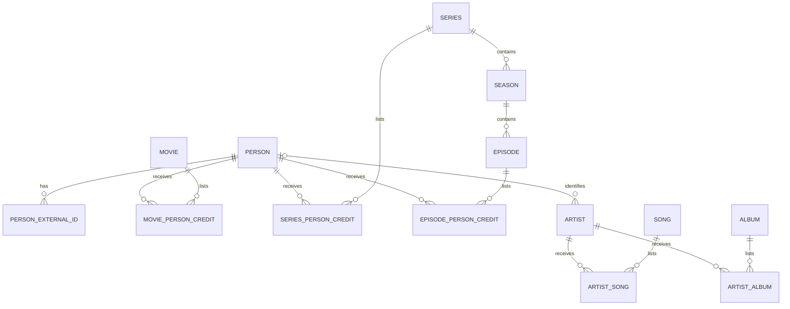

# Person profiles and cross-media credits

## Goal Capsule

**Objective**

A reader can open a person's profile from a local media credit and see that person's work across the libraries they can read.

**Means**

Use a shared Catalog Person identity, provider identifiers, and media-specific credit relations (KTD1–KTD3).

**Execution**

Deliver U1–U7 on one branch with local commits. The implementer owns the migration, verification and roadmap receipts. Push only on request. Follow the Product Contract for scope and the Verification Contract for acceptance. [Project workflow](../../AGENTS.md).

## Product Contract

### Summary

A Person page shows a portrait, biography, known biographical details, and credits grouped by media type. A person with movie, TV and music credits can appear under one profile. Each credit records the capacity in which the person worked, including a character or credited name when available.

### Problem Frame

Catalog has a director identity tied to TMDB and a separate Artist identity used by songs and albums. The current movie import keeps directors and a short cast summary. MusicBrainz represents both individuals and acts as artists. A shared profile therefore needs an identity for the individual and a way to reach the credits attached to their musical names. [Director and Artist credit vocabulary](../../CONCEPTS.md#catalog), [Movie parser](../../src/Metadata/Infrastructure/Api/Tmdb/DTO/TmdbMovieDto.php), [MusicBrainz artist guide](https://musicbrainz.org/doc/How_to_Add_an_Artist).

### Requirements

- **R1.** A Person has a stable public ID and display name. A profile can carry a portrait, biography, alternate names, birth and death dates, birthplace, sex and gender. Optional values may be unknown. Show age when the recorded dates support an exact value, using age at death when applicable. Sex and gender are independent. Provider fields may populate either only when their meaning matches the field.
- **R2.** A Person can have multiple provider identifiers. Support TMDB person IDs, MusicBrainz artist MBIDs for confirmed individuals, Apple Music artist IDs, and IMDb name IDs. Exact, verified identifiers can link records across providers. Matching names and unverified links require a administrator's decision. Conflicting identity claims must leave established links intact and give an administrator enough information to resolve them.
- **R3.** Movies support cast and crew, including actors, directors, writers and other jobs. A person can have several jobs or characters on one work. Preserve credited names and billing order when supplied. Existing Directors browsing and director profile links continue to work.
- **R4.** A Person can be linked to individual Artist identities so their existing song and album credits appear in one profile, including roles such as composer and producer. Band, orchestra and unclassified tag credits continue to work independently. The [Artist credit contract](../../CONCEPTS.md#artist-credit) still governs display names, scans, matches and edits.
- **R5.** Readers can search visible people and open profiles from movie and TV credits and linked Artist pages. Profiles show paginated local movie, series, episode, song and album credits with titles, roles and links. Search results, profile visibility, totals and credits follow the current library scope. Public reads hide a person with no visible credits.
- **R6.** Administrators can create or correct profiles, manage verified identifiers, link or unlink an Artist, and explicitly reconcile duplicate People. Routine enrichment respects corrections and their source.
- **R7.** Administrators can register series and episodes in a TV library and import their credits by confirmed TMDB series ID, season and episode number. Those credits use the same Person identities as movies and music. Each series and episode has a scoped detail view.

### Acceptance Examples

- **AE1.** A migrated director's bookmarked profile opens. A TMDB refresh adds their acting roles on one of their movies. The title appears once with all distinct roles and counts as one visible movie.
- **AE2.** A MusicBrainz artist typed as a person and a TMDB person share a verified IMDb name ID. With provider lookups available, either import order yields one profile showing movies and music, even when asynchronous TMDB profile enrichment has yet to run. An Apple Music artist ID from a verified MusicBrainz relationship is attached to the same identity.
- **AE3.** Two people with the same display name have different provider IDs and stay separate. If incoming evidence points to both, the import preserves the established identities and reports the conflict. An authorized merge preserves their valid credits and identifiers.
- **AE4.** An Artist has a stage name and a composer credit under another credited name. Linking it to a Person exposes those credits without rewriting either name. A similarly named band remains an independent Artist.
- **AE5.** A reader can access a song but lacks access to a movie credited to the same Person. The profile shows the song. The movie contributes no rows, counts or paging information. Revoking access to the last visible work makes the profile unavailable.
- **AE6.** A successful forced refresh with empty cast clears imported cast. If crew data in the same response is absent or malformed, existing crew remains. Retrying a complete payload creates no duplicate credits.
- **AE7.** A complete birth date and a complete death date yield age at death. A year-only birth date stays year-only and yields an age only if the recorded date bounds imply one value. A missing picture uses the ordinary portrait placeholder. Unknown sex and gender stay blank.
- **AE8.** An administrator registers a series and episode in a TV library. TMDB credits identify the same person credited by a movie and a song. The reader can open all visible works from one profile and return from each TV credit to that profile. A reader lacking access to the TV library sees no series or episode data from it.
- **AE9.** Separate provider profiles already exist when a verified shared identifier arrives after a failed lookup. An administrator can find the unresolved claim, reconcile the profiles and verify that both old links reach one library-scoped profile with all distinct credits. The next refresh leaves it unified.

### Deferred to Follow-Up Work

- TV file scanning, playback and catalog-wide television management are separate from TV credit registration. Concerts need their own Catalog targets before they can use Person credit relations. [TV groundwork](../../STRATEGY.md), [TV landing page](../../ui/web/src/features/tv/pages/TVHomePage.tsx), [Library type](../../src/Library/Domain/ValueObject/LibraryType.php).
- Provider-wide filmographies need a separate browsing and visibility contract. The profile lists works in Baander.
- The first delivery projects existing music roles and supports corrections through current Artist credit operations. Importing additional MusicBrainz recording, release or work relationships needs separate mapping and precedence rules. Apple Music identifiers can be attached using existing provider evidence or curation.

## Planning Contract

### Key Technical Decisions

**KTD1. Catalog owns Person and its provider identifiers.**

Use shared UUID and PublicId types. A child identifier table owns a unique non-null pair of namespace and normalized external ID, with a Person FK and claim provenance. Namespaces include the entity kind, such as TMDB person and Apple Music artist. A person can have multiple verified IDs per namespace, for example several MBIDs for individual performance identities. Store dates with their known precision, and record a known death even when its date is missing. Calculate age in complete years using the date bounds and the current date or death date. Provider imports fill blank fields. Record administrator overrides, including explicit clears, until released. Use provider-controlled portrait references and the established Catalog image path for administrator-managed portraits.

**KTD2. Resolve by verified identifier inside the write transaction.**

Normalize and sort the complete key set, lock the identities, and re-read their owners. Create a Person if no key resolves. If the matched keys resolve to one owner, reuse it and attach the verified new IDs. If keys resolve to several owners, return a typed conflict and keep the affected stored credits or Artist link intact. Use an explicit MusicBrainz IMDb name relationship to resolve a known local IMDb key or, when TMDB is configured, look up that ID through TMDB and accept a single person result. This allows the music flow to supply the TMDB key before asynchronous profile enrichment finishes. An unavailable lookup can be retried without changing Artist credits. If evidence arrives after separate People exist, record an actionable conflict keyed by the claims and owners for administrator reconciliation. Parse documented Apple Music and IMDb relationships from recognized provider URLs without fetching the relationship URLs. Reuse existing provider clients and their request limits. Finish remote lookups before acquiring locks and revalidate stored provider IDs under lock. Extend the Catalog lock order across Person creation, credit writes, Artist relinking and merges, with a whole-transaction retry for transient races. [Catalog lock solution](../solutions/architecture-patterns/concurrent-imports-find-or-create-identities-under-sorted-advisory-locks.md), [TMDB external IDs](https://developer.themoviedb.org/reference/person-external-ids), [TMDB Find By ID](https://developer.themoviedb.org/reference/find-by-id), [MusicBrainz artist URL relationships](https://musicbrainz.org/relationships/artist-url), [Apple Music artist ID](https://developer.apple.com/documentation/applemusicfeed/artist).

**KTD3. Keep one source for each credit.**

Store film credits in a movie–Person relation with UUID row identity, concrete FKs, cast/crew category, normalized role and display job, plus optional character, department, credited name, billing order and provider credit ID. Multiple characters and jobs can produce distinct credits. Use the provider credit ID as the stable source key within a movie and use a semantic key of person, category, job, character and credited name when absent, with explicit null handling. Reconcile migrated director links to matching provider entries on refresh. The optional Artist→Person relation supports several Artist identities for one person and one Person per Artist. The existing song and album credit tables still own music contributions. Read them via the Artist link. Artist retains its MBID for music lookup. Any Artist linking, MBID reassignment or merge revalidates the Person association using the same identity rules. [Original director credit schema](../../migrations/Version20261121143000.php), [Song credit mapping](../../src/Catalog/Infrastructure/Doctrine/Entity/ArtistSongEntity.php), [Album credit mapping](../../src/Catalog/Infrastructure/Doctrine/Entity/ArtistAlbumEntity.php).

**KTD4. Track TMDB cast, crew and director backfill independently.**

Distinguish unavailable, complete empty and complete nonempty responses for cast and crew. Normal enrichment fills an uninitialized partition. On upgraded movies, normal enrichment loads new crew jobs and preserves migrated directors. Forced enrichment replaces each authoritative provider partition, including the director subset. An unavailable or malformed partition keeps stored rows and remains eligible for retry. Resolve identity evidence for a whole credit partition before applying writes to it. Use the accepted movie identity and existing transaction boundary for metadata and accepted credit writes. Deletion cascades media links and detaches loaded ORM credit rows. People remain available for later resolution. [Current parser](../../src/Metadata/Infrastructure/Api/Tmdb/DTO/TmdbMovieDto.php), [Enrichment transaction](../../src/Metadata/Application/MovieMetadataEnricher.php), [Movie deletion](../../src/Catalog/Infrastructure/Doctrine/Repository/MovieRepository.php).

**KTD5. Scope before grouping or counting.**

Apply Catalog library scope to each media branch before profile existence, search, grouping, totals and pagination. Group by media kind and local media ID. Count distinct visible works and page with a stable sort and PublicId tie-breaker. Directors browsing filters to visible directing credits. Keep its web entry backed by shared People reads. Index both credit traversal directions and verify bounded hydration for populated pages. [Library scope helper](../../src/Catalog/Infrastructure/Doctrine/Query/CatalogReadScopeQuery.php), [Director reads](../../src/Catalog/Infrastructure/Doctrine/Repository/DirectorRepository.php).

**KTD6. Give TV credits local, library-scoped targets.**

Store a series in an existing TV library, seasons under that series, and episodes under the corresponding season. Keep episode identity unique by season and episode number and season identity by series and season number. Episodes inherit the series library. Use separate Person credit relations for series and episodes, using the cast/crew fields and local target guarantees from KTD3. Series credits derived from TMDB aggregate credits are shown as series credits. Episode-specific rows come only from the registered episode's credits. Resolve Person independently of the title or media kind. [TMDB series aggregate credits](https://developer.themoviedb.org/reference/tv-series-aggregate-credits), [TMDB episode credits](https://developer.themoviedb.org/reference/tv-episode-credits).

### Relationship model

## Implementation Units

### U1. Persist People and migrate directors

**Covers** R1–R3, AE1.

**Files** Catalog Domain, Application ports, Doctrine mappings, director repository, movie deletion, and a forward migration after [Version20261121143000.php](../../migrations/Version20261121143000.php).

**Approach** Copy existing identities and credit rows before removing the old tables. Preserve UUIDs, public IDs, portraits and movie links. Keep current director reads and sync working against the new tables. Mark the migrated director subset initialized and new cast and crew partitions awaiting discovery. Use native UUID, text, and calendar date mappings and project constraint names. Stop old writers before applying the migration and refresh the preview workers before running the upgrade checks.

**Verification** Compare identities and credit counts on an upgrade fixture, run a fresh install, and exercise scoped reads and movie deletion followed by a second flush. Check native types, FK behavior and indexes in PostgreSQL.

### U2. Resolve identities and import movie cast and crew

**Depends on** U1.

**Covers** R2–R3, AE1–AE3, AE6.

**Files** [TmdbMovieDto.php](../../src/Metadata/Infrastructure/Api/Tmdb/DTO/TmdbMovieDto.php), [TmdbAdapter.php](../../src/Metadata/Infrastructure/Api/Tmdb/TmdbAdapter.php), [MovieMetadataEnricher.php](../../src/Metadata/Application/MovieMetadataEnricher.php), Catalog Person resolution and movie credit writes.

**Approach** Carry full cast and crew identities and roles to Catalog while preserving the current short cast summary. Add bounded, deduplicated profile and external-ID lookups by stored TMDB person ID. Movie credits can commit before profile enrichment. Use the metadata sync entry point for backfill and forced refresh. [TMDB movie credits](https://developer.themoviedb.org/reference/movie-credits), [TMDB person details](https://developer.themoviedb.org/reference/person-details).

**Verification** Exercise real sync dispatch and persistence with mocked providers. Cover multiple jobs and characters, billing order, retries, authoritative empty, partial errors, absent credentials, provider ID mismatch and normal backfill of new roles. Check concurrent imports and transaction rollback.

### U3. Link individual musical Artists to People

**Depends on** U2.

**Covers** R2, R4, AE2–AE4, AE9.

**Files** [ArtistEntity.php](../../src/Catalog/Infrastructure/Doctrine/Entity/ArtistEntity.php), [ArtistMergeService.php](../../src/Catalog/Infrastructure/ArtistMergeService.php), Catalog Artist sync, MusicBrainz artist DTO and adapter, and the Artist relation migration.

**Approach** Resolve individuals by trusted classification and verified IDs, including MusicBrainz URL relationships and the bounded IMDb bridge in KTD2. Cache provider evidence using the existing provider cache conventions and share request limits with other lookups. Reuse Artist sync and add a bounded reconciliation pass for matched Artists with complete metadata. Preserve scanner name fallback within Artist. Fill Person profile fields from individual Artist data with preserved date precision and image ownership. Revalidate Artist associations on MBID changes, type changes, deletion and merge. An Artist merge with incompatible Person links surfaces a conflict for reconciliation.

**Verification** Cover individual, group and unknown classifications, both import orders before queued TMDB enrichment finishes, late evidence and retry, Artist relinking, concurrent enrichment against ID reassignment and preservation of credited names. Run existing scan, music match, role editing and Artist merge regressions.

### U4. Correct profiles and reconcile identities

**Depends on** U3.

**Covers** R1–R2, R6, AE3–AE4, AE7, AE9.

**Files** Catalog administration use cases, console entry points and operator command docs.

**Approach** Provide operator commands for profile creation and edits, unresolved identity claims, provider ID and Artist link corrections, and explicit Person merge. Record deliberate link removals so routine refresh respects them. Use shared Application commands for the operations. Move identifiers, Artist links and credits atomically. Collapse equivalent credits and preserve distinct credited roles and aliases. Apply the survivor's curated values and request explicit resolution of contradictory overrides. Resolve retired public IDs via the survivor's current library scope, including after subsequent merges. Use existing audit facilities and surface conflicts to authorized operators. [Admin and console rules](../../.agents/rules/admin-cli-parity.md).

**Verification** Test the real console entry points, conflict reporting, administrator unlink across resync, scoped retired IDs, repeated merge, rollback, and a merge racing a provider update. Check that an identity conflict leaves previously stored associations usable.

### U7. Register TV titles and import their credits

**Depends on** U2 and U4.

**Covers** R2, R5, R7, AE8–AE9.

**Files** Catalog TV models, Doctrine mappings and migrations, operator commands and docs, and the Metadata TMDB adapter.

**Approach** Add the series, season and episode hierarchy in KTD6. Provide operator commands to register or update a series by library and confirmed TMDB ID and to register only selected episodes by number. Import series aggregate cast/crew and registered episode cast, guests and crew through the same identifier resolver. Preserve the provider's roles through normalization and use KTD4's complete/unavailable semantics. Refresh registered TV records through metadata sync with bounded jobs. Include both TV link tables in Person merge and in series, episode and library deletion. [TV library enum](../../src/Library/Domain/ValueObject/LibraryType.php), [TMDB episode details](https://developer.themoviedb.org/reference/tv-episode-details).

**Verification** Register and refresh from the real operator entry point using mocked providers. Cover repeated registration, season zero specials, episode-only guest roles, missing and empty partitions, wrong library type, scope inheritance, cascade deletion, and merge across movies and TV.

### U5. Expose scoped profile and credit reads

**Depends on** U3, U4 and U7.

**Covers** R3–R5, R7, AE1, AE4–AE5, AE7–AE9.

**Files** Catalog query ports, Doctrine projections, API controllers, resources, and Auth scope inventory.

**Approach** Provide People search and profile reads and paginated work credits by media type. Add scoped person links to movie, series, episode and Artist resources. Provide scoped TV list and detail reads for every registered series and episode, including titles awaiting credits. Expose role-filtered Directors results through People reads. Return plain-text biographies and supported image references. Apply the same access rules to old profile IDs and generated links.

**Verification** Cover scope and OAuth access, profile existence, old IDs, search, distinct work counts, role filters, pagination, and TV detail reads when credits are empty or unavailable. Capture PostgreSQL query plans and bounded query count for a 50-work page.

### U6. Build People browsing and preserve Director navigation

**Depends on** U5.

**Covers** R1, R3–R5, R7, AE1, AE4–AE5, AE7–AE9.

**Files** [Catalog pages](../../ui/web/src/features/catalog/pages/), [web routes](../../ui/web/src/features/layout/routes.tsx), [Catalog live coverage](../../ui/web/src/features/catalog/live-coverage.ts), OpenAPI export, generated web client and operator guide.

**Approach** Reuse the directory, detail, portrait, movie card and music row patterns. Link profiles from movie and TV credits and individual Artist pages. Add series and episode detail and credit views reachable from the TV navigation and Person profile. Preserve Directors search, pagination, return navigation and bookmarks. Keep the library-scoped sampled refresh and invalidate after relevant mutations. Switch verified callers to People before removing superseded director-specific endpoints.

**Verification** Cover movie, TV and music in one profile, multiple roles, keyboard access, bookmarks, missing profile fields, and loading, error and access loss. Verify that TV navigation opens a registered title with empty or unavailable credits. Exercise account changes and live refresh through generated hooks and verify the full path in the isolated preview.

## Verification Contract

- Run the affected PHP unit, Functional and Integration selections in the CI image. Include fresh and upgrade migrations and deterministic concurrent import and merge cases using real PostgreSQL. Mock provider HTTP and use disposable services. Record schema, counts and representative query plans. [Testing guide](../../docs-book/part-2-developer-guide/testing/README.md), [Database naming](../../docs-book/part-2-developer-guide/development/database-naming.md), [PostgreSQL remediation skill](../../.agents/skills/postgres-remediation/SKILL.md), [PostgreSQL guidance](https://wiki.postgresql.org/wiki/Don%27t_Do_This).
- Run `make ci`, Symfony container lint and the OpenAPI export gate. Regenerate with `composer openapi` from the repository root and `yarn generate` in `ui/web`. Run focused web tests, lint and typecheck. Exercise the profile through the web API in the worktree preview with `make preview-up` and `E2E_BASE_URL` set from `make preview-url`.
- Record suite and assertion counts, static gates and preview verification in [ROADMAP.md](../../ROADMAP.md). Reproduce any claimed baseline failure on the baseline revision.

## Definition of Done

- AE1–AE9 pass through normal application entry points.
- Fresh and upgraded schemas preserve local data. Music playback, scanning, matching, credit edits and Directors navigation pass their regressions.
- Verified identifiers converge under retries and concurrent imports. Conflicts and explicit reconciliation preserve distinct credits.
- Scoped People reads and credit totals expose only visible works. Their movie, TV, song and album links work in the isolated preview.
- The roadmap records implementation evidence and the remaining TV and concert follow-up work.
