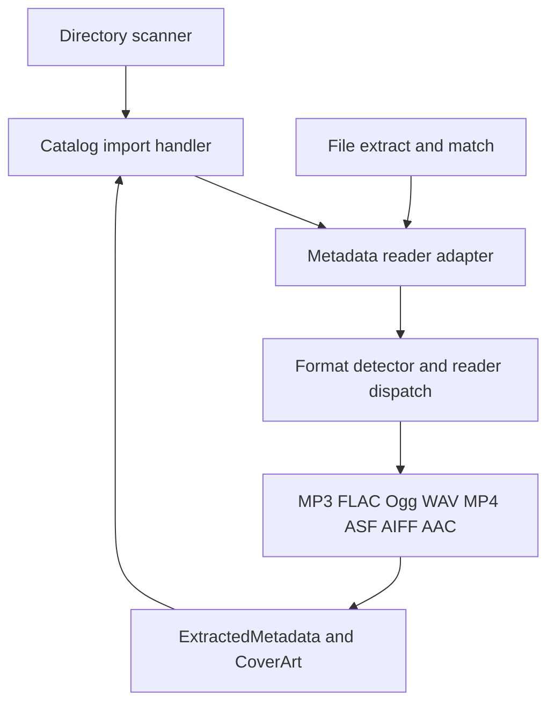

# Audio metadata formats - Plan

## Goal Capsule

Import embedded metadata from WMA, MP4 audio, WAV, AIFF and raw AAC through the existing catalog pipeline.
The user confirmed that “writers” means importing metadata into the catalog, not editing source files.
Implement and verify locally on the plan's feature branch; retain source files and do not push.

---

## Product Contract

### Summary and problem frame

The metadata package reads MP3, FLAC, Ogg/Opus and RIFF INFO tags.
`MetadataContentReader` incorrectly sends MP4 audio to the ID3 reader, `FormatDetector` confuses ADTS AAC with MPEG audio, and WMA has no reader.
`WavReader` ignores embedded ID3 and requires eighteen bytes for the bit-depth field in a sixteen-byte PCM format chunk.
`DirectoryScanner` omits aliases already understood by the metadata package and lists WMA twice.
`MediaFile::isAudio()` and `DiscoveredFile::isAudio()` repeat the audio extension list; both filters must accept the new aliases before scanned files can reach catalog import.
These findings come from the named classes in `packages/baander-media-metadata/src/` and `src/Library/Infrastructure/Scanner/DirectoryScanner.php`; the package extraction commit `ee70b0e84` already contains the MP4 dispatch error.

### Requirements

**Reading**

- R1. Read MP4 audio tags and pictures from `.m4a`, `.mp4a`, `.m4b` and MP4 containers, including AAC and ALAC audio.
- R2. Read WMA/ASF title, artist, album, numbering, date, genre, composer, MusicBrainz identifiers and embedded pictures when present.
- R3. Read WAV INFO and embedded ID3 tags, and derive ordinary PCM duration and audio properties without reading the audio payload into memory.
- R4. Read AIFF/AIFC text and embedded ID3 metadata, and raw ADTS AAC files with leading ID3 tags.
- R5. Preserve existing multi-value artist and MusicBrainz semantics, and return empty or partial metadata for malformed files without unbounded reads or loops.

**Catalog integration**

- R6. Discover supported audio aliases and route their metadata through the existing catalog importer and extract/match interfaces.
- R7. Leave source-file contents unchanged during reading and import.

### Scope boundaries

No source-tag writing, new editing interface, schema change or dependency on a media subprocess is required.
APE, WavPack, DSD and other specialist containers remain separate work because each needs its own parser and preservation fixtures; this change covers the requested formats plus AIFF and AAC already adjacent to the import workflow.
MP4 video classification and playback behavior remain governed by the existing library pipeline.

---

## Planning Contract

### Key technical decisions

- KTD1. Extend the existing PHP package's reader/parser structure and return `ExtractedMetadata`; catalog persistence remains with `FilesDiscoveredHandler` (R6, R7). This follows the user's clarification that catalog import is the intended write operation (session-settled: user-directed — chosen over editing source tags: the user requested importing metadata into the catalog).
- KTD2. Dispatch MP4, ASF, AIFF and ADTS AAC separately from ID3-only MP3 parsing. Preserve canonical format names and accept extension aliases at detection and explicit dispatch boundaries (R1–R4).
- KTD3. Traverse container lengths against file and parent bounds, skip audio payloads by seeking, and bound metadata allocations. Reject malformed lengths and make truncated structures terminate predictably (R5).
- KTD4. Reuse ID3 field and picture mapping for WAV, AIFF and AAC. Embedded ID3 takes precedence over older container text fields when populated; container audio properties remain authoritative (R3–R5).

### Design and evidence

MP4 field conventions follow the [Mutagen MP4 reference](https://mutagen.readthedocs.io/en/latest/api/mp4.html), including typed values, track/disc pairs and artwork.
RIFF and AIFF parsing follows the original specifications collected by [McGill's audio format reference](https://mmsp.ece.mcgill.ca/Documents/AudioFormats/).
ASF object and descriptor layouts must be checked against Microsoft's ASF specification during implementation.
The package remains framework-independent and retains its logger-based malformed-file behavior.

---

## Implementation Units

### U1. MP4 and WMA readers

- Intent: implement R1, R2 and R5 using KTD1–KTD3.
- Files: new MP4 and ASF reader/parser classes and their package tests.
- Checks: typed MP4 text, number pairs, freeform MusicBrainz fields, multiple artists, pictures, audio properties, extended atom sizes, unknown atoms and invalid bounds; ASF UTF-16 content, typed descriptors, pictures, duration and malformed object sizes.
- Execution note: exercise independent binary fixtures and a file produced by an external encoder where available.

### U2. WAV, AIFF and AAC reading

- Intent: implement R3–R5 using KTD2–KTD4.
- Files: WAV reader, new AIFF/AAC readers, ID3 reuse helper if required, and package tests.
- Checks: sixteen-byte PCM format chunks, odd padding, INFO/ID3 precedence, ID3 artwork, AIFF sample count and rate, AAC ADTS versus MPEG sync, tagged AAC, truncation and skipped audio payloads.
- Correct the verified shared ID3 omission of recording and release MusicBrainz identifiers: `Id3Parser` ignores the recording UFID and release user-text field, and `Id3Reader` never maps them. Cover these identifiers through MP3, WAV, AIFF and AAC readers using the [Picard tag mapping](https://picard-docs.musicbrainz.org/en/latest/appendices/tag_mapping.html).

### U3. Detection and catalog integration

- Intent: implement R6 and verify R7 using KTD1–KTD2.
- Files: format detector and dispatcher, `src/Library/Infrastructure/Scanner/DirectoryScanner.php`, `src/Library/Infrastructure/Scanner/MediaFile.php`, `src/Library/Application/Message/DiscoveredFile.php`, importer MIME mapping, service wiring and reader fixtures, API format documentation, focused scanner and importer tests.
- Checks: aliases `.mp4a`, `.m4b`, `.wave`, `.oga`, `.aif`, `.aiff`, `.aifc`; uppercase extensions; magic bytes over misleading extensions; aliases pass both audio classification filters and scanned tagged files reach catalog metadata mapping and audio MIME classification; existing MP3/FLAC/Ogg behavior remains covered.

### U4. Documentation and acceptance

- Intent: document supported formats and actual verification results.
- Files: package README, metadata context guide and `ROADMAP.md`.
- Checks: focused package and application tests in the CI image, applicable static analysis and formatting gates, independent final review, and clean whitespace diff.
- Test expectation: no prose-only tests; documentation claims must match the implementation and recorded checks.

---

## Verification Contract

Use the backend CI-image runner documented in `docs-book/part-2-developer-guide/testing/README.md` for authoritative package and affected application tests.
Use generated small binary fixtures for boundary cases and externally generated tagged audio for interoperability where the local tooling permits it.
Assert audio metadata and catalog inputs, not just reader selection; verify source hashes remain unchanged.
Record exact suite counts, static gate results and any unresolved limits inline in `ROADMAP.md`.

## Definition of Done

All four units are implemented, focused verification passes, the final review has no unresolved correctness findings, and local commits record the change.
No source audio file is rewritten and no branch is pushed.
