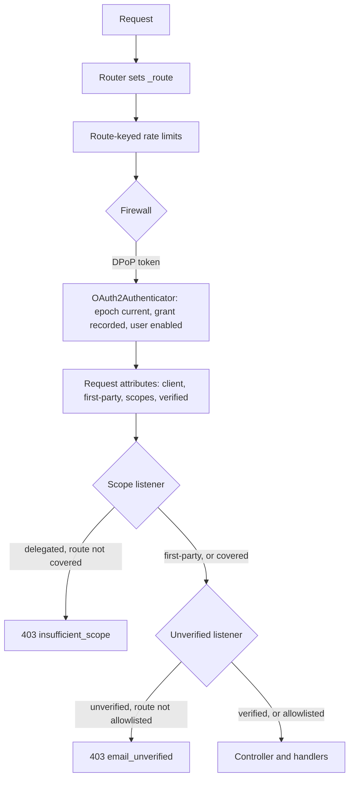
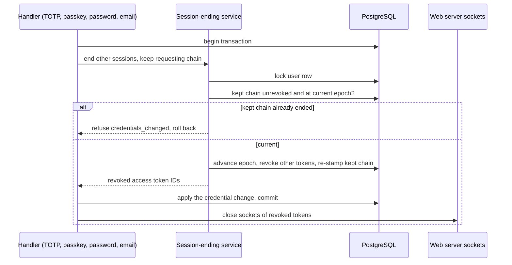
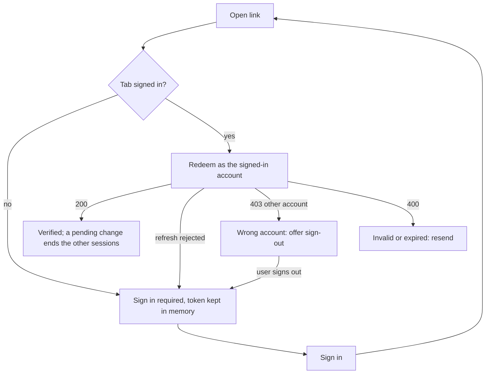
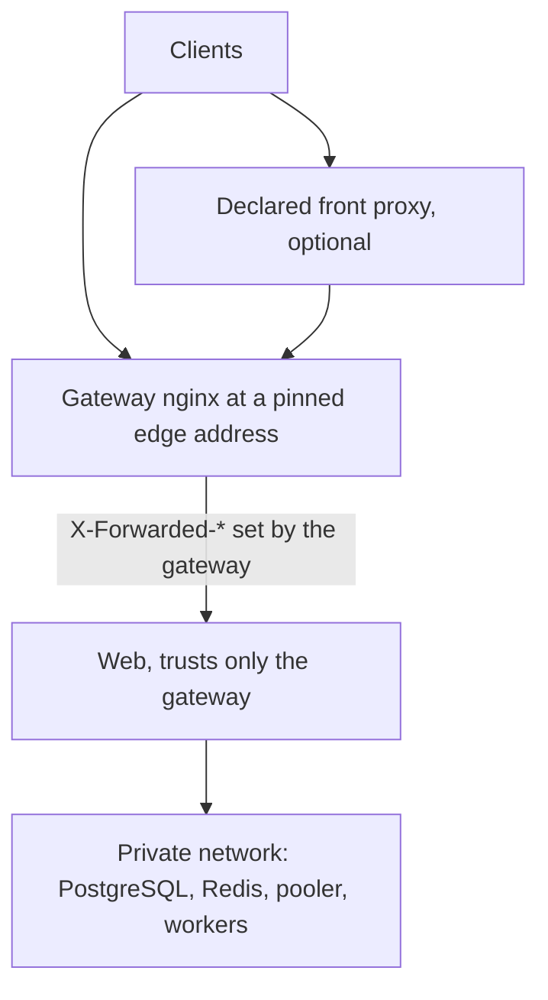

# Security Review Findings - Plan

## Goal Capsule

- **Objective:** No path found by the 2026-11-20 authentication and authorization review still works. Nobody can take over or keep an account they do not own, strip its second factor from a stolen session, act beyond what a user granted, lock other clients out of sign-in, or reach media, history or server details beyond their access.
- **Means:** Close each finding where it sits. The work reuses the 2026-11-19 hardening plan's mechanisms (the scope route map, step-up re-authentication, the credential epoch) and the system settings store, as this plan's KTD1–KTD24 apply them.
- **Product authority:** The Product Contract below. Its Key Decisions record what the user chose in the planning session. Planning Contract KTDs decide mechanism within those constraints.
- **Execution profile:**
  - One pull request, built with `ce-work` on a branch named after this plan, cut from `master` at `905d7da1e` or later.
  - Units land as local commits. Push only when the user asks.
  - Schema and locking work goes to the postgres specialist (`.agents/agents/postgres.md`): the migrations in U1, U2 and U16, and the advisory lock in U17. The three migrations run serially in the order U1, U2, U16.
  - Each finding unit starts with a failing test that reproduces the finding, because the review's reproduction tests were lost.
  - Source, tests and comments never cite this plan's IDs (AGENTS.md).
- **Stop conditions:**
  - Stop and ask if refusing the first-party client as an OAuth client breaks a web, Electron or mobile flow. Research found none.
  - Stop and ask if a Key Decision proves infeasible in code.
  - Stop and ask if Docker cannot pin the gateway's address on the rendered network without operator input that the preset configuration cannot carry.
- **Open blockers:** None.
- **Finish:** `ce-work` implements, runs `ce-simplify-code` at phase boundaries and `ce-code-review` before shipping, applies justified findings, and records the delivered items and the verification checkpoint in `ROADMAP.md`.

---

## Product Contract

### Summary

The plan closes the eight numbered findings and every low-severity item in `SECURITY_FINDINGS.md`. Baander's own client can no longer be used as a third-party OAuth client, and first-party authority depends on how a session was signed in. Rate limits follow the route a request reaches and the real client address behind the preset gateway. Account-security changes need step-up and end the account's other sessions. Verification links work only in the account's own signed-in session. Self-registration ships closed, and unverified accounts can do little until they verify. Media, history and server details follow the viewer's current access.

### Problem Frame

The 2026-11-19 hardening plan scoped delegated tokens, added step-up to email, TOTP setup and passkey registration, and fenced token issuance with a credential epoch. A second review on 2026-11-20 read the result in full and found eight medium and low findings plus a tail of low-severity items. None is critical: no reviewer could forge a token, skip DPoP or reach admin routes as a normal user.

The worst findings chain into account takeover. A signed-in victim who opens one crafted link hands an anonymous attacker a full first-party session, because the public pushed-authorization endpoint accepts Baander's own client and approves it without asking. A stolen session can turn TOTP off with a code alone, or brute-force the password through the password-change endpoint, and the sessions it opened survive the owner adding a second factor. Someone who registers another person's address first keeps their TOTP and passkeys after the owner resets the password, because anyone holding the link can verify the address.

The rest weakens limits or leaks data. Behind the preset gateway every client shares one rate-limit bucket, so twenty failed logins lock everyone out. A percent-encoded path skips the auth limits entirely. A token granted only `profile` downloads original media. A party host can pause another user's encoder. Live stream URLs keep working for a day after the owner loses access. Activity history shows titles from libraries the user lost. Members see absolute server paths.

Baander has no production deployments, so the fixes may break API contracts, delete stored sessions and rename settings without compatibility paths.

### Key Decisions

- **One plan resolves every finding and low-severity item, medium findings first.** It includes step-up on TOTP disable and password change, ending other sessions when sign-in methods change, and hiding server paths from non-admins. Governs R1–R33. (session-settled: user-directed — chosen over planning findings 1–8 only, or 1–6 only: the low items sit in the same code and share its tests.)
- **A verification link confirms an address only when opened in a signed-in session of the account it was sent for.** Governs R12. (session-settled: user-directed — chosen over removing TOTP and passkeys added before the account's first password reset, and over doing both: owner-session redemption closes the takeover without stripping a legitimate user's factors.)
- **Self-registration is an operator setting that ships closed; while open, an unverified account is confined to confirming its address.** Governs R13, R14. (session-settled: user-directed — chosen over open by default, a switch without confining unverified accounts, and leaving registration as is: new accounts reached the whole non-library API before proving their address.)
- **An unverified account may change its own address.** Governs R14. (session-settled: user-directed — chosen over a strict gate: a mistyped address would otherwise stay held with no expiry, and the new link still needs the account's own session.)
- **Turning TOTP on or off, adding or removing a passkey, and confirming a new email address end every other session, device pairings and third-party app tokens included.** Governs R10. (session-settled: user-directed — chosen over ending only other web and desktop sessions: someone holding a stolen session may have paired an app of their own.)
- **The passkey check endpoint is kept and rebuilt rather than removed.** Governs R22. (session-settled: user-directed — chosen over removing `POST /api/auth/passkey/authenticate`, which has no caller and has existed since the initial commit.)

### Requirements

**OAuth client authority**

- R1. Baander's first-party client is refused wherever it would be the authenticated or identified OAuth client: pushed authorization requests, every token grant including refresh, device authorization, and the consent lookup and decision of a pushed request. A signed-in first-party session keeps using consent, device approval, revocation and client management.
- R2. A token acts with first-party authority only when it belongs to the first-party client and its refresh token chain began with a password or passkey sign-in. Each access token records the grant that started its chain.
- R3. Every authorization request reaches the user as an explicit decision. Personal access clients are not first-party, and their consent page names the client type and the loopback redirect with its port.

**Delegated access**

- R4. A delegated token fetches original tracks and videos only with the `library` scope. A signed URL fetch without a token keeps working.
- R5. The build fails when a public route reads the caller's identity.

**Rate limits and client addresses**

- R6. Each rate limit applies to the route a request reaches, whatever percent-encoding its path uses.
- R7. Behind the preset gateway each client is rate limited under its own address. Web trusts only the gateway, the gateway sets every forwarding header itself, and client addresses pass through only from front proxies the operator declares, or from the host when the gateway listens on loopback.
- R8. The SPA shell, its Content-Security-Policy and every absolute URL the API builds use a configured public origin: the request's origin when it is `APP_URL`'s origin or a listed extra origin, and `APP_URL`'s origin otherwise. An unlisted Host or forwarded header never chooses it.

**Step-up and sessions**

- R9. Turning TOTP off, changing the password and removing a passkey require step-up re-authentication, with one answer for every mismatch and the per-account attempt limit.
- R10. Turning TOTP on or off, adding or removing a passkey, changing the password and confirming a new email address end every other session of the user and close their WebSockets at once. The session that made the change stays signed in.
- R11. A credential change is refused when the session requesting it was already ended by another change.

**Email verification and registration**

- R12. A verification link, for registration or a pending email change, confirms the address only when opened in a signed-in first-party session of the account it was sent for. Signed out, the page asks the user to sign in and returns to the link afterwards. Signed in to another account, the page says so and the link stays usable.
- R13. Self-registration is closed until an operator opens it at runtime. The web app shows when it is closed. Registration answers in the same time whether or not the address is taken.
- R14. Until its address is verified, an account reaches only public routes, its own profile, the verification link, resending the link, changing its own address, refreshing its session and signing out. The web app shows such an account a verification screen and starts no live updates or preference sync.

**Playback and media access**

- R15. A watch party can carry only a transcode job its host owns, and loses the job when the owner leaves the party. Non-admin job listings show only the caller's own jobs. A party play after a pause resumes the encoder.
- R16. Live HLS and DASH URLs stop serving once the job owner loses access to the video, as original and artifact URLs already do.
- R17. The public delivery patterns in the firewall admit only paths the delivery routes serve.
- R18. Activity history shows no title, cover, poster or ID of an item outside the viewer's current library access.
- R19. Only administrators see the filesystem paths of libraries, songs and videos.

**Passkeys**

- R20. Passkey ceremonies accept only the configured public origins, and the relying party ID is the host of `APP_URL`.
- R21. Passkey sign-in options name no account and list no credentials. New passkeys are discoverable credentials.
- R22. Passkey endpoints answer fixed error codes, and the passkey check endpoint applies the same checks as passkey sign-in.

**Administration and stored secrets**

- R23. Deleting, demoting or disabling the only enabled super admin is refused from the admin API and the console, also when two changes race.
- R24. Deleting a user closes their WebSockets at once.
- R25. Authorization codes and device codes are stored only as hashes.

**Exposure and hardening**

- R26. Anonymous health probes return status only, `/metrics` is not served through the shipped gateways, and full health detail is an admin route with a console counterpart.
- R27. Pairing codes are created by POST under the discovery rate limit, and expired pairing sessions do not accumulate.
- R28. Discogs and Last.fm searches are rate limited per user and accept 1 to 100 results. A provider's retry wait inside a request is capped.
- R29. Stored images are served with their stored, allowlisted media type and cannot run script.
- R30. Production refuses to boot with an empty or default Redis or database password, or with a VAPID private key that was ever committed.
- R31. Development commands run only in the dev environment or on a development instance, and the repository holds no TLS keys or trusted roots for development hosts.
- R32. Administrators get a configuration warning when registration is open while the mailer discards mail.

**Documentation**

- R33. Operator and developer documentation, `CONCEPTS.md` and `ROADMAP.md` describe the shipped behavior, and the install guide creates the first account as a super admin.

### Acceptance Examples

- AE1. **Covers R1, R2.** **Given** a signed-in user, **when** an anonymous caller pushes an authorization request naming the first-party client, **then** the push answers 400 `unauthorized_client` and stores no pushed request. A `refresh_token` grant naming the first-party client at `/api/oauth/token` also answers 400.
- AE2. **Covers R12.** **Given** an account someone else registered under an owner's address, **when** the owner opens the verification link signed out, **then** the page asks for sign-in, the address stays unverified and the link stays redeemable. The owner's later password reset claims the account.
- AE3. **Covers R10, R11.** **Given** a user signed in on sessions A and B with a paired TV, **when** A turns TOTP off with step-up, **then** A keeps working, B and the TV are refused, and B's WebSocket closes. A passkey registration that B started before the change and completes after it is refused.
- AE4. **Covers R6.** **Given** the registration limit exhausted for an address, **when** that address posts a registration to `/%61pi/auth/registe%72`, **then** it gets 429.
- AE5. **Covers R7.** **Given** a preset install, **when** a client connecting directly to the gateway sends its own `X-Forwarded-For`, **then** web rate limits it under its real address.
- AE6. **Covers R14.** **Given** a signed-in account with an unverified address, **when** it calls `GET /api/playlists/` or `POST /api/ws/tickets`, **then** each answers 403 `email_unverified`, while reading `/api/auth/me`, resending the link and changing its address succeed.
- AE7. **Covers R16.** **Given** a member who signed a live stream, **when** the member's access to the library is removed, **then** the next segment request with the signed URL is refused.
- AE8. **Covers R23.** **Given** exactly two enabled super admins, **when** each demotes the other at the same moment, **then** one demotion succeeds and the other answers 409 `last_super_admin`.

### Scope Boundaries

Considered and not built:

- **Closing WebSockets on a role change.** A demoted admin's socket loses the admin event families within about a second, because the live runtime re-reads roles (`tests/Integration/LiveUpdates/LiveAudienceTest.php`), and HTTP reads roles on every request. An admin-only event outside live snapshots would change the call.
- **Binding signed stream URLs to a user or session.** They stay shareable 24-hour capabilities, as the 2026-11-19 plan decided. R16 adds only the owner's current access, so a URL minted by a session that has since ended keeps working until it expires. Evidence of URLs shared outside a household would change the call.
- **Hashing device user codes.** A user code carries about 34.6 bits, lives minutes, needs a case-insensitive lookup and is echoed to the device page. An unsalted hash of it falls to offline guessing in seconds, so hashing adds nothing.
- **Ending sessions on an operator's email change.** It is an operator action and stays as it is. Documented, not changed.
- **Trusting private address ranges as proxies.** Workers that process untrusted media share the private network and could forge `X-Forwarded-For`.
- **Measuring registration timing before adding the response floor.** The floor is cheap and deterministic, and a timing assertion in CI would be flaky.
- **A notice after registration.** The verification screen of R14 tells the user what to do after they sign in.
- **A reason notice on web sessions that a security change ended.** They land on the sign-in page. A support burden would change the call.
- **A "mark verified" action in the web admin.** `app:user:mark-email-verified` and the admin API route already cover it, admins are alerted on each registration, and R32's warning names the no-mail case. Marking an address verified also makes a later password reset keep the account's factors, so an easy button would invite the finding 8 outcome. Installs with open registration and no mail that verify accounts often would change the call.

#### Deferred to Follow-Up Work

- Binding personal access pushes to a secret held by the client's owner, so nobody else can push as that client.
- A sessions list where users see and end their devices and app grants.
- A TOTP settings screen on the web. TOTP setup and disable remain API-only.

### Outstanding Questions

Deferred to implementation; none blocks the work.

- Which source address a host-local TLS proxy presents to the gateway when the preset listens on loopback. U5 confirms it in the preset qualification before declaring it.
- Where `ShutdownWorkflow` (`packages/baander-dev-qualification`) reads worker memory once public `/health` stops carrying it. U18 settles it.
- Whether Discogs search pages with `per_page` rather than `limit`. U19 checks the adapter against the provider.
- The response-time floor for registration. U10 sets it above the new-account path after hashing, measured on the CI image.

---

## Planning Contract

### Key Technical Decisions

- KTD1. **The first-party client is refused where the client is authenticated or identified, not where a session is presented.** `OAuthClientAuthenticator::authenticate()` and `identify()` refuse `ClientType::FirstParty`. The back channel answers `unauthorized_client`; the consent front channel answers `invalid_client` and never redirects. `AuthorizationRequestValidator::validatePush` refuses it explicitly as well, next to the device-client check. Bearer requests from the web app are untouched, because consent, device approval, revocation and client management authenticate the user's session, not an OAuth client. Governs R1.
- KTD2. **Each access token stores the grant that started its chain, and first-party authority requires a sign-in grant.**
  - `oauth_access_tokens.grant_type` is `text NOT NULL` with `chk_oauth_access_tokens_grant_type`, mapped with Doctrine `enumType`. Values: `password`, `passkey`, `authorization_code`, `device_code`.
  - `TokenPairIssuer::issue` takes the grant and refuses a sign-in grant for any client but the first-party one, and a non-sign-in grant for the first-party client. Rotation in `RefreshTokenHandler` copies the predecessor's grant.
  - `OAuth2Authenticator` reads the epoch and the grant in one indexed read, replacing `currentCredentialEpoch`.
  - The migration deletes access tokens, which cascades to refresh tokens, as `migrations/Version20261120110000.php` did. A backfilled guess could launder a pair minted through finding 1.
  - (session-settled: user-directed — chosen over relying on the endpoint refusal and the issuance check alone: authority then follows from the sign-in method even if a future grant forgets the refusal.) Governs R2.
- KTD3. **Consent is always explicit.** `GetAuthorizationRequestHandler` stops computing `consentRequired`; the field leaves the DTO, the resource, `openapi.json` and the web client, and `OAuthConsent.tsx` loses its auto-approve effect. `Client::createPersonalAccess()` sets `firstParty: false`. A migration clears the flag on existing personal access clients and adds `chk_oauth_clients_personal_access_not_first_party`. `ClientRepository::isFirstPartyClient()` drops its `NOT personal_access_client` clause. Silent approval for a fresh first-party session was rejected, because a request an attacker pushed still passes. Governs R3.
- KTD4. **The original media routes move to the `library` scope, and a unit test holds public routes to no identity reads.** The test sits beside `ScopeRouteInventoryTest` and loads routes the same way. For each `/api/` route in `ScopeRouteMap::PUBLIC_ROUTES` it reflects the controller method, follows same-class private calls transitively, and fails on identity reads (`getUser`, `getCurrentUser`, `getCurrentSecurityUser`, `getActorId`, `->current(`, `getToken`). It also fails on a method parameter carrying `#[CurrentUser]` or typed as a user identity, the form 16 controller methods use today. Its docblock says it is a heuristic deny-list. A PHPStan rule was rejected because following private helpers needs a collector. Governs R4, R5.
- KTD5. **Rate-limit rules key on the matched route.**
  - `RateLimitListener`, `DiscoveryRateLimitListener` and `AdminRateLimitListener` match `_route` against route-name constants, as `TokenEndpointDpopListener::TOKEN_ROUTE` does. The router runs at priority 32, ahead of all three, so `_route` is always set; per-rule method lists go.
  - `ApiRateLimitListener` and `ForceJsonListener` decide whether a request is an API request from the decoded path, through one shared helper.
  - An inventory test asserts that every limited route name exists with its method. The cover-extraction route in `ExtractCoversController` gets an explicit name first.
  - Governs R6.
- KTD6. **The preset gateway gets a pinned address on its own network, and web trusts exactly that address.**
  - Gateway and web share a dedicated edge network whose subnet comes from the preset configuration, with a documented default refused on overlap. The gateway joins only the edge network, so `web` always resolves to web's edge address. The gateway's static address lies outside the network's `ip_range`, so a container started earlier cannot take it.
  - `TRUSTED_PROXIES` is derived to that one address in `Renderer::environment()` and refused as an operator key; the refusal names the declared-proxy key.
  - The gateway sets `X-Forwarded-For $remote_addr` and `X-Forwarded-Host $host`, clears `X-Forwarded-Port`, and takes the protocol from `$scheme` unless the peer is a declared front proxy.
  - Declared front proxies render as `set_real_ip_from` entries with `real_ip_header X-Forwarded-For` and `real_ip_recursive on`. For a loopback listen address the preset declares the hairpin source automatically.
  - The recipe nginx in `docker/prod/nginx.conf` keeps its header handling. It sits behind the operator's TLS proxy and forwards the full `X-Forwarded-For` chain, and web resolves the client there through an operator-set `TRUSTED_PROXIES` that lists both nginx and the TLS proxy. Overwriting its headers would collapse every client onto the TLS proxy's address.
  - Rejected: `PRIVATE_SUBNETS` (workers could forge addresses), `network_mode: service:web` (the gateway would share the loopback Swoole management API), and the `REMOTE_ADDR` keyword (silently dropped under Swoole).
  - Governs R7.
- KTD7. **Every absolute URL the server renders comes from one public-origin resolver.** It returns the request's origin when that equals `APP_URL`'s origin or an entry of the unfiltered public-origins list of KTD16, and `APP_URL`'s origin otherwise, so a listed LAN address keeps working and a forged Host gets `APP_URL`. `SpaController`, the CSP socket origin in `SecurityHeadersListener`, and the cover and base URLs built with `getSchemeAndHttpHost()` (`ActivityController`, `UserRecentController`, `AlbumController`, `GetRecommendationsForUserHandler`) use it. `trusted_hosts` stays unset, because internal Hosts such as `gateway`, `web:9501` and `127.0.0.1:9501` would get 400. Governs R8.
- KTD8. **One Application service ends the other sessions of a credential change, inside the caller's transaction.**
  - It locks the user row first and refuses with 401 `credentials_changed` when the kept chain is revoked or behind the current epoch. Then it advances the epoch, revokes every access and refresh token except the kept chain, re-stamps the kept chain, and returns the revoked access token IDs.
  - The kept token is resolved inside the transaction. After commit the caller closes the revoked tokens' sockets through the `ChainConnectionCloser` pattern; a failed close is logged and never fails the change. `RevokedSocketReconciler` stays the backstop.
  - Password change and the operator TOTP reset (which keeps no session) move onto it. `PasswordChanger` removes outstanding reset tokens before it calls the service, keeping the reset-token-then-user lock order that `ResetPasswordHandler` relies on, so a password change racing a reset redemption waits instead of deadlocking.
  - It follows `docs/solutions/architecture-patterns/credential-changes-fence-token-issuance-with-a-credential-epoch.md`: every credential change advances the epoch in its own transaction.
  - Governs R10, R11.
- KTD9. **Step-up runs inside handlers, after refusals that cost no attempt.** Turning TOTP off checks that TOTP is enabled first; password change checks the new password's policy first. `CurrentPasswordMismatchException` and its 422 mapping go, so every mismatch answers `step_up_failed`. Requests carry a nullable, unvalidated `totpCode`, following `ChangeEmailRequest`. Passkey removal becomes `DeletePasskeyCommand` with step-up fields in a DELETE body. Governs R9.
- KTD10. **Verification redeems only for the signed-in caller.**
  - `auth_email_verify` moves to `FIRST_PARTY_ROUTES` with `#[IsGranted('IS_AUTHENTICATED_FULLY')]`. `VerifyEmailCommand` carries the caller, and the repository redeems with `WHERE token_hash = :hash AND user_id = :user`.
  - A live token of another account answers 403 `verification_link_other_account` and stays unused. Unknown, expired and used tokens keep the single 400.
  - For a pending address change the redeeming session is the kept session, so `email_verification_tokens` needs no new column.
  - On the web, a signed-out page shows "sign in required" without calling the server. A rejected refresh on this page resolves to the same state through a per-request opt-out of the interceptor's hard redirect, with the token kept in memory. Sign-in returns to the link through `returnToState`.
  - Governs R12.
- KTD11. **Registration is governed by a system setting, enforced before any work, and answered after a fixed floor.**
  - The Boolean setting `auth.registration_open` (default false, enforced) lives in `UserManagementSettingDefinitions` and changes through `app:settings:set` and `PATCH /api/admin/settings`, so parity needs no new command.
  - `RegisterUserHandler` checks it before hashing and answers 403 `registration_closed`.
  - A public `GET /api/auth/registration` tells the web app whether registration is open.
  - Both registration outcomes wait until a configured floor through `SleeperInterface`. The floor's clock starts after the password hash, which both outcomes run, so it covers only the part where they differ and does not depend on how fast the host hashes.
  - A configuration check warns while registration is open on a `null://` mailer.
  - Governs R13, R32.
- KTD12. **A second login listener confines unverified accounts.** It runs after `ScopeEnforcementListener` on `LoginSuccessEvent`. The authenticators set a verified flag in `AccessTokenAttributes` where they load the user, and a missing flag counts as unverified. The allowlist constant names `PUBLIC_ROUTES` by reference plus `auth_me`, `auth_email_verify`, `auth_me_email_verification`, `auth_me_email`, `auth_refresh` and `auth_logout`, and the inventory test holds it to the compiled routes. A role such as `ROLE_UNVERIFIED` was rejected: access control under `/api/auth/` is `PUBLIC_ACCESS`, and a promoted account would keep its roles. `createTestUser()` defaults to verified. Governs R14.
- KTD13. **Job ownership is checked when a party takes a job.** An owner-aware lookup on `PlaybackAccessInterface` replaces `findTranscodeJobVideoId`, and a job the host does not own answers 404, like a missing one. `PlaybackPositionChanged` stays as it is: a new host keeps steering after a handover while the owner is a member, and the owner leaving or being removed clears the party's job. `TranscodeJobController` index, show and metrics return only the caller's jobs to non-admins. Governs R15.
- KTD14. **Live delivery checks the job owner's access on every request, at controller entry.**
  - One Transcode port, in single-job and job-set forms, is implemented like `CompletedVideoDeliveryAdapter::context()`. It runs after the signature check, never inside the re-resolve closures that poll every 0.25 seconds, and refuses with 409 as artifacts do.
  - A manifest-only check was rejected: a finished presentation never fetches its manifest again, so its segments would keep serving.
  - The firewall rows and the live routes both narrow to `PublicId::PATTERN`, `s[0-9]+` subtitle keys and `full.vtt`.
  - Governs R16, R17.
- KTD15. **Viewer-dependent fields are filtered where the response is built.** Activity enrichment filters its album and movie maps through `LibraryReadScope::allows`. An activity outside the viewer's scope keeps its own fields and carries null item fields and `songAvailable: false`. Library, song and video resources get member variants on the `UserResource::forDelegatedToken` pattern, chosen by `isGranted('ROLE_ADMIN')`. `path` leaves `LibraryResource`'s required list. Governs R18, R19.
- KTD16. **Passkey ceremonies pin their origins, and sign-in is discoverable only.**
  - `CeremonyStepManagerFactory::setAllowedOrigins($origins, false)` (`web-auth/webauthn-lib` 5.3.9) replaces the deprecated `CheckOrigin`.
  - The origins come from one public-origins parameter built from `APP_URL` and `AUTH_EXTRA_ORIGINS`. That variable is renamed from `AUTH_DPOP_EXTRA_ORIGINS` and also serves DPoP. Only the list passed to `setAllowedOrigins` is filtered to hosts equal to or under the relying party ID, which is the host of `APP_URL`; DPoP keeps every listed origin, such as a LAN address or `http://127.0.0.1:9501` in the qualification workflows.
  - Authentication options take no `userId` and return an empty `allowCredentials`, and `auth.passkey.resident_key` becomes `required`.
  - Governs R20, R21.
- KTD17. **The passkey check endpoint runs the sign-in checks and answers one failure code.** It verifies through `AuthenticatePasskeyHandler`: single-use challenge, counter and clone check, and user verification for TOTP accounts. It returns no exception text, and an unknown credential answers like a bad signature. Registration errors likewise answer a fixed code and log the detail. Inherits the Key Decision that keeps the endpoint. Governs R22.
- KTD18. **Super admin continuity is one Application service under a transaction-scoped advisory lock.** `SetUserRolesHandler`, `DeleteUserHandler` and `DisableUserHandler` call it inside a transaction. It takes the lock, counts enabled super admins, and refuses with `ConflictException` `last_super_admin` (409, exit 1) only when the target is an enabled super admin losing that status and the count is 1. Row locks were rejected, because `lockCredentialEpoch` takes the same mode and would queue those admins' logins. Governs R23.
- KTD19. **User deletion closes sockets after commit, as `DisableUserHandler` does.** Governs R24.
- KTD20. **Codes are hashed in place, following the refresh-token precedent of commit `63d24010e`.** `oauth_auth_codes.code_id` and `oauth_device_codes.device_code` store the hex SHA-256, through one private helper per repository. The domain state's code becomes nullable with a throwing getter, and the migration deletes both tables' rows. Governs R25.
- KTD21. **Public health probes return status only.** They keep the status, component, per-check status and `draining`. Full detail moves to an admin route under `/api/debug` with `#[CliCounterpart('app:health:check')]`, and the admin quick action calls it. Both shipped gateways answer 404 for `/metrics`; Prometheus keeps scraping `app:9501` on the app network as documented. Governs R26.
- KTD22. **Pairing and provider searches get bounds where they are created or called.**
  - The QR payload becomes a POST under the route-keyed discovery limiter.
  - Creating a pairing code deletes expired pairing sessions in the same transaction. The limiter bounds how often that runs, so no schedule is needed.
  - Metadata search reads its query through a `#[MapQueryString]` DTO with a 1 to 100 range, answering 422.
  - Non-MusicBrainz sources spend a per-user limiter modeled on `musicbrainz_user`, and the Discogs adapter caps its `Retry-After` wait.
  - Governs R27, R28.
- KTD23. **Images are served with the stored type from an allowlist.** JPEG, PNG and WebP pass; derivatives are WebP. Any other stored type is served as `application/octet-stream` with `Content-Disposition: attachment`. Image responses carry `Content-Security-Policy: default-src 'none'; sandbox`. Governs R29.
- KTD24. **Production and development hygiene.**
  - `ProductionSecrets` gains credential checks. The Redis password must be set and not the default. The `DATABASE_URL` and `DATABASE_CONTROL_URL` password must not be empty or the default. The VAPID private key is compared with SHA-256 digests of the committed values.
  - `ProductionSecretsTest` reads only tracked env files.
  - `app:dev:create-users` and `app:dev:setup` refuse to run unless the environment is `dev` or the container carries a development-instance marker. `ComposeRuntime` in `packages/baander-dev-environment` sets the marker on preview and persistent instances, and production images never carry it. (session-settled: user-directed — chosen over a persistent-instance bootstrap without fixed development users: the persistent instance and the probes keep the fixed development credentials, while production images never carry the marker.)
  - The tracked `docker/dev/juul.localdomain.key`, `juul.localdomain.crt`, `cert.ini` and `ca.crt` are deleted with their two Dockerfile trust lines, and the qualification probes that look for the key are updated. (session-settled: user-directed — chosen over removing only the key, or keeping them: nothing serves them, and the dev image trusted both certificates as roots.)
  - Governs R30, R31.

### High-Level Technical Design

How an API request is authorized after this plan:

First-party here means the first-party client with a password or passkey grant (KTD2). The scope listener and the unverified listener both answer through route-name constants that the inventory tests hold to the compiled routes.

A credential change that keeps the requesting session:

Opening a verification link:

Preset network after U5:

The edge network carries only the gateway and web, so no worker can reach web as a trusted proxy.

### Assumptions

- Ending every local session through the KTD2 migration is acceptable before production. TVs re-pair, and personal access tools start a new grant.
- `web-auth/webauthn-lib` stays on 5.3.x for this work; `setAllowedOrigins` exists there.

### Sequencing

- Migrations run serially: U1, then U2, then U16.
- U8 and U9 build on U7's service.
- U11 needs U9 (its allowlist names `auth_email_verify` as a first-party route) and comes after U10 because both edit the registration and verification tests.
- U15 comes after U8; both change `PasskeyController`.
- U19 needs U4's route-keyed discovery limiter.
- U6 needs the public-origins parameter that U15 builds.
- U22 closes the documentation once behavior is fixed.
- Every other unit can run in parallel, with two exceptions:
  - Units that edit `AuthController.php` (U8, U9, U10), `ScopeRouteMap.php` (U3, U4, U9, U10, U11, U18, U19) or `ScopeRouteInventoryTest.php` (U3, U11) serialize their edits to those files.
  - The lead regenerates `openapi.json` and `ui/web/src/shared/api-client/gen/` after integrating each unit that changes an API contract (U1, U8, U9, U10, U11, U14, U15, U18, U19); workers do not regenerate them in parallel.

### System-Wide Impact

- **Sessions and codes.** The KTD2 migration ends every web, Electron, TV, personal access and third-party session on development instances. The KTD20 migration deletes unredeemed codes, so a TV in the middle of pairing restarts.
- **API contracts.** Changed or added: `consentRequired` (removed), password change and TOTP disable bodies, passkey delete (DELETE with a body), `/api/auth/email/verify` (authenticated), `GET /api/auth/registration`, the discovery QR payload (POST), passkey authentication options (no `userId`), the health and metrics bodies, and optional `path` fields. `openapi.json` and the generated web client are regenerated with each.
- **Tests.**
  - About 40 test files mint tokens directly and need a grant. Twenty-two of them go through `tests/Fixtures/Auth/FirstPartyOAuthClient.php`.
  - `createTestUser()` flips to verified, with about 20 call sites opting out.
  - Tests that use the first-party client at `/api/oauth/token` move to a delegated client: `DpopStoreOutageTest`, and `RefreshEndpointTest` for its personal access pair.
  - Tests that charge a shared limiter need client addresses no other test uses (`docs/solutions/developer-experience/coverage-runs-push-the-stack-lanes-past-the-backend-budget.md`).
- **Web app.** A verification screen for unverified accounts, the verify-email page's sign-in return, step-up dialogs for password change and passkey removal (with copy that the change signs out other devices), registration closed state and consent labels.
- **Operators.** The preset configuration gains an edge subnet and a declared-proxy list, and `TRUSTED_PROXIES` becomes derived. `AUTH_DPOP_EXTRA_ORIGINS` is renamed `AUTH_EXTRA_ORIGINS`. Registration is closed by default. The install guide creates the first account as a super admin, because system settings need `ROLE_SUPER_ADMIN` to change from the web.

### Risks

| Risk | Mitigation |
|---|---|
| The edge subnet collides with a host LAN or another Docker pool | Configurable subnet, refused on overlap at start; preset qualification checks it |
| The hairpin source address differs by Docker version or userland-proxy setting | U5 measures it in the preset qualification before declaring it; the declared-proxy list remains the operator's override |
| Test churn from the grant column and the verified default hides a real regression | Each finding unit starts with its failing reproduction; full suites run on the final revision |
| The coverage run exceeds the backend budget, as on 2026-11-20 | Report lost stack lanes as not run and rerun their files without coverage, per the coverage-budget learning |
| The unverified gate freezes the web client's own gate requests | U11 treats an unverified principal as signed out for live recovery, sockets and preference sync, with a web test for resend under the gate |

---

## Implementation Units

| U-ID | Title | Key files | Depends on |
|---|---|---|---|
| U1 | First-party client refused as an OAuth client; consent always asked | `OAuthClientAuthenticator.php`, `AuthorizationRequestValidator.php`, `GetAuthorizationRequestHandler.php`, `Client.php`, `OAuthConsent.tsx`, migration | — |
| U2 | Sessions record their sign-in grant | `TokenPairIssuer.php`, `RefreshTokenHandler.php`, `OAuth2Authenticator.php`, `AccessTokenEntity.php`, migration | U1 |
| U3 | Original media needs `library`; public routes read no identity | `ScopeRouteMap.php`, new inventory test | — |
| U4 | Rate limits follow the matched route | `RateLimitListener.php`, `ApiRateLimitListener.php`, `DiscoveryRateLimitListener.php`, `AdminRateLimitListener.php`, `ForceJsonListener.php` | — |
| U5 | Preset gateway trusted exactly | `packages/baander-deployment/src/Presets/Renderer.php`, `Configuration.php`, `docker/prod/nginx.conf` | — |
| U6 | Server-rendered origins come from the configured public origins | `SpaController.php`, `SecurityHeadersListener.php`, cover and base URL builders | U15 |
| U7 | Shared session-ending service with a fence | `PasswordChanger.php`, new service, token repositories, `ResetUserTotpHandler.php` | — |
| U8 | Step-up and session ending on TOTP, password and passkey changes | TOTP, password and passkey handlers, `PasskeyController.php`, `AccountManagement.tsx`, `PasskeyManagement.tsx` | U7 |
| U9 | Verification links need the account's own session | `VerifyEmailHandler.php`, `EmailVerificationTokenRepository.php`, `AuthController.php`, `VerifyEmail.tsx` | U7 |
| U10 | Registration setting, closed by default | `UserManagementSettingDefinitions.php`, `RegisterUserHandler.php`, `AuthController.php`, `RegisterPage.tsx` | — |
| U11 | Unverified accounts confined to verification | new listener, `OAuth2Authenticator.php`, `TestAuthenticator.php`, `tests/Functional/TestCase.php`, web providers and `ProtectedRoute.tsx` | U9, U10 |
| U12 | Party and transcode job ownership | `PlaybackAccessInterface.php`, `AuthorizedPlayback.php`, `PartyMediaAccess.php`, `TranscodeJobController.php` | — |
| U13 | Live delivery re-checks owner access; firewall patterns match routes | `StreamManifestController.php`, `StreamSegmentController.php`, new port, `security.yaml` | — |
| U14 | Activity and resources follow viewer access | `ActivityEnrichmentService.php`, `LibraryResource.php`, `SongResource.php`, `VideoResource.php` | — |
| U15 | Passkey origins, discoverable sign-in and fixed errors | `PasskeyService.php`, `PasskeyController.php`, `PasskeyAuthenticator.php`, `config/packages/auth.yaml` | U8 |
| U16 | One-time codes hashed at rest | `AuthCodeRepository.php`, `DeviceCodeRepository.php`, code domain state, migration | U2 |
| U17 | Last super admin protected; deleted users' sockets close | new continuity service, three user handlers | — |
| U18 | Health and metrics expose status only | `HealthCheckController.php`, new admin route, gateways, `QuickActions.tsx` | — |
| U19 | Pairing and metadata search limits | `DiscoveryController.php`, `MetadataSearchController.php`, `DiscogsAdapter.php` | U4 |
| U20 | Images served with their stored type | `ImageController.php` | — |
| U21 | Production secrets, dev-only commands and dev certificates | `ProductionSecrets.php`, `CreateUsersCommand.php`, `SetupCommand.php`, `Dockerfile`, `docker/dev/` | — |
| U22 | Documentation, concepts and roadmap | docs-book pages, `CONCEPTS.md`, `ROADMAP.md`, `SECURITY_FINDINGS.md` | all |

### U1. First-party client refused as an OAuth client; consent always asked

- **Goal:** Nobody can obtain a first-party session through the OAuth endpoints, and every authorization request reaches the user.
- **Requirements:** R1, R3; AE1; KTD1, KTD3.
- **Dependencies:** None.
- **Files:**
  - `src/Auth/Application/Service/OAuthClientAuthenticator.php`, `src/Auth/Application/Service/AuthorizationRequestValidator.php`
  - `src/Auth/Application/QueryHandler/OAuth/GetAuthorizationRequestHandler.php`, `src/Auth/Application/DTO/AuthorizationRequestDTO.php`, `src/Auth/Interface/Resource/OAuth/AuthorizationRequestResource.php`
  - `src/Auth/Domain/Model/OAuth/Client.php`, `src/Auth/Infrastructure/Repository/OAuth/ClientRepository.php`
  - `migrations/Version<timestamp>.php` (personal access flag and check constraint)
  - `ui/web/src/features/auth/components/OAuthConsent.tsx`, `ui/web/src/shared/i18n/locales/en/translation.json` and the other locales' consent keys
  - `openapi.json`, `ui/web/src/shared/api-client/gen/`
  - Tests: `tests/Integration/OAuthGrantPathAcceptanceTest.php`, `tests/Unit/Auth/Application/CommandHandler/OAuth/AuthorizationCodeGrantTest.php`, `tests/Integration/DpopStoreOutageTest.php`, `ui/web/src/features/auth/pages/__tests__/OAuthConsentPage.test.tsx`, `ui/web/src/features/auth/api/__tests__/oauth-authorize-api.test.ts`
- **Approach:**
  1. Add the refusal to `authenticate()` and `identify()`, and the explicit check in `validatePush`.
  2. Move `DpopStoreOutageTest`'s token-endpoint cases to a delegated client so their fault injection still runs.
  3. Remove silent approval end to end, add a `personal_access` client label, and show the loopback redirect with its port on the consent page.
  4. Migrate the personal access flag with the postgres specialist.
- **Execution note:** Start with the failing acceptance test of AE1 on `GrantPathOAuthKernel`.
- **Patterns to follow:** the device-client refusal in `validatePush`; `migrations/Version20261119130000.php` for a named check constraint.
- **Test scenarios:**
  - Covers AE1. An anonymous push naming the first-party client answers 400 `unauthorized_client` and stores no pushed request.
  - A `refresh_token`, `authorization_code` or device-code grant naming the first-party client answers 400 `unauthorized_client`.
  - A consent lookup for a pushed request of the first-party client answers `invalid_client` without a redirect.
  - A signed-in first-party session still loads a third-party consent page, approves a device code and revokes its token.
  - A personal access client's request shows the consent page with its type label and redirect port, and nothing is approved until the user decides.
  - The consent web page never approves on load.
- **Verification:** The grant-path acceptance tests pass, the OpenAPI drift check is clean, and the consent page tests cover the explicit decision.

### U2. Sessions record their sign-in grant

- **Goal:** First-party authority follows from how a session was signed in, not from the client ID alone.
- **Requirements:** R2; AE1; KTD2.
- **Dependencies:** U1.
- **Files:**
  - a grant enum under `src/Auth/Domain/Model/OAuth/`, `src/Auth/Domain/Model/OAuth/AccessToken.php`, `AccessTokenState.php`
  - `src/Auth/Application/Service/TokenPairIssuer.php`, `src/Auth/Application/Command/OAuth/IssueTokenCommand.php`, the issue, authorization-code, device-code and refresh handlers under `src/Auth/Application/CommandHandler/OAuth/`
  - `src/Auth/Interface/Controller/User/LoginController.php`, `src/Auth/Interface/Controller/Passkey/PasskeyLoginController.php`
  - `src/Auth/Infrastructure/Doctrine/Entity/OAuth/AccessTokenEntity.php`, `src/Auth/Infrastructure/Repository/OAuth/AccessTokenRepository.php`, `src/Auth/Infrastructure/Cache/CachedAccessTokenRepository.php`, `src/Auth/Infrastructure/Adapter/OAuth/AccessTokenRepository.php`
  - `src/Auth/Infrastructure/Security/OAuth/OAuth2Authenticator.php`
  - `migrations/Version<timestamp>.php`, `tests/Fixtures/LiveUpdates/capture-sources.json`, `tests/Fixtures/Auth/FirstPartyOAuthClient.php`
  - Tests: `tests/Unit/Auth/Infrastructure/Security/OAuth/OAuth2AuthenticatorTest.php`, `tests/Integration/OAuthFirewallAcceptanceTest.php`, `tests/Integration/OAuthGrantPathAcceptanceTest.php`, `tests/Functional/Auth/RefreshEndpointTest.php`, the test files that build `AccessTokenEntity` or call `AccessToken::issue` directly
- **Approach:**
  1. Add the column, the enum mapping and the check constraint; list the column in `capture-sources.json`, which the capture coverage test requires.
  2. Carry the grant from each issuing handler into `TokenPairIssuer`, enforce the pairing there, and copy it on rotation.
  3. Replace the authenticator's epoch read with one read of the epoch and the grant.
  4. Give the fixture helper a grant argument so tests state their grant.
- **Patterns to follow:** the credential epoch's path from capture to issuance to rotation; `oauth_clients.token_endpoint_auth_method` for an enum column with a named check.
- **Test scenarios:**
  - A password login and a passkey login yield first-party authority with the user's roles.
  - A token of the first-party client whose stored grant is `authorization_code` authenticates as delegated with no scopes.
  - Issuing a `password` grant for a personal access client, or an `authorization_code` grant for the first-party client, is refused before anything is written.
  - Rotation keeps the chain's grant across several refreshes.
  - The migration leaves no access token and adds the constraint; `InitialSchemaMigrationTest` still passes on a fresh install.
- **Verification:** The firewall and grant-path acceptance tests pass on `ProductionOAuthKernel`, and the schema comparison is clean.

### U3. Original media needs the `library` scope; public routes read no identity

- **Goal:** A delegated token without `library` cannot fetch media, and no public route can quietly depend on who is calling.
- **Requirements:** R4, R5; KTD4.
- **Dependencies:** None.
- **Files:**
  - `src/Auth/Infrastructure/Security/OAuth/ScopeRouteMap.php`
  - new `tests/Unit/Auth/Infrastructure/Security/OAuth/PublicRouteIdentityTest.php` beside `ScopeRouteInventoryTest.php`
  - Tests: `tests/Functional/Controller/StreamControllerAccessTest.php`, `tests/Integration/OAuthScopeEnforcementTest.php`, `tests/Integration/SignedDeliveryFirewallTest.php`
- **Approach:** Move `stream_original_video` and `stream_original_track` to `[self::LIBRARY]`. Write the identity test so it fails on master for exactly those two routes before the move.
- **Execution note:** Write the delegated fetch test and the identity test first; both fail on master.
- **Patterns to follow:** `ScopeRouteInventoryTest` route loading without the container.
- **Test scenarios:**
  - A `profile` token fetching `/api/stream/original/track?id=<track>` answers 403 `insufficient_scope`; a `library` token answers 200.
  - A signed URL without a token still streams the original.
  - The identity test fails when a public controller method, or a private helper it calls, reads the authenticated user.
  - The identity test fails when a public controller method takes a `#[CurrentUser]` parameter.
- **Verification:** Scope enforcement and signed delivery tests pass, and the identity test lists every public `/api/` route.

### U4. Rate limits follow the matched route

- **Goal:** No path encoding avoids a rate limit.
- **Requirements:** R6; AE4; KTD5.
- **Dependencies:** None.
- **Files:**
  - `src/Auth/Infrastructure/Security/RateLimitListener.php`, `src/Auth/Infrastructure/Security/ApiRateLimitListener.php`
  - `src/Discovery/Infrastructure/EventListener/DiscoveryRateLimitListener.php`, `src/Catalog/Infrastructure/EventListener/AdminRateLimitListener.php`, `src/Catalog/Interface/Controller/ExtractCoversController.php` (route name)
  - `src/Shared/Infrastructure/EventListener/ForceJsonListener.php` and the shared decoded-path helper
  - Tests: `tests/Unit/Auth/Infrastructure/Security/RateLimitListenerTest.php`, `tests/Functional/Auth/AuthEndpointRateLimitTest.php`, `tests/Functional/Auth/ApiRateLimitTest.php`, `tests/Unit/Discovery/Infrastructure/EventListener/DiscoveryRateLimitListenerTest.php`, a new limited-route inventory test
- **Approach:**
  1. Map each rule to its route names, per the table in the rate-limit dossier (Sources).
  2. Switch the three listeners to route-name constants, and the API and JSON checks to the decoded path.
  3. Add the inventory test after `ApiRateLimitTest::testEveryExemptRouteExistsAndServesGet`.
- **Execution note:** Start with AE4 and the anonymous API case in `AuthEndpointRateLimitTest`; both fail on master.
- **Patterns to follow:** `TokenEndpointDpopListener` route constants; `RateLimitTestCase::exhaust`, `requestFrom`, `assertTooManyRequests`.
- **Test scenarios:**
  - Covers AE4. With `auth_register_ip` exhausted for an address, a registration to `/%61pi/auth/registe%72` answers 429.
  - With the anonymous API limit exhausted for an address, `GET /%61pi/playlists` answers 429, not 401.
  - The discovery and cover-extraction limits apply to encoded paths of their routes.
  - The inventory test fails when a limited route is renamed.
  - `HEAD` on a limited GET route is charged like `GET`.
- **Verification:** Limiter unit and functional tests pass, each with client addresses no other test uses.

### U5. Preset gateway trusted exactly

- **Goal:** Behind the preset gateway every client is limited under its own address, and no client can choose the scheme, host or port web sees.
- **Requirements:** R7; AE5; KTD6.
- **Dependencies:** None.
- **Files:**
  - `packages/baander-deployment/src/Presets/Renderer.php`, `Configuration.php`, `Preset.php` (if start records the subnet)
  - `packages/baander-core/src/EnvironmentVariable.php`, `packages/baander-dev-environment/src/Runtime/ComposeRuntime.php`
  - `deploy/preset/README.md`, the `deploy/preset/example-*.json` files
  - `packages/baander-dev-qualification/src/Fixtures/Qualification/Qualification.php`
  - Tests: `packages/baander-deployment/tests/PresetDeploymentTest.php`, `packages/baander-dev-environment/tests/DevelopmentRuntimeTest.php`, `tests/Unit/Shared/Infrastructure/Http/ProxyTrustTest.php`
- **Approach:**
  1. Render the edge network with its subnet, bridge gateway and `ip_range`, and the gateway's static address, and take the gateway off the private network that `Renderer`'s shared service block gives every service.
  2. Derive `TRUSTED_PROXIES` and add it to the refused keys; add an `EnvironmentVariable::TRUSTED_PROXIES` constant and use it in `ComposeRuntime`.
  3. Rewrite the gateway's forwarding headers and add the declared-proxy list. Leave `docker/prod/nginx.conf`'s header handling as it is (KTD6).
  4. Extend the preset qualification. It compares web's `TRUSTED_PROXIES` with the gateway's inspected address, keeps `http://gateway/health` reachable, and records the hairpin source for a loopback listener before that source is declared.
- **Execution note:** Mostly rendering and packaging. Prove it with rendered-output tests first, then the preset qualification at runtime.
- **Patterns to follow:** `Host/Gateway.php` pinning in `packages/baander-dev-environment`; `DevelopmentRuntimeTest` line 246 assertion style.
- **Test scenarios:**
  - The rendered environment's `TRUSTED_PROXIES` equals the gateway's static address on the edge network, with nothing else.
  - Only the gateway and web join the edge network; workers and helpers do not, and the gateway joins no other network.
  - A configuration that sets `TRUSTED_PROXIES` is refused with a message naming the declared-proxy key.
  - An edge subnet overlapping an existing Docker network is refused at start.
  - The rendered gateway config overwrites `X-Forwarded-For`, `X-Forwarded-Host` and `X-Forwarded-Proto` and clears `X-Forwarded-Port`.
  - A declared front proxy renders as `set_real_ip_from`, and its forwarded protocol is honored; an undeclared peer's protocol header is ignored.
  - Covers AE5. A request whose client sends its own `X-Forwarded-For` resolves to the client's real address in web (qualification).
- **Verification:** The tooling suite's preset and dev-environment tests pass, and the preset qualification reports web trusting exactly the gateway.

### U6. Server-rendered origins come from the configured public origins

- **Goal:** No absolute URL the server renders depends on a Host or forwarded header outside the configured public origins.
- **Requirements:** R8; KTD7.
- **Dependencies:** U15 (the public-origins parameter).
- **Files:**
  - `src/Shared/Interface/Controller/SpaController.php`, `templates/spa.html.twig`, `src/Shared/Infrastructure/EventListener/SecurityHeadersListener.php`
  - `src/Activity/Interface/Controller/ActivityController.php`, `src/Activity/Interface/Controller/UserRecentController.php`, `src/Catalog/Interface/Controller/AlbumController.php`, `src/Recommendation/Application/QueryHandler/GetRecommendationsForUserHandler.php`
  - Tests: a new SPA controller functional test, `tests/Unit/Shared/Infrastructure/EventListener/SecurityHeadersListenerTest.php`, the cover URL cases in the activity and album tests
- **Approach:** Add one resolver over the public-origins parameter from U15, and replace each `getSchemeAndHttpHost()` base-URL builder with it.
- **Patterns to follow:** the issuer parameter in `config/packages/auth.yaml`; `DpopProofValidator` origins.
- **Test scenarios:**
  - `GET /` with `Host: other.baander.app` renders the API URL of `APP_URL`.
  - `GET /` on a listed extra origin renders that origin as its API URL.
  - The CSP `connect-src` socket origin follows the same rule: a listed origin renders itself and a forged Host gets `APP_URL`'s.
  - Activity, recent, album and recommendation cover URLs start with `APP_URL`'s origin under a forged Host.
- **Verification:** No `getSchemeAndHttpHost()` call remains in a URL builder that renders to clients.

### U7. Shared session-ending service with a fence

- **Goal:** Every credential change ends the account's other sessions at once and cannot complete from a session that another change already ended.
- **Requirements:** R10, R11; AE3; KTD8.
- **Dependencies:** None.
- **Files:**
  - new service under `src/Auth/Application/Service/`, `src/Auth/Application/Service/PasswordChanger.php`, `src/Auth/Application/CommandHandler/User/ChangePasswordHandler.php`, `src/Auth/Application/CommandHandler/User/ResetUserTotpHandler.php`
  - `src/Auth/Domain/Repository/OAuth/AccessTokenRepositoryInterface.php`, `RefreshTokenRepositoryInterface.php`, their Doctrine implementations, `src/Auth/Infrastructure/Cache/CachedAccessTokenRepository.php`
  - `src/Auth/Application/Service/ChainConnectionCloser.php` (reuse), `src/Auth/Infrastructure/Swoole/RevokedSocketReconciler.php` (docblock)
  - Tests: `tests/Integration/PasswordChangeSessionRevocationTest.php`, `tests/Unit/Auth/Application/Service/PasswordChangerTest.php`, a unit test of the new service
- **Approach:**
  1. Extract the session part of `PasswordChanger::change()` into the service, called after the reset-token removal; make `revokeForUser` return revoked access token IDs through `RETURNING`.
  2. Add the lock-first fence and resolve the kept token inside the transaction.
  3. Close revoked sockets after commit.
  4. Move password change and the operator TOTP reset onto the service.
- **Execution note:** Prove the fence with a two-process race that waits until `pg_locks` shows the waiter, as the advisory-lock learning describes. Never inspect locks after a lock timeout.
- **Patterns to follow:** `TokenChainRevoker` with `ChainConnectionCloser`; `UserRepository::advanceCredentialEpoch` and `lockCredentialEpoch`.
- **Test scenarios:**
  - A password change from session A keeps A working and ends B, a delegated token and a refresh chain of the same user.
  - B's socket closes when the change commits, before the reconciler runs.
  - A change requested by a session that a concurrent change already ended answers 401 `credentials_changed` and changes nothing.
  - Two changes from the same session in two tabs both succeed, because the second sees its own chain re-stamped.
  - The operator TOTP reset keeps no session and advances the epoch.
  - A failed socket close is logged and the change still commits.
- **Verification:** The revocation race tests pass against PostgreSQL, and the existing password-change tests pass unchanged in behavior.

### U8. Step-up and session ending on TOTP, password and passkey changes

- **Goal:** A stolen session can neither strip the second factor nor guess the password, and every factor change ends the other sessions.
- **Requirements:** R9, R10; AE3; KTD8, KTD9.
- **Dependencies:** U7.
- **Files:**
  - `src/Auth/Application/CommandHandler/Totp/DisableTotpHandler.php`, `EnableTotpHandler.php`, `src/Auth/Application/Command/Totp/DisableTotpCommand.php`, `EnableTotpCommand.php`, `src/Auth/Interface/Request/Totp/DisableTotpRequest.php`, `src/Auth/Interface/Controller/Totp/TotpController.php`, `TotpChangeRefusal.php`
  - `src/Auth/Application/CommandHandler/User/ChangePasswordHandler.php`, `ChangePasswordCommand.php`, `ChangePasswordRequest.php`, `src/Auth/Application/Exception/CurrentPasswordMismatchException.php` (delete), `src/Auth/Interface/Controller/User/AuthController.php`
  - `src/Auth/Application/CommandHandler/Passkey/RegisterPasskeyHandler.php`, new `DeletePasskeyCommand` and handler, a passkey delete request under `src/Auth/Interface/Request/Passkey/`, `src/Auth/Interface/Controller/Passkey/PasskeyController.php`
  - `translations/auth+intl-icu.{en,da,th}.yaml`, `config/packages/auth.yaml` (step-up caller comment)
  - `ui/web/src/features/settings/components/AccountManagement.tsx`, `PasskeyManagement.tsx`, `StepUpDialog.tsx`, `ui/web/src/features/settings/hooks/use-passkey-list.ts`, locale files
  - `openapi.json`, `ui/web/src/shared/api-client/gen/`
  - Tests: `tests/Functional/Auth/StepUpTest.php`, `tests/Unit/Auth/Application/CommandHandler/Totp/DisableTotpHandlerTest.php`, `tests/Unit/Auth/Application/CommandHandler/User/PasswordHandlersTest.php`, `tests/Unit/Auth/Application/CommandHandler/Passkey/RegisterPasskeyHandlerTest.php`, `tests/Integration/PasskeyRegistrationOutboxTransactionTest.php`, `tests/Integration/PasswordChangeSessionRevocationTest.php`, `ui/web/src/features/settings/components/__tests__/AccountManagement.test.tsx`, `PasskeyManagement.test.tsx`
- **Approach:**
  1. Route TOTP disable, password change and passkey deletion through `StepUpVerifier` per KTD9.
  2. Call the U7 service from TOTP enable, TOTP disable, passkey registration and passkey deletion; commands gain the requesting access token ID from `AccessTokenAttributes`.
  3. Move passkey deletion out of the controller into its handler and raise `PasskeyDeleted`.
  4. Forget the pending TOTP secret and spend the step only after commit, so a lock timeout leaves setup retryable.
  5. Rebuild `ChangePasswordDialog` on `StepUpDialog` and put `StepUpDialog` in front of passkey removal. The password change, passkey removal and add-passkey prompts all say that the change signs out other devices and apps.
- **Execution note:** Start with the two failing `StepUpTest` cases: TOTP disable with a code and no password, and password change with TOTP on and no code.
- **Patterns to follow:** `StartTotpSetupHandler` and `ChangeOwnEmailHandler` step-up calls; `ChangeEmailRequest` for the unvalidated `totpCode`.
- **Test scenarios:**
  - With TOTP on, disabling with the current code and no password answers 422 `step_up_failed`; with the password and code it succeeds.
  - Disabling TOTP when it is off answers its refusal and spends no step-up attempt.
  - With TOTP on, the right current password and no code answers `step_up_failed` for a password change; a wrong password gets the same answer.
  - A new password that breaks the policy is refused before any step-up attempt is spent.
  - The eleventh step-up attempt in 15 minutes on these routes answers 429.
  - Removing a passkey without step-up answers 422; with it, the passkey is gone and `PasskeyDeleted` is recorded.
  - Covers AE3. Turning TOTP off from session A keeps A, ends B and a paired device, and closes B's socket.
  - Turning TOTP on and registering a passkey keep the session that sent the second request of the ceremony and end the rest.
  - A passkey registration started before another session's password change and completed after it is refused.
  - The web password dialog asks for a code only when TOTP is on, and the passkey removal dialog submits the password and code.
- **Verification:** Step-up, handler and revocation tests pass, the OpenAPI drift check is clean, and the settings web tests pass.

### U9. Verification links need the account's own session

- **Goal:** Holding a verification link is not enough to verify an address; the account's own signed-in session must redeem it.
- **Requirements:** R12, R10; AE2; KTD10, KTD8.
- **Dependencies:** U7.
- **Files:**
  - `src/Auth/Interface/Controller/User/AuthController.php` (verify), `src/Auth/Application/Command/User/VerifyEmailCommand.php`, `src/Auth/Application/CommandHandler/User/VerifyEmailHandler.php`
  - `src/Auth/Application/Port/EmailVerificationTokenRepositoryInterface.php`, `src/Auth/Infrastructure/Repository/EmailVerificationTokenRepository.php`, a new other-account exception
  - `src/Auth/Infrastructure/Security/OAuth/ScopeRouteMap.php`
  - `templates/email/auth/email_verification.{html,txt}.twig`, `translations/auth+intl-icu.{en,da,th}.yaml`
  - `ui/web/src/features/auth/components/VerifyEmail.tsx`, `ui/web/src/features/auth/pages/VerifyEmailPage.tsx`, `ui/web/src/shared/api-client/axios-instance.ts` (per-request redirect opt-out), locale files
  - `tests/Fixtures/producer-runtime.php`, `openapi.json`, generated client
  - Tests: `tests/Functional/Controller/AuthControllerTest.php`, `tests/Functional/Auth/EmailVerificationDeliveryTest.php`, `tests/Functional/Auth/PasswordResetClaimTest.php`, `tests/Unit/Auth/Application/CommandHandler/User/VerifyEmailHandlerTest.php`, `tests/Functional/Auth/EmailVerificationTokenRepositoryTest.php`, `tests/Integration/OpenApiSpecTest.php`, `ui/web/src/features/auth/pages/__tests__/VerifyEmailPage.test.tsx`, `LoginPage.test.tsx`
- **Approach:**
  1. Make the route first-party and authenticated, carry the caller into the command, and scope redemption to the caller per KTD10.
  2. For a pending address change, call the U7 service with the redeeming session as the kept one.
  3. Rewrite the mail text to say the link needs the account's sign-in, and that a person who did not create the account can ignore it.
  4. Add the web states and the redirect opt-out; keep `/verify-email` public so the page can explain.
     - On 403 `verification_link_other_account` the page names the signed-in account and offers "Sign out and continue"; nothing signs out until the user presses it, and the token stays in memory.
     - The success state of a pending address change says the user's other sessions were signed out.
- **Execution note:** Start with AE2 as a functional test; on master the anonymous redemption answers 200.
- **Patterns to follow:** `#[IsGranted('IS_AUTHENTICATED_FULLY')]` on the resend route; `returnToState` in `ui/web/src/features/auth/lib/return-to.ts`.
- **Test scenarios:**
  - Covers AE2. An anonymous redemption answers 401, the address stays unverified and the token row remains.
  - The account's own signed-in session redeems the registration link and verifies the address.
  - Another signed-in account gets 403 `verification_link_other_account`, and the owner can still redeem the link afterwards.
  - On that 403 the web page signs nobody out until the user presses "Sign out and continue", then shows the sign-in state with the token kept.
  - A verified user who asked to change to another person's address cannot have the change confirmed by an anonymous or other-account redemption; `users.email` is unchanged.
  - Redeeming a pending-change link from session A confirms the address, keeps A and ends the user's other sessions.
  - Unknown, expired and used tokens answer 400.
  - The web page, signed out, shows the sign-in state without calling the server, and after sign-in returns to the link and verifies.
  - The web page with a stale stored session resolves to the sign-in state and keeps the token, instead of a full-page redirect.
- **Verification:** Verification, reset-claim and OpenAPI tests pass, and the preview completes a signed-out link through sign-in.

### U10. Registration setting, closed by default

- **Goal:** An install accepts self-registration only when an operator opens it, and registration reveals nothing through its timing.
- **Requirements:** R13, R32; KTD11.
- **Dependencies:** None.
- **Files:**
  - `src/Auth/Application/Settings/UserManagementSettingDefinitions.php`, `src/Auth/Application/CommandHandler/User/RegisterUserHandler.php`, a new registration-closed exception
  - `src/Auth/Interface/Controller/User/AuthController.php` (register response, new `GET /api/auth/registration`), `src/Auth/Infrastructure/Security/OAuth/ScopeRouteMap.php`
  - `src/Shared/Infrastructure/Health/HealthCheckService.php` (mailer check), `config/packages/auth.yaml` (floor)
  - `ui/web/src/features/auth/pages/RegisterPage.tsx`, locale files, `ui/web/tests/e2e/auth/login.spec.ts`, `ui/web/tests/e2e/styling/forms-admin.spec.ts`
  - `tests/Fixtures/producer-runtime.php`, `openapi.json`, generated client
  - Tests: `tests/Unit/Auth/Application/CommandHandler/User/RegisterUserHandlerTest.php`, `tests/Functional/Controller/AuthControllerTest.php`, `tests/Functional/Auth/EmailVerificationDeliveryTest.php`, `tests/Functional/Auth/RegistrationLanguageTest.php`, `tests/Integration/OpenApiSpecTest.php`, `ui/web/src/features/auth/pages/__tests__/RegisterPage.test.tsx` (new)
- **Approach:**
  1. Add the setting and the handler check; open the setting in the tests that register.
  2. Add the public route and give the web register page a closed state. A submit answered 403 `registration_closed` also switches the page to that state.
  3. Apply the response floor to both registration outcomes, timed from the end of the password hash; set its value from the new-account path after hashing, measured on the CI image.
  4. Add the mailer warning.
  5. Fulfil the registration-state request in the e2e specs that visit `/register`.
- **Patterns to follow:** `admin.can_create_users` in the same definitions class and its read in `UserManagementVoter`; `SleeperInterface` use in Application code.
- **Test scenarios:**
  - With no stored setting, a registration answers 403 `registration_closed`, creates no user, hashes nothing and sends no mail.
  - With the setting open, a new address and a taken address both answer 202.
  - Both outcomes wait for the configured floor (recording sleeper).
  - `GET /api/auth/registration` answers the current state anonymously.
  - The register page shows the closed message when the setting is off, and when a submit answers 403 `registration_closed`.
  - The configuration check warns when registration is open on `null://null`, and stays quiet when it is closed.
- **Verification:** Registration tests pass with the setting both ways, and `app:settings:set auth.registration_open true` opens registration on the preview.

### U11. Unverified accounts confined to verification

- **Goal:** An account that has not proved its address can only finish verifying it, and the web app stays usable while it does.
- **Requirements:** R14; AE6; KTD12.
- **Dependencies:** U9, U10.
- **Files:**
  - new listener under `src/Auth/Infrastructure/Security/`, `src/Auth/Application/Http/AccessTokenAttributes.php`, `src/Auth/Infrastructure/Security/OAuth/OAuth2Authenticator.php`, `src/Auth/Infrastructure/Security/OAuth/ScopeRouteMap.php` or a sibling list
  - `tests/Functional/Security/TestAuthenticator.php`, `tests/Functional/TestCase.php`
  - `tests/Integration/OAuthFirewallAcceptanceTest.php`, `tests/Integration/OAuthGrantPathAcceptanceTest.php`, `tests/Integration/DpopStoreOutageTest.php` (verify users in setup)
  - `ui/web/src/App.tsx`, `ui/web/src/shared/live/provider.tsx`, `ui/web/src/features/settings/hooks/use-preference-bootstrap.tsx`, `ui/web/src/features/auth/components/ProtectedRoute.tsx`, a verification gate component, an `auth-store.ts` selector, locale files
  - `openapi.json` (403 `email_unverified`), generated client
  - Tests: a listener unit test, the extended `ScopeRouteInventoryTest`, a functional gate test, `ui/web/src/features/auth/components/__tests__/ProtectedRoute.test.tsx`, provider tests
- **Approach:**
  1. Set the verified flag in the authenticators and the test authenticator; add the listener and its allowlist per KTD12.
  2. Flip `createTestUser()` to verified and opt out the tests that need an unverified user.
  3. Key the web providers on principal and verified state, and treat an unverified principal as signed out for live recovery, sockets and preference sync.
  4. Render the gate from `ProtectedRoute` as a full page without the player or library navigation. It shows the account's address and re-reads the profile on mount, on focus and on demand. It offers the resend action of `EmailVerificationNotice`, the account's existing email-change dialog with its step-up prompt, and sign-out.
- **Execution note:** Start with AE6 on master, where the ticket request answers 200.
- **Patterns to follow:** `ScopeEnforcementListener` and its unit test; `AccountManagement.tsx`'s handling of an undefined `emailVerifiedAt`.
- **Test scenarios:**
  - Covers AE6. An unverified account gets 403 `email_unverified` on `GET /api/playlists/` and `POST /api/ws/tickets`, and 200 on `GET /api/auth/me`, the resend route and the email change route.
  - A request without the verified flag is treated as unverified.
  - A verified account and an operator-created account pass the listener unchanged.
  - A delegated token of an unverified account is refused by the scope listener or the gate, never served.
  - The inventory test fails when an allowlisted route name no longer exists.
  - On the web, an unverified sign-in shows the gate, a resend from the gate resolves, and verifying elsewhere then focusing the tab opens the app and starts live updates.
- **Verification:** The functional and integration suites pass with the verified default, and the preview walks an unverified account from sign-in through verification.

### U12. Party and transcode job ownership

- **Goal:** Nobody can steer another user's encoder through a watch party or read their jobs.
- **Requirements:** R15; KTD13.
- **Dependencies:** None.
- **Files:**
  - `src/Transcode/Application/Port/PlaybackAccessInterface.php`, `src/Transcode/Infrastructure/Auth/AuthorizedPlayback.php`
  - `src/Party/Infrastructure/PartyMediaAccess.php`, `src/Party/Application/Port/PartyMediaAccessPortInterface.php`, `src/Party/Application/CommandHandler/LeavePartySessionHandler.php` and any handler that removes a member
  - `src/Transcode/Interface/Controller/TranscodeJobController.php` and its query
  - `src/Party/Application/CommandHandler/StartPlaybackHandler.php` or `src/Transcode/Application/CommandHandler/UpdateTranscodePositionHandler.php` (play maps to resume)
  - Tests: `tests/Functional/Controller/PartySessionCreationTest.php`, `tests/Unit/Party/Infrastructure/PartyMediaAccessTest.php`, `tests/Unit/Transcode/Infrastructure/Auth/AuthorizedPlaybackTest.php`, `tests/Unit/Transcode/Interface/Controller/TranscodeJobAuthorizationTest.php`, `tests/Unit/Transcode/Infrastructure/Swoole/PlaybackPositionChangedListenerTest.php`
- **Approach:**
  1. Replace the lookup with the owner-aware one and treat a foreign job as missing.
  2. Clear the party's job when its owner leaves or is removed.
  3. Scope the job routes for non-admins.
  4. Confirm the play-after-pause defect with a test, then map party play to resume.
- **Execution note:** Start with the failing party creation case; give the `job()` test helper an owner.
- **Patterns to follow:** `sessionsForJobs` in `AuthorizedPlayback` for owner equality.
- **Test scenarios:**
  - A host creating a party with another user's job on a video both can play gets 404.
  - A host's own job is accepted, and a new host keeps steering it after a handover while the owner stays.
  - When the job's owner leaves the party, play, pause and seek stop signalling the encoder.
  - A non-admin listing jobs sees only their own; an admin sees all.
  - A party play after a party pause resumes the encoder.
- **Verification:** Party and transcode authorization tests pass, and `docs-book/part-2-developer-guide/contexts/party.md` matches the checked ownership.

### U13. Live delivery re-checks owner access; firewall patterns match routes

- **Goal:** Losing access to a video stops its live streams, and the public firewall rows cover only delivery paths.
- **Requirements:** R16, R17; AE7; KTD14.
- **Dependencies:** None.
- **Files:**
  - new port and adapter under `src/Transcode/`, `src/Transcode/Interface/Controller/StreamManifestController.php`, `StreamSegmentController.php`, `config/services.yaml`
  - `config/packages/security.yaml` (delivery rows), class-level route requirements on both live controllers and the quality ladder route
  - Tests: `tests/Integration/SignedDeliveryFirewallTest.php`, `tests/Unit/Shared/Infrastructure/Security/DeliveryRouteInventoryTest.php`, `tests/Fixtures/Shared/SignedDeliveryRoutes.php`, a unit test of the new adapter
- **Approach:**
  1. Add the port and call it once per request after the signature check.
  2. Rewrite the integration tests that pin today's behavior: `testMembershipRemovedAfterSigningLeavesTheSignedUrlServingAndRefusesNewGrants` and `testMemberOfAnotherLibraryIsServedBySignedUrlWithoutCredential`.
  3. Tighten the route requirements and the firewall rows.
  4. Make the inventory test substitute real sample IDs and check the reverse direction: paths such as `/api/transcode/jobs/master.m3u8` are not public.
- **Execution note:** Start with AE7 in `SignedDeliveryFirewallTest`, which answers 200 on master.
- **Patterns to follow:** `CompletedVideoDeliveryAdapter::context()` and its unit test; `CompletedVideoController` route requirements.
- **Test scenarios:**
  - Covers AE7. After the member's library access is removed, a live segment and a live manifest request with the signed URL answer 409.
  - A disabled owner's live URLs stop serving.
  - The check runs once per request, not inside the re-resolve wait.
  - `/api/transcode/jobs/master.m3u8` needs authentication before routing, and a subtitle segment named `a.b.vtt` is not public.
  - Signed live delivery for an owner with access keeps working for master, DASH, media, init, segment and subtitle paths.
- **Verification:** Signed delivery and inventory tests pass, and the preview plays a live stream end to end.

### U14. Activity and resources follow viewer access

- **Goal:** History and catalog responses show only what the viewer can currently see.
- **Requirements:** R18, R19; KTD15.
- **Dependencies:** None.
- **Files:**
  - `src/Activity/Infrastructure/ActivityEnrichmentService.php`, `src/Activity/Interface/Resource/ActivityResource.php` (nullability description)
  - `src/Library/Interface/Resource/LibraryResource.php`, `src/Catalog/Interface/Resource/SongResource.php`, `src/Catalog/Interface/Resource/VideoResource.php`
  - `src/Library/Interface/Controller/LibraryController.php`, `src/Catalog/Interface/Controller/SongController.php`, `AlbumController.php`, `src/Playlist/Interface/Controller/PlaylistController.php`
  - `ui/web/src/features/library/api/library-api.ts`, `ui/web/src/features/catalog/types/album.ts`, admin components that read `path`
  - `openapi.json`, generated client
  - Tests: `tests/Unit/Activity/Infrastructure/ActivityEnrichmentPublicIdentityTest.php` (rewrite), an activity functional case, `tests/Unit/Library/Interface/Resource/LibraryResourceTest.php`, `tests/Unit/Catalog/Interface/Resource/SongResourceTest.php`, `tests/Functional/Library/LibraryAdministrationTest.php`, `tests/Integration/OpenApiSpecTest.php`
- **Approach:** Filter the enrichment maps by scope; add member variants of the three resources; keep the full view for the console and admin.
- **Patterns to follow:** `UserResource::forDelegatedToken` and its `oneOf` schema.
- **Test scenarios:**
  - After a grant is revoked, `GET /api/activity/history` returns the activity with null song title, IDs and cover, and `songAvailable: false`.
  - A movie activity outside scope carries no movie title, ID or poster.
  - History keeps its page size when some rows are out of scope.
  - A granted non-admin's `GET /api/libraries` and `GET /api/songs/{id}` carry no `path`; an admin's do.
  - The console's library and song output keeps `path`.
- **Verification:** Resource, activity and OpenAPI tests pass, and admin library screens still show paths.

### U15. Passkey origins, discoverable sign-in and fixed errors

- **Goal:** Passkeys work only from Baander's own origins, sign-in reveals nothing about an account, and failures reveal nothing about the library's checks.
- **Requirements:** R20, R21, R22; KTD16, KTD17.
- **Dependencies:** U8.
- **Files:**
  - `src/Auth/Infrastructure/Security/Passkey/PasskeyService.php`, `src/Auth/Infrastructure/Security/Passkey/PasskeyAuthenticator.php`, `src/Auth/Interface/Controller/Passkey/PasskeyController.php`
  - `src/Auth/Application/CommandHandler/Passkey/AuthenticatePasskeyHandler.php`, the WebAuthn request DTOs
  - `src/Auth/Infrastructure/Security/OAuth/DpopProofValidator.php` and the shared public-origins parameter, `config/packages/auth.yaml`, `config/services.yaml`, `.env.example`, `.env.dev`, `.env.test`
  - `packages/baander-dev-qualification` references to `AUTH_DPOP_EXTRA_ORIGINS`
  - `translations/auth+intl-icu.{en,da,th}.yaml`, `openapi.json`, generated client
  - Tests: `tests/Unit/Auth/Infrastructure/Security/Passkey/PasskeyLoginCeremonyTest.php`, `PublicPasskeyAuthenticationTest.php`, `PasskeyServiceTest.php`, `PasskeyAuthenticatorTest.php`, `tests/Functional/Auth/AuthEndpointRateLimitTest.php`, `tests/Unit/Auth/Infrastructure/Security/OAuth/DpopProofValidatorTest.php`
- **Approach:**
  1. Build the public-origins parameter once and use it in DPoP and passkeys; rename the variable everywhere.
  2. Derive the relying party ID from `APP_URL` and pin the origins.
  3. Drop `userId` from the options and the claimed-user branch, and require resident keys.
  4. Route the check endpoint through `AuthenticatePasskeyHandler` and replace every exception-text answer with fixed codes.
- **Patterns to follow:** `DpopProofValidator` origin normalization; `WebAuthnTestCredential::assert` for origin cases.
- **Test scenarios:**
  - An assertion from `https://evil.baander.app` or `https://baander.app:8443` is refused; one from `APP_URL`'s origin is accepted.
  - An origin in `AUTH_EXTRA_ORIGINS` under the relying party ID is accepted for passkeys and DPoP.
  - With `APP_URL=https://baander.app` and `http://127.0.0.1:9501` listed, a DPoP proof for the listed origin passes and a passkey assertion from it is refused.
  - Authentication options contain no credential IDs and accept no `userId`.
  - The check endpoint answers one failure code for an unknown credential, a bad signature and a reused challenge, with no exception text.
  - The check endpoint refuses a cloned authenticator whose counter went backwards, as sign-in does.
  - Passkey registration requests a resident key.
- **Verification:** Passkey unit and functional tests pass, and passkey registration works in the preview.

### U16. One-time codes hashed at rest

- **Goal:** A database reader cannot redeem an authorization or device code.
- **Requirements:** R25; KTD20.
- **Dependencies:** U2.
- **Files:**
  - `src/Auth/Infrastructure/Repository/OAuth/AuthCodeRepository.php`, `DeviceCodeRepository.php`
  - `src/Auth/Domain/Model/OAuth/AuthCode.php`, `AuthCodeState.php`, `DeviceCode.php`, `DeviceCodeState.php`
  - `migrations/Version<timestamp>.php`
  - Tests: `tests/Integration/OAuthGrantPathAcceptanceTest.php`, `tests/Unit/Auth/Infrastructure/Repository/OAuth/AuthCodeRepositoryFlushTest.php`, `tests/Integration/OAuthClientPersistenceTest.php`, `tests/Integration/AuthCodePkceMigrationTest.php`
- **Approach:** Hash on every write and lookup through one helper per repository; make the code nullable in domain state; delete existing rows in the migration.
- **Patterns to follow:** `RefreshTokenRepository` hashing and `RefreshToken::getTokenId()`'s throwing getter.
- **Test scenarios:**
  - After a device authorization, no `oauth_device_codes` row holds the issued device code, and one holds its SHA-256.
  - After a consent decision, no `oauth_auth_codes` row holds the issued code.
  - The code grant and the device flow still complete end to end.
  - A stored code read back cannot be turned into its plain value.
- **Verification:** Grant-path and persistence tests pass, and a fresh install migrates cleanly.

### U17. Last super admin protected; deleted users' sockets close

- **Goal:** An install always keeps an enabled super admin, and a deleted user's sockets end at once.
- **Requirements:** R23, R24; AE8; KTD18, KTD19.
- **Dependencies:** None.
- **Files:**
  - new continuity service under `src/Auth/Application/Service/`, `src/Auth/Domain/Repository/UserRepositoryInterface.php` (lock), `src/Auth/Infrastructure/Doctrine/UserRepository.php`
  - `src/Auth/Application/CommandHandler/User/SetUserRolesHandler.php`, `DeleteUserHandler.php`, `DisableUserHandler.php`
  - `translations/auth+intl-icu.{en,da,th}.yaml`, `docs-book/part-1-operator-guide/commands/app-user-delete.md`, `app-user-roles.md`, `app-user-disable.md`
  - Tests: handler unit tests, `tests/Functional/Controller/AdminUserControllerTest.php`, `tests/Functional/Auth/AdminUserCliParityTest.php`, a two-process race test
- **Approach:**
  1. Wrap the three handlers in transactions and call the service first.
  2. Close a deleted user's sockets after commit with the disable handler's warnings.
- **Execution note:** Prove AE8 with a child process that waits until `pg_locks` shows the waiter.
- **Patterns to follow:** `LibraryRepository` advisory lock; `DisableUserHandler::closeLiveConnections`.
- **Test scenarios:**
  - The only enabled super admin deleting, demoting or disabling themselves gets 409 `last_super_admin`, from the API and from the console (exit 1).
  - With two enabled super admins, one can be demoted.
  - On an install with no super admin, deleting or demoting an admin works.
  - Covers AE8. Two super admins demoting each other at the same moment: one succeeds, the other gets 409.
  - Deleting a user closes their sockets at once; with no web server running, the deletion succeeds with a warning.
- **Verification:** Admin, parity and race tests pass.

### U18. Health and metrics expose status only

- **Goal:** Anonymous callers learn whether Baander is up, not how it is built or loaded.
- **Requirements:** R26; KTD21.
- **Dependencies:** None.
- **Files:**
  - `src/Shared/Interface/Controller/HealthCheckController.php`, `src/Shared/Infrastructure/Health/HealthCheckService.php`, a new admin route under `/api/debug`, `src/Shared/Interface/Console/HealthCheckCommand.php`
  - `packages/baander-deployment/src/Presets/Renderer.php` (gateway), `docker/prod/nginx.conf`
  - `ui/web/src/features/admin/components/dashboard/QuickActions.tsx`, generated client
  - `packages/baander-dev-qualification` `ShutdownWorkflow` memory read
  - `src/Auth/Infrastructure/Security/OAuth/ScopeRouteMap.php` (new route), `openapi.json`
  - Tests: `tests/Functional/Controller/HealthCheckControllerTest.php`, `tests/Unit/Shared/Interface/HealthCheckMemoryPressureTest.php`, `HealthCheckWorkerOutageTest.php`, `tests/Integration/AdminCliParityTest.php`, `tests/Integration/Docker/NginxTemplateTest.php`, `PresetDeploymentTest.php`
- **Approach:**
  1. Thin the public bodies.
  2. Add the admin detail route with its console counterpart and point the quick action at it.
  3. Answer 404 for `/metrics` in both gateways.
  4. Move `ShutdownWorkflow` to a memory source that still works.
- **Test scenarios:**
  - Anonymous `GET /health` carries status, component, per-check status and `draining`, and no Redis `dbSize`, VM stats, worker memory or profile fingerprint.
  - `/live` keeps the `draining` flag the player reads.
  - The admin detail route returns the full detail to an admin and 403 to a member; the parity test finds its console counterpart.
  - Both rendered gateway configs answer 404 for `/metrics`.
- **Verification:** Health, parity and gateway tests pass, and the preset qualification's health probe still succeeds.

### U19. Pairing and metadata search limits

- **Goal:** Authenticated users cannot grow the pairing table or drain provider quotas without limit.
- **Requirements:** R27, R28; KTD22.
- **Dependencies:** U4.
- **Files:**
  - `src/Discovery/Interface/Controller/DiscoveryController.php`, `src/Discovery/Application/CommandHandler/CreatePairingCodeHandler.php` and its repository, `src/Discovery/Infrastructure/EventListener/DiscoveryRateLimitListener.php`, `src/Auth/Infrastructure/Security/OAuth/ScopeRouteMap.php` (renamed route)
  - `src/Metadata/Interface/Controller/MetadataSearchController.php`, `MetadataBrowseController.php`, a search query DTO, `src/Metadata/Infrastructure/Api/Discogs/DiscogsAdapter.php`
  - `config/packages/framework.yaml`, `config/services.yaml`, `docs-book/part-1-operator-guide/configuration/rate-limits.md`
  - `openapi.json`, generated client
  - Tests: `tests/Unit/Discovery/Infrastructure/EventListener/DiscoveryRateLimitListenerTest.php`, `tests/Functional/Controller/DiscoveryControllerSecurityTest.php`, `tests/Unit/Metadata/Interface/Controller/MetadataMusicBrainzUserLimitTest.php`, `MetadataResponseTest.php`, a Discogs adapter test
- **Approach:**
  1. Make the QR payload a POST under the discovery limiter, and purge expired sessions when a code is created.
  2. Add the query DTO and the per-user provider limiter, with the six touches each limiter needs (framework entry, description row, test limit, wiring, docs row, dev-skip sentence).
  3. Cap the Discogs wait.
- **Patterns to follow:** `LyricsController`'s `MapQueryString`; the `musicbrainz_user` limiter.
- **Test scenarios:**
  - `GET` on the QR payload route no longer creates a pairing session; `POST` does, and is limited.
  - Creating a pairing code removes expired pairing sessions.
  - `?source=lastfm&limit=100000` answers 422; `limit=100` is accepted.
  - Discogs and Last.fm searches answer 429 after the per-user limit.
  - A Discogs `Retry-After` above the cap is not waited out inside the request.
- **Verification:** Discovery and metadata tests pass, and `app:rate-limiter:list` shows the new limiter.

### U20. Images served with their stored type

- **Goal:** A stored image file can never run as a document at Baander's origin.
- **Requirements:** R29; KTD23.
- **Dependencies:** None.
- **Files:** `src/Media/Interface/Controller/ImageController.php`; Tests: a new image controller functional test.
- **Approach:** Replace `mime_content_type()` with the stored type checked against the allowlist, and add the response headers.
- **Patterns to follow:** `SetCoverHandler`'s extension allowlist.
- **Test scenarios:**
  - A JPEG, PNG or WebP image is served with its stored type.
  - An SVG stored under a `.jpg` image row is served as `application/octet-stream` with `attachment`.
  - Every image response carries `Content-Security-Policy: default-src 'none'; sandbox` and `nosniff`.
- **Verification:** The image test passes and covers display in the preview.

### U21. Production secrets, dev-only commands and dev certificates

- **Goal:** Production cannot boot on public credentials, and development shortcuts and keys do not ship.
- **Requirements:** R30, R31; KTD24.
- **Dependencies:** None.
- **Files:**
  - `src/Shared/Infrastructure/Security/ProductionSecrets.php`, `tests/Unit/Shared/Infrastructure/Security/ProductionSecretsTest.php`
  - `src/Auth/Interface/Console/CreateUsersCommand.php`, `src/Command/Dev/SetupCommand.php`, `docs-book/part-1-operator-guide/commands/app-dev-create-users.md`, `app-dev-setup.md`, `dev-docs/getting-started.md`
  - `packages/baander-dev-environment/src/Runtime/ComposeRuntime.php`, `packages/baander-dev-environment/src/Runtime/InstanceBootstrap.php`, `packages/baander-core/src/EnvironmentVariable.php`, `packages/baander-dev-environment/tests/DevelopmentRuntimeTest.php`
  - `docker/dev/juul.localdomain.key`, `juul.localdomain.crt`, `cert.ini`, `ca.crt` (delete), `Dockerfile` (two trust lines)
  - `packages/baander-dev-qualification/src/Fixtures/DockerContext.php`, `packages/baander-dev-qualification/src/Fixtures/Worker/Production.php`
- **Approach:**
  1. Add the credential checks and fix the test's env file source.
  2. Guard both dev commands per KTD24 and set the marker in `ComposeRuntime`, so the persistent bootstrap's `app:dev:setup` still runs. Mark the commands' docs development-only, and correct the stale password in `dev-docs/getting-started.md`.
  3. Delete the certificate files and their Dockerfile lines, and update the two qualification probes.
- **Test scenarios:**
  - A prod lookup with an empty `REDIS_PASSWORD`, `REDIS_PASSWORD=baander`, or `DATABASE_URL` with password `baander` reports each variable.
  - A VAPID private key matching a committed value is refused; a freshly generated one passes.
  - `ProductionSecretsTest` passes on a checkout without an untracked `.env`.
  - Without the development-instance marker, a prod kernel refuses `app:dev:create-users` and `app:dev:setup` with a message naming the requirement; with the marker both run, and the dev kernel runs both.
  - The rendered preview and persistent instances carry the marker, and a persistent instance's bootstrap still creates the development users (dev-environment test).
- **Verification:** Unit and tooling tests pass, the dev image builds and the preview starts, and `git ls-files docker/dev` lists no key or certificate.

### U22. Documentation, concepts and roadmap

- **Goal:** Operators and developers can understand and run the changed behavior, and the roadmap records the delivery.
- **Requirements:** R33.
- **Dependencies:** U1–U21.
- **Files:**
  - `docs-book/part-1-operator-guide/getting-started/installation.md`, `administration/user-management.md`, `administration/sessions-and-access.md`, `administration/oauth-clients.md`, `configuration/account-security.md`, `configuration/authentication-and-limits.md`, `configuration/rate-limits.md`, `configuration/environment-variables.md`, `maintenance/security.md`, `operations/health-and-metrics.md`, `media/watch-parties.md`, `commands/app-user-disable.md`
  - `docs-book/part-2-developer-guide/contexts/auth-account-security.md`, `auth-oauth-server.md`, `auth-tokens.md`, `auth-inventory.md`, `party.md`, `transcode.md`, `discovery.md`, `development/api-authentication.md`, `architecture/application-threat-model.md`, `testing/security-and-firewall.md`
  - `deploy/preset/README.md`, `src/Auth/README.md`, `config/packages/auth.yaml` comments
  - `CONCEPTS.md`, `ROADMAP.md`, `SECURITY_FINDINGS.md`
- **Approach:**
  1. Document each behavior change, the new settings and variables with their defaults, and the session effects of security changes.
  2. Install docs create the first account with `--role super-admin`.
  3. `CONCEPTS.md`:
     - update "First-party client" (sign-in grant), "Credential epoch" (every factor change advances it) and "Step-up re-authentication" (TOTP disable, password change, passkey removal);
     - check that the entries this plan added ("Sign-in grant", "Self-registration", "Unverified account", "Declared front proxy") match what shipped.
  4. Record each finding's resolution and the verification checkpoint in `ROADMAP.md`, then retire `SECURITY_FINDINGS.md`, as completed plans are retired.
  5. Run `prose-fix` on every changed page.
- **Test expectation:** none -- documentation only; `CommandDocsCoverageTest` runs with U17, U18 and U21.
- **Verification:** The pages describe only shipped behavior, and `prose-fix` has run on them.

---

## Verification Contract

| Gate | Command | Proves |
|---|---|---|
| Backend unit suites | `bash scripts/test-backend-container.sh --testsuite Unit,StaticAnalysisRules` | Listeners, services, inventories, resources, handlers |
| Functional and integration files | `bash scripts/test-functional-container.sh <file>` for each new or changed file | Endpoints, races, migrations and firewall matrices against PostgreSQL and Redis |
| Full backend and static gates | `make ci` | Composer validation, PHPStan, Deptrac and all backend suites; lost stack lanes rerun without coverage |
| Tooling | `composer run-script --timeout=7200 test:tooling`, `composer analyse:tooling`, `composer check:tooling-architecture` | Preset rendering, dev environment, qualification fixtures |
| OpenAPI drift | `php -d memory_limit=2G bin/console app:export-openapi-spec --env=test --no-debug --check` | The spec matches the controllers |
| Generated client | `yarn --cwd ui/web generate:check` | The web client matches `openapi.json` |
| Web tests | `yarn --cwd ui/web test` | Consent, verification page, gate, settings dialogs, register page, admin actions |
| Browser check | `make preview-up`, then `E2E_BASE_URL="$(make preview-url)"` for the e2e suite and manual flows | Signed-out verification link through sign-in, unverified gate, password change with step-up, passkey registration and removal, closed registration, live playback |
| Preset qualification | the preset qualification in `packages/baander-dev-qualification` | Web trusts exactly the gateway; client addresses resolve correctly; health probe reachable |

Run expensive suites one at a time; the backend runner tars the checkout when it starts.

---

## Definition of Done

- Every requirement except R33 has a passing test that names its behavior, R33 is met by U22's documentation verification, and every acceptance example has a test that covers it.
- Each finding in `SECURITY_FINDINGS.md` has a test that fails on `905d7da1e` and passes on the final commit.
- All gates in the Verification Contract pass on the final commit, with any lost coverage lane reported and rerun.
- The scope, limited-route, unverified-allowlist and public-identity inventory tests classify every compiled route.
- No source, test or comment cites this plan's IDs.
- Abandoned or experimental code from approaches that did not pan out is removed from the diff.
- `ROADMAP.md` records the delivered items and the verification checkpoint, and `SECURITY_FINDINGS.md` is retired.

---

## Sources

- `SECURITY_FINDINGS.md` (review of 2026-11-20) and `docs/plans/2026-11-19-2119-fix-auth-security-hardening-plan.md`.
- Research dossiers, machine-local and best effort while the scratch directory exists: `/tmp/compound-engineering-1000/ce-plan-research/68b35e53/` (`repo-oauth.md`, `repo-ratelimit-deploy.md`, `repo-account-security.md`, `repo-registration-verification.md`, `repo-cross-context.md`, `spec-flow.md`). Each unit names the code it changes, so a missing dossier is not a blocker.
- Learnings: `docs/solutions/architecture-patterns/credential-changes-fence-token-issuance-with-a-credential-epoch.md`, `docs/solutions/architecture-patterns/concurrent-imports-find-or-create-identities-under-sorted-advisory-locks.md`, `docs/solutions/developer-experience/coverage-runs-push-the-stack-lanes-past-the-backend-budget.md`.
- Library: `web-auth/webauthn-lib` 5.3.9 `CeremonyStepManagerFactory::setAllowedOrigins` and `CheckAllowedOrigins`.
- Swoole 6.2.1 and Symfony 8.1.10 behavior for raw paths and trusted proxies, as probed in the rate-limit dossier.
