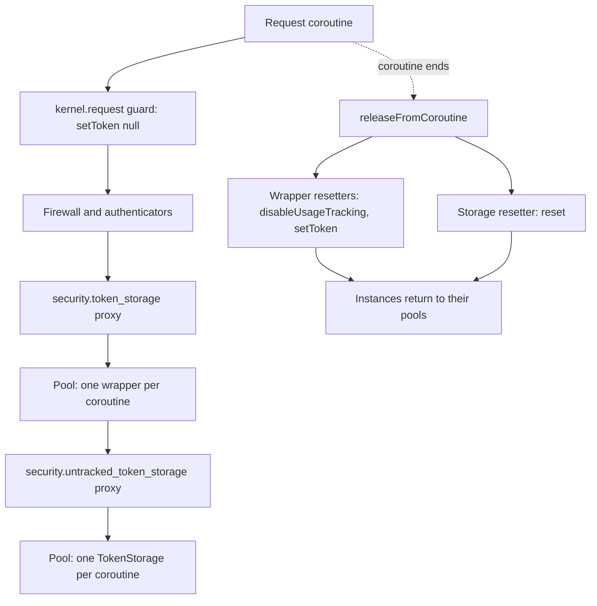
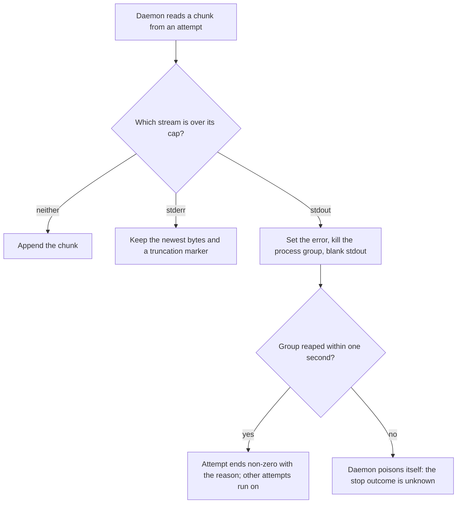
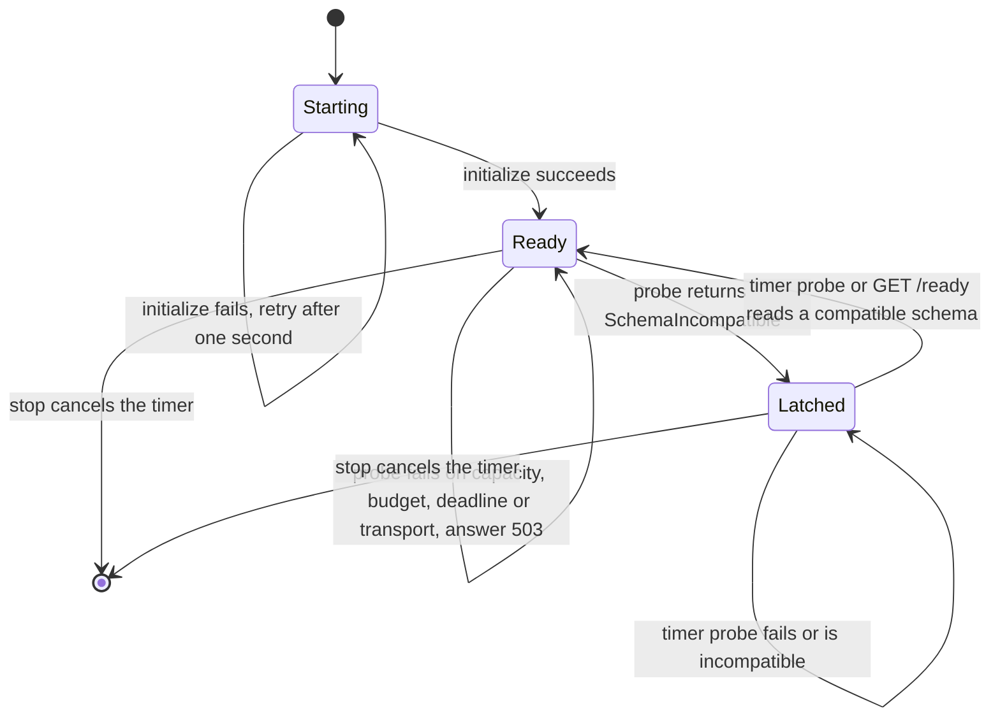
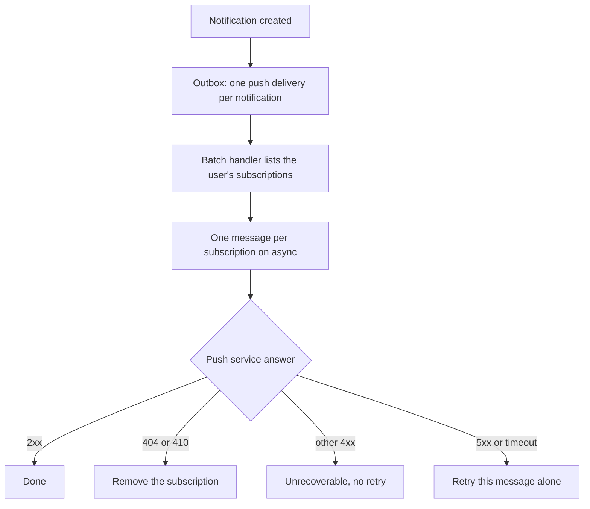
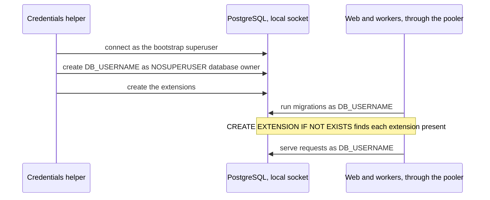

# Security Audit Findings 2026-11-24 - Plan

## Goal Capsule

- **Objective:** Nobody without an account can act as a signed-in user or stall the web tier. A file placed in a library cannot read outside that library, run script on the instance's origin or stop playback for everyone. Every other path the 2026-11-24 audit found is closed, or recorded with the reason it stays.
- **Means:** Close each finding where it sits, with a regression test that fails before the fix. The request-identity fix has three layers (KTD1); the media fixes share one container table (KTD13).
- **Product authority:** The Product Contract below. Its Key Decisions record what the user chose. Planning Contract KTDs decide mechanism inside those constraints, and the Assumptions list the choices made for the user that the user has not confirmed.
- **Execution profile:**
  - One pull request, built with `ce-work` on the branch `fix/security-audit-findings`, cut from `master` at `9524a6fd9` or later. Units land as local commits. Push only when the user asks.
  - The units run in three phases, in order. `master` is safe after each phase, so the branch can be merged early at a phase boundary if the user asks.
  - Each finding unit starts with a failing test that reproduces the finding. The audit's replay scripts are listed under Sources.
  - Schema, locking and role work goes to the postgres specialist (`.agents/agents/postgres.md`): the migrations in U16, U20, U21 and U23, the advisory locks in U20, U21 and U25, and the role layout in U35.
  - Dockerfile changes are batched into U7 and U37, because every gate result after a Dockerfile change needs a rebuilt CI image.
  - The lead regenerates `openapi.json` and the web client after each API contract change.
  - Source, tests and comments never cite this plan's IDs or the audit's finding IDs (AGENTS.md).
- **Stop conditions:**
  - Stop and ask if the request-identity drill of U5 cannot be shown failing on the unfixed server. A drill that cannot fail proves nothing.
  - Stop and ask if `composer update` in U1 would move a package outside the named set and its dependencies, or the Redis Messenger patch no longer applies.
  - Stop and ask if refusing RSA proof algorithms (KTD6) breaks a first-party client. Research found none.
  - Stop and ask before any step that would reset an instance the user owns, or any migration that would delete its data. The plan needs none.
  - Stop and ask before U25 is built: the user has not decided whether a start that finds no free video slot may end another user's silent session. The entry under Deferred / Open Questions states the choice.
  - Stop and ask if a Key Decision or an Assumption proves infeasible in code.
- **Open blockers:** None.
- **Finish:** `ce-work` implements, runs `ce-simplify-code` at phase boundaries and `ce-code-review` before shipping, applies justified findings, and records the delivered items and the verification checkpoint in `ROADMAP.md`.

---

## Product Contract

### Summary

The plan closes the 34 findings of `SECURITY_FINDINGS.md`, with one part of L8 deferred, and decides each hardening note. Every request gets its own security token, cleared when the request ends. DPoP proofs and client assertions cost bounded time. FFmpeg opens only the library file it was given, and only as a real media container. Original media is never rendered as a document. One hostile file fails its own job and nothing else. The registry stays ready through a failed probe. Member input, limiter keys, push delivery and logs are bounded. The preset no longer trusts Redis, the database role or the log agent with more than each needs, and build inputs are pinned.

### Problem Frame

The audit of 2026-11-24 read the whole repository at `9524a6fd9` and attacked a disposable instance. It found one critical defect. The Swoole bundle runs only the first reset method of each pooled service, and Symfony clears the security token in the second. A request with no credentials therefore runs as the last user that web worker authenticated. On the test instance such a request created a super admin, in both the `dev` and the `prod` environment. The code dates from the first commit.

Five high findings follow. One unauthenticated request with a `PS256` proof held a web worker for 206.6 seconds. A DASH manifest named `.mkv` played a film from another library. A text-padded file was served from the application origin as `text/xml` and ran script in two browsers. One failed `GET /ready` turns the registry off until a later probe succeeds. `composer.lock` carries 38 open advisories.

The 14 medium and 14 low findings are bounds and trust boundaries that are missing: a media file with a large tag stops the worker deployment pair, a symlink leaves the library, an admin path reaches the `ftp://` wrapper, sign-in fields and member fields have no size limit, per-address limits count each IPv6 address separately, the preset runs the application as a database superuser, and build inputs are fetched without verification.

Baander has no production deployments. The fixes may change API contracts, re-encode cached presentations and rename settings without compatibility paths. Local instances keep their data.

### Key Decisions

- **One plan resolves every finding and decides every hardening note.** Governs R1–R40. (session-settled: user-directed — chosen over planning action points 1 to 5 only, which the audit report recommended as the first step: the user asked for each issue found to be fixed.)

### Requirements

**Request identity**

- R1. A request that carries no credentials is anonymous on every web worker, whatever that worker handled before. (C1)
- R2. Two requests that one worker handles at the same time each see only their own identity until they end. (C1)
- R3. Every reset method Symfony declares for a pooled service runs when a coroutine releases the service. A test fails when a pooled service declares a reset method its pool does not run. (C1)

**Cost before authentication**

- R4. Verifying a DPoP proof or a client assertion takes bounded time whatever key and algorithm the sender chooses. The security runtime drill refuses a `PS256` proof with a 2048-bit exponent in under one second. (H1)
- R5. A sign-in request over 64 KiB is refused before it is decoded. A login block stores at most 255 characters per field, and blocks older than 30 days are deleted. (M4)
- R6. Every per-address rate limit counts an IPv6 /64 as one client. (M5)
- R7. Concurrent wrong passwords for one account are checked at most as often as the failure limit allows. (L3)
- R8. Clearing rate limiters needs a super admin, and the log records who cleared which limiter. (M6)

**Library files**

- R9. Importing or playing a library file reads no other file. A file whose content is a playlist or manifest format is refused at import with a readable reason, and at playback. (H2)
- R10. A transcode, a cover extraction and a lyrics sidecar read only files that resolve inside the library. A symlink whose target leaves the library root is not imported, and a row whose file no longer resolves inside its library is marked unavailable by the next scan. (M2)
- R11. One media file, whatever its tags, streams or keyframes, fails at most its own job. Other running jobs and the worker deployment pair keep running. (M1)
- R12. A browser never renders an original media response as a document. The response has a media type taken from the probed container, an attachment disposition and a sandbox policy, and every non-HTML API response carries a restrictive default policy. (H3)
- R13. The metadata file endpoints and commands read only files inside a library. PHP cannot open URL wrappers in any image. (M3)

**Dependencies and build inputs**

- R14. No locked PHP dependency has a known advisory when the branch merges. A scheduled gate reports new PHP and JavaScript advisories and does not pass when the advisory source is unreachable. (H5)
- R15. Every base image and every downloaded build input is pinned by digest, hash or commit, and a gate fails on an unpinned one. The desktop audio binding is verified against hashes committed in the repository. (M10)
- R16. Pull requests from forks do not run on a runner that holds the Docker socket, and the runner image is referenced by an immutable tag. (M10)

**Registry**

- R17. A failed readiness probe leaves registration and lookup working unless rqlite itself reported an incompatible schema, and an unready registry becomes ready again without a client's help. (H4)
- R18. The registry reads requests and database responses into bounded buffers. (M13)
- R19. A certificate issued for an API client or the backup worker does not pass as a Raft peer. (M13)
- R20. The registry binary is built with hardening flags and a current OpenSSL patch release, negotiates only listed cipher suites, and logs its state changes. (L10)
- R21. Pairing completion checks the server and the expiry before it returns a completed session. (L10)

**Member and admin API**

- R22. A user holds at most 20 push subscriptions. One failing endpoint is retried alone, and its failure does not send the notification to the other endpoints again. (M7)
- R23. Every member-writable string and list has a size bound that validation and the database both enforce, and each per-owner collection has a count cap. (M11)
- R24. List endpoints return bounded pages. A page below 1, a non-numeric page and a page whose offset would overflow answer `400`. (M11, L6)
- R25. Malformed input to an API route answers a `4xx` status, never `500`. (L6)
- R26. A member cannot make another member's recommendation listing shorter. (L2)
- R27. Members do not receive a radio source's sync URL or sync configuration. (L1)
- R28. One user holds at most a configured number of encode sessions. When no video slot is free, a new start can take the slot of a session that has reported no playback for ten minutes, so an abandoned session does not hold a slot for 24 hours. The radio country catalog is cached, and the station list is bounded. (L9)
- R29. Webhook, provider and push destinations are judged by the IPv4 address an IPv6 address embeds, and site-local addresses are refused. (L4)

**Deployment and operations**

- R30. The operator guide's installation produces the production stack. (M8)
- R31. A process that can write to Redis can neither make a worker run a handler nor have a value it wrote unserialized. In the preset, Redis runs as a non-root user with a named ACL user and no password in its arguments. (M9)
- R32. In the preset, the application's PostgreSQL role is not a superuser. (M9)
- R33. The preset's log agent can issue only the five read calls it uses. (M9)
- R34. Production logs at `info`. Both log copies are bounded, request-derived log fields are length-capped, and signed URLs stay out of access logs. (M14, L7)
- R35. The application boots only in the `dev`, `test` or `prod` environment. The production check refuses a Redis or database password under 16 bytes, and the preset refuses every committed secret when it renders. (L8)

**Clients**

- R36. The desktop renderer runs sandboxed, never loads the web client without a content policy, cannot read a stored password, and treats a server URL as an origin. DevTools open only in unpackaged builds. Discovered servers are bounded, normalised and marked when unencrypted. (M12, L11)
- R37. The web client percent-encodes every value it places in an API path. (L5)
- R38. The static file handler serves no dot-path and no PHP source. (L12)
- R39. A refused refresh answers `401` with an authentication message. (L13)

**Hardening and records**

- R40. Each hardening note of the audit is fixed or recorded with its reason, as the table under Scope Boundaries states. The documents that describe changed behaviour are updated, the committed development keys in Git history are documented as burned, and `SECURITY_FINDINGS.md` is retired once every finding is closed or carried into `ROADMAP.md` as an open item. (L14)

### Acceptance Examples

- AE1. **Covers R1.** Given a production server with four web workers where an admin's requests have reached every worker. When requests without `Authorization`, `DPoP` or `Cookie` headers ask for `GET /api/admin/users` and `GET /api/auth/me` on connections that together reach every worker. Then every answer is the one a freshly started server gives: `401` and `404`.
- AE2. **Covers R2.** Given user A's request is suspended after authentication. When user B's request is authenticated and completes on the same worker, and A's request resumes. Then A's request reads A's identity, and B's response names B.
- AE3. **Covers R9.** Given a DASH manifest named `Holiday Clip (2021).mkv` whose `<BaseURL>` names a file under another library's mount. When the library is scanned. Then no video is imported and the scan report names the refused format. Given a row for that file imported before the fix. When a member asks to play it. Then the request fails and FFmpeg opens no file other than the manifest. Given a completed transcode. When the worker probes its own published manifest. Then the probe succeeds.
- AE4. **Covers R11.** Given a member's transcode is running. When a Matroska file with a 1.2 MB `COMMENT` tag is played. Then at most that one playback fails. The running transcode continues, both worker containers stay up, and a new transcode starts.
- AE5. **Covers R12.** Given any imported video. When its signed original URL is opened as a page in Chromium and in Firefox. Then the browser downloads the file and runs no script, and the response carries `Content-Disposition: attachment` and `Content-Security-Policy: default-src 'none'; sandbox`.
- AE6. **Covers R17.** Given every database pool slot is busy. When `GET /ready` answers `503`. Then, once the slots are free, a lookup answers `200` with no `/ready` call in between. Given rqlite reports an incompatible schema. When `/ready` answers `503`. Then lookups answer `503` until the schema is compatible again, and after that a lookup answers `200` within a few seconds with no `/ready` call.
- AE7. **Covers R5.** Given a sign-in body of 2,000,000 bytes. Then the answer is `413` and no login block is stored. Given a sign-in whose honeypot field holds 300 characters. Then the stored field holds 255.
- AE8. **Covers R7.** Given an account with a failure limit of 10. When 50 wrong passwords arrive at once. Then at most 10 password checks run.
- AE9. **Covers R22.** Given a user with 20 push subscriptions. When a 21st is registered. Then the oldest is removed. Given one endpoint answers `500`. When a notification is sent. Then only that endpoint is retried, and no other endpoint receives the notification again because of that failure.

### Scope Boundaries

**In scope:** the application (`src/`, `packages/`, `config/`), the web client and desktop shell, the registry, the deployment preset, the images, the CI workflows and the documents that describe them.

**Out of scope:**

- `ui/rn` and Essentia (AGENTS.md).
- Rewriting Git history to remove the development TLS key and the earlier development secrets. The plan documents them as burned (R40).
- The primary checkout's blocked preview. Repairing or resetting it is the user's decision.

**Hardening notes, each decided.** The rows are the audit's notes, plus the missing cap on personal access clients that the audit's working notes record.

| Note | Decision |
| --- | --- |
| Web policy lacks `form-action`; allows any `http:` image and media source | Fixed in U14: `form-action 'self'`; `http:` sources only when the page itself is served over HTTP |
| Web policy lacks `strict-dynamic` | Not built. After U13 nothing a member controls is served from `'self'` as script, and audio worklets and workers load by `'self'`. Evidence that would change this: a script-typed response a member can influence |
| HSTS lacks `includeSubDomains` | Not built. An instance on a registrable domain would force HTTPS on every other subdomain of that domain. An operator who wants it sets it at the proxy |
| `CspNonceListener` overwrites the nonce | Fixed in U14: the duplicate listener and its unused Twig extension are removed |
| Disabling a user does not advance the credential epoch | Fixed in U42 |
| Pending TOTP secret unsealed in the cache | Fixed in U42 |
| No cap on personal access clients | Fixed in U42 |
| No step-up on consent, device approval and personal access client creation | Deferred; see below |
| No recovery codes; no list of sessions or grants | Deferred; both are features that earlier plans already deferred |
| Swoole management API on `127.0.0.1:9200` has no authentication | Not built. Only a process in the web container reaches it, and the two request paths toward loopback are closed in U15 and U26. Evidence that would change this: another loopback request path |
| GD decodes covers with no pixel bound; `FlacParser` keeps every block | Fixed in U43 |
| A sidecar `.lrc` follows symlinks with no size cap | Fixed in U11 |
| Provider responses have no size cap; remote cover type comes from a header | Fixed in U26 |
| Registry: no cipher list, no log output | Fixed in U30 |
| Registry: no per-source session cap | Deferred; see below |
| `minimum-stability: dev` | Fixed in U1 |
| Yarn installs with no minimum package age; `ui/electron` and `packages/baander-audio-core` are outside the dependency policy | Fixed in U8 |
| Yarn install scripts enabled | Not built. The desktop build needs install scripts for its native modules, and a per-package allowlist is separate work. Evidence that would change this: an advisory for an install-script attack on a locked package |
| A new party host steers the previous host's encoder | No change. `docs-book/part-2-developer-guide/contexts/party.md` documents it as the design, introduced in `d4c35e50d` |
| Webhook delivery ignores the per-user `webhook` preference | Deferred; see below |

**Considered and not built:**

- A scheduled purge of login blocks. Blocks are deleted in the transaction that stores a new one (KTD9). A schedule runs in the worker's consumer and stops with it.
- A static rule that fails CI on an unbounded request field. The admin-only request classes would need bounds first. Evidence that would change this: another unbounded member field found after this plan.
- A secret-scanning gate. The values in history are development values that the production check already refuses. Evidence that would change this: a real credential committed.
- Serving the desktop renderer from the `baander:` scheme with the file-privilege fuse off. It is the stronger boundary, and it needs a containment check in the protocol handler first. U38 takes the smaller steps.
- A build target for a production installation from source. The preset README already documents the production build (R30).
- A stored marker that a video is not eligible for copy after its keyframe listing overflowed. The compact listing admits about 95,000 keyframes, and an overflow fails one copy session with a named reason that the viewer sees at once. Evidence that would change this: a library file that overflows the compact listing and does not play another way.

#### Deferred to Follow-Up Work

- **Step-up on consent, device approval and personal access client creation.** Every approval would ask for the password and spend the per-account step-up allowance. That is a product decision.
- **Consent before a playlist collaborator is added.** U21 and U22 bound the size and the page of what one member can put into another's playlist list, and the other member can leave. The number of playlists a user can be added to stays unbounded. Consent needs an invitation state, an accept route and a share dialog change.
- **Refusing the committed `.env.test` secrets at boot.** 56 files boot a production kernel on those values, and generated secrets would have to reach the database and Redis containers of every test lane. That is a change to the test runners. Until then the boot check accepts them, and U41 makes the preset refuse them at render.
- **Removing container inspect from the log agent.** Inspect returns every container's environment, `APP_SECRET` included. U36 stops the agent from changing containers; it does not stop it from reading that.
- **The desktop runtime smoke test in CI.** It needs Electron under Xvfb in the runner image. Until then the sandbox and file-access changes of U38 are proved by a local run.
- **Honouring the per-user `webhook` preference.** Every new user is seeded with `webhook` off, so honouring the stored value stops all webhook delivery. The choice is between a per-user channel and an admin-only channel.
- **A per-source session cap in the registry.** The registry threat model lists it as separate qualification work, and a wrong default halves capacity behind a gateway that shows one address.
- **TOTP recovery codes and a sessions list.** Recorded in `ROADMAP.md` by the two earlier plans.
- **One content policy for the desktop and the web client.** The desktop `media-src` has no `https:`, so radio streams the web policy allows are blocked on desktop. That is a functional gap, not an audit finding.

### Outstanding Questions

None blocks the work. Each is for the user, and the plan proceeds on the stated default.

- **Report the reset-method defect upstream?** The bundle is a fork of `symfony-swoole/swoole-bundle`. Whether upstream `v0.35.6` has the same defect was not checked. Default: fix the fork only.
- **Should members be able to run metadata provider searches?** `MetadataSearchController` has no role check. Default: unchanged.
- **Is the Forgejo instance open to outside accounts?** Default: assume it may be, and keep fork pull requests off the socket-holding runner (R16).

---

## Planning Contract

### Key Technical Decisions

**Request identity**

- KTD1. **The request-identity fix has three layers, landed in this order.** First the bundle runs every reset method. Then `security.untracked_token_storage` and `security.authorization_checker` become per-coroutine pooled services. Last, a `kernel.request` listener above the firewall clears the token on main requests. The first layer alone leaves interleaved requests sharing one token, because every pooled `security.token_storage` wraps the same inner storage. The third layer is the only one that covers in-process kernels, which never release pools. It must not land before the second: with one shared storage it would wipe the token of a suspended request.
- KTD2. **A pool's resetter carries a list of methods and runs all of them, then rethrows the first failure,** as Symfony's `ServicesResetter` does. `SimpleResetter` takes the list; `StatefulServicesPass::getServiceResetters()` returns the lists it now truncates. A `?`-prefixed method is dropped when the class lacks it.
- KTD3. **The inner storage and the authorization checker are tagged `swoole_bundle.stateful_service` in the bundle's `SecurityProcessor`.** The `ResetInterface` fallback gives the storage the resetter `reset`. The tag lives in the bundle because the bundle owns security isolation; the alternatives were the `stateful_services` list in `config/packages/swoole.yaml` and an application compiler pass.
- KTD4. **R1 and R2 each get a proof at the level where the defect lives.** A compiler-pass unit test, a two-coroutine isolation test, a production-firewall acceptance test, a real-server drill over every worker, and a forced interleave on a fixture kernel. The drill holds `3 × workers` authenticated connections open, opens as many fresh anonymous ones, and proves that every worker served both sides from a per-worker request count. The fan-out of `app:server:stats` reports memory, coroutines and pool sizes today, none of which rises per request, so U5 adds Swoole's request count to it. Fixed dispatch pins a connection to one worker, so fewer connections can miss a worker and report a false pass.
- KTD5. **Every edit under `packages/swoole-bundle/src` updates `packages/swoole-bundle/upstream-review.json` in the same unit.** CI compares the recorded hashes.

**Authentication and limits**

- KTD6. **DPoP proofs accept `EdDSA`, `ES256`, `ES384` and `ES512` only.** Every first-party signer uses ES256, and no client, test or command signs a proof with RSA. Client assertions keep the RSA algorithms. The shared converter refuses an RSA key over 4096 bits or with an exponent other than 65537, and verifies `PS256` with OpenSSL's native PSS padding instead of the pure-PHP path. Bounding the key alone does not close H1: an ordinary 2048-bit key still costs about 1.3 seconds of pure-PHP arithmetic per request. `DpopProofValidator` refuses a `DPoP` header over 4096 bytes before parsing it. `ext-gmp` is installed and required as a second barrier for the remaining big-integer paths.
- KTD7. **The bounds sit in `JwkPublicKeyConverter`, so they also cover `ClientAssertionVerifier`,** which runs the same verification with a sender-chosen algorithm before the client is authenticated. The audit did not list that path.
- KTD8. **Sign-in bounds are a domain invariant plus a database check.** `LoginBlock::create()` scrubs invalid UTF-8 and cuts each field to 255 characters; a `CHECK` on `octet_length` (1020 bytes) backs it. A listener keyed on route names refuses a body over 64 KiB with `413`. It runs after the router (priority 32) and before `RateLimitListener` (priority 10), which decodes the body.
- KTD9. **Login blocks older than 30 days are deleted in the transaction that inserts a new block.** This follows KTD22 of the 2026-11-22 plan. The per-address limit bounds how often it runs.
- KTD10. **One helper folds a client address into its limiter subject:** IPv4 unchanged, IPv6 cut to /64 with `IpUtils::anonymize`. It lives in `src/Shared/Infrastructure/Http/` because Auth, Catalog and Discovery use it. All 15 address-keyed sites call it. Warnings keep logging the full address. Limiter subjects are hashed, so no stored state migrates.
- KTD11. **Both limiter-clear routes carry a method-level `#[IsGranted('ROLE_SUPER_ADMIN')]`.** One Application service clears and logs the actor; the controller and `app:rate-limiter:clear` both call it. A prefix rule for `auth_*` and `oauth_*` names was rejected: it needs an inline role check and misses `anonymous_api` and `discovery_endpoint_ip`.
- KTD12. **The per-account failure limit is reserved before the password check and refunded on success and when a code is required.** `RedisRateLimiter` gains `refund()`, clamped at zero. Resetting the limiter on success was rejected: the owner's sign-in would clear an attacker's count.

**Media**

- KTD13. **One container table names every supported container:** its file extensions, its FFmpeg demuxer name and its media type. The scanner's extension lists, the import check, the FFmpeg input clause, the original media type and `DeliveryDecisionService::container()` all read it. Today five places hold five lists.
- KTD14. **One builder writes the input clause of every FFmpeg and ffprobe command,** from a path and an input kind. The kind says what the input is: library audio, library video, the worker's own published presentation, or a generated `lavfi` source. It emits `-format_whitelist <set> -protocol_whitelist file` before `-i`. A whitelist was chosen over forcing `-f` by extension, which would refuse valid misnamed files. A source test fails on a literal `-i` outside the builder. The sets are in the High-Level Technical Design.
- KTD15. **The new arguments change every encode fingerprint,** because `EncodePresentationIdentity` hashes the whole argument list. Completed encode artifacts stop matching and are re-encoded on next play. The pre-release policy accepts this once.
- KTD16. **On stdout overflow the native execution daemon fails that one attempt.** It kills the process group, blanks stdout and reports a non-zero outcome with the reason. For stderr it keeps a bounded tail with a truncation marker and does not fail, so a damaged but playable film is not killed by decoder warnings. The daemon still poisons itself when a launch or stop outcome is unknown. This restores KTD6 of the reserved-worker-control plan (`be35cc909`), which the code had gone past.
- KTD17. **Probes name the entries they read.** The video probe asks for the stream tags `DURATION`, `language` and `title` and the chapter tag `title`; the audio probe asks for no tag. Format entries are named too, so no format tag is printed. Dropping all tags was rejected: `videoEnd` comes from `DURATION`. One named tag is still unbounded, so KTD16 remains the fix and KTD17 only removes the common trigger.
- KTD18. **The keyframe listing uses one compact entry per keyframe.** That moves the cap from about 10,000 keyframes to about 95,000. When a listing still overflows, that copy session fails with a named reason and nothing else is affected. A fallback to encode inside the worker was rejected: copy and encode are different sessions, and only encode takes an encoder slot.
- KTD19. **The transcode worker resolves its source through `VideoPortInterface` with an unrestricted scope.** The session was authorized when it was created; the worker needs containment, not a second access check. This removes a baselined Deptrac violation.
- KTD20. **Original media extends the image contract of `a6998f170`.** The type comes from the container table by probed family and file extension. A row with no stored family is mapped by extension inside its kind's set, so the result is always a constant from the table. Every original is an attachment with `default-src 'none'; sandbox`. The disposition carries no file name: Symfony refuses a non-ASCII or `%` fallback name, and library files have such names. A disposition and a policy act only on navigation, so `<video>`, `<audio>`, `fetch` and MSE playback are unaffected. `SecurityHeadersListener` gives every non-HTML kernel response `default-src 'none'; frame-ancestors 'none'; sandbox` unless the controller set a policy. No `Cross-Origin-Resource-Policy` header is added: the desktop renderer and extra origins load signed media cross-origin. Static files get no policy, because a worker script's policy governs the worker.
- KTD21. **Metadata file reads are confined in the shared port, so the API and the console agree.** A new method in the Library Media Files Contract resolves a path inside any library. A path outside answers with the "missing" text, which closes the existence oracle. Metadata Infrastructure gains that contract as a Deptrac edge.
- KTD22. **`allow_url_fopen=Off` goes into a shared fragment in the `runtime` image stage.** `docker/dev/php.ini` changes too, because the `ci` stage loads it last. The log agent's checkpoint call and the tests that read `http://` through file functions move to curl first.

**Member API**

- KTD23. **Push delivery fans out one message per subscription.** The batch handler dispatches a per-subscription command to `async`, and each is retried alone. `408`, `429`, `5xx` and timeouts are retried; `404` and `410` remove the subscription; any other `4xx` is unrecoverable. The outbox stays one delivery per channel per notification. The cap is checked under a per-user advisory lock in the registering transaction and evicts the user's longest-registered row.
- KTD24. **New length checks on user content are added `NOT VALID`.** New and changed rows are checked; existing rows are left alone, which protects local data. `login_blocks` is the exception: its over-length fields are attacker input and are cut to the bound in the migration, so its check is validated at once. No row is deleted.
- KTD25. **Page arithmetic moves into `QueryParameters::page()`,** which returns page, limit and offset. It answers `400` for a page below 1, a non-numeric page, and a page whose offset would overflow; a page past the last one returns an empty page. It replaces six unclamped computations and two hand clamps. The playlist list takes `limit` and `offset` through `QueryParameters::pagination()`, and its four web callers page through it.
- KTD26. **The per-user cap counts encode sessions, under a per-user advisory lock in `CreateTranscodeSessionHandler`.** Both entry points, `AuthorizedPlayback::start` and `POST /api/transcode/sessions/`, create sessions through that handler, and the video row lock does not serialise two videos. The cap is a server setting with a default of 6, which is two automatic starts of three tiers. Over the cap, the user's session with the oldest sign of life is ended when it has reported no playback for two minutes; when every session is playing, the start answers `409` with a named reason. When no video slot is free at all, admission ends the session with the oldest sign of life, whoever owns it, if it has reported no playback for ten minutes. Without that step the cap never binds on the shipped 4 GB and 8 GB examples, which have 1 and 3 video slots. A signed start creates up to three sessions, each in its own transaction, so `AuthorizedPlayback::start` first checks under the same lock that all of its tiers fit, and cancels the sessions it created when a later tier is still refused. Counting playbacks by `requestId` was rejected: the client chooses that id.
- KTD27. **One address classifier in `packages/baander-http-client` serves both destination policies.** It decodes the embedded IPv4 of `::/96`, `64:ff9b::/96`, `64:ff9b:1::/48`, `2002::/16` and Teredo addresses and classifies that address, and it refuses `fec0::/10`. The webhook LAN allowlist is applied to the embedded address.

**Registry**

- KTD28. **Readiness latches only on a typed `SchemaIncompatible` failure.** While unready, a read-only readiness probe re-runs every second on a member timer that `stop()` cancels. A generation counter stops a probe that started before a newer incompatible answer from setting the flag. A successful `/ready` still restores readiness. Re-running `initialize()` was rejected: it writes schema and skips the column check.
- KTD29. **Both read buffers are capped at 16,384 bytes, after a characterization test.** The growth is only suspected, so the first step proves or refutes it on `beast::test::stream`. The cap stays either way.
- KTD30. **rqlite gets two certificate authorities:** a client CA for the API and the backup worker, a node CA for voters. The entrypoint refuses to start when the two files are identical. Voters keep one leaf for HTTP and Raft.
- KTD31. **Hardening flags are set in `relay/CMakeLists.txt` for Release builds without sanitizers,** so the release contracts test the binary that ships. `_FORTIFY_SOURCE` fails the three `-O0 -Werror` configurations.

**Deployment**

- KTD32. **The dependency update names its packages:** `symfony/*`, `web-token/jwt-library`, `web-auth/webauthn-lib` and `spomky-labs/otphp`, with their dependencies, run in the application image. A full update would move about 250 packages past the reviewed fork and the qualified Redis Messenger patch.
- KTD33. **The advisory gate is an advisories-only mode of the existing dependency checker,** run by a new scheduled workflow. The checker already parses `composer audit` and `yarn npm audit` and treats an unreachable source as a gap. Its online mode also fails on every outdated package, so it cannot be the gate as it stands.
- KTD34. **Messenger envelopes are signed with Symfony's `SigningSerializer`, keyed by `kernel.secret`.** `AsyncWorkloadCompilerPass` fails the container build when a type the message codec can decode is not a signed type. The rule covers every codec type, not every workload: the serializer passes an unsigned envelope of an unsigned type through. A rejected envelope is acknowledged and dropped with one log line; it is not stored in the failure transport, which a flood would fill. A project serializer with its own key was rejected: it adds a secret the preset must generate and rotate.
- KTD35. **The preset's Redis credentials are delivered the way the pooler's are:** a volume written by a disposable helper that receives the secret by environment name. The application reads the Redis user from the DSN.
- KTD36. **The preset's bootstrap superuser is reachable only over the PostgreSQL container's local socket.** The credentials helper creates `DB_USERNAME` as a `NOSUPERUSER` database owner and pre-creates the extensions, so the first migration's `CREATE EXTENSION IF NOT EXISTS` statements do nothing. The test stack uses the same layout, so the functional suite runs the migrations as that role. Tests that create databases keep a harness-only path: the test stack's application role may create databases, and new databases inherit the extensions. The development stack keeps its current role: its volumes hold objects owned by that role, and changing it needs a data reset.
- KTD37. **The log agent reaches Docker through an allow-listing proxy rendered from the gateway image.** The proxy listens only on a Unix socket in a volume that it shares with the agent alone; it joins no network and publishes no port, so web and workers cannot reach it. The proxy passes five `GET` paths, and passes the two endless ones unbuffered with no idle timeout. Container inspect still returns every container's environment, `APP_SECRET` included; the threat model records that residual, and removing inspect is deferred.
- KTD38. **Build inputs are pinned by the mechanism each already has a precedent for:** digests on `FROM` lines, `sha256sum -c` on downloads, commits on Git fetches, Node copied from the pinned `node` image instead of a setup script. The scope is every fetched input, not only the lines the audit cites. The runner image is referenced by the commit tag `runner.yaml` already pushes.
- KTD39. **The operator guide installs through the preset, and one command context serves every operator page.** The Compose procedure moves to the developer guide.
- KTD40. **`App\Kernel` refuses an environment name outside `dev`, `test` and `prod`.** One check closes every environment guard in the application; no test, package or script names another environment. The secret rules move to `packages/baander-core`, so the placeholder and length rules cannot drift between render and boot. The preset's deny-list is the wider one: it also holds the `.env.test` values, which the boot check still accepts.

**Clients**

- KTD41. **The generated client encodes path parameters with Orval's `urlEncodeParameters`.** The 68 hand-written paths use one tagged-template helper, and an ESLint rule refuses a raw interpolation in an API path.
- KTD42. **The desktop stores a server URL as its origin** and derives the origin again before it writes the policy. When bootstrap fails, the renderer shows an error and does not import the web client.

### High-Level Technical Design

**Request identity after the fix (KTD1–KTD3).** Each coroutine takes its own instance from both pools. Releasing the coroutine runs every resetter and returns the instances.

**FFmpeg input kinds (KTD14).** The three file kinds use the protocol list `file`. Stream copy uses the library-video set, because copy is offered for any source container whose codecs fit.

| Input kind | Used by | Format whitelist |
| --- | --- | --- |
| Library audio | Import probe, audio rendition and its probes | `mp3`, `flac`, `ogg`, `wav`, `aac`, `mov`, `asf`, `aiff` |
| Library video | Import probe, play-time probe, keyframe listing, encode, stream copy, subtitle extraction, timeline preview | `mov`, `matroska`, `avi`, `asf` |
| Published presentation | Probe of the worker's own `manifest.mpd` | `dash`, `mov` |
| Generated source | Hardware capability probes | forced `-f lavfi`, no whitelist |

**Native output overflow (KTD16).**

**Registry readiness (KTD28).**

**Push delivery (KTD23).**

**Preset database roles (KTD36).**

### Assumptions

The user asked for work to start, so these choices were not confirmed. Each is a default the user can overrule; the units that depend on one cite it by its label.

- **RSA proofs refused.** DPoP stops advertising and accepting RSA algorithms (KTD6). Third-party clients must sign proofs with EC or EdDSA keys.
- **Originals download on navigation.** A signed original URL opened as a page downloads the file; it no longer plays in the browser's own viewer (KTD20).
- **Login block retention is 30 days,** and stored fields hold 255 characters (R5).
- **Admins lose "Clear All".** Clearing limiters becomes a super admin action (KTD11).
- **Bounds on member content.** U21's table lists them, for example a 2,000-character playlist description and 1,000 playlists per owner. Two more caps sit in other units: 1,000 recommendation rows per user (U23), and 20 push subscriptions per user with the oldest evicted (U20).
- **Six encode sessions per user** by default, as a server setting that applies to admins too. A start over the cap ends that user's own stalest session, which may be a film paused on another device (KTD26).
- **An idle session can lose its slot to another user.** When no video slot is free, a new start ends the session that has been silent longest, if it has reported no playback for ten minutes. A paused player reports once an hour, so this can end a film that another user paused. The user decides this before U25 is built; the alternative leaves small deployments exposed.
- **The radio station list returns at most 500 rows per request,** and the country catalog is cached for six hours.
- **Unknown environments do not boot.** An instance started with `APP_ENV=staging` is refused (KTD40).
- **Committed test secrets are refused by the preset, not yet at boot.** The boot check keeps accepting the `.env.test` values that 56 test files boot on (KTD40).
- **Redis and database passwords need 16 bytes,** checked when the preset renders and when the application boots.
- **The operator guide documents one installation, the preset.** Operator command pages change from `dc exec app php bin/console` to the new command context.
- **The desktop keeps its credential write and clear channels.** Only the read path, which returns a stored password to page script and has no caller, is removed.
- **Discovery accepts `http:` only for a private or loopback address literal or a `.local` name,** and stores the origin, not the announced URL.
- **Log bounds:** the preset sets the `local` log driver with `max-size` 50 MB and five files, which replaces the daemon's default driver for its services. Per-boot log directories older than 14 days are pruned, keeping the current and the previous boot.
- **`docker/prod/nginx.conf` is kept and fixed.** The 2026-11-22 plan kept it on purpose for installations behind an operator proxy.
- **Fork pull requests on Forgejo run no job on the socket-holding runner.** The contributing guide's sentence that forks run every gate changes.

### Sequencing

- **Phase 1 (U1–U8)** closes what an unauthenticated sender can reach: stale identity, proof cost, known advisories. U1 runs first because it replaces the vendored Symfony security configuration that the C1 tests read. U2, U3, U4 and U5 run in that order (KTD1). U7 carries both Phase 1 image changes and the URL-wrapper setting, so the CI image is rebuilt once.
- **Phase 2 (U9–U32)** closes what an account or a library file can reach. U9 creates the container table that U10, U12 and U13 read. U11 and U12 both change `TranscodeSessionSubscriber`; U11 lands first. Every change to the encode argument list lands in U9, so completed encode artifacts are invalidated once. U21 creates the request-validation conventions that U22–U24 follow.
- **Phase 3 (U33–U44)** closes the preset, supply chain and client items. U33 lands before U34 because signed envelopes are the stronger Redis barrier. U37 carries every remaining Dockerfile change.
- `ce-simplify-code` runs after U8, U32 and U43. U44 runs last.

### System-Wide Impact

- **Every request path.** U2–U4 change how each request obtains and releases its identity. The whole functional suite and the three runtime drills are the regression surface.
- **Every FFmpeg command.** U9 changes the argument list of all 11 command builders. Completed encode artifacts are re-encoded once (KTD15).
- **API contracts.** U6 (advertised proof algorithms), U13 (media response headers), U18 (clear routes answer `403` to admins), U21–U25 (validation, paging, new `4xx` answers; the people and TV lists change from a silent clamp to `400`), U24 (radio source fields). `openapi.json` and the generated client change with each.
- **Images.** U7 and U37 change the Dockerfiles. Every later gate runs on a rebuilt CI image.
- **Preset.** U33–U36 change the rendered services, add a credentials volume and a proxy service, and change the database role. The preset qualification that the 2026-11-22 plan left unrun is still owed.
- **Operators.** U32 rewrites the installation procedure; U40 changes the log level; U41 refuses environments that booted before.
- **Fork inventory.** U2, U3 and U14 edit the bundle (KTD5).

### Risks

| Risk | Mitigation |
| --- | --- |
| A callback outside the bundle's entry points holds a pooled token storage until the worker stops, and a full pool blocks later coroutines without an error | U3 asserts with `SwoolePoolStatsProvider` that `active` returns to its idle value after the drill, and checks each callback that reads the token for `CoWrapper::defer()` |
| A streamed response runs in a new coroutine and finds an empty token storage | Research found no identity read inside the stream closures. U3 adds a test for the stream controllers |
| A test or a client request sent no credentials after an authenticated one and only worked because of the leak. `LibraryReadScopeProvider` also reads the ambient token to decide admin authority | U5 ends with a triage pass over the functional suite, the Playwright suite and the desktop smoke test. A new `401` there is a caller to fix, not a regression |
| The media type follows the file extension inside a probed family, so a Matroska file named `.webm` is offered as an original it may not play | Accepted: a wrong extension costs a playback fallback, never a text type. U13 checks what the web client does after a failed original |
| The C1 drill passes for the wrong reason, as the audit's first production attempt did | U5 must fail on the unfixed server first, and must prove every worker served both sides (KTD4) |
| A whitelist refuses a real file: an AVI with embedded XSUB subtitles loses that subtitle track | Accepted; the film still plays. U9 records it in the library guide |
| FFmpeg behaviour was recalled from its source, not run: list matching by comma element, inheritance by nested demuxers | U9's first step is a native-lane test in which real ffprobe refuses an MPD and an `#EXTM3U` playlist and still opens the worker's own manifest |
| The Redis Messenger patch does not apply to Symfony 8.1.11 | Stop condition; U1 runs the patch's owning regressions |
| `composer audit` needs the network, and the gates run with `--network none` | The advisory gate is a separate scheduled workflow (KTD33) and fails closed on a refused connection |
| Signed envelopes reject messages queued before the change, and rotating `APP_SECRET` invalidates queued and failed messages | No production deployments exist. U33 documents the rotation effect in the credential rotation page |
| Coverage runs already lose stack lanes at the 3,600-second budget, and this plan adds many stack-lane tests | A lane that ends with exit 124 is reported as not run and its files are rerun without coverage |
| Limiter tests share buckets | Each new limiter test file takes its own `198.18.x` range; `LoginAccountThrottleTest` owns `198.18.10.x` |
| An OpenSSL bump and pinned digests need the network for hashes | U30 and U37 look the values up when they run; a value that cannot be verified is a blocker for that unit, not a guess |
| The registry's Beast and rqlite behaviour was recalled, not checked | U28 starts with a characterization test; U29's regression connects a client-CA leaf to a Raft port and expects refusal |
| A `.env.test` edit reaches test containers only once committed | U41 commits its env-file change before it is verified |

---

## Implementation Units

| U-ID | Title | Key files | Depends on |
| --- | --- | --- | --- |
| U1 | Dependencies at their fixed versions | `composer.json`, `composer.lock`, `PasskeyService.php` | — |
| U2 | The bundle runs every reset method | `StatefulServicesPass.php`, `Proxifier.php`, `SimpleResetter.php` | U1 |
| U3 | Per-coroutine token storage and authorization checker | `SecurityProcessor.php` | U2 |
| U4 | Request-start guard and firewall acceptance | new listener, `OAuthFirewallAcceptanceTest.php` | U3 |
| U5 | Real-server drill and interleave proof | `SecurityWorkflow.php`, new fixtures | U4 |
| U6 | Proof and assertion key bounds | `JwkPublicKeyConverter.php`, `DpopProofValidator.php` | U1 |
| U7 | Image runtime settings | `Dockerfile`, `docker/dev/php.ini`, `bin/log-agent.php` | U1 |
| U8 | Advisory gate | `packages/baander-dev-dependencies`, new workflow | U1 |
| U9 | Container table and FFmpeg input clause | new value object, `FFmpegArguments.php`, 11 command builders | — |
| U10 | Import refuses playlist formats | `FilesDiscoveredHandler.php`, probe results | U9 |
| U11 | Transcode and scan stay inside the library | `TranscodeSessionSubscriber.php`, `DirectoryScanner.php` | — |
| U12 | Output overflow fails one attempt | `NativeExecutionDaemon.php`, `ProcessExecutor.php` | U9, U10, U11 |
| U13 | Original media type, disposition and default policy | `VideoService.php`, `OriginalMediaController.php`, `SecurityHeadersListener.php` | U9 |
| U14 | Header hardening and static handler | `SecurityHeadersListener.php`, `AdvancedStaticFilesServer.php` | U13 |
| U15 | Metadata file reads confined to libraries | `MediaFileMetadata.php`, `deptrac.yaml` | — |
| U16 | Sign-in storage bounds | `LoginBlock.php`, new listener, migration | — |
| U17 | IPv6 limiter keys | new helper, four listeners | — |
| U18 | Limiter clearing authority | `RateLimiterMonitorController.php`, new service | — |
| U19 | Failure limit reserved before the check | `RedisRateLimiter.php`, `PasswordAuthenticator.php` | U16 |
| U20 | Push subscription cap and per-endpoint delivery | `PushSubscriptionRepository.php`, `SendPushHandler.php` | — |
| U21 | Member input bounds | request classes, migration | — |
| U22 | Page arithmetic and bounded lists | `QueryParameters.php`, eight controllers, playlist list | U21 |
| U23 | Recommendations: validated writes, per-viewer listings | `RecommendationController.php`, `RecommendationRepository.php` | U21 |
| U24 | Radio: member projection, cached catalog, bounded stations | `RadioSourceService.php`, `IprdStationSyncAdapter.php` | U22 |
| U25 | Per-user share of transcode slots | `CreateTranscodeSessionHandler.php` | — |
| U26 | Outbound address classifier and response bounds | `packages/baander-http-client`, `WebhookDestinationPolicy.php` | — |
| U27 | Registry readiness | `relay/cpp/server.cpp`, `relay/cpp/core.cpp` | — |
| U28 | Registry read bounds | `relay/cpp/server.cpp`, `relay/cpp/transport.cpp` | U27 |
| U29 | Registry certificate authorities | `relay/docker/rqlite-entrypoint.sh`, test harness | — |
| U30 | Registry build hardening, ciphers and logging | `relay/CMakeLists.txt`, OpenSSL pins | U28 |
| U31 | Pairing completion order | `CompletePairingHandler.php` | — |
| U32 | Operator installation through the preset | `installation.md`, operator command pages | — |
| U33 | Signed Messenger envelopes | `messenger.php`, `AsyncWorkloadCompilerPass.php` | — |
| U34 | Preset Redis identity | `Renderer.php`, `RedisClientFactory.php` | U33 |
| U35 | Preset PostgreSQL role | `Renderer.php`, `Pooler.php`, credentials script | U34 |
| U36 | Log agent behind a read-only proxy | `LogCollection.php`, `Renderer.php` | U7, U35 |
| U37 | Pinned build inputs and CI runner | six Dockerfiles, workflows, `fetch-prebuilds.mjs` | U7, U8 |
| U38 | Desktop renderer and discovery | `ui/electron/src` | — |
| U39 | Web client path encoding | `orval.config.ts`, hand-written API files | — |
| U40 | Production logging bounds | `monolog.yaml`, `Renderer.php`, nginx files | U36 |
| U41 | Environment and secret rules | `Kernel.php`, `ProductionSecrets.php`, `packages/baander-core` | U35 |
| U42 | Account hardening | `AuthController.php`, `DisableUserHandler.php`, `PendingTotpSecrets.php` | — |
| U43 | Image and tag parser bounds | `GdImageConverter.php`, `FlacParser.php` | — |
| U44 | Documentation and records | threat models, `CONCEPTS.md`, `ROADMAP.md` | all |

### Phase 1: before any instance is exposed

### U1. Dependencies at their fixed versions

- **Goal:** No locked PHP package carries a known advisory, and passkey registration parses only the attestation formats the product uses.
- **Requirements:** R14, R40; KTD32.
- **Dependencies:** None.
- **Files:**
  - `composer.json`, `composer.lock`, `patches.lock.json`, `patches/README.md`, `scripts/composer.json`, `scripts/composer.lock`
  - `src/Auth/Infrastructure/Security/Passkey/PasskeyService.php`
  - `docs-book/part-2-developer-guide/getting-started/php-dependencies.md`
  - Tests: `tests/Unit/Auth/Infrastructure/Security/Passkey/PasskeyServiceTest.php`, `tests/Functional/Auth/PasskeyEndpointsTest.php`
- **Approach:**
  1. Update the named set (KTD32) inside the application image, in the root lock and in any other owned lock that carries one of the packages. Three path-repository entries will change their locked branch name; that diff is expected.
  2. Confirm that the Redis Messenger patch applies to Symfony 8.1.11 and that its owning regressions pass. Record the new qualification in `patches/README.md`.
  3. Confirm that `CeremonyStepManagerFactory::setAllowedOrigins()` still exists in `web-auth/webauthn-lib` 5.3.13.
  4. Set `minimum-stability` to `stable` in the root and in `scripts/composer.json`, with an explicit `@dev` on each path package.
  5. Register the attestation formats `none` and `packed` only. The parameter `auth.passkey.attestation` is `none`, so the other four formats are never requested.
- **Execution note:** This is a lock change. Its proof is the full gate set plus `composer audit --locked --no-plugins` reporting no advisory, run once by hand with the network.
- **Patterns to follow:** the "PHP dependency and runtime refresh" record in `ROADMAP.md`.
- **Test scenarios:**
  - A passkey registration with `fmt: none` succeeds.
  - A registration whose attestation uses `tpm`, `android-key`, `apple` or `fido-u2f` is refused.
  - `composer audit --locked --no-plugins` reports no advisory for the four lock files the dependency policy owns: the root lock, `scripts/composer.lock`, `packages/tsduck-php-ffi/composer.lock` and `relay/composer.lock`.
- **Verification:** The backend suites pass on the new lock, the fork inventory check passes, and the advisory count is zero.

### U2. The bundle runs every reset method

- **Goal:** A pooled service's every `kernel.reset` method runs when its coroutine ends.
- **Requirements:** R3; KTD1, KTD2, KTD5.
- **Dependencies:** U1.
- **Files:**
  - `packages/swoole-bundle/src/Bridge/Symfony/Bundle/DependencyInjection/CompilerPass/StatefulServicesPass.php`
  - `packages/swoole-bundle/src/Bridge/Symfony/Bundle/DependencyInjection/CompilerPass/StatefulServices/Proxifier.php`
  - `packages/swoole-bundle/src/Bridge/Symfony/Container/SimpleResetter.php`
  - `packages/swoole-bundle/src/Bridge/Symfony/Cache/CacheAdapterProcessor.php`
  - `packages/swoole-bundle/upstream-review.json`, `packages/swoole-bundle/README.md`
  - Tests in `tests/Unit/Shared/Infrastructure/Swoole/`: `FrameworkIsolationPipelineTest.php`, `FrameworkIsolationDoctrineTest.php`, `CacheAdapterProcessorTest.php`, `ProxifierPoolLifetimeTest.php`, `ServicePoolLifecycleTest.php`
- **Approach:** Carry the method list from `getServiceResetters()` through `proxifyKnownStatefulServices()` and `Proxifier` into the resetter. The table of places that assume one method is in the C1 dossier under Sources.
- **Patterns to follow:** `vendor/symfony/dependency-injection/ServicesResetter.php` for run-all-then-rethrow; `reduceServiceResetters()` and `DoctrineProcessor`, which already treat the value as a list.
- **Test scenarios:**
  - A service tagged with two reset methods has both run on release, in tag order. The pass test uses the real shape `['security.token_storage' => ['disableUsageTracking', 'setToken']]`.
  - When the first method throws, the second still runs, the first failure is rethrown and the instance is discarded.
  - A `?`-prefixed method is dropped when the class lacks it and runs when the class has it.
  - A `resetter` on the stateful tag still replaces the `kernel.reset` methods, as cache pools rely on.
  - A service with one reset method behaves as before.
- **Verification:** The Swoole unit tests pass in the native lane and the fork inventory check accepts the new hashes.

### U3. Per-coroutine token storage and authorization checker

- **Goal:** Each coroutine has its own security token and its own authorization stacks.
- **Requirements:** R2, R3; KTD1, KTD3, KTD5.
- **Dependencies:** U2.
- **Files:**
  - `packages/swoole-bundle/src/Bridge/Symfony/Security/SecurityProcessor.php`, `packages/swoole-bundle/upstream-review.json`
  - Tests: new `tests/Unit/Shared/Infrastructure/Swoole/FrameworkIsolationSecurityTest.php`, `FrameworkIsolationOwnershipTest.php`, new `tests/Integration/PooledServiceResetCoverageTest.php`, `scripts/backend-native-tests.json`
- **Approach:**
  1. Tag both services in `SecurityProcessor::process()`.
  2. Check every callback outside the bundle's entry points that reads the token for `CoWrapper::defer()`: the WebSocket handlers, `LiveUpdateRuntime`, `LiveFrameSender`, `HealthMonitorSubscriber` and `WorkerDrain`.
  3. Re-check that no `StreamedResponse` closure reads identity, since it runs in a new coroutine with an empty storage.
- **Patterns to follow:** `FrameworkIsolationMailerTest.php` for two coroutines with a channel handshake; `ProxifierPoolLifetimeTest.php` for the pool wiring; `SecurityProcessor`'s existing tag for the access decision manager.
- **Test scenarios:**
  - A token set in coroutine A is invisible in coroutine B, and is gone after A releases.
  - A released storage instance is handed to the next coroutine empty.
  - Resetting the wrapper when the inner pool has no assignment for that coroutine raises nothing.
  - `isGranted` stacks of two coroutines do not mix.
  - After both coroutines end, every pool's `active` count is back at its idle value.
  - The container test fails when a pooled service's `kernel.reset` list is longer than its resetter's method list, shown with a fixture service.
  - A streamed response completes with the pooled storage in place.
- **Verification:** The isolation tests pass in the native lane, and the container test lists no uncovered reset method in the compiled `prod` container.

### U4. Request-start guard and firewall acceptance

- **Goal:** A request starts with no token, in the server and in in-process kernels.
- **Requirements:** R1; KTD1.
- **Dependencies:** U3.
- **Files:**
  - New listener in `src/Auth/Infrastructure/Security/`
  - Tests: `tests/Integration/OAuthFirewallAcceptanceTest.php`, a unit test for the listener
  - Workarounds to delete: `tests/Functional/Controller/PartySessionAccessTest.php`, `tests/Functional/Controller/PartyInvitationTest.php`, `tests/Functional/Auth/EmailVerificationDeliveryTest.php`
  - `docs-book/part-2-developer-guide/testing/conventions.md`
- **Approach:** The listener handles `kernel.request` for main requests at a priority above the firewall (8) and above every token reader. It calls `setToken(null)`.
- **Test scenarios:**
  - On the production firewall, a request with a bound token answers `200`; the next request with no credentials answers `401` on `/api/admin/users` and `404` on `/api/auth/me`. Run once with the manual pool release and once without.
  - A sub-request does not clear the main request's token.
  - The three functional tests pass with their manual `setToken(null)` lines removed.
- **Verification:** The acceptance cases fail on the commit before U2 and pass here.

### U5. Real-server drill and interleave proof

- **Goal:** The two acceptance examples for request identity are proved on a real multi-worker server and under a forced coroutine switch.
- **Requirements:** R1, R2; AE1, AE2; KTD4.
- **Dependencies:** U4.
- **Files:**
  - New fixture under `tests/Fixtures/`, called from `packages/baander-dev-qualification/src/Fixtures/Web/SecurityWorkflow.php`
  - `src/Shared/Infrastructure/Swoole/Control/Operation/DebugStatsOperation.php`, with the `app:server:stats` table and its API schema
  - `packages/baander-dev-qualification/tests/WebRuntimeWorkflowTest.php`
  - New fixture kernel under `tests/Fixtures/Auth/`, derived from `ProductionOAuthKernel`; new `tests/Integration/RequestIdentityInterleaveTest.php`; `scripts/backend-native-tests.json`
  - `packages/baander-dev-dependencies/resources/php-dependencies.json` (fork proofs), `docs-book/part-2-developer-guide/testing/runtime-drills.md`
- **Approach:**
  1. The drill follows KTD4 and stays inside the 360-second security-drill budget. It reads each worker's request count before the authenticated phase, between the phases and after the anonymous phase.
  2. The interleave test runs in a child process through `tests/Fixtures/Swoole/CoroutineProbe.php`. The fixture kernel waits on a `Swoole\Coroutine\Channel` between the firewall and the identity read.
  3. Triage: run the functional suite, the Playwright suite and the desktop smoke test. A request that now answers `401` was relying on the previous request's identity; fix the caller.
- **Execution note:** Run the drill against the commit before U2 first and keep its failing output for the commit message.
- **Patterns to follow:** `tests/Fixtures/security-runtime.php` and `tests/Fixtures/WebRuntime/StreamClient.php` for DPoP-bound requests against `app:serve`; `tests/Unit/Shared/Infrastructure/Swoole/WebSocketDisconnectProbeTest.php` for a child-process server.
- **Test scenarios:**
  - Covers AE1. After the admin's requests, anonymous requests answer `401` and `404` on every worker.
  - When a worker's request count did not rise in both phases, the drill reports itself inconclusive and fails.
  - After a member's requests, and again after the admin signs out, anonymous requests still answer `401`.
  - Covers AE2. User A's suspended request resumes as A after user B's request completed.
  - Two users calling `GET /api/auth/me` concurrently on shared workers always receive their own profile.
- **Verification:** `bash scripts/test-security-runtime-container.sh` passes, the shutdown drill `bash scripts/test-web-shutdown-container.sh` still passes with the bundle changes, and the triage pass names each caller it fixed.

### U6. Proof and assertion key bounds

- **Goal:** No sender-chosen key or algorithm makes verification slow.
- **Requirements:** R4; KTD6, KTD7. Assumption: RSA proofs refused.
- **Dependencies:** U1.
- **Files:**
  - `src/Auth/Infrastructure/Security/OAuth/JwkPublicKeyConverter.php`, `DpopProofValidator.php`, `ClientAssertionVerifier.php`
  - `src/Auth/Domain/Model/OAuth/ValueObject/ClientKeySource.php`
  - `src/Auth/Interface/Controller/OAuth/AuthorizationServerMetadataController.php`
  - Tests in `tests/Unit/Auth/Infrastructure/Security/OAuth/`: `DpopProofValidatorTest.php`, new `JwkPublicKeyConverterTest.php`, `ClientAssertionVerifierTest.php`; `tests/Unit/Auth/Interface/Controller/OAuth/AuthorizationServerMetadataTest.php`; `tests/Fixtures/security-runtime.php`
  - `openapi.json`; `docs-book/part-2-developer-guide/contexts/auth-client-authentication.md`, `development/api-oauth-client-authentication.md`
- **Approach:**
  1. Split the shared algorithm constant: one list for proofs, one for assertions. The metadata controller advertises each.
  2. Put the RSA bounds and the native PSS verification in the converter.
  3. Add one private length guard at the top of both public methods of `DpopProofValidator`, so it runs before `extractNonce()` parses the header on all five call paths.
  4. Refuse an out-of-bounds RSA key when a client's keys are registered or fetched.
- **Execution note:** Confirm in the CI image that `openssl_verify` accepts `OPENSSL_PKCS1_PSS_PADDING`. The measurement so far is from the host.
- **Patterns to follow:** the 2048-bit floor in `JwkPublicKeyConverter`; `testMalformedEcPointReturnsInvalidProofWithoutPoisoningReplayCache` in `DpopProofValidatorTest.php`.
- **Test scenarios:**
  - A proof with `alg` `PS256` or `RS256` is refused as an unsupported algorithm, and the replay cache is untouched.
  - A `DPoP` header of 4,097 bytes is refused before it is parsed, on `validate` and on `extractNonce`.
  - An assertion key with an 8,192-bit modulus, or with exponent 3, is refused.
  - A valid `PS256` assertion from a 2048-bit key with exponent 65537 verifies.
  - A registered or fetched client key outside the bounds is refused.
  - The metadata document lists EC and EdDSA algorithms for proofs and still lists RSA algorithms for assertions.
  - An ES256 sign-in still succeeds.
  - In the security drill, a `PS256` proof with a 2048-bit exponent is answered in under one second.
- **Verification:** The unit tests and the security drill pass. If nothing in `src/` uses `web-token/jwt-library` afterwards, its direct requirement is removed.

### U7. Image runtime settings

- **Goal:** Every image has `ext-gmp`, and no image lets PHP open a URL wrapper.
- **Requirements:** R4, R13; KTD6, KTD22.
- **Dependencies:** U1.
- **Files:**
  - `Dockerfile`, new fragment beside `docker/php/opcache.ini`, `docker/dev/php.ini`
  - `composer.json` (`ext-gmp`), `bin/log-agent.php`
  - `src/Shared/Infrastructure/Health/HealthCheckService.php`
  - `packages/baander-dev-qualification/src/Fixtures/Worker/Production.php`, `src/Fixtures/Qualification/Qualification.php`, `src/Acceptance/MediaClient.php`
  - Tests that read `http://` through file functions: `tests/Integration/LogAgentTest.php`, `tests/Integration/Docker/NginxTemplateTest.php`, `tests/Unit/Shared/Infrastructure/Http/StreamedResponseProcessorTest.php`, `tests/Unit/Worker/TrackDeliveryTest.php`, `tests/Unit/Metadata/Infrastructure/Api/MetadataStreamRedirectTest.php`
  - `packages/baander-images/tests/ApplicationInventoryTest.php`
- **Approach:**
  1. Move the log agent's checkpoint call and the listed tests and fixtures to curl.
  2. Add `gmp` to the extension list, `libgmp-dev` to the `base` packages, and the extension to the build-evidence artifacts.
  3. Copy the new fragment in the `runtime` stage, and set the same value in `docker/dev/php.ini`.
  4. Rebuild the CI image before any gate.
- **Execution note:** Packaging work. Prove it with assertions inside the built images, not with unit tests.
- **Patterns to follow:** `ConfiguredLogNodeClient.php` for curl in the log subsystem; the memory-limit check in `HealthCheckService`.
- **Test scenarios:**
  - In the production image, `extension_loaded('gmp')` is true and `ini_get('allow_url_fopen')` is off.
  - `composer check-platform-reqs` passes in the CI image and fails when the extension is absent.
  - The log agent's `--checkpoint` reaches its listener.
  - `file_get_contents('http://…')` fails in the CI image; the redirect canary test becomes this assertion.
  - The health check reports a configuration problem when the setting is on.
  - `composer install` still works in the `dev` and `ci` stages.
- **Verification:** The CI image builds, the production worker lifecycle check passes, and the packaged inventory reports no unowned artifact.

### U8. Advisory gate

- **Goal:** A new advisory in any lock file is reported within a day, and an unreachable advisory source is not a pass.
- **Requirements:** R14, R40; KTD33.
- **Dependencies:** U1.
- **Files:**
  - `packages/baander-dev-dependencies/src/Php/Check.php`, `src/JavaScript/Check.php`, their commands and `resources/javascript-dependencies.json`
  - `composer.json` (scripts), new `.github/workflows/dependency-advisories.yaml`
  - `ui/web/.yarnrc.yml`, `ui/site/.yarnrc.yml`, the lock files that carry today's JavaScript advisories
  - `ui/electron/package.json` and its lock file; new lock file for `packages/baander-audio-core`; `.github/workflows/audio-core.yml`
  - Tests: `packages/baander-dev-dependencies/tests/PhpDependencyCheckTest.php`, `JavaScriptDependencyCheckTest.php`, `tests/Unit/Shared/Infrastructure/Ci/PublicationWorkflowTest.php`
  - `docs-book/part-2-developer-guide/getting-started/php-dependencies.md`, `contributing/continuous-integration.md`
- **Approach:**
  1. Add an advisories-only mode to both checkers. Abandoned packages are reported and do not fail it.
  2. Fix today's JavaScript advisories, or list each as an exception with its reason.
  3. Bring `ui/electron` and `packages/baander-audio-core` into the JavaScript policy's scope. `ui/rn` shares a Yarn pin with `ui/electron` and is not touched.
  4. Set a non-zero minimum package age in the two Yarn configurations.
  5. Add the scheduled workflow, modelled on `registry-nightly.yaml`, and register it in `PublicationWorkflowTest`.
- **Patterns to follow:** `testEmptyFailedAuditIsGap` for "a refusal is not a pass"; `testNightlyRegistryRunsFiveVoterFuzzAndRetainsDiagnostics` for a scheduled workflow's test.
- **Test scenarios:**
  - The mode passes when packages are outdated and no advisory applies.
  - It exits 1 when the audit output holds an advisory.
  - It exits 2 when the audit output is empty or the command failed.
  - The JavaScript mode honours a reasoned exception and fails on an unlisted advisory.
  - The workflow exists once, in `.github/workflows`, with read-only permissions and both checks.
- **Verification:** Both modes pass on the branch with the network available, and the workflow test passes.

### Phase 2: what an account or a library file can reach

### U9. Container table and FFmpeg input clause

- **Goal:** FFmpeg and ffprobe open only the file they are given, and only as a real media container.
- **Requirements:** R9; AE3; KTD13, KTD14, KTD15.
- **Dependencies:** None.
- **Files:**
  - New Shared kernel value object for the container table
  - `src/Transcode/Infrastructure/FFmpeg/`: `FFmpegArguments.php`, `FFprobeArguments.php`, `SegmentEncoder.php`, `CopySegmentArguments.php`, `FFmpegAdapter.php`, `HardwareTranscodeDiagnostics.php`
  - `src/Transcode/Infrastructure/Transcode/AudioRenditionExecutor.php`, `src/Transcode/Infrastructure/Preview/VideoTimelinePreview.php`, `src/Transcode/Infrastructure/HLS/FMP4SegmentWriter.php`
  - `src/Transcode/Infrastructure/Swoole/TranscodeProcessPool.php`, `TranscodeSessionSubscriber.php`
  - `src/Library/Infrastructure/Scanner/DirectoryScanner.php`, `MediaFile.php`, `src/Library/Application/Message/DiscoveredFile.php`
  - `docker/ffmpeg/expected-capabilities.txt`
  - Tests: `tests/Unit/Transcode/Infrastructure/FFmpeg/FFprobeArgumentsTest.php`, `CopySegmentArgumentsTest.php`, `SegmentEncoderStreamArgsTest.php`; `tests/Unit/Media/AudioRenditionExecutorTest.php`; `tests/Unit/Transcode/Infrastructure/Preview/VideoTimelinePreviewTest.php`; a new native-lane test beside `SegmentEncoderSourceSelectionMediaTest.php`; `tests/Integration/VideoCopyPresentationTest.php`; a source test; `scripts/backend-native-tests.json`
  - `docs-book/part-1-operator-guide/media/library-management.md`, `docs-book/part-2-developer-guide/contexts/transcode.md`, `CONCEPTS.md`
- **Approach:**
  1. Write the native-lane test first (see the execution note).
  2. Create the table and make the scanner's extension lists and kind predicates read it.
  3. Add the input-clause builder beside `FFmpegArguments::input()` and route all 11 command builders through it. The subscriber chooses the kind: library video for the play-time probe, published presentation for its own manifest. `HardwareCapabilitiesProber` uses the generated-source kind.
  4. List every whitelisted demuxer in `expected-capabilities.txt`, so the capability gate proves the build has it.
- **Execution note:** Start with real ffprobe refusing an MPD and an `#EXTM3U` playlist named `.mkv` and `.mp3`, and opening the worker's own manifest. Research recalled this FFmpeg behaviour from its source; the test confirms it.
- **Patterns to follow:** `FFmpegArguments::input()`; the pinned option order in `CopySegmentArgumentsTest`.
- **Test scenarios:**
  - The whitelist options sit immediately before each `-i`, including both inputs of the segment encoder, and the copy command keeps its pinned option order.
  - Real ffprobe refuses a DASH manifest, an HLS playlist, a concat script and an IMF playlist under a media file name.
  - Each container in the table opens: MP4, MOV, Matroska, WebM, AVI, FLAC, MP3, Ogg, WAV, AAC and AIFF, generated with `lavfi`.
  - `VideoProbeResult` for that generated set is the same before and after the change.
  - The copy presentation test still passes, which proves the published-presentation kind.
  - An H.264 and AAC source in an AVI container is still stream-copied.
  - A literal `-i` outside the builder fails the source test.
- **Verification:** The exact-argument tests, the native-lane tests and the FFmpeg capability gate pass.

### U10. Import refuses playlist formats

- **Goal:** A scan imports only files whose probed format is a container of the file's kind, and says why it refused the rest.
- **Requirements:** R9; AE3; KTD13.
- **Dependencies:** U9.
- **Files:**
  - `src/Catalog/Application/CommandHandler/FilesDiscoveredHandler.php`
  - `src/Transcode/Application/DTO/AudioProbeResult.php`, `src/Transcode/Domain/ValueObject/VideoProbeResult.php`
  - `src/Transcode/Infrastructure/FFmpeg/FFprobeAdapter.php`, `FFprobeArguments.php`, `ProcessExecutor.php`
  - Tests: `tests/Unit/Catalog/Application/CommandHandler/FilesDiscovered*Test.php`, `tests/Unit/Transcode/Infrastructure/FFmpeg/ProcessExecutorTest.php`, a new functional scan test modelled on `tests/Functional/Media/ScannedTrackPlaybackTest.php`
- **Approach:**
  1. The scan probes run with `-v error` instead of `-v quiet`. FFmpeg refuses an input outside the whitelist before ffprobe prints its format, so the refusal is read from the exit status and the error text, and reported as "not a supported media container".
  2. A probe that succeeds is still compared with the table for the file's kind.
  3. The local `proc_open` path caps stdout and keeps a bounded stderr tail, because the probes now print errors.
  4. A rescan that refuses a known file marks its row unavailable and reports the reason.
  5. The checks stay outside the scanner's per-directory transactions.
- **Patterns to follow:** the refusal in `AudioProbeResult`; the per-file failure isolation in `FilesDiscoveredHandler`.
- **Test scenarios:**
  - Covers AE3. A manifest named `.mkv` or `.mp3` is not imported, and the scan report names the format.
  - A tagless file whose content is a manifest is refused although the tag reader returns empty metadata.
  - MPEG-TS content named `.mkv` is refused.
  - A genuine file in the same batch is imported.
  - A rescan of a manifest imported before the fix reports the refusal and marks the row unavailable.
  - A probe that writes megabytes of errors is cut to a bounded tail.
- **Verification:** The scan test passes against real ffprobe.

### U11. Transcode and scan stay inside the library

- **Goal:** No transcode, sidecar read or scan follows a path out of the library.
- **Requirements:** R10, R40; KTD19.
- **Dependencies:** None.
- **Files:**
  - `src/Transcode/Infrastructure/Swoole/TranscodeSessionSubscriber.php`, `src/Transcode/Infrastructure/Auth/AuthorizedPlayback.php`, `src/Transcode/Infrastructure/Transcode/CompletedVideoArtifactAdapter.php`
  - `src/Library/Infrastructure/Scanner/DirectoryScanner.php`
  - `src/Catalog/Application/CommandHandler/FilesDiscoveredHandler.php` (the `.lrc` sidecar)
  - `deptrac.baseline.yaml`
  - Tests: new `tests/Unit/Library/Infrastructure/Scanner/DirectoryScannerTest.php`, `tests/Unit/Transcode/Infrastructure/Swoole/TranscodeWorkerExecutionTest.php`, a functional case for `POST /api/stream/sign`
  - `docs-book/part-1-operator-guide/media/library-management.md`, `docs-book/part-2-developer-guide/contexts/library.md`
- **Approach:**
  1. Replace the repository in the subscriber with `VideoPortInterface` and delete the baseline entry.
  2. Place the refusal so that a fenced retry of the subscriber's loop neither repeats nor masks it.
  3. Refuse early in `AuthorizedPlayback` and in the session-creation route, so `POST /api/stream/sign` and `POST /api/transcode/sessions/` answer `409` as delivery does.
  4. Skip a scanned entry whose real path leaves the library's real path. A link that stays inside is still imported.
  5. Read a `.lrc` sidecar only when it resolves inside the library and is under 1 MiB.
  6. The scan's availability check tests containment as well as existence. A row imported earlier through an escaping link is then marked unavailable, with a report line.
- **Patterns to follow:** `VideoService` and `LibraryMediaFileResolver` over `StoragePathBoundary`; the symlink cases in `tests/Unit/Media/Infrastructure/Service/StreamServiceTest.php`; `testControlRevisionDuringCompletionStillCompletesTheSealedGeneration` for the fence.
- **Test scenarios:**
  - The scanner does not yield a file symlink whose target is outside the root, and yields one whose target is inside.
  - A stored video path that now leaves the library fails the session with a reason, and no FFmpeg command runs.
  - `POST /api/stream/sign` and `POST /api/transcode/sessions/` for that video answer `409`.
  - A row imported earlier through an escaping link is marked unavailable by the next scan, and the scan report says why.
  - A link retargeted to the outside after import is refused at play.
  - A control revision moved at the fence does not turn the refusal into a retry loop.
  - A `.lrc` symlink that leaves the library, and a `.lrc` over 1 MiB, are ignored.
  - Deptrac passes without the baseline entry.
- **Verification:** The unit and functional tests pass and Deptrac reports no new violation.

### U12. Output overflow fails one attempt

- **Goal:** A file that makes a command print too much fails that command only.
- **Requirements:** R11; AE4; KTD16, KTD17, KTD18.
- **Dependencies:** U9, U10, U11.
- **Files:**
  - `src/Shared/Infrastructure/Worker/NativeExecutionDaemon.php`, `NativeExecutionAttempt.php`
  - `src/Transcode/Infrastructure/FFmpeg/ProcessExecutor.php`, `FFprobeArguments.php`, `FFmpegArguments.php`, `CopySourceTiming.php`
  - `src/Transcode/Infrastructure/Swoole/TranscodeProcessPool.php`, `TranscodeSessionSubscriber.php`
  - Tests: `tests/Integration/NativeExecutionDaemonTest.php`, `tests/Unit/Shared/Infrastructure/Worker/NativeExecutionProtocolTest.php`, `tests/Unit/Transcode/Infrastructure/FFmpeg/ProcessExecutorTest.php`, `tests/Unit/Transcode/Infrastructure/Swoole/TranscodeProcessPoolTest.php`, `FFprobeArgumentsTest.php`
  - `docs-book/part-1-operator-guide/commands/app-worker.md`, `workers/background-work.md`, `docs-book/part-2-developer-guide/contexts/transcode.md`, `CONCEPTS.md`
- **Approach:**
  1. In the daemon, handle a stdout overflow the way the deadline path handles a timeout, and keep draining the failed attempt's pipes until it is reaped.
  2. Report a non-zero outcome and blank stdout whenever the error is set, including an overflow found in the final drain after the child exited 0. Callers judge on the exit code alone.
  3. Pass the error text through `execNative`.
  4. Keep both buffers small enough that one reply fits the 3,000,000-byte frame.
  5. Name the probe entries (KTD17), add `-loglevel error -nostats` to subtitle extraction, and compact the keyframe listing (KTD18).
  6. Check what the web client does after a failed copy session, and record it in the unit's commit message.
- **Patterns to follow:** the deadline path in `NativeExecutionDaemon`; `testExecutionTimeoutReturnsTerminalFailureWithoutBlockingControl`.
- **Test scenarios:**
  - The overflow test, rewritten: the attempt ends `exited` with the error, a non-zero code and empty stdout; `handshake` still answers ready; an attempt started earlier is still `running`.
  - An overflow found after the child exited 0 is still a failure with empty stdout.
  - A command that writes 9 MB of stderr finishes with its own exit code and a bounded tail that carries a truncation marker.
  - A reply with both buffers full encodes within the frame limit.
  - A process group that is not reaped within one second still poisons the daemon.
  - Covers AE4. A Matroska file with a 1.2 MB `COMMENT` tag, built with an `ffmetadata` input, now probes cleanly; the same size in a `title` stream tag fails that attempt alone.
  - `VideoProbeResult` for the generated source set is unchanged, including `videoEnd`, track languages and chapter titles.
  - A keyframe listing that overflows fails that copy session with a named reason, and other attempts keep running.
  - Subtitle extraction prints no input dump.
- **Verification:** The daemon tests pass in the native lane, the recorded drain cause stays empty in them, and the worker load proof of 8 video and 12 audio jobs passes.

### U13. Original media type, disposition and default policy

- **Goal:** No response built from a library file can be rendered as a document on the application origin.
- **Requirements:** R12; AE5; KTD13, KTD20. Assumption: originals download on navigation.
- **Dependencies:** U9.
- **Files:**
  - `src/Catalog/Infrastructure/VideoService.php`, `src/Catalog/Application/Dto/VideoSourceMetadata.php`
  - `src/Media/Application/Service/DeliveryDecisionService.php`
  - `src/Media/Interface/Controller/OriginalMediaController.php`, `StreamController.php`
  - `src/Shared/Infrastructure/EventListener/SecurityHeadersListener.php`
  - Tests: `tests/Unit/Catalog/Infrastructure/VideoServiceTest.php`, `tests/Unit/Media/DeliveryDecisionServiceTest.php`, `tests/Unit/Media/Interface/Controller/OriginalMediaControllerTest.php`, `StreamControllerRangeTest.php`, `tests/Unit/Shared/Infrastructure/EventListener/SecurityHeadersListenerTest.php`, a new functional test modelled on `tests/Functional/Media/Interface/Controller/ImageFileResponseTest.php`
  - `docs-book/part-1-operator-guide/maintenance/security.md`, `docs-book/part-2-developer-guide/contexts/media.md`, `contexts/shared.md`
- **Approach:**
  1. Replace the `finfo` call with a lookup in the container table. `DeliveryDecisionService::container()` uses the same lookup; it reads the sniffed type today to pick one name from ffprobe's comma list.
  2. Send the track's stored type through the same allowlist.
  3. Set disposition and policy in the two controllers' file responses. The disposition has no file name (KTD20). The headers are final before the sendfile starts.
  4. Add the default policy to the listener.
- **Patterns to follow:** `ImageController` as changed in `a6998f170`; `ImageFileResponseTest`.
- **Test scenarios:**
  - A file with text-like bytes, a `.mkv` name and a Matroska probe is served as `video/x-matroska`, never as a `text/*` type.
  - MP4, MOV, Matroska and WebM sources still resolve to original delivery.
  - An unknown family is served as `application/octet-stream`.
  - An original named `Amélie (2001).mkv` or `100% Pure.mp3` is served with its headers, not `500`.
  - A song row with no stored container format is typed by its extension.
  - `GET`, `HEAD` and a range request each carry the attachment disposition, the sandbox policy and `nosniff`.
  - A JSON response and a DASH manifest response carry the default policy. This reverses `testJsonResponsesCarryNoPolicyButKeepTheBaselineHeaders`.
  - A policy set by a controller is left alone, and the HTML shell keeps its nonce policy.
  - Covers AE5 in Chromium and Firefox, with a positive control on the commit before the fix that shows the script running.
  - In the web client, an MP4 original, an hls.js presentation and an audio track still play.
- **Verification:** The unit and functional tests pass, the browser check is recorded with both engines, and the unit records what the web client does after a failed original.

### U14. Header hardening and static handler

- **Goal:** The page policy forbids form posts elsewhere, the nonce has one source, and the static handler serves no source file.
- **Requirements:** R38, R40; KTD5.
- **Dependencies:** U13.
- **Files:**
  - `src/Shared/Infrastructure/EventListener/SecurityHeadersListener.php`
  - Remove `src/Shared/Infrastructure/EventListener/CspNonceListener.php` and `src/Shared/Interface/Twig/CspExtension.php`. Both date from the first commit, `00ca99c0a` superseded them, and no template calls the extension.
  - `packages/swoole-bundle/src/Server/RequestHandler/AdvancedStaticFilesServer.php`, `packages/swoole-bundle/upstream-review.json`
  - Tests: `SecurityHeadersListenerTest.php`, `tests/Functional/Shared/SpaSecurityHeadersTest.php`, `tests/Unit/SwooleBundle/Server/RequestHandler/AdvancedStaticFilesServerTest.php`, `tests/Unit/Shared/Infrastructure/Http/BundleStaticFileBoundaryTest.php`
- **Approach:** The static handler refuses a path with a dot-prefixed segment other than `.well-known`, and the `php` extension, and falls through to the decorated handler. A deny list changes no served asset; an extension allowlist would need `wasm` added first.
- **Test scenarios:**
  - The page policy contains `form-action 'self'`.
  - `http:` appears in `img-src` and `media-src` only when the request is not secure.
  - The header's nonce and the template's nonce are equal with one listener.
  - `/index.php`, `/.vite/manifest.json` and `/.env` reach the kernel handler.
  - `/assets/../.vite/manifest.json` does too: the rule is tested on the raw path and on the resolved path.
  - `/assets/` files, `/dsp/*.wasm`, the worklets and `/auth-stream-worker.js` are still served.
- **Verification:** The listener and static handler tests pass, and `yarn --cwd ui/web test:audio-graph` passes.

### U15. Metadata file reads confined to libraries

- **Goal:** The metadata file endpoints, their commands and embedded-cover extraction read only library files.
- **Requirements:** R10, R13; KTD21.
- **Dependencies:** None.
- **Files:**
  - `src/Metadata/Infrastructure/Reader/MediaFileMetadata.php`, `src/Metadata/Application/CommandHandler/ExtractAlbumCoverHandler.php`
  - New method in the Library Media Files Contract, implemented beside `src/Library/Infrastructure/Filesystem/LibraryMediaFileResolver.php`; `deptrac.yaml`
  - `src/Metadata/Interface/Request/ExtractMetadataRequest.php`, `MatchMetadataRequest.php`; `openapi.json` and the generated client
  - Tests: `tests/Functional/Metadata/MetadataSyncControllerAccessTest.php`, `tests/Functional/Metadata/Interface/Console/MetadataFileCliParityTest.php`, `tests/Unit/Metadata/Interface/Controller/MetadataSyncControllerTest.php`, `tests/Unit/Metadata/Interface/Console/MetadataFileCommandsTest.php`
  - `docs-book/part-1-operator-guide/commands/app-metadata-file-extract.md`, `app-metadata-file-match.md`
- **Patterns to follow:** `LibraryMediaFileResolver` over `StoragePathBoundary`; `realpath` never uses a stream wrapper.
- **Test scenarios:**
  - `ftp://127.0.0.1:<port>/a.mp3` answers `422` with the "missing" text, and a loopback listener records no connection.
  - A real file outside every library answers the same `422` text as a path that does not exist.
  - A file inside a library is read.
  - A symlink inside a library whose target is outside is refused.
  - The two console commands give the same answers.
  - Cover extraction for a song whose stored path leaves the library is refused.
- **Verification:** The functional and parity tests pass, and Deptrac accepts the new edge without a baseline entry.

### U16. Sign-in storage bounds

- **Goal:** A sign-in request cannot store or make the server decode more than a bounded amount.
- **Requirements:** R5; AE7; KTD8, KTD9, KTD24. Assumption: login block retention.
- **Dependencies:** None.
- **Files:**
  - `src/Auth/Domain/Model/LoginBlock.php`, `src/Auth/Infrastructure/Security/User/PasswordAuthenticator.php`, `src/Auth/Infrastructure/Doctrine/Repository/LoginBlockRepository.php`
  - New body-limit listener in `src/Auth/Infrastructure/Security/`
  - `migrations/Version<timestamp>.php`
  - Tests: `tests/Unit/Auth/Infrastructure/Security/Passkey/AuthenticatorTest.php` (it holds `PasswordAuthenticatorTest`), a new functional test beside `tests/Functional/Auth/LoginAccountThrottleTest.php`, `tests/Unit/Shared/Infrastructure/Security/LimitedRouteInventoryTest.php`, `tests/Fixtures/security-runtime.php`
  - `docs-book/part-2-developer-guide/contexts/auth-inventory.md`, `docs-book/part-1-operator-guide/commands/app-login-block-list.md`
- **Approach:**
  1. The listener covers the route names `RateLimitListener` already limits, held by the limited-route inventory. It measures the received bytes, not only the declared length. Pushed authorization requests keep their own 65,536-byte cap.
  2. The authenticator stops logging the raw email.
  3. The migration cuts over-length fields to the bound and adds the checks, with the postgres specialist. It deletes no row.
  4. The insert deletes blocks older than 30 days with a DBAL statement in the same transaction.
- **Patterns to follow:** `OAuthController`'s pushed-request body cap and its `413`; `migrations/Version20261120090000.php` for a length check on `text`.
- **Test scenarios:**
  - Covers AE7. A 2,000,000-byte body answers `413`, is never JSON-decoded, and stores nothing.
  - A body of exactly 64 KiB is accepted.
  - A 300-character honeypot field is stored as 255 characters.
  - A field with a NUL byte or invalid UTF-8 is stored scrubbed and cut on a character boundary, and the answer stays `401`.
  - Storing a block deletes a block 31 days old and keeps one 29 days old.
  - The inventory test lists every capped route.
  - In the security drill, an oversized sign-in body answers `413` and the `login_blocks` count is unchanged.
- **Verification:** The unit, functional and drill cases pass, and the schema comparison is clean.

### U17. IPv6 limiter keys

- **Goal:** A client cannot escape a per-address limit by moving inside its IPv6 /64.
- **Requirements:** R6; KTD10.
- **Dependencies:** None.
- **Files:**
  - New helper in `src/Shared/Infrastructure/Http/`
  - `src/Auth/Infrastructure/Security/RateLimitListener.php`, `ApiRateLimitListener.php`, `RateLimiterOAuthClientThrottle.php`
  - `src/Catalog/Infrastructure/EventListener/AdminRateLimitListener.php`, `src/Discovery/Infrastructure/EventListener/DiscoveryRateLimitListener.php`
  - Tests: `tests/Unit/Auth/Infrastructure/Security/RateLimitListenerTest.php`, `RateLimiterOAuthClientThrottleTest.php`, `tests/Unit/Catalog/Infrastructure/EventListener/AdminRateLimitListenerTest.php`, `tests/Unit/Discovery/Infrastructure/EventListener/DiscoveryRateLimitListenerTest.php`, `tests/Functional/Auth/AuthEndpointRateLimitTest.php`
  - `docs-book/part-1-operator-guide/configuration/rate-limits.md`; the limiter comments in `config/packages/auth.yaml` and `framework.yaml`
- **Approach:** The client throttle keeps its /24 fold for IPv4 and takes its IPv6 fold from the helper. An IPv4-mapped IPv6 address is keyed as its IPv4 address.
- **Patterns to follow:** `RateLimiterOAuthClientThrottle::network()`; the `sameNetwork` and `otherNetwork` providers in its test.
- **Test scenarios:**
  - Two addresses in one /64 share a bucket at each of the 15 key sites.
  - Two addresses in different /64 networks do not.
  - Two IPv4 addresses in one /24 stay separate for per-address limits.
  - A zone suffix is ignored, and `::ffff:198.18.20.7` shares a bucket with `198.18.20.7`.
  - The limit warning logs the full address.
- **Verification:** The listener tests pass; the functional test uses its own `198.18.x` range and literal IPv6 cases.

### U18. Limiter clearing authority

- **Goal:** Only a super admin clears rate limiters, and the log shows who did.
- **Requirements:** R8; KTD11. Assumption: admins lose "Clear All".
- **Dependencies:** None.
- **Files:**
  - `src/Shared/Interface/Controller/RateLimiterMonitorController.php`, `src/Shared/Interface/Console/RateLimiterClearCommand.php`, new Application service in `src/Shared/Application/`
  - `ui/web/src/features/admin/pages/RateLimitersPage.tsx`
  - Tests: `tests/Functional/Controller/RateLimiterMonitorControllerTest.php`, `tests/Functional/Console/RateLimiterCommandsTest.php`, `tests/Unit/Shared/Interface/Console/RateLimiterClearCommandTest.php`, `tests/Integration/AdminCliParityTest.php`, new `ui/web/src/features/admin/pages/__tests__/RateLimitersPage.test.tsx`
  - `openapi.json`; `docs-book/part-1-operator-guide/configuration/rate-limits.md`, `commands/app-rate-limiter-clear.md`
- **Patterns to follow:** `AdminLoginBlockController` for the method-level attribute and its role-matrix test; `AdminUserSettings` for an Application service that logs its actor; `OAuthClientsPage.tsx` with `useAdminCheck().isSuperAdmin`.
- **Test scenarios:**
  - An admin receives `403` on both clear routes and `200` on the list.
  - A super admin clears, and a log record names the actor and the limiters. The test uses a real stream handler.
  - The console command clears and records `Actor::CLI`.
  - The web page shows "Clear All" only to a super admin.
- **Verification:** The functional, parity and web tests pass.

### U19. Failure limit reserved before the check

- **Goal:** The per-account failure limit holds under concurrency.
- **Requirements:** R7; AE8; KTD12.
- **Dependencies:** U16 (both edit `PasswordAuthenticator.php`).
- **Files:**
  - `packages/baander-redis-rate-limiter/src/Limiter/RedisRateLimiter.php`
  - `src/Auth/Application/Port/LoginFailureThrottleInterface.php`, `src/Auth/Infrastructure/Security/RateLimiterLoginFailureThrottle.php`, `src/Auth/Infrastructure/Security/User/PasswordAuthenticator.php`
  - `tests/Fixtures/Auth/RecordingLoginFailureThrottle.php`
  - Tests: `packages/baander-redis-rate-limiter/tests/Limiter/`, `tests/Unit/Auth/Infrastructure/Security/RateLimiterLoginFailureThrottleTest.php`, the `PasswordAuthenticatorTest` cases, `tests/Functional/Auth/LoginAccountThrottleTest.php`, a new race test modelled on `tests/Integration/RateLimiterConcurrencyTest.php`
  - The limiter comment in `config/packages/auth.yaml`
- **Approach:** The reservation takes no lock on the user row and spends no TOTP step. It is kept only when the password or the code was wrong. Every other exit refunds it: success, a code request, a disabled account and a store failure. A crash between reserve and refund leaves one charge, which errs toward lockout.
- **Test scenarios:**
  - Covers AE8. With a limit of 10 and 50 concurrent wrong passwords, at most 10 password checks run.
  - A correct sign-in is not charged.
  - A sign-in that is asked for a code is not charged; a rejected code stays charged.
  - A sign-in to a disabled account, and one that ends in a store failure, are not charged.
  - A refund after the window rolled over, or after the limiter was cleared, leaves the count at zero.
- **Verification:** The package tests, unit tests and the race test pass.

### U20. Push subscription cap and per-endpoint delivery

- **Goal:** One user's subscriptions cannot multiply the server's outbound work.
- **Requirements:** R22; AE9; KTD23, KTD24.
- **Dependencies:** None.
- **Files:**
  - `src/Notification/Infrastructure/Push/PushSubscriptionRepository.php`, `src/Notification/Interface/Controller/PushSubscriptionController.php`
  - `src/Notification/Application/Handler/SendPushHandler.php`, a new per-subscription command and handler
  - `config/packages/messenger.php`, the notification message codec
  - `migrations/Version<timestamp>.php` (length checks on the endpoint and key columns)
  - Tests: `tests/Unit/Notification/Application/Handler/SendPushHandlerTest.php`, `tests/Functional/Notification/Infrastructure/Push/PushSubscriptionRegistrationRepositoryTest.php`, `tests/Functional/Controller/PushSubscriptionControllerTest.php`, `tests/Functional/MessagingCodecWiringTest.php`, `tests/Unit/Messenger/MessengerRoutingTest.php`, a new retry test modelled on `tests/Integration/NotificationRetryDeliveryTest.php`
  - `docs-book/part-2-developer-guide/contexts/notification.md`, `src/Notification/README.md`
- **Approach:** The cap and eviction run under a per-user advisory lock in the registering transaction (KTD23). The table has live-capture triggers that list its columns, so the unit adds no column. A batch that fails while it is dispatching is retried as a whole and may queue a subscription twice; delivery is at-least-once in that case. The new message keeps its routed transport, so inline console runs still reach it.
- **Patterns to follow:** `WebhookDeliveryService` for `UnrecoverableMessageHandlingException` on a permanent failure; `NewAlbumMetadataSyncTest::queued()` for listing waiting messages.
- **Test scenarios:**
  - Covers AE9. The 21st registration evicts the oldest subscription.
  - Two concurrent registrations at the cap leave exactly 20 rows.
  - A `404` or `410` removes the subscription and is not retried.
  - A `400` or `403` is not retried.
  - A `429`, a `500` or a timeout retries that endpoint alone, and the other endpoints receive the notification once.
  - A key or endpoint over its length answers `422`.
- **Verification:** The unit, functional and retry tests pass; the routing and codec wiring tests accept the new message.

### U21. Member input bounds

- **Goal:** No member-writable field or collection is unbounded.
- **Requirements:** R23, R25; KTD24. Assumption: bounds on member content.
- **Dependencies:** None.
- **Files:**
  - Request classes: `CreatePlaylistRequest`, `UpdatePlaylistRequest`, `ReorderSongsRequest`, `PlayActivityRequest`, `CreateEqDeviceProfileRequest`, `UpdateEqDeviceProfileRequest`, `UpdateSidebarSectionsRequest`, `UpdatePreferenceRequest`, `ControlPlaybackRequest`, `StartRadioRequest`, `DeliveryRequest`
  - The playlist create, add-song and add-collaborator handlers; the EQ profile and push subscription controllers
  - `migrations/Version<timestamp>.php`
  - The web forms that send these fields
  - Tests: one request test per context under `tests/Unit/<Context>/Interface/Request/`; `422` cases in `tests/Functional/Controller/PlaylistControllerTest.php`, `ActivityControllerTest.php`, `EqDeviceProfileControllerTest.php`, `PreferenceRequestBodyTest.php`; `tests/Integration/PlaylistConcurrencyTest.php`
  - `openapi.json` and the generated client
- **Approach:** Constraints go on the request classes, mirrored as `maxLength` and `maxItems` in the OpenAPI schemas. Count caps are checked under a transaction-scoped advisory lock. Controllers that decode the body by hand validate the shape before they build a typed object.

  | Field or collection | Bound |
  | --- | --- |
  | Playlist name; description | 255; 2,000 characters |
  | Smart rules | 50 rules; fields, operators and value length as the web client's `SmartRule` type allows |
  | Playlists per owner; collaborators and songs per playlist | 1,000; 50 and 10,000 |
  | Reorder list | 10,000 public ids |
  | Play activity `platform`, `player` | 64 characters |
  | EQ profile `deviceId`; payload; profiles per user | 255 characters; 16 KiB encoded; 50 |
  | Sidebar sections | 100 entries, 16 KiB encoded |
  | Notification preferences | 64 entries |
  | Session queue | 10,000 public ids |
  | Radio `streamUrl` | 2,048 characters |
  | Delivery capability names | 32 characters each |

- **Patterns to follow:** `RegisterPlaybackEndpointRequest` and `AdminCreateOAuthClientRequest` for `Count` with `All`; `SuperAdminContinuity` for a transaction-scoped advisory lock; `tests/Unit/Notification/Interface/Request/UpdatePreferenceRequestTest.php`.
- **Test scenarios:**
  - A 3,000,000-character description answers `422` and stores nothing.
  - A `PATCH` with a 256-character name answers `422`.
  - 51 smart rules, or a rule with an unknown field, answer `422`.
  - `{"name": []}` sent to the EQ profile route answers `422`, not `500`.
  - The 1,001st playlist and the 51st collaborator are refused.
  - Two concurrent creates at the cap leave 1,000 playlists.
  - A row that exceeded a bound before the migration is still readable.
- **Verification:** The request and functional tests pass, the OpenAPI drift check is clean, and the generated client matches.

### U22. Page arithmetic and bounded lists

- **Goal:** Every list endpoint computes its offset safely and returns a bounded page.
- **Requirements:** R24, R25; KTD25.
- **Dependencies:** U21.
- **Files:**
  - `src/Shared/Interface/Request/QueryParameters.php`
  - `src/Catalog/Interface/Controller/`: `ArtistController.php`, `AlbumController.php`, `MovieController.php`, `MovieDirectorController.php`, `PeopleController.php`, `TvReadController.php`
  - `src/Favorites/Interface/Controller/FavoritesController.php`, `src/Shared/Infrastructure/Messenger/FailureTransportAdministration.php`
  - The playlist list controller and `PlaylistRepository.php`
  - `ui/web/src/features/catalog/pages/HomePage.tsx`, `ui/web/src/features/catalog/components/menus/SongContextMenu.tsx`, `ui/web/src/features/playlist/components/AddToPlaylistDialog.tsx`, `ui/web/src/features/playlist/pages/PlaylistsPage.tsx`
  - Tests: `tests/Unit/Shared/Interface/QueryParametersTest.php`, a new functional test with a data provider over the six routes, `tests/Functional/Controller/PlaylistControllerTest.php`, web tests for the four callers
  - `openapi.json` and the generated client
- **Approach:** Movie and movie director controllers are groundwork and are fixed like the others. The failed-message arithmetic is shared with a console command, which reports the same refusal. The playlist list orders by name and then by id, so its pages are stable, and each of the four web callers pages to the end.
- **Patterns to follow:** `QueryParameters::integer()` and `pagination()`; `ActivityController` for offset paging.
- **Test scenarios:**
  - `page=9223372036854775807&limit=100` answers `400` on each of the six routes.
  - Page 0, a negative page and a non-numeric page answer `400`.
  - The people and TV lists behave as before on valid pages.
  - The playlist list returns at most `limit` rows and the total.
  - The add-to-playlist dialog finds a playlist that is on the second page.
- **Verification:** The unit, functional and web tests pass, and the generated client matches.

### U23. Recommendations: validated writes, per-viewer listings

- **Goal:** A member's recommendation rows are validated and capped, and cannot crowd another member's listing.
- **Requirements:** R25, R26; KTD24.
- **Dependencies:** U21.
- **Files:**
  - `src/Recommendation/Interface/Controller/RecommendationController.php`, a new request class
  - `src/Recommendation/Domain/Repository/RecommendationRepositoryInterface.php`, `src/Recommendation/Infrastructure/Doctrine/Repository/RecommendationRepository.php`, the two listing queries and their handlers
  - `migrations/Version<timestamp>.php`
  - Tests: `tests/Functional/Controller/RecommendationControllerTest.php`, `tests/Unit/Recommendation/Interface/Controller/RecommendationControllerTest.php`
  - `openapi.json` and the generated client
- **Approach:** `findBySource` and `findTargeting` take the viewer and filter before the `LIMIT`: the viewer's own rows and the global rows that have no user. An administrator's view is unchanged. The row cap counts rows written through the API, not rows the generator writes; the unit settles how the table tells them apart. The request class bounds `score` to the generator's range. Per-row library visibility stays after the query. Moving visibility into SQL too would give exact page sizes; it needs a cast on the `text` id columns and an index review, and is left out unless the query plan is cheap.
- **Patterns to follow:** `findForUser` for the in-query user predicate; `testSharedLibraryDoesNotExposeOrDeleteAnotherUsersRecommendation`.
- **Test scenarios:**
  - `POST /api/recommendations/` with `{}` answers `422`.
  - A 256-character name, a non-finite score or a score outside the range answers `422`.
  - The 1,001st row a user writes through the API is refused, and the generator can still write that user's rows.
  - A global row with no user still appears in every member's listing.
  - Member A stores 100 high-score rows for a song; member B's listing for that song still returns B's row.
  - An administrator's listing is unchanged.
- **Verification:** The functional tests pass and the OpenAPI drift check is clean.

### U24. Radio: member projection, cached catalog, bounded stations

- **Goal:** Members see no sync configuration, and radio reads cost bounded work.
- **Requirements:** R27, R28. Assumption: station list limit.
- **Dependencies:** U22.
- **Files:**
  - `src/Radio/Interface/Controller/RadioSourceController.php`, `RadioStationController.php`; `src/Radio/Infrastructure/RadioSourceService.php`, the station service and repository, the country subscription service
  - `src/Radio/Infrastructure/Sync/IprdStationSyncAdapter.php`
  - `ui/web/src/features/catalog/hooks/use-starred-stations.ts`, `ui/web/src/features/radio/api/radio-api.ts`, `ui/web/src/features/radio/hooks/use-radio-stations.ts`, `ui/web/src/features/radio/components/StationBrowser.tsx`, `ui/web/src/features/radio/components/StarredStations.tsx`
  - `ui/web/src/features/admin/hooks/use-radio-admin.ts`, `ui/web/src/features/admin/pages/RadioAdminPage.tsx`, the radio and admin `live-coverage.ts` files
  - Tests: `tests/Functional/Controller/RadioSourceControllerTest.php`, `tests/Unit/Radio/Interface/Console/RadioAdminCommandsTest.php`, `tests/Integration/AdminCliParityTest.php`, the Radio unit tests
  - `openapi.json`; `docs-book/part-2-developer-guide/contexts/radio.md`
- **Approach:**
  1. The member view of a radio source omits `syncUrl` and `syncConfig`; the admin view and the console output keep them. The OpenAPI schema is corrected, and the two dead client functions are removed.
  2. The country catalog is cached with a six-hour TTL. The adapter's process-lifetime memo, which never expires today, gets the same lifetime.
  3. The station list takes `limit` and `offset` through `QueryParameters::pagination()`, with a `limit` of at most 500, a stable order and the total, and escapes `%` and `_` in the search term. The station browser pages through a country's stations, as the playlist callers do in U22; one country can hold over 2,000. Both starred lists read their stations by id instead of fetching every station, and the admin page shows the returned total. The console list keeps its list-all behaviour through an explicit argument.
- **Patterns to follow:** `RecommendationPublicIdentity::project()` for a role-dependent projection; `TmdbAdapter` for a TTL cache on `cache.app`.
- **Test scenarios:**
  - A member's source list has neither field; an admin's has both.
  - The console create output still equals the API create answer.
  - Two country requests inside the TTL make one outbound request; a request after it makes another.
  - A station `limit` over 500 answers `400`.
  - A search for `50%` matches the literal text.
  - A starred station outside the first page still appears on the home page and in the Radio page's starred list.
  - In a country with 501 stations, the last station appears in the station browser.
- **Verification:** The functional, parity and web tests pass.

### U25. Per-user share of transcode slots

- **Goal:** One account cannot hold every video slot.
- **Requirements:** R28; KTD26. Assumptions: six encode sessions per user, an idle session can lose its slot to another user.
- **Dependencies:** None.
- **Files:**
  - `src/Transcode/Application/CommandHandler/CreateTranscodeSessionHandler.php`, `src/Transcode/Infrastructure/Auth/AuthorizedPlayback.php`, `src/Transcode/Interface/Controller/TranscodeSessionController.php`
  - A server setting definition for the cap
  - Tests: a unit test for the handler, a new integration test beside `tests/Integration/TranscodeSessionOwnershipPersistenceTest.php`
  - `docs-book/part-1-operator-guide/media/transcoding.md`, `commands/app-transcode-job-cleanup.md`, `CONCEPTS.md`
- **Approach:** The cap bounds a user's share of slots. It is not a container limit, and the slot count still bounds capacity. The unit first confirms that every encode session is created through the handler and that copy sessions take no encoder slot. It then finds where admission learns that no slot is free, and reclaims there. The 24-hour idle expiry stays, because it equals the life of a signed URL.
- **Patterns to follow:** `TranscodeRuntimeState::lockAdmission`; `SuperAdminContinuity` for the advisory lock.
- **Test scenarios:**
  - A user at the cap starts another session: that user's session with the oldest sign of life, silent for over two minutes, ends and the new one is admitted.
  - When all of the user's sessions are playing, the start answers `409` with a named reason.
  - While a slot is free, another user's sessions are untouched.
  - When no slot is free and another user's session has reported no playback for ten minutes, that session ends and the start is admitted.
  - When no slot is free and every session reported playback within ten minutes, the start is refused as it is today.
  - Two concurrent starts by one user one below the cap leave exactly the cap.
  - Many sessions under one `requestId` count one by one.
  - A session created through `POST /api/transcode/sessions/` counts like one created by a signed start.
  - A three-tier start that would cross the cap answers `409`, creates no session and ends none.
  - When a later tier of a start is refused through a race, the sessions that start created are cancelled.
- **Verification:** The unit and integration tests pass; the integration test runs alone because it shares transcode state.

### U26. Outbound address classifier and response bounds

- **Goal:** No outbound request reaches a private address through an IPv6 form, and no provider response is read without a size limit.
- **Requirements:** R29, R40; KTD27.
- **Dependencies:** None.
- **Files:**
  - New classifier in `packages/baander-http-client/src/`, `PublicDestinationPolicy.php`, `PublicHttpClient.php`
  - `src/Notification/Infrastructure/Webhook/WebhookDestinationPolicy.php`
  - The provider adapters under `src/Metadata/Infrastructure/Api/`, `src/Lyrics/Infrastructure/Api/LrclibClient.php`, `src/Radio/Infrastructure/Sync/IprdStationSyncAdapter.php`
  - `src/Catalog/Application/CommandHandler/MusicBrainzMatch/MatchCovers.php`
  - Tests: `packages/baander-http-client/tests/PublicDestinationPolicyTest.php`, `PublicHttpClientTest.php`, `tests/Unit/Notification/Infrastructure/Webhook/WebhookDestinationPolicyTest.php`, `tests/Functional/Notification/Interface/Console/WebhookCommandsTest.php`
  - `src/Notification/README.md`, `docs-book/part-2-developer-guide/testing/security-and-firewall.md`
- **Approach:** `PublicHttpClient` gains one capped-read method, and every adapter uses it. A remote cover's type is detected from its bytes, as an uploaded cover's is.
- **Patterns to follow:** `ClientJwksFetcher::cappedBody`; `SetCoverHandler` with `MimeDetector`.
- **Test scenarios:**
  - `http://[64:ff9b::a00:5]:8080/`, `http://[::7f00:1]:9200/`, `http://[fec0::1]/` and `http://[2002:a00:5::1]/` are refused by the webhook policy. The literal addresses stay literal in the tests.
  - A NAT64 address that embeds a public IPv4 address is accepted.
  - A webhook LAN allowlist entry for `10.0.0.0/8` admits `64:ff9b::a00:5`.
  - A provider host whose AAAA record is `::a00:5` or `fec0::1` is refused.
  - A response body over the cap fails with a named error and is not buffered.
  - A cover whose header says `image/png` and whose bytes are HTML is refused.
- **Verification:** The package tests and the webhook and push unit tests pass.

### U27. Registry readiness

- **Goal:** The registry keeps serving through a failed readiness probe and recovers by itself.
- **Requirements:** R17; AE6; KTD28.
- **Dependencies:** None.
- **Files:**
  - `relay/cpp/server.cpp`, `relay/include/registry/core.hpp`, `relay/cpp/core.cpp`
  - Tests: `relay/tests/core_test.cpp`, `relay/tests/Support/HttpContract.php`, `HttpProxy.php`, `ClusterContract.php`
  - `relay/README.md`, `docs-book/part-1-operator-guide/administration/registry.md`
- **Approach:** The comparison of the readiness result moves into core as a typed validation, so a native test reaches it. The existing contracts are extended in place: a new `run_*.php` script would cost a runner edit and a tooling-test edit. The container health check keeps probing `/health`; liveness must not depend on rqlite. `stop()` cancels the timer and the probe request that is in flight.
- **Patterns to follow:** `validate_schema_result` and its GoogleTest; the `shutdown_timer` member for a timer that `stop()` cancels; the saturation block in `HttpContract::databaseAndLifecycle`.
- **Test scenarios:**
  - Covers AE6, first part. During pool saturation `/ready` answers `503`; after the writes finish, a lookup answers `200` before any `/ready`, then `/ready` answers `200`.
  - The proxy closes the readiness response: `/ready` `503`, lookup `200`; with the fault off, `/ready` `200`.
  - Covers AE6, second part. After the proxy stops rewriting the readiness result, a lookup answers `200` within a few seconds without a `/ready` call.
  - The malformed-schema and changed-checksum cases still keep lookups closed.
  - A latched registry exits in under one second on shutdown.
  - In core, a wrong column set or checksum raises `SchemaIncompatible`, and a transport failure does not.
  - In the cluster contract, a lookup succeeds after the minority's `/ready` `503` and the heal, without waiting on `/ready`.
- **Verification:** `bash scripts/test-registry.sh release` and `sanitize` pass and each contract process exits 0.

### U28. Registry read bounds

- **Goal:** A request or database response cannot grow a read buffer without limit.
- **Requirements:** R18; KTD29.
- **Dependencies:** U27 (both edit `server.cpp`).
- **Files:**
  - New `relay/include/registry/http_limits.hpp`, `relay/cpp/server.cpp`, `relay/cpp/transport.cpp`, `relay/CMakeLists.txt`
  - Tests: a new GoogleTest case, `relay/tests/Support/HttpContract.php`, `TransportFixture.php`, `TransportContract.php`, `LoadSmoke.php`
  - `relay/README.md`, `docs-book/part-2-developer-guide/architecture/registry-threat-model.md`
- **Execution note:** Write the characterization test first. If an unbounded buffer does not grow, record the finding as refuted and keep the cap as a second barrier.
- **Patterns to follow:** `relay/include/registry/http_headers.hpp` for a shared constexpr header; the `$hostile` prefix and closure timing in `HttpContract.php`.
- **Test scenarios:**
  - `http::read` of a header and 1 MiB of unterminated chunk extension grows an unbounded buffer to about 1 MiB, and fails with `buffer_overflow` on the capped buffer.
  - With a 10,000 ms session deadline, 64 KiB of unterminated chunk extension closes the connection within two seconds. The test accepts a `400` or a reset.
  - An unterminated trailer block does the same, and `/health` answers `200` afterwards.
  - The largest legitimate registration is accepted, and an 8,193-byte chunk still answers `413`.
  - A database response with 64 KiB of chunk extension makes the transport fixture answer `503` in under two seconds.
  - In the release load smoke, 32 connections that each push several MiB leave peak RSS under 64 MiB.
- **Verification:** The registry gates pass in the release, sanitize and thread modes.

### U29. Registry certificate authorities

- **Goal:** Holding a client certificate grants no cluster trust.
- **Requirements:** R19; KTD30.
- **Dependencies:** None.
- **Files:**
  - `relay/docker/rqlite-entrypoint.sh`
  - Test harness in `relay/tests/Support/`: `Tls.php`, `Cluster.php`, `FaultNetworkServer.php`, `ContainerContract.php`, `HttpContract.php`, `RestoreContract.php`, `BackupFixture.php`, `EncryptedBackupContract.php`
  - `relay/README.md`, `relay/backup/README.md`, `relay/backup/curl.example.conf`, the registry threat model and operator page
- **Approach:** `ca.crt` goes away with no compatibility path. The cluster contract also answers an open point: whether rqlite 10.5.1 uses the HTTP client CA for any node-to-node call.
- **Patterns to follow:** the entrypoint's startup guards that exit 64, with their table test in `ContainerContract.php`; the untrusted-chain case in `TransportContract.php`.
- **Test scenarios:**
  - A voter whose two CA files are byte-identical exits 64 with a fixed message.
  - A leaf signed by the client CA connects to a voter's Raft port, attempts a read, and receives an alert or a close.
  - A node leaf connects.
  - The API and the backup worker still reach the voters, and the cluster, restore and backup contracts pass.
- **Verification:** `bash scripts/test-registry.sh release` and `bash scripts/test-registry-container.sh` pass.

### U30. Registry build hardening, ciphers and logging

- **Goal:** The shipped registry binary is hardened, current and observable.
- **Requirements:** R20, R40; KTD31.
- **Dependencies:** U28.
- **Files:**
  - `relay/CMakeLists.txt`, `relay/docker/Dockerfile`, `relay/tools/inventory/Inventory.php`
  - The OpenSSL pin sites: `packages/baander-dev-registry/src/QualificationRunner.php`, `StaticQualification.php`, `StaticAnalysis/Pins.php`, `relay/third_party/inventory/native/components.json`, `embedded.json`, `relay/third_party/openssl-LICENSE.txt`, `packages/baander-dev-registry/tests/Fixtures/registry-command.php`, `tests/Unit/Shared/Infrastructure/Ci/PublicationWorkflowTest.php`
  - `relay/cpp/server.cpp`, `relay/cpp/transport.cpp`, `relay/docker/docker-compose.yml`
  - Tests: `packages/baander-dev-registry/tests/RegistryInventoryTest.php`, `relay/tests/Support/TransportContract.php`, `HttpContract.php`
  - `relay/README.md`, the registry operator page and threat model
- **Approach:**
  1. Add stack protection, stack-clash protection, control-flow protection, fortified sources, libstdc++ assertions and full RELRO for Release builds without sanitizers. The linker flags are added to the existing map option, which the inventory reads.
  2. Make the inventory's link-command gate require the flags.
  3. Move OpenSSL to the current 3.5 patch release, with its SHA-256, at every pin site.
  4. Set a cipher list on the listener and on the database client.
  5. Log startup, shutdown, a readiness latch and a recovery, one line each. Nothing is logged per request, and Compose rotates the log.
- **Test scenarios:**
  - The inventory gate fails when the image's link command lacks a required flag.
  - The sanitize, fuzz and static configurations still build.
  - A TLS 1.2 client that offers only static-RSA suites is refused after a positive control connects.
  - A latch and a recovery each write one line, and the existing scan finds no secret in the log.
- **Verification:** All registry gates pass, including the static and container gates.

### U31. Pairing completion order

- **Goal:** A completed pairing session is returned only to the right server and only before it expires.
- **Requirements:** R21.
- **Dependencies:** None.
- **Files:** `src/Discovery/Application/CommandHandler/CompletePairingHandler.php`; `tests/Unit/Discovery/Application/CommandHandler/CompletePairingHandlerTest.php`; `docs-book/part-2-developer-guide/contexts/discovery.md`
- **Approach:** The server check and the expiry check move above the completed-session return. Making completion atomic is PostgreSQL work the finding does not require; the application threat model already lists the pairing race as unproven.
- **Test scenarios:**
  - A completed session with another server's id is refused.
  - A completed session past its expiry is refused.
  - A completed session with the matching server before expiry is returned without a second dispatch.
- **Verification:** The Discovery unit tests pass.

### U32. Operator installation through the preset

- **Goal:** An operator who follows the guide gets the production stack, and a developer who creates a worktree is told what it lacks before anything is changed.
- **Requirements:** R30; KTD39. Assumption: one documented installation.
- **Dependencies:** None.
- **Files:**
  - `docs-book/part-1-operator-guide/getting-started/installation.md`, `deploy/preset/README.md`
  - The operator pages that use the `dc` command context, including the pages under `commands/`
  - `docs-book/part-1-operator-guide/README.md`, `docs-book/README.md`, `maintenance/security.md`, `maintenance/upgrading.md`, `getting-started/deployment-topology.md`
  - A developer guide page for the Compose stack; `docs-book/part-2-developer-guide/getting-started/development-environment.md`
  - `docker-compose.yml` (PostgreSQL published on `127.0.0.1`)
  - `packages/baander-dev-environment/src/Runtime/ComposeRuntime.php`
  - Tests: a tooling test beside `packages/baander-images/tests/ApplicationBuildContractTest.php`; `packages/baander-dev-environment/tests/DevelopmentBootstrapTest.php`
  - `ROADMAP.md` (the source-installation checkpoint)
- **Approach:**
  1. The installation page becomes the preset procedure: build the production images from source, write the configuration, render, start, create the first account.
  2. The page keeps its `#command-context` anchor and defines one command form for running a console command in the web container. The operator pages use that form.
  3. The Compose procedure moves to the developer guide, labelled as the development stack.
  4. The development environment guide lists `.env` as the third prerequisite of a linked worktree, and `make preview-up` refuses before any mutation when `.env` is missing.
  5. Run `prose-fix` on the changed pages: the Knuth register for procedures, Chen for introductions.
- **Execution note:** This unit writes the page and marks the procedure unverified. U44 runs it once against the final preset, after the last unit that changes the preset.
- **Test scenarios:**
  - The tooling test fails when an operator page names a `--target dev` build or `dc exec app`.
  - `make preview-up` in a worktree without `.env` refuses with a message that names the file, and the instance is not marked as having started a database mutation.
- **Verification:** The website build validates the links, the tooling test passes, and the page says that its procedure is not yet verified.

### Phase 3: the preset, build inputs and clients

### U33. Signed Messenger envelopes

- **Goal:** A process that can write to Redis can neither make a worker run a handler nor have an object built from a value it wrote.
- **Requirements:** R31; KTD34.
- **Dependencies:** None.
- **Files:**
  - `config/packages/messenger.php`, `src/Shared/Infrastructure/Messaging/AsyncWorkloadCompilerPass.php`, the handler declarations of every codec type
  - `config/packages/cache.yaml` and a marshaller that authenticates cache values
  - `src/Shared/Infrastructure/Messenger/FailureTransportAdministration.php`, `packages/swoole-bundle/src/Bridge/Symfony/Messenger/SwooleServerTaskTransportHandler.php`, `packages/swoole-bundle/upstream-review.json`
  - Tests: `tests/Functional/MessagingCodecWiringTest.php`, `tests/Integration/MessengerJsonDeliveryTest.php`, a new integration test on the Redis transport
  - `docs-book/part-1-operator-guide/maintenance/credential-rotation.md`, `docs-book/part-2-developer-guide/contexts/shared.md`
- **Approach:**
  1. Turn signing on for every type the message codec can decode, and make the compiler pass fail the container build for an unsigned one (KTD34).
  2. Judge the three consumers that use the message codec directly: `NotificationDeliveryBus`, `RelayNotificationDeliveriesHandler` and `JobMessageSerializer`. Each either reads from PostgreSQL, which this finding does not cover, or gets the same check.
  3. The Redis-backed cache pools read and write through a marshaller that authenticates each value with a key derived from `kernel.secret`. A value that does not verify is a cache miss, and it is never unserialized. The audit names this path beside the unsigned envelopes: Symfony's default marshaller unserializes with every class allowed. The same marshaller covers the cached OAuth client key sets.
  4. With the signing serializer, a decode failure arrives as an envelope that carries the failure, not as a thrown exception. `FailureTransportAdministration` and the bundle's task transport handler rely on the throw and are adapted. A rejected envelope is dropped with one log line.
- **Execution note:** Confirm on Symfony 8.1.11 how a failed signature surfaces before adapting the callers.
- **Patterns to follow:** the codec and handler checks already in `AsyncWorkloadCompilerPass`; `RateLimiterStateCodec` for a restricted `unserialize`.
- **Test scenarios:**
  - An envelope written to the Redis stream without a signature is rejected and its handler does not run.
  - A serialized object written to a cache key without a valid authentication tag is read as a miss and is never instantiated.
  - An envelope whose body was changed after signing is rejected.
  - A signed envelope is handled.
  - The container build fails when a codec type is not a signed type.
  - A flood of forged envelopes adds no row to the failure transport.
  - An inline console run and a hand-stamped test envelope still reach their handler.
  - A message on the failed transport is retried successfully under the same secret.
- **Verification:** The messaging tests pass. The credential rotation page says that rotating `APP_SECRET` invalidates queued and failed messages and empties the caches, and tells the operator to drain the queues first. The threat model records that a process holding the Redis credentials can replay a captured signed envelope, because the signature carries no nonce or expiry.

### U34. Preset Redis identity

- **Goal:** Preset Redis runs without root, without its password in its arguments, and with a named user.
- **Requirements:** R31; KTD35.
- **Dependencies:** U33.
- **Files:**
  - `packages/baander-deployment/src/Presets/Renderer.php`, `Configuration.php`, `Preset.php`, a credentials helper modelled on the pooler's
  - `config/packages/cache.yaml`, `src/Shared/Infrastructure/Redis/RedisClientFactory.php`, `.env.example`, `compose.test.yaml`, `docker-compose.yml`, the shared stack definition in `packages/baander-dev-environment`
  - Tests: `packages/baander-deployment/tests/PresetDeploymentTest.php`, a unit test for `RedisClientFactory`
  - `packages/baander-dev-ci/src/Backend/StackIsolation.php` and the test-only Redis DSN
  - `deploy/preset/README.md`, `docs-book/part-1-operator-guide/configuration/environment-variables.md`
- **Approach:** The ACL user's command categories come from an inventory of the commands the application issues, taken while the unit runs. Known so far: `INFO`, `DBSIZE`, eight constant `EVAL` scripts, streams and the tag-aware cache adapter's reads. The test stack uses the same ACL with the `default` user off. The functional suite alone does not prove the inventory: in the test environment the Messenger transports are in memory and `cache.app` is on the filesystem. The Redis-transport integration tests, the production-kernel drills and the installation run of U44 exercise the rest. Tests that issue administrative commands such as `ACL SETUSER`, `FLUSHALL` and `CLIENT PAUSE` use a test-only admin user; the application identity stays unprivileged. The credentials helper also gives the data volume to the non-root user, because Redis appends to files on it. The cache pools read the same encoded URL as the other clients; today they interpolate the raw password.
- **Patterns to follow:** `Pooler::credentialsHelper` and the test that asserts the password is absent from the arguments.
- **Test scenarios:**
  - The rendered Redis service has a non-root `user`, drops all capabilities, and carries no password in its command.
  - The helper receives the secret by environment name only.
  - The `default` user cannot authenticate.
  - The cache, session, Messenger and limiter clients connect as the named user from the DSN.
  - A command outside the ACL fails.
  - A Redis password that contains `@` and `%` connects every client.
- **Verification:** The tooling suite passes, and the functional suite passes against the ACL-configured test Redis.

### U35. Preset PostgreSQL role

- **Goal:** In the preset, web and workers hold no superuser credential.
- **Requirements:** R32; KTD36.
- **Dependencies:** U34 (both edit `Renderer.php`).
- **Files:**
  - `packages/baander-deployment/src/Presets/Renderer.php`, `Pooler.php`, `Preset.php`, `PostgresSettings.php`
  - `docker/postgres/pooler/baander-pooler-credentials`, `pgbouncer.ini`
  - Tests: `packages/baander-deployment/tests/PresetDeploymentTest.php`, `PresetPostgresSettingsTest.php`, `PoolerHealthcheckTest.php`
  - `compose.test.yaml`, `tests/Integration/InitialSchemaMigrationTest.php`, `tests/Integration/DatabaseTimeZoneGuardTest.php`
  - `deploy/preset/README.md`, `docs-book/part-1-operator-guide/maintenance/backup-and-recovery.md`, `.agents/skills/postgres-remediation/references/extensions.md`
- **Approach:** The postgres specialist owns this unit. The role layout is a parameter of the shared pooler code, so the development stack keeps its current layout (KTD36). The test stack uses the preset's layout, with the extensions created from `tests/Fixtures/postgres-extensions.sql` in the application database and in the template that new databases copy. Its application role may create databases, because `InitialSchemaMigrationTest` and `DatabaseTimeZoneGuardTest` do. The case that has the migration role create the extensions in an empty database becomes a fresh database that migrates as the unprivileged owner. Maintenance statements that need the owner or a superuser keep a documented path over the local socket: `ALTER EXTENSION pgroonga UPDATE`, `REINDEX DATABASE` and `REFRESH COLLATION VERSION`.
- **Test scenarios:**
  - The rendered web and worker URLs name a role that the helper creates `NOSUPERUSER`.
  - No rendered service other than PostgreSQL receives the superuser credential.
  - On a fresh install, the migrations run to the end as the owner role with the extensions already present.
  - `COPY … TO PROGRAM` as the application role is refused.
  - The functional suite passes with a `NOSUPERUSER` application role.
  - The development stack renders as before.
- **Verification:** The tooling suite passes. The preset qualification confirms the role attributes on a running stack; while that qualification stays unrun, the roadmap says so.

### U36. Log agent behind a read-only proxy

- **Goal:** The log agent cannot create, start or change a container.
- **Requirements:** R33; KTD37.
- **Dependencies:** U7, U35.
- **Files:**
  - `packages/baander-deployment/src/Observability/LogCollection.php`, `Presets/Renderer.php`, `Configuration.php`, the kill-order table
  - `packages/baander-dev-environment/src/Runtime/ComposeRuntime.php`, `docker-compose.yml`
  - `src/Shared/Infrastructure/LogViewer/Agent/DockerClient.php` if the proxy changes response framing
  - Tests: `packages/baander-deployment/tests/LogCollectionTest.php`, `PresetDeploymentTest.php`, `tests/Integration/LogAgentTest.php`
  - `docs-book/part-1-operator-guide/operations/log-viewer.md`, the application threat model
- **Approach:** The proxy is an nginx server rendered from the gateway image. It gets its own complete main configuration, not a `conf.d` file alone: the gateway image's main configuration runs workers as an unprivileged user, and the Docker socket admits only root or its group. The proxy therefore runs with the socket access the agent has today, and the agent loses it. The agent's client keeps speaking HTTP over a Unix socket, now the proxy's (KTD37). It passes `GET` on `/info`, `/containers/json`, `/events`, `/containers/{id}/json` and `/containers/{id}/logs`. The agent's Docker client rejects any `Transfer-Encoding` header and treats a read timeout as a coverage gap. The proxy therefore passes `/events` and followed logs unbuffered, without re-chunking and without an idle timeout.
- **Test scenarios:**
  - The rendered agent has no Docker socket mount; the proxy has it.
  - The rendered proxy joins no network, publishes no port, and shares its socket volume with the agent only.
  - The five read calls succeed through the proxy against a root-owned socket of mode 0660.
  - `POST /containers/create`, a `DELETE` and an exec path answer `403` at the proxy, against a fake Docker socket.
  - The five read calls work through the proxy, including the two streamed ones.
  - The proxy has a kill-order score.
- **Verification:** The tooling suite and `LogAgentTest` pass. The threat model records that container inspect still exposes container environments.

### U37. Pinned build inputs and CI runner

- **Goal:** A build uses only inputs whose content was fixed in the repository.
- **Requirements:** R15, R16; KTD38.
- **Dependencies:** U7, U8.
- **Files:**
  - `Dockerfile`, `docker/ffmpeg/Dockerfile`, `docker/nginx/Dockerfile`, `docker/nginx/Dockerfile.test`, `docker/postgres/Dockerfile`, `docker/runner/Dockerfile`
  - `packages/baander-configuration/resources/tooling-defaults.json` (the image catalog)
  - `packages/baander-dev-dependencies/src/Php/LocalEvidence.php`, `DockerEvidence.php`; `packages/baander-images/tests/ApplicationBuildContractTest.php`
  - `.github/workflows/ci.yaml` and the other workflows that name the runner image; `.github/workflows/audio-core.yml`; `.github/workflows/dependency-advisories.yaml`
  - `packages/baander-audio-core/node/scripts/fetch-prebuilds.mjs` and a committed hash list
  - Tests: `tests/Unit/Shared/Infrastructure/Ci/PublicationWorkflowTest.php`, the dependency checker tests
  - `docs-book/part-2-developer-guide/contributing/continuous-integration.md`
- **Approach:**
  1. Put a digest on every external `FROM` and on the catalog's floating images.
  2. Replace the two piped installers: Node is copied from the pinned `node` image, and rustup is downloaded and checked.
  3. Give every other fetched input a hash or a commit: the FFmpeg build script and its twelve source fetches, liburing, the PECL bundles, TSDuck, Xdebug, the PostgreSQL apt-source packages and the Emscripten SDK.
  4. Add gate rules for an undigested `FROM`, a piped installer and a mutable job container.
  5. Reference the runner image by commit tag. On Forgejo, keep fork pull requests off the socket-holding runner; route by a `runs-on` expression that does not depend on a repository variable, because Forgejo evaluates `if:` after a runner has taken the job.
  6. The desktop binding's installer checks a hash list committed in the package and fails when no hash matches. The release job stops replacing published assets.
  7. Extend the scheduled workflow of U8 with a digest drift report.
- **Execution note:** Digests and hashes are looked up while the unit runs. Rebuild every image and rerun the FFmpeg capability gate and the media suites on the pinned bases.
- **Patterns to follow:** `relay/docker/Dockerfile` for a digest pin; `docker/runner/Dockerfile` for `ARG …_SHA256` with `sha256sum -c`; the "unpinned action" case of `PublicationWorkflowTest::treeViolationProvider`.
- **Test scenarios:**
  - The gate fails on a synthetic Dockerfile with an undigested `FROM`, with `curl … | sh`, and with a download that has no checksum step.
  - The workflow test refuses a job container with a mutable tag.
  - On Forgejo, a fork pull request runs no step on the socket-holding runner, and a same-repository pull request runs every gate. GitHub behaviour is unchanged.
  - The binding installer fails when the downloaded asset matches no committed hash, and when the release lacks the asset.
- **Verification:** Every image builds from the pinned inputs, and the capability gate, the media suites and the workflow test pass.

### U38. Desktop renderer and discovery

- **Goal:** The desktop renderer has no more privilege than a web page needs, and a LAN responder cannot hand it an arbitrary server.
- **Requirements:** R36; KTD42. Assumptions: credential write and clear channels kept; `http:` discovery for private hosts only.
- **Dependencies:** None.
- **Files:**
  - `ui/electron/src/main/flags.ts`, `src/main/windows/main-window.ts`, `src/main/index.ts`, `src/renderer/index.tsx`
  - `ui/electron/src/ipc/modules/config.ipc.ts`, `src/ipc/channels.ts`, `src/preload/index.ts`, `ui/web/src/types.d.ts`
  - `ui/electron/src/main/services/discovery.service.ts`, `src/ipc/modules/discovery.ipc.ts`, `src/renderer/config/index.html`
  - Tests: `ui/electron/tests/ipc-security.test.ts`, `window-lifecycle.test.ts`, `discovery-service.test.ts`, `runtime-smoke.mjs`
  - `docs-book/part-2-developer-guide/testing/frontend-and-browser.md`
- **Approach:** Dropping the file-access switch may change nothing while Electron's file-privilege fuse is on; the smoke test in `file://` mode decides whether DSP modules and worklets still load. Discovery stores at most 64 servers, caps each field's length, shows the responder's address, and never selects a server by itself. The bootstrap error view offers the way back to setup.
- **Patterns to follow:** `config-window.ts`, which already runs `sandbox: true` with the same preload; the `app.isPackaged` gate in `main-window.ts`.
- **Test scenarios:**
  - The main window is created with `sandbox: true`.
  - `set-server-url` with `https://api.baander.app/path;script-src *` stores `https://api.baander.app`, and the written policy holds only that origin.
  - When bootstrap fails, the renderer shows an error and the web client module is not imported.
  - The `get-user` channel is absent from the preload, the IPC module and the type declarations.
  - DevTools do not open when `app.isPackaged` is true.
  - A responder announcing `http://192.168.1.10:8080/music` is stored as `http://192.168.1.10:8080` and marked unencrypted; one announcing `http://203.0.113.5/` is refused.
  - `http://nas.local:8080` is accepted, and `http://media.baander.app/` is refused.
  - A 65th server evicts the oldest, and an over-long field is refused.
  - In the smoke test, DSP WebAssembly and worklets load in `file://` mode, and the loopback server is still listed.
- **Verification:** `yarn tsc`, `yarn test` and `yarn test:smoke` pass in `ui/electron`.

### U39. Web client path encoding

- **Goal:** A route parameter cannot change which API path the client calls.
- **Requirements:** R37; KTD41.
- **Dependencies:** None.
- **Files:**
  - `ui/web/orval.config.ts`, the regenerated `ui/web/src/shared/api-client/gen/endpoints/index.ts`
  - A new path helper in `ui/web/src/shared/api-client/`, and the hand-written API files that interpolate a path (about 20 files, 68 sites; the browser dossier lists them)
  - `ui/web/src/features/layout/components/route-elements.tsx`, the ESLint configuration, the `live-coverage.ts` files that quote call sources
  - Tests: `ui/web/src/shared/api-client/__tests__/`, `ui/web/tests/live-updates/coverage.test.ts`, a Playwright case under `ui/web/tests/e2e/admin/`
- **Approach:** Turn on `urlEncodeParameters` and regenerate in a commit of its own, because it rewrites all 277 URL builders. The helper is applied to raw interpolations only; a site that already encodes keeps its form.
- **Patterns to follow:** `ui/web/src/features/admin/api/logs-api.ts`, which already encodes its parameter.
- **Test scenarios:**
  - The helper encodes `../artists/x?` as one path segment.
  - A generated URL function encodes `/`, `?`, `#` and `%` in a path parameter.
  - Opening `/admin/library/..%2Fartists%2F<id>%3F` makes no request to `/api/artists/<id>`.
  - A call site that already encoded its parameter is not encoded twice.
  - The ESLint rule reports a raw interpolation in an API path.
  - The live-coverage test passes with the updated call sources.
- **Verification:** `yarn --cwd ui/web test`, `generate:check` and lint pass, and the Playwright case passes on the preview.

### U40. Production logging bounds

- **Goal:** Production logs are bounded in rate, size and field length, and carry no signed URL.
- **Requirements:** R34. Assumptions: log bounds; `docker/prod/nginx.conf` kept.
- **Dependencies:** U36 (both edit `Renderer.php`).
- **Files:**
  - `config/packages/monolog.yaml`, `config/services.yaml`, `src/Shared/Infrastructure/Logging/CorrelationIdProcessor.php`, a bounded web processor
  - `packages/baander-deployment/src/Presets/Renderer.php`, `Preset.php`
  - `docker/prod/nginx.conf`, `docker/dev/nginx.conf.template`
  - Tests: a new `CorrelationIdProcessorTest.php` in `tests/Unit/Shared/Infrastructure/Logging/`, `packages/baander-deployment/tests/PresetDeploymentTest.php`, `tests/Integration/Docker/NginxTemplateTest.php`
  - `docs-book/part-1-operator-guide/operations/log-viewer.md`, `configuration/environment-variables.md`
- **Approach:**
  1. Set the production `file` and `stdout` handlers to `info`. The handler keeps the name `stdout`; a fixture kernel references it.
  2. A correlation ID over 512 bytes, or with a control character, is replaced by a generated one where the header is read, so the Messenger stamp carries the bounded value too. URL and referrer are cut to 2,048 bytes.
  3. The web processor becomes a pooled service, so two interleaved requests each log their own URL.
  4. Rendered services name the `local` log driver with its size options, and the lifecycle controller prunes old boot directories. A `logging` key is not a container limit.
  5. Both nginx files log `$uri`. The forwarding of `X-Forwarded-Proto` in `docker/prod/nginx.conf` stays, as KTD6 of the 2026-11-22 plan decided.
- **Execution note:** Before lowering the level, search the fixtures and integration tests for assertions on debug-level production log lines. At least 13 files reference production log paths.
- **Patterns to follow:** `StreamSignatureRedactionProcessorTest.php`; the 512-byte bound in `LogQuery`.
- **Test scenarios:**
  - The compiled production configuration logs at `info`.
  - A 10,000-byte correlation ID is replaced; a normal one is kept.
  - A 5,000-byte referrer is cut to 2,048 bytes.
  - Two interleaved requests each log their own URL.
  - Every rendered service has the log-driver options, and none has a CPU, memory or PID key.
  - A boot directory 15 days old is pruned; the current and the previous are kept whatever their age.
  - An access-log line for a signed delivery URL has no query string.
- **Verification:** The unit and tooling tests pass, checked with real stream handlers and separate stdout and stderr capture.

### U41. Environment and secret rules

- **Goal:** The application boots only under a known environment name and never on a short password, and the preset renders no committed secret.
- **Requirements:** R35; KTD40. Assumptions: unknown environments do not boot, committed test secrets refused by the preset, 16-byte passwords.
- **Dependencies:** U35 (both edit the preset configuration).
- **Files:**
  - `src/Kernel.php`, `src/Shared/Infrastructure/Security/ProductionSecrets.php`, shared rules in `packages/baander-core/src/`
  - `packages/baander-deployment/src/Presets/Configuration.php`
  - The test fixtures and preset test configurations whose Redis or database password is under 16 bytes
  - Tests: `tests/Unit/Shared/Infrastructure/Security/ProductionSecretsTest.php`, `packages/baander-deployment/tests/PresetDeploymentTest.php`, a new kernel test
  - `docs-book/part-1-operator-guide/configuration/environment-variables.md`, `maintenance/security.md`, `deploy/preset/README.md`
- **Execution note:** Find the fixtures whose passwords are under 16 bytes first and lengthen them in this unit. Commit a tracked env-file change before verifying it in a container.
- **Test scenarios:**
  - `new Kernel('staging', false)` is refused with a message that names the three environments.
  - The preset refuses each secret value found in a tracked env file, `.env.test` included.
  - A `prod` kernel still boots on the `.env.test` values; the roadmap records that as open.
  - A 15-byte Redis or database password is refused at boot and at render; a 16-byte one is accepted.
  - The preset refuses a 31-byte `APP_SECRET` at render.
- **Verification:** The unit and tooling tests pass, and the three runtime drills pass.

### U42. Account hardening

- **Goal:** A disabled account's earlier sign-in cannot come back, a pending TOTP secret is sealed, and a refused refresh says what happened.
- **Requirements:** R39, R40.
- **Dependencies:** None.
- **Files:**
  - `src/Auth/Interface/Controller/User/AuthController.php`
  - `src/Auth/Application/CommandHandler/User/DisableUserHandler.php`, `src/Auth/Application/Service/PendingTotpSecrets.php`, the personal access client controller
  - Tests: `tests/Functional/Auth/RefreshEndpointTest.php`, `tests/Integration/OAuthGrantPathAcceptanceTest.php`, `tests/Functional/Auth/DisabledUserAccessTest.php`, a new race test modelled on `tests/Integration/PasswordChangeSessionRevocationTest.php`, a unit test for `PendingTotpSecrets`
  - `CONCEPTS.md`, `docs-book/part-2-developer-guide/contexts/auth-account-security.md`
- **Approach:**
  1. `refreshFailure()` uses the existing `errors.invalid_token` text; the `503` path keeps its text.
  2. Disabling a user advances the credential epoch through `CredentialChangeRevoker`. The lock order is the continuity advisory lock, then the user row.
  3. The pending TOTP secret is sealed with the existing TOTP cipher before it is cached.
  4. A user holds at most 20 personal access clients.
- **Patterns to follow:** `ResetUserTotpHandler` for the revoker call; `testALoginWhosePasswordCheckPassedBeforeAChangeCommitsGetsNoSession`.
- **Test scenarios:**
  - A refused refresh answers `401` with "Invalid or expired token.".
  - A sign-in whose password check passed before a disable committed gets no session, and its tokens do not work after the account is enabled again.
  - The cached pending secret does not contain the Base32 secret, and confirming TOTP still succeeds.
  - The 21st personal access client is refused.
- **Verification:** The functional and integration tests pass.

### U43. Image and tag parser bounds

- **Goal:** A cover image or a FLAC file cannot make a parser allocate without limit.
- **Requirements:** R40.
- **Dependencies:** None.
- **Files:**
  - `packages/baander-image-processing/src/GdImageConverter.php`, `src/Media/Infrastructure/Converter/ImageConverter.php`, `src/Media/Interface/Controller/ImageController.php`
  - `packages/baander-media-metadata/src/Parser/FlacParser.php`
  - Tests: `packages/baander-image-processing/tests/GdImageConverterTest.php`, `packages/baander-media-metadata/tests/Parser/FlacParserTest.php`
- **Approach:** Both converters already hold the `getimagesize` result; they refuse an image over 50 megapixels before decoding. `FlacParser` reads within a total-bytes budget and stops keeping raw block data, which only a test reads.
- **Patterns to follow:** the byte budgets in `AsfParser` and `Mp4Parser`.
- **Test scenarios:**
  - An image whose header declares 30,000 by 30,000 pixels is refused before GD decodes it.
  - An ordinary cover converts.
  - A FLAC file whose metadata blocks exceed the budget parses to a bounded result.
- **Verification:** The package tests pass in the Unit suite.

### U44. Documentation and records

- **Goal:** The documents say what the code now does, and the audit is closed in the record.
- **Requirements:** R40.
- **Dependencies:** All other units.
- **Files:**
  - `docs-book/part-2-developer-guide/architecture/application-threat-model.md`, `registry-threat-model.md`
  - `CONCEPTS.md`, `ROADMAP.md`
  - `docs/solutions/runtime-errors/swoole-callbacks-outside-the-bundle-leak-pooled-services.md`, `docs/solutions/architecture-patterns/credential-changes-fence-token-issuance-with-a-credential-epoch.md`
  - `docs-book/part-1-operator-guide/maintenance/security.md`
  - `packages/swoole-bundle/README.md`, `SECURITY_FINDINGS.md`
- **Approach:**
  1. Add threat-model rows for each closed path and for each recorded residual.
  2. Correct the two learnings whose text the fixes contradict: per-coroutine isolation covered the tagged service only, and issuance did not refuse a disabled user.
  3. Record in the security page that the development TLS key and the early development secrets in Git history are burned, and that the production check refuses them.
  4. Record the delivered items, the verification checkpoint and each deferred item in `ROADMAP.md`, then retire `SECURITY_FINDINGS.md`.
  5. Run the installation procedure of U32 once on a disposable state directory, against the final preset. Record in the page what was verified: the stack starts, the application role is not a superuser, the Redis `default` user is off, and the log proxy refuses a write call. If the host cannot run it, the page stays marked unverified and `ROADMAP.md` gives the reason.
  6. Run `prose-fix` on the changed prose. Run `ce-compound` for the two new learnings: reset methods and shared dependencies of pooled services, and per-input demuxer whitelists.
- **Test expectation:** none -- documentation, plus one run of the documented installation.
- **Verification:** The website build validates the links, the `prose-fix` audit accounts for every change, and the installation page states its verification evidence inline.

---

## Verification Contract

| Gate | Command | Proves |
| --- | --- | --- |
| Backend unit suites and native lane | `bash scripts/test-backend-container.sh --testsuite Unit,StaticAnalysisRules` | Compiler pass, isolation, converters, validators, argument builders, daemon, listeners, request classes; tests listed in `scripts/backend-native-tests.json` run one process per file |
| Functional and integration files | `bash scripts/test-functional-container.sh <file>` for each new or changed file | Endpoints, firewall acceptance, races, migrations against PostgreSQL and Redis |
| Security, web and shutdown drills | `bash scripts/test-security-runtime-container.sh`, `bash scripts/test-web-runtime-container.sh`, `bash scripts/test-web-shutdown-container.sh` | Request identity on a real multi-worker server, proof cost, body caps, shutdown order with the bundle changes |
| Full backend and static gates | `make ci` | Composer validation, PHPStan, Deptrac and all backend suites; a lost stack lane is rerun without coverage |
| Tooling | `composer run-script --timeout=7200 test:tooling`, `composer analyse:tooling`, `composer check:tooling-architecture`, `composer check:tooling-format` | Preset rendering, dependency checker, workflow and Dockerfile gates |
| Dependencies | `composer check:php-dependencies:local`, `composer check-platform-reqs` in the CI image, the advisories-only modes of U8 with the network | Fork inventory, `ext-gmp`, no open advisory |
| OpenAPI drift | `php -d memory_limit=2G bin/console app:export-openapi-spec --env=test --no-debug --check` | The spec matches the controllers |
| Generated client and web tests | `yarn --cwd ui/web generate:check`, `yarn --cwd ui/web test`, `yarn --cwd ui/web test:audio-graph` | The client matches the spec; paging callers, admin page, path helper, audio graph under the new policy |
| Desktop | `yarn tsc`, `yarn test` and `yarn test:smoke` in `ui/electron` | IPC surface, sandbox, discovery, DSP loading in `file://` mode |
| Registry | `bash scripts/test-registry.sh release`, `sanitize`, `thread`, `fuzz`; `bash scripts/test-registry-container.sh` | Readiness, read bounds, CAs, hardening flags, OpenSSL pin |
| Images | `php scripts/build-application.php --target ci --revision <sha> --tag baander-ci-prewarm:local` after each Dockerfile change, then the FFmpeg capability gate | Extensions, ini settings, pinned inputs, whitelisted demuxers present |
| Browser check | `make preview-up`, then `E2E_BASE_URL="$(make preview-url)"` for the e2e suite and the manual cases | Original media downloads and runs no script in Chromium and Firefox; playback of original, HLS and audio; path encoding |
| Worker load proof | the 8 video and 12 audio load proof of the worker qualification | A per-attempt failure under contention leaves the pair running |
| Preset qualification | the preset qualification in `packages/baander-dev-qualification` | Role attributes, Redis ACL, proxy, log bounds on a running preset |

Run expensive suites one at a time; the backend runner copies the checkout when it starts. The security drill has a 360-second deadline and gains probes in U5, U6 and U16; check the budget when the third lands. A Dockerfile change needs a rebuilt CI image before any gate result counts. Tracked env-file changes reach test containers only once committed.

---

## Definition of Done

- Every requirement has a passing test that names its behaviour, except R30 and the documentation part of R40, which their units' verification covers. Every acceptance example has a test that covers it.
- Each finding of `SECURITY_FINDINGS.md` has a test that fails on `9524a6fd9` and passes on the final commit. For H4, M13 and the build-input findings, the failing state is shown by the new contract or gate case. The deferred part of L8 is recorded in `ROADMAP.md` as open.
- The request-identity drill was shown failing on the commit before U2.
- All gates in the Verification Contract pass on the final commit. A lost coverage lane is reported and rerun. A gate that could not run, such as the preset qualification, is recorded in `ROADMAP.md` as not run, with the reason.
- `composer audit --locked` reports no advisory, and the scheduled workflow exists.
- The route inventories classify every compiled route, and Deptrac passes with one baseline entry fewer.
- No source, test or comment cites this plan's IDs or the audit's finding IDs.
- Abandoned or experimental code from approaches that did not work is removed from the diff.
- `ROADMAP.md` records the delivered items, the verification checkpoint and every deferred item, and `SECURITY_FINDINGS.md` is retired.

---

## Sources

- `SECURITY_FINDINGS.md` (audit of 2026-11-24 at `9524a6fd9`).
- Earlier plans whose decisions bind this one: `docs/plans/2026-11-22-1418-fix-security-review-findings-plan.md` (KTD5, KTD6, KTD9, KTD14, KTD18, KTD22, KTD23, KTD24) and `docs/plans/2026-11-19-2119-fix-auth-security-hardening-plan.md` (KTD9, KTD10, KTD11, KTD15, KTD17).
- Research dossiers, machine-local and best effort while the scratch directory exists: `/tmp/compound-engineering-1000/ce-plan-research/e0c54977/` (`c1-swoole.md`, `auth.md`, `media.md`, `browser.md`, `member-api.md`, `registry.md`, `deployment.md`, `learnings.md`, `spec-flow.md`). Each unit names the code it changes, so a missing dossier is not a blocker.
- The audit's working notes and replay scripts, machine-local and best effort: `/home/martin/dev/baander-audit-scripts/` (`ledger.md`, `attack/`, and the reviewers' proof-of-concept folders). They show how each finding was reproduced; the regression tests rebuild those cases and do not depend on the folder.
- Learnings: `docs/solutions/runtime-errors/swoole-callbacks-outside-the-bundle-leak-pooled-services.md`, `docs/solutions/best-practices/static-ffmpeg-build-silently-drops-components-the-application-uses.md`, `docs/solutions/best-practices/ffmpeg-major-upgrades-break-shortest-and-guessed-frame-rates.md`, `docs/solutions/runtime-errors/fenced-completion-retry-must-not-redo-one-shot-steps.md`, `docs/solutions/runtime-errors/heartbeat-checked-against-an-earlier-clock-reading-looks-future.md`, `docs/solutions/architecture-patterns/health-checks-run-in-a-messenger-consumer-cannot-see-outages-that-stop-it.md`, `docs/solutions/developer-experience/one-workflow-tree-for-forgejo-and-github.md`, `docs/solutions/developer-experience/coverage-runs-push-the-stack-lanes-past-the-backend-budget.md`, `docs/solutions/developer-experience/test-containers-inherit-production-storage-paths-from-env-example.md`, `docs/solutions/runtime-errors/registry-coroutine-work-must-preserve-the-signal-reactor.md`.
- Library behaviour read in vendored source: Symfony 8.1.10 `ResettableServicePass` and `ServicesResetter` (one method list per service); `vendor/symfony/security-bundle/Resources/config/security.php` (the two reset methods of `security.token_storage`); Symfony Messenger `SigningSerializer`; Orval 8.46 `urlEncodeParameters`.
- Library behaviour recalled and confirmed by a first-step test in its unit: FFmpeg whitelist matching and inheritance (U9), Boost.Beast buffer growth (U28), rqlite peer verification (U29), Electron's file-privilege fuse (U38).
- Not checked: upstream `symfony-swoole/swoole-bundle` `v0.35.6`, the advisory texts, and any behaviour that needs a built image.

---

## Deferred / Open Questions

These entries are review items left for the plan's author. They do not block implementation.

### From 2026-11-24 review

- **A playback start that fills every video slot is still possible on small deployments** — R28 (the per-user encode session cap), KTD26 and U25 (P2, product-lens, security-lens, adversarial, confidence 75)

  On a deployment with six or fewer video slots, one member who signs a film and never cancels still holds every video slot for 24 hours. The shipped 4 GB and 8 GB examples have 1 and 3 video slots, the cap defaults to 6, and the cap ends only the starter's own silent sessions, so it is never reached there. The choice is between recording that exposure as open for small deployments, and letting a start that finds no free slot end any user's session that has reported no playback for some minutes, which can end another user's paused film. The plan assumes the second and does not build U25 until the user has answered.
