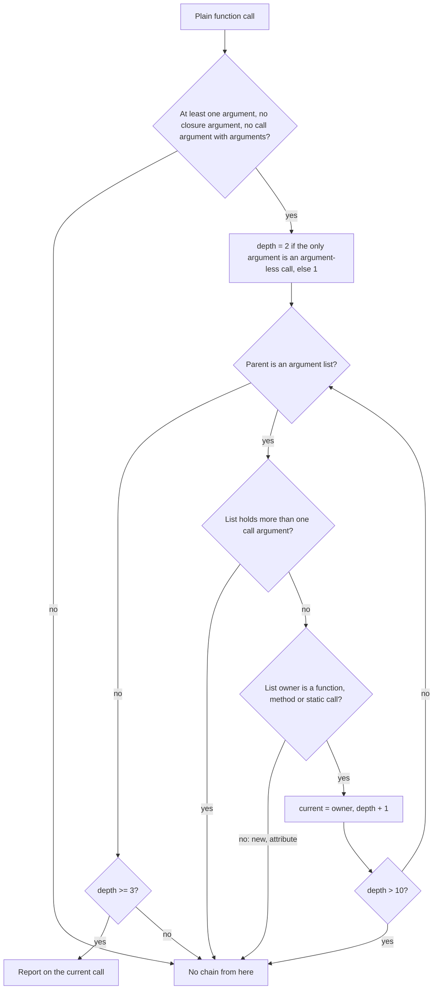
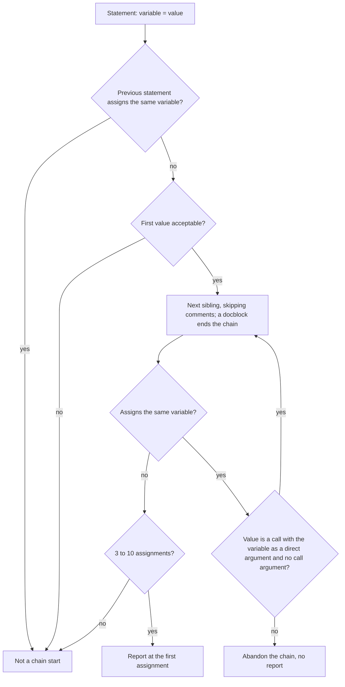
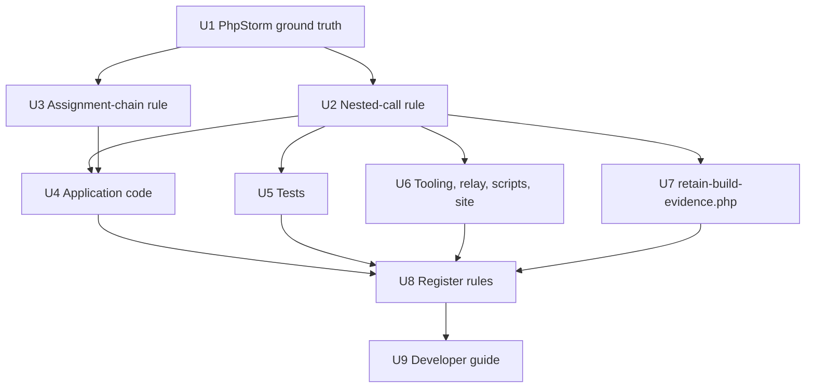

# Pipe Operator Inspection Check - Plan

## Goal Capsule

- **Objective:** The owner's PhpStorm shows no "can be replaced with a pipe operator" warning in Baander's first-party PHP. A change that would bring one back fails `make ci` and CI before it reaches `master`.
- **Means:** Two PHPStan rules that report exactly what PhpStorm's inspection reports (KTD1 to KTD4), and a one-time conversion of every current finding in one house shape (KTD5 to KTD7).
- **Product authority:** The Product Contract below. Its Key Decisions record what the owner chose. The Planning Contract's KTDs decide the mechanism inside those constraints.
- **Execution profile:**
  - One pull request, built with `ce-work` on the branch `refactor/pipe-operator-inspection-check`, cut from `master` at `d49e4d5c6` or later. Units land as local commits. Push only when the owner asks (AGENTS.md).
  - The rules are built first and registered last (KTD8), so every commit keeps `make ci` green.
  - The conversion units can run as parallel workers on disjoint file sets. Each worker runs its checks in its own worktree, because the container runners snapshot the whole working tree, half-finished edits from other workers included. The lead runs the authoritative gates one at a time and commits by area.
  - The briefs for `ce-simplify-code` and `ce-code-review` state that the hoisted locals exist because of the rule. A pass that inlines them recreates findings. The briefs also name the hand-review lists from KTD7.
  - Source, tests and comments never cite this plan's IDs (AGENTS.md).
- **Stop conditions:**
  - Stop and ask if U1 cannot run PhpStorm's inspection and the owner cannot run it either. The claim that the rules match the IDE rests on that run.
  - Stop and re-plan if U1 shows PhpStorm disagreeing with the emulation on shapes other than the 63 listed in KTD4. That would mean the walk itself was read wrongly.
  - Stop and ask if a finding cannot be fixed without changing behaviour or adding a PHPStan ignore.
  - Stop if a conversion would touch `packages/swoole-bundle` or a generated file.
- **Open blockers:** None.
- **Finish:** `ce-work` implements the units, runs `ce-simplify-code` after the conversion and `ce-code-review` before shipping, applies justified findings, and records the delivered items and the verification checkpoint in `ROADMAP.md`.

---

## Product Contract

### Summary

Two PHPStan rules in `packages/baander-phpstan-rules` report what PhpStorm 2026.3's pipe-operator inspection reports, for both of its messages, and both PHPStan configurations run them. A one-time conversion fixes the 573 nested-call findings and the one assignment chain on the tree today. Each becomes a pipe, a named local, or a small helper where a local would change evaluation.

### Problem Frame

The owner asked on 2026-11-14 and again on 2026-11-25 for PhpStorm's "Nested function calls can be replaced with a pipe operator" findings to be fixed. Both passes converted two-level calls such as `bin2hex(random_bytes(4))`, following an agent's reading of the inspection. PhpStorm 2026.3.0.1 (build 263.7307.352) reports only chains of three or more levels (`MIN_DEPTH = 3` in `PhpPipeOperatorCanBeUsedInspection`), and it never flags two-level calls. The passes therefore removed almost nothing the owner sees. On `d49e4d5c6` an emulation of the inspection finds 573 findings in 369 files, plus one chain of assignments. No check exists, so new code brings findings back unnoticed.

### Key Decisions

- **Match PhpStorm's inspection exactly.** (session-settled: user-directed — chosen over the two-level shape and over both shapes together: the goal is that the IDE stops reporting, and it never reports two-level calls.) Governs R1, R2, R6, R9.
- **Cover the assignment-chain message as well.** (session-settled: user-directed — chosen over the nested-call message only: the whole inspection should find nothing.) Governs R3, R6.
- **Fix multi-argument steps with a named local, or with a helper where a local would change evaluation, not with PhpStorm's quick fix.** (session-settled: user-approved — chosen over the quick fix's untyped `fn($x)` steps, which swallow the outer assertion and can drop a by-reference write.) Governs R7.

### Requirements

**Detection**

- R1. A PHPStan rule reports every nested-call chain that PhpStorm 2026.3's inspection reports with "Nested function calls can be replaced with a pipe operator", once, on the outermost call, and nothing else (KTD2).
- R2. Two-level calls, pipes, and chains whose top argument list belongs to `new` or an attribute are not reported.
- R3. A second rule reports each chain of three to ten consecutive assignments that PhpStorm reports with "Chain of assignments can be replaced with a pipe operator", once, at its first assignment (KTD3).
- R4. Both PHPStan configurations run both rules, so `make phpstan`, `composer analyse:tooling`, `make ci` and CI fail on a new finding in any path either configuration analyses.
- R5. Each error carries PhpStorm's message, an identifier in the house form, and a tip that points to the developer guide's pipe section.

**Conversion**

- R6. After the conversion both rules report zero findings on the tree, including the ten findings in files that neither configuration analyses.
- R7. Each finding is fixed in the house shape (KTD5): pipe stages for single-argument levels, a named local where a step takes several arguments, and a helper or a statement-bodied closure where a local would change whether or when a value is computed.
- R8. The conversion changes no behaviour. It is proved by an AST round trip, a placement and name check, hand review of the listed sites, and the existing suites (KTD7).
- R9. Two-level calls, pipes outside a reported chain, `packages/swoole-bundle` and generated files keep their form.

**Documentation**

- R10. The developer guide states the house shapes, warns against PhpStorm's quick fix for multi-argument steps, says how an `assert` chain is fixed, and gives the parity check against PhpStorm.

### Success Criteria

- PhpStorm's Inspect Code with this inspection reports nothing outside `packages/swoole-bundle` and the rules' own fixture data. U1's run is repeated at the end, or the owner runs it in the IDE.
- In each configuration, a scratch file with a three-level chain makes the PHPStan run fail with the rule's identifier (the negative control in U8).

### Scope Boundaries

- Two-level calls stay nested, including the 1,500 or so `bin2hex(random_bytes(...))`-style calls. Pipes written by the 2026-11-25 pass stay as they are.
- Other PHP 8.5 forms (`array_first`/`array_last`, `new Foo()->x`, enums) are outside this plan.
- `packages/swoole-bundle` is an upstream fork compared by file hash (`packages/swoole-bundle/upstream-review.json`). PhpStorm will keep showing its 3 findings.
- PHP inside string literals (`php -r` bodies, generated harness files) is left alone. 322 nested-call texts sit in strings, and neither the rules nor the conversion see them.
- Generated and recipe files keep their form: `config/bundles.php`, `config/reference.php`, `config/preload.php`, `public/index.php`, `bin/console` and `bin/phpunit`.
- Considered and not built:
  - **A committed conversion tool.** The conversion runs once; the rules are the durable check. A tool would only earn its place if a second whole-tree conversion became likely, for example after a PhpStorm upgrade lowered `MIN_DEPTH`.
  - **Widening PHPStan coverage to the unanalysed paths** (`bin/`, `config/`, `migrations/`, `ui/site`, `docs/optimize`, the excluded scripts and the rule package's own source). The ten findings there are converted once and not watched. Widening the coverage is a separate change with its own findings. It becomes worth doing if findings reappear in those files.
  - **An inspection-profile scope in `.idea/inspectionProfiles/Project_Default.xml`** that hides the swoole-bundle findings and the fixture data from PhpStorm. The profile is the owner's IDE configuration. The owner can add the scope if the leftover warnings bother them.
  - **Automatic detection of PhpStorm drift.** The rule docblocks name the build they mirror, and the developer guide holds the parity command (R10). Automation becomes worth it if Toolbox upgrades change the inspection more than once.

### Outstanding Questions

None block the work. U1 settles the five shapes in KTD4 before the rule fixtures are frozen.

---

## Planning Contract

### Key Technical Decisions

- KTD1. **Two `PHPStan\Node\FileNode` rules, one per PhpStorm message** (instantiates the first two Key Decisions; governs R1 to R3). In PHPStan 2.3.7 a rule on `FuncCall`, `MethodCall` or `StaticCall` sees no parent, so it cannot tell the outermost call of a chain or an argument list owned by `new`. `FileNode` is `@api`. It hands over the statements after `RichParser` has turned pipes back into `BinaryOp\Pipe`, so the rules never see PHPStan's virtual pipe calls and never depend on the undocumented `virtualPipeOperatorCall` attribute. Each rule builds a private parent map. It must not run `ParentConnectingVisitor` on PHPStan's shared nodes. A probe `FileNode` rule reported exactly the expected lines under PHPStan 2.3.7. The identifiers are `baander.pipeOperator.nestedCalls` and `baander.pipeOperator.assignmentChain`, and each docblock names the inspection class and build 263.7307.352 it mirrors.

- KTD2. **The nested-call walk mirrors the bytecode of `PhpPipeOperatorCanBeUsedInspection`.**
  1. A walk starts only at a plain function call. Variable callables such as `$f($x)` count.
  2. The starting call needs at least one argument. It is rejected when any argument is a closure or arrow function, or a call that itself has arguments.
  3. Depth starts at 2 when the call's only argument is an argument-less call, otherwise at 1.
  4. The walk climbs to the enclosing call while the current call sits in an argument list. It stops without reporting when that list holds more than one call argument, or when the list's owner is not a function, method or static call (`new`, an attribute).
  5. When the current call's parent is not an argument list, the rule reports the current call if depth is 3 or more.
  6. Chains deeper than 10 are never reported.
  7. There is no function-name list, no by-reference check, no argument-count check at enclosing levels, and no requirement to sit inside a function. A pipe used as an argument does not reset the depth above it.

- KTD3. **The assignment-chain walk mirrors the same class.**
  1. A chain starts at a plain `=` statement whose previous statement does not assign the same variable. Compound assignments never start a chain.
  2. The first value may not be a closure. If it is a call, it may not have a call argument or the variable itself as an argument.
  3. The chain continues through following statements that assign the same variable. A `//`, `#` or `/* */` comment is skipped; a `/** */` docblock ends the chain.
  4. A continuation whose value is not a call, or whose call has a call argument or lacks the variable as a direct argument, abandons the whole chain with no report.
  5. A different statement ends the chain, and the chain is reported when it has 3 to 10 assignments.
  6. One error is reported per chain, at its first line. PhpStorm marks every assignment.

- KTD4. **Where PhpStorm's PSI and php-parser may differ, the rules follow what U1 observes in the IDE.** The emulation infers five shapes:
  - `exit(...)` as a level: 17 entry-script lines such as `exit(Cli::main(array_slice($_SERVER['argv'], 1)))` at `scripts/dev-environment.php:18`;
  - first-class-callable arguments: 11 levels, e.g. `src/Auth/Interface/Console/CreateUserCommand.php:70`;
  - named or spread call arguments: 19;
  - variable-callable levels: 16;
  - a statement-level `/** */` docblock between assignments.

  Each shape gets a fixture whose expected result is the IDE's. If U1 shows PhpStorm reporting the `exit` lines, the conversion count grows by those sites.

- KTD5. **The house shape for fixing a finding** (governs R7; R10 documents it). Apply in this order:
  1. Every single-argument level becomes a pipe stage with a first-class callable: `trim(...)`, `self::read(...)`, `$this->path(...)`.
  2. A two-level head may stay nested, for example `implode(', ', array_column($rows, 'k'))`, with the outer single-argument levels piped after it.
  3. Where a chain still reaches three levels, hoist values into named locals before the statement, from the innermost outward, until the chain is under three levels. A name says what the value holds, as in `$json = file_get_contents($p); $this->assertSame(1, json_decode($json, true));`.
  4. Never make a one-stage pipe in an argument position just to break the chain, such as `json_decode($p |> file_get_contents(...), true)`.
  5. Where hoisting is unsafe under KTD6, use a named private helper or a closure with a statement body. A typed `static fn` pipe step is the last resort. Never use the quick fix's untyped, non-static `fn($x)`.
  6. A pipe inside concatenation, under `!`, a cast or array access is parenthesised, as the existing pipes are.

  An `assert` chain is fixed by hoisting only when the operand is cheap and pure. Otherwise it gets an explicit check and throw. Production runs with `zend.assertions=-1` (`Dockerfile:639`), which compiles out the nested form, while a pipe or a local would evaluate the operand. The tree has no `assert` chain today.

- KTD6. **A hoist is allowed only when it keeps evaluation the same.** The hoisted expression must:
  - run exactly once, unconditionally, and before any other call or write in the statement;
  - not sit in a loop condition, an `elseif` condition, an arrow function, a ternary branch, the right operand of `&&`, `||` or `??`, or a `match` arm;
  - use a name not otherwise used in the function scope. In templates the scope includes the files shared through `include`: `ui/site/templates/typography.php` shares its symbol table with `head.php`, `header.php` and the `WebsiteBuilder` scope.

  An object-valued hoist, where a destructor would now run later, goes to the lead's review list. The research probe found 16 sites that need a helper and 24 hoists that would reorder a call. Both counts came from bottom-up ordering and are recounted under KTD5. Both template echoes in `typography.php` clear with pipes alone.

- KTD7. **Behaviour is proved four ways** (governs R8):
  1. An AST round trip per converted file: inline each hoisted local, fold pipes back into calls, and compare with the base revision.
  2. A placement and name check for every hoist under KTD6. The round trip cannot see where a hoist lands or what name it takes.
  3. Hand review of three lists: helper and closure sites, reordering sites, object-valued hoists.
  4. The existing suites for the touched areas.

  The conversion tooling stays out of the tracked tree. It lives where it survives the work; the session scratchpad does not qualify. It builds on php-parser 5.9.0's format-preserving printer with three guards: parenthesise a new arrow function on the right of `|>`, keep an argument's `unpack` flag (8 chains hold spread arguments), and never hoist into a file with `InlineHTML`.

- KTD8. **The rules are registered last.** U2 and U3 build and test the rules without registering them, and each conversion unit runs them through a scratch configuration that includes a repository configuration and registers both rules. For the files that neither configuration analyses, it also names those paths and clears `excludePaths`. U8 registers the rules once the tree reports zero, so no commit leaves `make ci` red. Acceptance is zero findings on the rebased tip, not the 573 count. `master` moves while the work runs.

- KTD9. **`phpstan-tooling.neon` includes `vendor/baander/phpstan-rules/extension.neon` and gets its own `tmpDir`, `var/cache/phpstan-tooling`.** Today it has neither. Without the include the rules miss 94 tooling-package findings and the relay and script code. Without a `tmpDir`, runs from several checkouts share `/tmp/phpstan`, the hazard `phpstan.dist.neon:8-10` describes, and the two configurations would overwrite each other's result cache if they shared one directory.

- KTD10. **Package metadata follows the rules' needs.** `packages/baander-phpstan-rules/composer.json` moves to `php: >=8.5` and `phpstan/phpstan: ^2.3`, like the other first-party packages, and the lock entry for the path package is refreshed.

### High-Level Technical Design

The nested-call walk (KTD2) for one starting call:

The assignment-chain walk (KTD3) from a starting statement:

### Sequencing

U4 to U7 touch disjoint files and can run in parallel. U7 is its own commit because it invalidates the native Docker build stages.

### System-Wide Impact

- Every contributor and agent writing PHP meets the rules in `make ci` and CI. The tip and the developer guide section tell them the house fix.
- `make ci` and CI keep their current steps; the new findings arrive through the existing PHPStan steps.
- Changing `scripts/retain-build-evidence.php` invalidates the `COPY` layers at `Dockerfile:163`, `296`, `339` and `383`. That forces one rebuild of liburing, the eight PECL extensions, Swoole and the TSDuck evidence step for every preview and CI image.

### Risks

| Risk | Mitigation |
| --- | --- |
| The IDE models a shape differently from the emulation (KTD4) | U1 runs the IDE's own inspection before fixtures are frozen; the rules follow the IDE |
| A PhpStorm upgrade changes the inspection | Docblocks name the mirrored build; the parity command in the developer guide (R10) shows drift after an upgrade |
| A PHPStan upgrade changes `FileNode` contents or pipe reversal | Fixtures pin pipes in every form, so an upgrade that changes them fails the rule tests |
| A hoist changes evaluation and the round trip passes | The KTD6 placement and name check, plus hand review of the three lists |
| The rules load in neither configuration, and the gate passes anyway (a worktree whose `vendor/` links to the main checkout resolves the main checkout's package) | U8's negative control runs each configuration against a scratch chain and requires a failure with the rule's identifier |
| A pipe step drops a by-reference write | KTD5 forbids arrow steps except as a last resort. Four sites have a by-reference argument beside a chain argument: `src/Shared/Infrastructure/LogViewer/Agent/DockerRecords.php:50`, `src/Transcode/Infrastructure/FFmpeg/HardwareCapabilitiesProber.php:226`, `packages/baander-dev-ci/src/Architecture/SourcePolicy.php:78`, `tests/Functional/Media/AudioStreamTestCase.php:174`. Review them by hand |
| The coverage run exceeds the backend budget (exit 124) | Treat a timed-out lane as not run: rerun its files without coverage and record "passing lanes plus rerun, coverage not measured" (`docs/solutions/developer-experience/coverage-runs-push-the-stack-lanes-past-the-backend-budget.md`) |

---

## Implementation Units

### U1. PhpStorm ground truth

**Goal:** Know what PhpStorm 2026.3.0.1 itself reports, so that the fixtures and the conversion target the IDE rather than the emulation.

**Requirements:** R1, R3 (KTD4).

**Dependencies:** None.

**Files:**
- No tracked files.
- A scratch file holds the five KTD4 shapes, plus a three-level chain and a two-level call as controls.

**Approach:**
- Run `~/.local/share/JetBrains/Toolbox/apps/phpstorm/bin/inspect.sh` with a profile that enables only `PhpPipeOperatorCanBeUsedInspection`. Point it at the scratch file and at the paths the two PHPStan configurations analyse.
- PhpStorm is running. Give the headless run its own configuration and system directories so it does not collide with the IDE; if that fails, ask the owner to run Inspect Code.
- Compare the result with the emulation's 573 findings and one chain, shape by shape, and record the result for each KTD4 shape.

**Test expectation:** none -- this unit is a measurement. Its output is the baseline the rule fixtures and U8's parity check use.

**Verification:**
- `packages/baander-deployment/src/Workers/Lifecycle.php:48` is reported.
- `packages/baander-configuration/tests/InvocationConfigurationTest.php:16` is not.
- Each KTD4 shape has a recorded IDE result.

### U2. Nested-call rule

**Goal:** A tested `FileNode` rule that reports what the nested-call branch reports.

**Requirements:** R1, R2, R5 (KTD1, KTD2, KTD4, KTD10).

**Dependencies:** U1.

**Files:**
- Create: `packages/baander-phpstan-rules/src/Rules/NestedCallPipeOperatorRule.php`.
- Create: `packages/baander-phpstan-rules/tests/Rules/NestedCallPipeOperatorRuleTest.php`.
- Create: fixture files under `packages/baander-phpstan-rules/tests/Rules/data/`.
- Modify: `packages/baander-phpstan-rules/composer.json`, `composer.lock`.

**Approach:**
- Follow `MapRequestPayloadObjectTypeRule` and its `RuleTestCase` test, with parsed-source fixtures in `tests/Rules/data/`.
- The rule is not added to `extension.neon` here (KTD8).
- The message is PhpStorm's text. The tip points to the developer guide's pipe section, which U9 writes.
- The fixtures keep their nested calls on purpose. The conversion units skip `tests/Rules/data/`.

**Patterns to follow:** `packages/baander-phpstan-rules/src/Rules/MapRequestPayloadObjectTypeRule.php`, `packages/baander-phpstan-rules/tests/Rules/MapRequestPayloadObjectTypeRuleTest.php`, `packages/baander-phpstan-rules/tests/Rules/rules-test.neon`.

**Test scenarios:**
- `array_values(array_unique(array_column($rows, 'k')))` gives one error, on the line of `array_values`, with the identifier `baander.pipeOperator.nestedCalls`.
- `$this->assertSame(1, json_decode(file_get_contents($p), true))` gives one error, on the `assertSame` line.
- A static call on top (`self::rolesFor(array_values(array_unique($x)))`) gives one error.
- A depth-5 chain gives exactly one error, on its outermost call.
- `strtoupper(trim(getenv()))`: an argument-less innermost call counts as a level, so it is reported.
- `bin2hex(random_bytes(4))` is not reported.
- `random_bytes(4) |> bin2hex(...)` and a multi-stage pipe with a `static fn` step are not reported.
- `strtoupper(strtolower(trim($s |> ltrim(...))))` is reported: a pipe used as an argument does not reset the depth.
- A chain whose innermost call takes a closure (`a(b(array_filter($x, fn ($v) => $v)))`) is not reported.
- `f(g(h($x)), k($y))` is not reported: the list holds two call arguments.
- `new Foo(a(b(c($x))))` is not reported: the top list belongs to `new`.
- A chain inside an attribute argument is not reported.
- A depth-10 chain is reported. A depth-11 chain is not.
- Top-level script code and a template file with `InlineHTML` are reported like code inside functions.
- One fixture per KTD4 shape (`exit(...)`, a first-class-callable argument, named and spread arguments, a variable-callable level) expects what U1 recorded for the IDE.
- An `assert(is_array(json_decode(file_get_contents($p), true)))` chain is reported: the inspection has no function-name list.

**Verification:** The `StaticAnalysisRules` suite passes. Run through a scratch configuration on `d49e4d5c6`, the rule lists the same sites as U1's baseline.

### U3. Assignment-chain rule

**Goal:** A tested `FileNode` rule that reports what the assignment-chain branch reports.

**Requirements:** R3, R5 (KTD1, KTD3, KTD4).

**Dependencies:** U1.

**Files:**
- Create: `packages/baander-phpstan-rules/src/Rules/AssignmentChainPipeOperatorRule.php`.
- Create: `packages/baander-phpstan-rules/tests/Rules/AssignmentChainPipeOperatorRuleTest.php`.
- Create: fixture files under `packages/baander-phpstan-rules/tests/Rules/data/`.

**Approach:** The same structure as U2: not registered, PhpStorm's message, a tip to the guide section. The walk covers every statement list, both function and closure bodies and top-level code.

**Patterns to follow:** U2.

**Test scenarios:**
- Three assignments `$s = trim($s); $s = strtolower($s); $s = ucfirst($s);` give one error, at the first line, with the identifier `baander.pipeOperator.assignmentChain`.
- Two such assignments are not reported. Ten are reported. Eleven are not.
- A `//` comment between two assignments keeps the chain. A `/** */` docblock ends it, with the result U1 recorded.
- A chain that starts with `$s .= 'x'` is not a chain start.
- A continuation `$s = 'literal';` abandons the chain with no report, even after three calls.
- A continuation whose call does not take the variable as a direct argument abandons the chain.
- A first value that is a call with a call argument is not a chain start.
- An assignment to a different variable after three calls ends the chain, and the chain is reported.
- A chain inside a closure body and a chain at the top level of a script are both reported.

**Verification:** The `StaticAnalysisRules` suite passes. Through a scratch configuration on `d49e4d5c6`, the rule reports exactly `src/Catalog/Domain/Service/TitleNormalizer.php:50`.

### U4. Convert application code

**Goal:** Zero findings in `src/` and the application packages.

**Requirements:** R6, R7, R8, R9 (KTD5, KTD6, KTD7).

**Dependencies:** U2, U3.

**Files:** The files with findings under `src/`: 91 findings in 72 files, including `src/Catalog/Domain/Service/TitleNormalizer.php`. Also `packages/baander-media-metadata` (15) and `packages/baander-image-processing` (3).

**Approach:**
- Convert in the KTD5 shape. The `TitleNormalizer` chain folds its single-argument steps into a pipe, and its first assignment gets its own name.
- Keep the conversion tooling and its guards (KTD7).
- Review the by-reference sites in `src` by hand: `DockerRecords.php:50` and `HardwareCapabilitiesProber.php:226`.
- Commit by area: application code.

**Test expectation:** none -- the conversion preserves behaviour. KTD7's round trip and the existing suites prove it; no new behaviour is added.

**Verification:**
- The rules report zero on these paths through the scratch configuration.
- The round trip and placement checks pass; the three review lists are read.
- The application PHPStan configuration, `composer check:imports` and the Unit, Functional and Integration runs covering these files pass.

### U5. Convert tests

**Goal:** Zero findings in `tests/`.

**Requirements:** R6, R7, R8, R9 (KTD5, KTD6, KTD7).

**Dependencies:** U2.

**Files:** The files with findings under `tests/Unit` (199 findings, 107 files), `tests/Integration` (72, 47), `tests/Functional` (39, 29), `tests/Fixtures` (33, 23) and `tests/Support` (5, 5).

**Approach:**
- Most findings end in an assertion (`->assertSame` 145, `->assertCount` 16). They get a local named for the actual value, so the assertion keeps its shape.
- `tests/Unit/Shared/Infrastructure/Http/NativeDnsResolverRuntimeTest.php:78` pipes a `glob()` result that can be false into `count(...)`. Handle the false result explicitly.
- `tests/Functional/Media/AudioStreamTestCase.php:174` passes `exec(..., $output, $code)` by reference beside the chain. Review it by hand.
- The fixture scripts under `tests/Fixtures` run as separate processes; keep their `declare(strict_types=1)` first.

**Test expectation:** none -- the conversion preserves behaviour (KTD7). The converted tests must still pass, and must still fail on the regressions they guard.

**Verification:**
- The rules report zero on `tests/`.
- The round trip and placement checks pass.
- The full backend suite passes (`bash scripts/test-backend-container.sh`).
- The application PHPStan configuration and `composer check:imports` pass.

### U6. Convert tooling, relay, scripts and the site template

**Goal:** Zero findings in the tooling packages, `relay/`, `scripts/` (apart from U7), `ui/site` and the rule package's own source.

**Requirements:** R6, R7, R8, R9 (KTD5, KTD6, KTD7).

**Dependencies:** U2.

**Files:**
- The files with findings in the tooling packages: 94 findings in 63 files, mostly `baander-dev-qualification`, `baander-dev-environment`, `baander-deployment` and `baander-dev-website`.
- `relay/tests` and `relay/tools`: 10 findings.
- `scripts/`: 3 findings outside `scripts/retain-build-evidence.php`.
- `ui/site/templates/typography.php:18,85,101`.
- `packages/baander-dev-qualification/resources/qualification/generate.php:109`, one of the 94 tooling-package findings, named here because neither configuration analyses it.
- `packages/baander-phpstan-rules/src/Rules/ConsistentOpenApiTagDescriptionRule.php:59`.
- In total 111 findings: with U4's 109, U5's 348 and U7's 5, the 573 on `d49e4d5c6`.

**Approach:**
- The two `typography.php` echoes clear with pipes alone (KTD6). Check any hoist there against the scope shared through `include`.
- `packages/baander-dev-ci/src/Architecture/SourcePolicy.php:78` has a by-reference `array_push` beside the chain. Review it by hand.
- `packages/baander-dev-qualification/src/Fixtures/Worker/Containment.php:81` already holds a pipe inside a reported chain.
- Run the tooling source policy on this batch. Its exceptions match literal source text.
- The findings in files that neither configuration analyses are checked with a scratch configuration that names those paths (KTD8).

**Test expectation:** none -- the conversion preserves behaviour (KTD7).

**Verification:**
- The rules report zero on these paths.
- `composer check:tooling-architecture`, `composer check:tooling-format`, `composer check:imports` and the tooling PHPStan configuration pass.
- `composer test:tooling` passes for the touched packages.
- The site build (`make website-build`) still renders `typography.php`.

### U7. Convert `scripts/retain-build-evidence.php`

**Goal:** Zero findings in the build-evidence script, in a commit that names the native rebuild it causes.

**Requirements:** R6, R7, R8 (KTD5, KTD6, KTD7).

**Dependencies:** U2.

**Files:** `scripts/retain-build-evidence.php` (lines 148, 151, 197, 215, 247).

**Approach:** This is a separate commit, because the `Dockerfile` copies this script before the native builds (System-Wide Impact). The base image is `php:8.5.12-zts`, so pipes parse there.

**Test expectation:** none -- the conversion preserves behaviour. `packages/baander-images/tests/RetainBuildEvidenceTest.php` covers the script.

**Verification:** The rules report zero on the file through a scratch configuration that names it. `RetainBuildEvidenceTest` passes. A CI image build from the commit completes.

### U8. Register the rules in both configurations

**Goal:** Both PHPStan configurations enforce both rules.

**Requirements:** R4 (KTD8, KTD9).

**Dependencies:** U4, U5, U6, U7.

**Files:**
- Modify: `packages/baander-phpstan-rules/extension.neon`.
- Modify: `phpstan-tooling.neon`.

**Approach:**
- Add both rules to `extension.neon`. Add the extension include and `tmpDir: var/cache/phpstan-tooling` to `phpstan-tooling.neon`.
- Rebase on the current `master` and convert any findings that arrived since `d49e4d5c6`. Acceptance is zero on the rebased tip.

**Test scenarios:**
- With a scratch file holding a three-level chain inside an analysed path, `make phpstan` fails and names `baander.pipeOperator.nestedCalls`. The tooling configuration fails the same way on a scratch file inside a tooling path.
- The same negative control with a three-assignment chain names `baander.pipeOperator.assignmentChain` in both configurations.
- On the converted tree, both configurations pass.

**Verification:**
- The negative controls fail as expected, and the scratch files are removed afterwards.
- `make ci` passes on the rebased tip.
- U1's inspection run, repeated on the tip, reports nothing outside `packages/swoole-bundle` and the rule fixture data.

### U9. Developer guide

**Goal:** A developer who meets the rule finds the house fix, the warning about the quick fix, and the parity check in one place.

**Requirements:** R5, R10.

**Dependencies:** U8.

**Files:**
- Modify: `docs-book/part-2-developer-guide/development/coding-conventions.md` (a new "Pipe operator" section).
- Modify: `docs-book/part-2-developer-guide/testing/README.md`, whose `make ci` description omits the imports and tooling steps that `make ci` now runs.

**Approach:**
- The section states the KTD5 shapes with one example each, the KTD6 placement rule, and the `assert` note.
- It warns that PhpStorm's quick fix wraps multi-argument steps in untyped `fn($x)` steps, swallows the outer assertion, and can drop a by-reference write. Use the house shape instead.
- It says that a docblock between assignments only hides a chain.
- It gives the parity check: run `inspect.sh` with a one-inspection profile and compare it with PHPStan's JSON output filtered by the two identifiers, after a PhpStorm or PHPStan upgrade.
- The rule tips link to this section's anchor.
- Run `prose-fix` on the changed prose.

**Test expectation:** none -- documentation.

**Verification:**
- `make website-build` passes, so the links and the anchor resolve.
- The `prose-fix` audit is clean.
- The `make ci` description matches the Makefile.

---

## Verification Contract

| Gate | Command | When |
| --- | --- | --- |
| CI image present | `DOCKER_CONTEXT=default docker images` shows the image passed as `BAANDER_TEST_IMAGE`; rebuild it if missing | Before the first gate |
| Rule tests | `bash scripts/test-backend-container.sh --testsuite Unit,StaticAnalysisRules` | U2, U3, U8 |
| Rules on a batch | PHPStan with a scratch configuration that includes `phpstan.dist.neon` or `phpstan-tooling.neon` and registers both rules (KTD8) | U4 to U7 |
| Application PHPStan | `make phpstan` (with `BAANDER_TEST_IMAGE` and `DOCKER_CONTEXT=default`) | U4, U5, U8 |
| Tooling PHPStan | `php scripts/check-backend-container.php --image "$BAANDER_TEST_IMAGE" -- php vendor/bin/phpstan analyse --configuration phpstan-tooling.neon --memory-limit=1G --no-progress` | U6, U7, U8 |
| Imports, format, source policy | `composer check:imports`, `composer check:tooling-format`, `composer check:tooling-architecture` | U4 to U8 |
| Backend suites | `bash scripts/test-backend-container.sh` (a timed-out coverage lane is rerun without coverage, per Risks) | U4, U5, final |
| Tooling suite | `composer run-script --timeout=7200 test:tooling` | U6, U7, final |
| Site build | `make website-build` | U6, U9 |
| Full local gate | `make ci` | U8, final |
| IDE parity | `inspect.sh` with the one-inspection profile from U1 | U1, U8 |

---

## Definition of Done

- Both rules are registered in both PHPStan configurations, and the negative controls fail with the right identifiers.
- Both rules report zero findings on the rebased tip, including the files that neither configuration analyses.
- PhpStorm's inspection, run headless or by the owner, reports nothing outside `packages/swoole-bundle` and the rule fixture data.
- Every converted file passes the round trip and the placement and name check. The helper, reordering and object-hoist lists have been reviewed.
- `make ci` and the tooling suite pass.
- The developer guide section exists and the rule tips link to it.
- No experimental code or conversion tooling is left in the tracked tree.
- `ROADMAP.md` records the delivered items and the verification checkpoint: findings per rule on the tip, the negative-control results, the round-trip and placement counts, the PHPStan errors fixed in place, and the suite counts.
