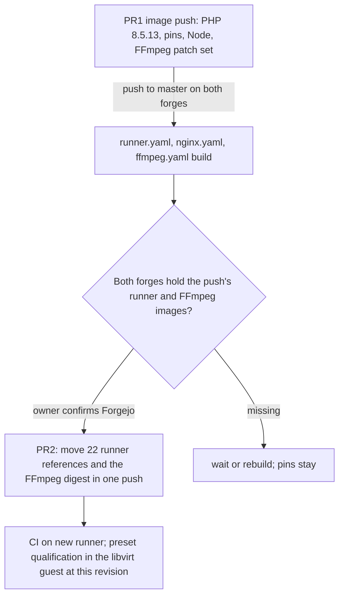
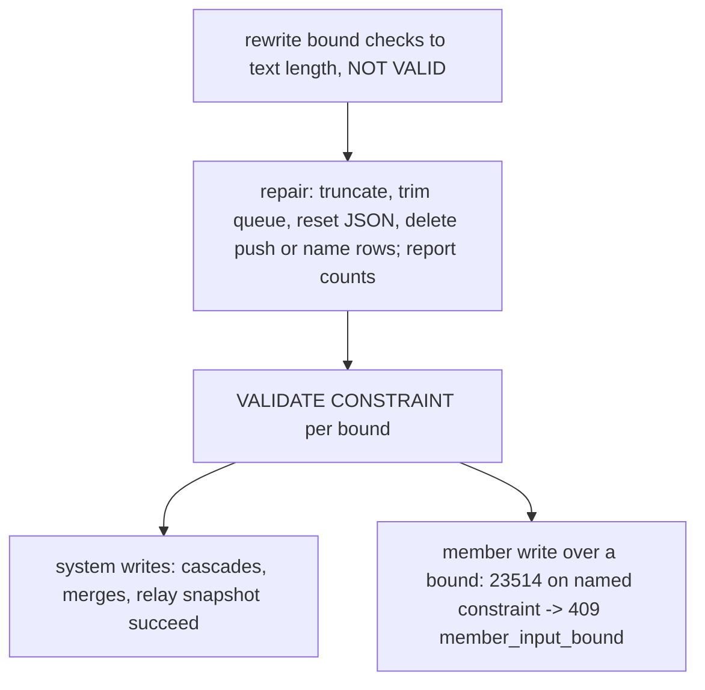
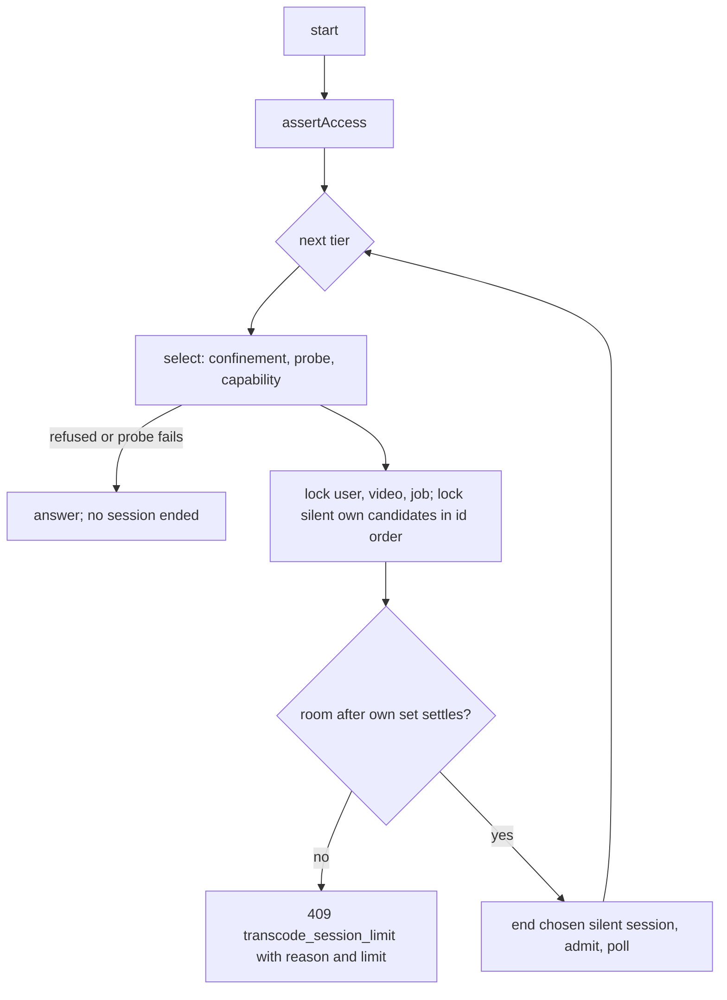

# Roadmap Open Items After the Security Audit - Plan

## Goal Capsule

- **Objective:** GitHub CI on `master` passes (a step stays red only for a recorded external cause), the API answers a definite status where the audit found 500s or wrong shapes, and the roadmap's open list holds only items that need a live environment or an owner decision.
- **Means:** fix each open item from the four selected roadmap groups with a test, or close it with a recorded finding where a fix is out of reach (KTD1).
- **Authority:** AGENTS.md and the rules it names, then this plan's Product Contract, then its Key Technical Decisions. Where code contradicts a requirement, stop and ask; do not reinterpret the requirement.
- **Stop conditions:** stop and ask the owner before removing or narrowing any capability not named in Key Decisions, before changing any API contract beyond R9–R17, if the repair migration (U10) would change more rows than its rehearsal reported, or if a fix needs a change under `packages/swoole-bundle/src` without a reviewed hash update.
- **Execution profile:** one branch named after this plan, delivered in two groups (PR1, PR2 under Implementation Units). Inside PR1, the image-input push (U3's commit with U4 and U5) goes to `master` on both forges first so the runner, nginx and FFmpeg images build while the rest proceeds. Units land as local commits; push follows the owner's standing instruction for this fix series.
- **Who finishes:** `ce-work` implements and verifies; the owner confirms the Forgejo registry tags before PR2.

---

## Product Contract

### Summary

Close the open items the owner selected from ROADMAP.md on 2026-11-26: unblock CI, refresh the drifted image pins and the PHP runtime, harden the FFmpeg and registry builds, fix the audit's behaviour gaps with the contracts the owner approved, add the missing tests, and run the checks that can run locally. Items that cannot be fixed here end as recorded findings with their evidence.

### Problem Frame

The 2026-11-24 security audit closed its findings but left an open list in ROADMAP.md: behaviour gaps with known causes, supply-chain gaps, and tests that were never written or never run. The fixes of 2026-11-26 (VAPID, the website tests, Symfony 8.1.12, the two-command drill) added a few more. Several items keep CI red: the scheduled dependency workflow reports six drifted base images and Docker Hub rate limits, the proxy test image no longer builds because Alpine moved to PHP 8.5.13, and the quality gate fails intermittently at the Matroska movie-origin step, which stops every later step, PHPUnit included. Others answer 500 where a member's request has a definite answer, or leak an administrator's email into logs. Until these close, a red CI run says nothing new, and the roadmap mixes real blockers with routine work.

### Key Decisions

- **Refused tracks answer 409 on every route.** A track whose path escapes its library answers 409 "Playback media is unavailable." on delivery, signed-original and legacy stream routes. Governs R10. (session-settled: user-approved — chosen over keeping 500 on delivery and 403/404 elsewhere: one answer for one condition)
- **Over-bound rows are repaired in place and the bounds validated.** Governs R6, R7, R8. (session-settled: user-approved — chosen over a 409-only fix with a recorded residual: system writes such as cascades, merges and the relay tick cannot answer 409)
- **Updating a row over a member-input bound answers 409.** Governs R9. (session-settled: user-approved — chosen over leaving the 500)
- **Lists refuse an out-of-range limit instead of clamping it, and the web app reads every page.** Governs R11, R12. (session-settled: user-approved — chosen over keeping the silent clamp)
- **The recommendation POST returns the 201 and created recommendation its docs promise.** Governs R13. (session-settled: user-approved — chosen over changing the docs to match the message body)
- **Original Ogg Opus files are served as `audio/ogg`.** Governs R16. (session-settled: user-approved — chosen over keeping `audio/opus`: RFC 7845 registers `audio/ogg`)
- **PHP moves from 8.5.12 to 8.5.13 in every image together.** Governs R1. (session-settled: user-approved — chosen over patching only the nginx test image)
- **rav1e and zix build for a portable x86-64 baseline and stay in the FFmpeg build.** Governs R4. (session-settled: user-directed — chosen over dropping both libraries or keeping `-march=native`)
- **The image-drift check retries Docker Hub 429s and the workflow logs in only when secrets exist.** Governs R3. (session-settled: user-approved — chosen over retry-only and over a mandatory login)
- **The preset qualification runs in the libvirt guest; the worker load proof stays blocked.** Governs R24. (session-settled: user-directed — chosen over disabling host swap and over running the 12-CPU load drill on this workstation)
- **Native build items may end as findings.** The registry's GCC 16 warnings and ZTS harness crash and the FFmpeg nested downloads are investigated; a recorded finding with evidence closes an item the investigation cannot fix. Governs R4, R5. (session-settled: user-approved — chosen over treating them as must-fix)

### Requirements

**CI passes**

- R1. Every image declares PHP 8.5.13, and the proxy test image builds again.
- R2. The six drifted base images (`composer:2.11.1`, `debian:bookworm-slim`, `docker:cli`, `nginx:alpine3.24`, `nginx:alpine`, `nginx:stable-alpine`) are pinned at reviewed current digests.
- R3. The scheduled image-drift step does not fail on a transient Docker Hub 429.
- R20. The Matroska movie-origin step passes reliably, or its failure is traced to a recorded cause with a fix.
- R21. Every CI workflow runs on a runner image built from a revision that contains the supply-chain hardening, and the FFmpeg image it uses is the hardened build.

**Supply chain**

- R4. Every download the FFmpeg build performs is verified against a committed hash or a pinned commit, `cargo-c` is pinned, and no build step targets the build machine's CPU.
- R5. The registry builds without false compiler errors on GCC 16, and its harness either runs in the ZTS image or refuses it with a clear message.
- R22. The production image carries no Node runtime, and no record or script still lists PIE.

**Member data and API answers**

- R6. A member-input bound measures the size a write produces, so a value that passes the bound on disk also passes when rewritten.
- R7. No stored row exceeds a member-input bound, and every bound is validated.
- R8. Catalog and station deletes, album and artist merges, and the playback relay's snapshot write succeed for every stored row.
- R9. A member write that would exceed a member-input bound answers 409 with a reason, not 500.
- R10. A track whose path escapes its library answers 409 on every playback route, and the web player stops with a translated message instead of retrying.
- R11. The song list and the recommendation lists answer 400 for a limit outside their documented range.
- R12. The web app reads every page of a list it needs whole, and stops correctly on a short or empty page.
- R13. The recommendation POST answers 201 with the created recommendation.
- R14. A recommendation generation run replaces only its own rows and completes when a member row or another run holds the same key.
- R15. The activity history answers with paging meta.
- R16. Original media carries the registered media type for its container, and a Matroska file named `.webm` is offered as Matroska.
- R17. A transcode start never ends a user's session without using the room it freed, never counts an expired admission as held, and a session cancel stops its execution; the web player names the session limit when it refuses a start.

**Records and logs**

- R18. Revoked personal access clients are purged on a schedule.
- R19. Logs and audit fields record an administrator by user id, not email.
- R23. Console listings print stored text without terminal control sequences or formatter markup.

**Tests and gates**

- R25. The missing tests the audit listed exist and fail on the defect they guard: the pool reset releases its lock and hands out a fresh instance, the Docker proxy refuses encoded newlines and dot segments, the 409 session-limit body carries its reason and limit, and the registry stops cleanly during startup and during a probe.
- R26. A test fails when either PHPStan configuration stops loading the project's rules.
- R27. The two verified PostgreSQL findings are recorded in the postgres-remediation skill's Doctrine reference.
- R24. The path-encoding browser spec and an original-media browser check run against a preview, and the preset qualification runs in the libvirt guest at the plan's final revision.
- R28. ROADMAP.md records each delivered item with its verification and keeps only open items that need an environment or an owner decision.

### Success Criteria

- The CI run on the final `master` revision passes every quality-gate step, the website workflow and the scheduled dependency workflow, with any remaining red step traced to a recorded external cause.
- `composer check:php-dependencies:local` and the online advisory check report no finding outside the leftover agent worktrees.
- The repair migration's per-constraint counts appear in ROADMAP.md, and a rewrite of every repaired row succeeds after VALIDATE.

### Scope Boundaries

- Not removing the deprecated `ImageConverter`, and no server-side LAN discovery responder.
- The threat models' residual risks and the older "Security review findings" section stay as they are.
- `ui/rn` and Essentia are untouched.
- The worker load proof (8 video and 12 audio jobs) stays recorded as not run.
- Considered and not built: a per-platform image-drift comparison, which would quiet index-only churn but changes the check's contract; the owner can ask for it once recurring churn shows.
- Considered and not built: reserving the generator's strategy names in the recommendation API, which would narrow the API; conflict-tolerant inserts (KTD8) close the race without it.
- Considered and not built: `failOnSkipped` in `phpunit.xml.dist`. CI already passes `--fail-on-skipped` to every lane (`packages/baander-dev-ci/src/Backend/Coordinator.php:117`); the setting would only break direct host and IDE runs.
- Considered and not built: raising `runtimes.php.minimum` to 8.5.13. The pinned `composer:2.11.1` image still embeds PHP 8.5.12, so the online check would report it until the upstream image is rebuilt.

### Outstanding Questions

- Blocking PR2: the owner confirms that the Forgejo registry holds the runner and FFmpeg images for the PR1 image commit (no token is available to check it from here).

---

## Planning Contract

### Key Technical Decisions

- KTD1. **Investigations end in a fix or a finding, never silence.** U1, U5, U7 each end with either a committed fix and its test or a ROADMAP.md entry that states the evidence, the cause found or not found, and what would change it.
- KTD2. **One commit moves every PHP declaration and the image pins that share their files.** The local dependency check reports `runtime-agreement` when declarations disagree, so `Dockerfile`, `docker/runner/Dockerfile`, both relay build scripts, `docker/nginx/Dockerfile.test`, the composer and debian pins, and the `docker:cli` pin in `.github/workflows/runner.yaml` land together. `runtimes.php.minimum` stays at 8.5.12 (see Scope Boundaries).
- KTD3. **Images publish before pins move, on both forges.** Image workflows build only on `master` pushes, so the PR1 image push (U3, U4, U5) goes alone first; the runner pin (22 workflow references) and the FFmpeg digest move only in PR2, after both forges hold the new images. Editing the workflow files in PR2 restarts the FFmpeg, nginx and postgres builds once; PR2 accepts that cost in one push.
- KTD4. **FFmpeg nested downloads are pre-seeded from a committed manifest.** The build script skips any download already present, so tarballs fetched and checked against committed SHA-256 values before the script runs need no script change; forge archives that are not byte-stable are fetched by pinned commit and archived locally instead. One ordered patch set pins `cargo-c` to a reviewed version with `--version =<version> --locked`, makes the script's `download()` fail when a file was not pre-seeded, and replaces `-march=native`/`target-cpu=native` with the x86-64 baseline for rav1e and zix. The `BuildInputsTest` gate learns the manifest form if it cannot see it.
- KTD5. **Bounds measure the rewritten size.** The member-input checks change from `pg_column_size()` (stored, possibly compressed) to the length of the value's text form, so the bound and every write agree (R6). The change lands in a new forward migration that drops the jsonb bounds and re-adds them `NOT VALID` with the text-form expression; the applied 2026-11-25 bound migrations stay unchanged, because a database that ran them never sees an in-place rewrite and the development environment refuses an applied migration whose hash changed.
- KTD6. **The repair changes each over-bound value in the least destructive way the column allows, then validates.** Text columns are truncated to their bound. A queue keeps the entries around its current index up to the bound. JSON configuration over its bound (`smart_rules`, EQ `payload`, sidebar `items`) is reset to its column default. A push subscription whose endpoint or keys exceed their bounds is deleted, and its `user_agent` is truncated otherwise. Recommendation names over 255 characters are deleted, because truncation can collide on the unique index. The migration reports counts per constraint, bumps `persistence_version` on repaired playlists, and leaves the capture triggers on so open clients refetch.
- KTD7. **Map 23514 to 409 only for the named bound constraints.** The conversion matches the SQLSTATE and the quoted constraint name in `DoctrineTransaction`, where deadlocks are already converted, and throws a `ConflictException` subclass with reason `member_input_bound`. A violation of any other check stays a logged 500, and the reason differs from `playback_control_stale_revision`, which the web session coordinator resyncs on.
- KTD8. **Generator inserts tolerate an existing key.** Generation deletes only `origin = 'generator'` rows for its own user or the global user, and writes its rows with `ON CONFLICT DO NOTHING` in the same unit, so a member row or a second run cannot fail the job. The member `DELETE /source/...` gets the matching origin scope.
- KTD9. **"Strict" means refusing an out-of-range limit, not adding paging.** The song list, recommendation index, for-you, by-source and targeting routes validate `limit` with `QueryParameters::integer` at their current maximums (100, 200, 100, 100, 100) and answer 400 outside them. The by-source and targeting routes stay top-N without offset, because they filter rows after the query. The user-recent route keeps its clamp; it is not a recommendation list.
- KTD10. **A shared cursor reader replaces the `limit: 1000` song reads.** It lives beside `ui/web/src/shared/utils/read-all-pages.ts`, follows `meta.has_next_page`/`meta.next_cursor`, stops on an empty page, caps the read at the session queue bound (`ControlPlaybackRequest::MAX_QUEUE`, 10,000), and aborts when the caller's ownership changes. `readAllPages` also stops on an empty page.
- KTD11. **Refusal is distinct from absence.** A typed confinement-refusal exception that extends `InvalidArgumentException` (keeping the resolver port contract) carries the 409 with reason `media_unavailable`; a missing file keeps each route's current answer, and no access on the signed-original route stays 403.
- KTD12. **The share fixes keep the lock order.** Expired admissions leave both the share count and the slot count through one SQL predicate evaluated at one time base. `makeRoom` locks every silent own candidate in session-id order and chooses from the locked set. Room is decided after each tier's `select()` succeeds, so a start that fails confinement or the probe ends no session. `cancelSession`, `pauseSession` and `resumeSession` act on the execution through one implementation shared with stale-session expiry.
- KTD13. **Actor identity comes from a Shared port.** A Shared Application interface returns the current actor's user id or null, implemented in Auth Infrastructure, and replaces `getUserIdentifier()` in the limiter clear, the job-monitor retry audit, and the recommendation job's `triggered_by` and `requeued_by`.
- KTD14. **One console choke point cleans cells.** The sanitizer in `src/Shared/Interface/Console/Log/LogTerminalText.php` moves to a Shared console helper; `AdminCommandSupport::list()` strips control sequences and escapes formatter markup in every cell. Direct `->table()` callers that print stored user data use the same helper.
- KTD15. **The wasm type comes from configuration.** `config/packages/swoole.yaml` maps `wasm` to `application/wasm`; the Swoole bundle fork's default map stays unchanged, so no fork hash moves.
- KTD16. **Each unit that changes the OpenAPI spec regenerates `openapi.json` and the web client in its own commit,** because CI checks both on every push.
- KTD17. **The PHPStan configuration test parses both configurations.** It resolves each include to `packages/baander-phpstan-rules/extension.neon` and checks that the extension registers every rule class in `packages/baander-phpstan-rules/src/Rules/`; it lives in the `StaticAnalysisRules` suite, because the tooling image lacks the extensions `phpstan.dist.neon` needs.

### High-Level Technical Design

The publish order across both forges (KTD3):

The over-bound repair and its writers (KTD5, KTD6, KTD7):

A video start under the share after U20 (KTD12):

### Assumptions

- The owner's local data has few or no over-bound rows; the rehearsal in U10 shows the counts before any change to persistent data.

### Risks & Dependencies

| Risk | Mitigation |
|---|---|
| Docker Hub's anonymous window lasts hours, so a seconds-long backoff only delays the same gap | U6 bounds the total backoff inside the step's 30-minute timeout and the optional login removes the anonymous limit |
| Alpine replaces `8.5.13-r0` at its next rebuild, as it did `8.5.12-r0` | Exact pinning stays (fails closed); the next break shows in the proxy test image build, and ROADMAP.md names it |
| Gitiles `+archive` tarballs are not byte-stable | KTD4 fetches those by pinned commit instead of hashing an archive |
| The repair migration takes `lock_timeout 2s` against live writers in a development stack | Run it with writers stopped in the rehearsal; a timeout fails the migration, which can be rerun |
| Index-only image churn recurs because the check compares index digests | Reported to the owner when it recurs; not suppressed (Scope Boundaries) |

---

## Implementation Units

| U-ID | Title | Key files | Depends on |
|---|---|---|---|
| U1 | Matroska movie-origin step | `scripts/test-transcode-adaptive-browser.sh`, `packages/baander-dev-qualification` | — |
| U28 | Media-ownership step on CI | `scripts/test-two-command-browser-checkpoint.sh`, `packages/baander-dev-qualification` | — |
| U29 | Website font-arrival stability | `ui/site/tests/stability.spec.ts` | — |
| U2 | Movie-endpoint step on CI | `scripts/test-movie-endpoint-browser.sh`, `tests/Fixtures/TwoCommand/deployment.php` | U1, U28 |
| U3 | PHP 8.5.13 and the drifted pins | `Dockerfile`, `docker/runner/Dockerfile`, `docker/nginx/*`, `relay/docker/*`, `runner.yaml` | — |
| U4 | Node out of production, PIE leftovers | `Dockerfile`, `scripts/retain-build-evidence.php`, `third_party/inventory/*` | U3 |
| U5 | Verified, portable FFmpeg build | `docker/ffmpeg/Dockerfile`, a new download manifest and patch set | — |
| U6 | Image-drift retry and optional login | `packages/baander-dev-dependencies/src/Php/DockerEvidence.php`, `dependency-advisories.yaml` | — |
| U7 | Registry GCC 16 and ZTS harness | `relay/CMakeLists.txt`, `relay/tests/Support/Runtime.php` | — |
| U8 | PHPStan configuration test | `packages/baander-phpstan-rules/tests/` | — |
| U9 | Runner pin and FFmpeg digest | `.github/workflows/*`, `tooling-defaults.json`, `ImageCatalogTest.php` | U3, U5 published |
| U10 | Bound measure, repair, validate | `migrations/`, `.agents/skills/postgres-remediation/references/doctrine.md` | — |
| U11 | 409 for writes over a bound | `src/Shared/Infrastructure/Doctrine/DoctrineTransaction.php` | U10 |
| U12 | Refused tracks answer 409 | `src/Media/...`, `ui/web/src/features/player/...` | — |
| U13 | Strict limits and whole-list reads | `SongController.php`, `RecommendationController.php`, `ui/web/src/shared/utils/` | — |
| U14 | Recommendation POST and generation | `RecommendationController.php`, `GenerateRecommendationsHandler.php`, `RecommendationRepository.php` | — |
| U15 | Activity history meta | `ActivityController.php`, `ActivityPortInterface.php` | — |
| U16 | Purge revoked personal access clients | `src/Auth/...`, `migrations/` | — |
| U17 | Actor user id in logs and audits | `src/Shared/Application/Port/`, `src/Auth/Infrastructure/` | — |
| U18 | Clean console listings | `src/Shared/Interface/Console/AdminCommandSupport.php` | — |
| U19 | Media types | `MediaContainer.php`, `config/packages/swoole.yaml`, `migrations/` | — |
| U20 | Transcode share fixes | `TranscodeSessionShare.php`, `TranscodeSessionShareStore.php`, `TranscodeSessionService.php` | — |
| U21 | Session-limit message in the player | `useBaanderPlayer.ts`, `translation.json` | U20 |
| U22 | Pool reset assertions | `tests/Unit/Shared/Infrastructure/Swoole/ServicePoolLifecycleTest.php` | — |
| U23 | Docker proxy refuses encoded newlines | `packages/baander-deployment/src/Observability/LogCollection.php` | — |
| U24 | Registry stop tests | `relay/tests/Support/HttpContract.php`, `HttpProxy.php` | U7 |
| U25 | Browser checks on a preview | `ui/web/tests/e2e/` | U12, U19 |
| U26 | Preset qualification in the libvirt guest | `scripts/qualify-deployment.php` | U9 |
| U27 | ROADMAP.md and docs record | `ROADMAP.md`, `docs-book/` | all |

### PR1: CI, images, behaviour gaps and tests

Waits on: nothing.

### U1. Matroska movie-origin step

**Goal:** the "Matroska movie origins, delayed audio and subtitles" quality-gate step passes reliably, because its failure stops every later CI step.

**Requirements:** R20

**Dependencies:** none

**Files:**
- `scripts/test-transcode-adaptive-browser.sh` and the scenarios `matroska-delayed-fresh`, `matroska-delayed-seek` it runs
- the code the trace points at (to be found)
- test: the scenario or unit test that reproduces the cause

**Approach:**
1. Download the `backend-verification` artifact of the failed runs on `9cba01be3` (45869964516), `b5c708887` and `372dc91da` into a fresh directory and read the adaptive-browser evidence for both scenarios.
2. Compare with a passing run's evidence to find what differs (timing, seek target, delayed-audio offset, browser state).
3. Reproduce locally with the step's environment; fix the cause or, failing that, record the finding per KTD1.

**Execution note:** start from the evidence of the three failed runs; do not retry the step until it passes.

**Test scenarios:**
- The failing scenario, run repeatedly with the fix, passes every time.
- A regression test at the lowest layer that shows the cause, if the cause is in application or fixture code.

**Verification:** the step passes on CI on three consecutive `master` runs, or ROADMAP.md records the cause and evidence.

### U28. Media-ownership step on CI

**Goal:** the "Independent web and worker media ownership" steps pass on CI in Chromium and Firefox. After `c4297b363` fixed the drill's sign-in, run 45877146331 on `c3365a78f` failed later: the browser checkpoint's `page.waitForURL` timed out after 30 s and the control worker unit was missing at that point. The same drill passed locally.

**Requirements:** R20 (Objective: CI passes)

**Dependencies:** none

**Files:**
- `scripts/test-two-command-browser-checkpoint.sh`, `packages/baander-dev-qualification/src/Fixtures/Worker/`, `tests/Fixtures/TwoCommand/` (only where the trace points)
- test: the drill phase or fixture test that reproduces the cause

**Approach:**
1. Read the `backend-verification` artifact of run 45877146331 (`two-command-chromium`): worker unit logs, the checkpoint's browser log, and the timing of the control unit's exit.
2. Compare with the passing local run's evidence to find what differs on the CI runner (unit lifetime, start order, resource limits, timeouts).
3. Fix the cause with a test, or record the finding per KTD1.

**Execution note:** start from the failed run's artifact, not from reruns.

**Test scenarios:**
- The drill, run with the CI step's environment, keeps both worker units running through the authenticated checkpoint.
- A regression test at the layer where the cause sits.

**Verification:** the Chromium and Firefox media-ownership steps pass on CI, or ROADMAP.md records the cause and evidence.

### U29. Website font-arrival stability

**Goal:** the website's font-arrival stability test passes reliably. On `c4297b363` the case "390px /features/equalizer/: nothing moves when the fonts arrive after first paint" failed while 220 tests passed; a font-arrival case also failed on `02b09f172` on 2026-11-25.

**Requirements:** R20 (Objective: CI passes)

**Dependencies:** none

**Files:**
- `ui/site/tests/stability.spec.ts`, and the page or stylesheet the trace points at

**Approach:** read the failed run's screenshot and trace for the moved element, decide whether the page shifts (a real layout defect) or the test measures too early, and fix that side.

**Test scenarios:**
- The equalizer page at 390 px, with fonts delayed after first paint, shows no layout shift across repeated runs.

**Verification:** the website workflow passes on CI; the test passes repeatedly in a local run.

### U2. Movie-endpoint step on CI

**Goal:** confirm the "Selected video endpoint through movie completion and replay" step passes once U1 and U28 let CI reach it, and fix it if it does not.

**Requirements:** R20

**Dependencies:** U1, U28

**Files:**
- `scripts/test-movie-endpoint-browser.sh`, `tests/Fixtures/TwoCommand/deployment.php` (only if a fix is needed)

**Approach:** read the step's result on the first CI run that reaches it; it uses the first-party drill sign-in fixed in `c4297b363`. On failure, diagnose from its artifacts the way the media-ownership step was diagnosed.

**Test expectation:** none -- verification unit; any fix carries its own test.

**Verification:** the step passes on CI.

### U3. PHP 8.5.13 and the drifted pins

**Goal:** every image declares PHP 8.5.13 and the six drifted base images are pinned at reviewed current digests, in one commit (KTD2).

**Requirements:** R1, R2

**Dependencies:** none

**Files:**
- `Dockerfile` (base `php:8.5.13-zts-trixie@sha256:…`, the composer pin at the composer stage)
- `docker/runner/Dockerfile` (`PHP_VERSION`, `PHP_SHA256`, composer pin)
- `relay/docker/build-tooling-php.sh`, `relay/docker/build-qualification-php.sh` (version and checksum)
- `relay/docker/Dockerfile`, `backup.Dockerfile`, `rqlite.Dockerfile`, `qualification.Dockerfile` (composer and debian pins)
- `relay/README.md` (recorded debian index and amd64 digests)
- `docker/nginx/Dockerfile`, `docker/nginx/Dockerfile.test` (nginx pins, `PHP_VERSION`, `PHP_PACKAGE_VERSION=8.5.13-r0`)
- `packages/baander-configuration/resources/tooling-defaults.json` (`nginx:stable-alpine`)
- `.github/workflows/runner.yaml` (`docker:cli`)
- docs: `docs-book/part-2-developer-guide/getting-started/development-environment.md`, `php-dependencies.md`, `docs-book/part-1-operator-guide/maintenance/upgrading.md`

**Approach:**
1. Re-read each tag's current index digest and the php.net 8.5.13 tarball hash at implementation time; the research values are from 2026-11-26 and may have moved.
2. Review the composer and debian amd64 children, which changed; the other four changed only their index.
3. Move every declaration and pin in one commit and run the local dependency check before committing.

**Patterns to follow:** the documented review-then-edit procedure in `docs-book/part-2-developer-guide/contributing/continuous-integration.md` ("Dependency advisories").

**Test scenarios:**
- The local dependency check reports no `runtime-agreement` or `runtime-archive` finding.
- `--image-drift` reports none of the six images.
- The proxy test image builds and its PHP reports 8.5.13.
- The registry container quality gate passes on the new relay images.

**Verification:** the image push (U3 with U4 and U5) reaches `master` on both forges and the runner, nginx and FFmpeg image workflows succeed.

### U4. Node out of production, PIE leftovers

**Goal:** the production and worker images carry no Node runtime, and nothing still lists PIE (R22).

**Requirements:** R22

**Dependencies:** U3 (same push; editing `scripts/retain-build-evidence.php` invalidates the native stages that U3 rebuilds anyway)

**Files:**
- `Dockerfile` (move the `node-dist` copies, the npm/npx/corepack links and `corepack enable` from `base` to `dev`)
- `scripts/retain-build-evidence.php` (drop the `pie` special case)
- `packages/baander-images/tests/RetainBuildEvidenceTest.php`, `packages/baander-images/tests/ApplicationInventoryTest.php`
- `third_party/inventory/application-review.md` (a dated note that PIE left the image in `944605d1e`), `third_party/inventory/application-review.json`, `third_party/inventory/pie-1.5.2/`
- `docs-book/part-2-developer-guide/testing/worker-lifecycle-qualification.md` (stale PIE sentence)

**Approach:** the `ci`, `dev`, `dev-runtime` and tooling consumers keep Node through `dev`; confirm no production code path runs `node`, `npm` or `npx` before moving it.

**Test scenarios:**
- The production image has no `/usr/bin/node` and no `/usr/lib/node_modules`, and the CI image still runs the website block renderer.
- The application packaged inventory of the production image reports no Node review gaps.
- The evidence script tests pass without the PIE case.

**Verification:** the CI image build, the tooling suite and the production inventory artifact show the change.

### U5. Verified, portable FFmpeg build

**Goal:** every FFmpeg build download is verified, `cargo-c` is pinned, and no step targets the build machine's CPU (KTD4).

**Requirements:** R4, R21

**Dependencies:** none (same push as U3)

**Files:**
- `docker/ffmpeg/Dockerfile`
- a committed download manifest with SHA-256 values and pinned commits beside it
- an ordered patch set for `ffmpeg-build-script` (`cargo-c` at a reviewed version with `--locked`, `download()` refusing a file that was not pre-seeded, rav1e `target-cpu` and zix `c_args` baseline)
- `packages/baander-dev-dependencies/tests/BuildInputsTest.php` (only if the gate must learn the manifest form)

**Approach:**
1. List the downloads the pinned script performs for the enabled components, including FFmpeg's own source tarball.
2. Pre-seed `packages/` with files checked against the manifest; fetch the forge archives that are not byte-stable by pinned commit.
3. Apply the patch set with `git apply --check` first, as `ffmpeg-final` does for the libbac patch.
4. Diff the built component listing against the current image.

**Execution note:** this is packaging work; prefer the image build and the capability gate over unit coverage.

**Test scenarios:**
- A tampered manifest entry fails the build at the checksum step.
- A manifest with one entry removed fails the build at that download.
- The build log shows the reviewed `cargo-c` version installed.
- `BuildInputsTest` passes for the new Dockerfile.
- The built binary's component list equals today's, and rav1e and zix are present.

**Verification:** the `ffmpeg.yaml` build succeeds on both forges; the image digest is ready for U9. Items that cannot be verified end as findings (KTD1).

### U6. Image-drift retry and optional login

**Goal:** the scheduled drift step survives a transient Docker Hub 429 and uses a login when one is configured.

**Requirements:** R3

**Dependencies:** none

**Files:**
- `packages/baander-dev-dependencies/src/Php/DockerEvidence.php`, `ImageDrift.php`
- `.github/workflows/dependency-advisories.yaml` (job-level flag from the secrets, conditional login step)
- tests: `packages/baander-dev-dependencies/tests/` drift tests, `tests/Unit/Shared/Infrastructure/Ci/PublicationWorkflowTest.php`
- `docs-book/part-2-developer-guide/contributing/continuous-integration.md`

**Approach:**
1. Classify `429`/`toomanyrequests` in the inspect error and retry it with bounded exponential backoff; never retry 401, 403 or `manifest unknown`.
2. Exhausted retries stay a gap (exit 2).
3. Expose `HAS_DOCKERHUB: ${{ secrets.DOCKERHUB_TOKEN != '' }}` at job level, since a step `if:` cannot read secrets, and log in only when it is true.

**Test scenarios:**
- A fake inspect that answers 429 twice then succeeds yields evidence with no gap.
- A fake inspect that keeps answering 429 yields a gap after the bounded attempts.
- A 401 or `manifest unknown` fails at once without retry.
- The workflow test accepts the login step and its condition, and the step order and timeout stay asserted.

**Verification:** the tooling suite passes; the next scheduled run shows no 429 gap or shows the bounded retry in its log.

### U7. Registry GCC 16 and ZTS harness

**Goal:** the registry builds on GCC 16 without false errors, and the harness runs in the ZTS image or refuses it clearly.

**Requirements:** R5

**Dependencies:** none

**Files:**
- `relay/CMakeLists.txt`
- `relay/tests/Support/Runtime.php`, `relay/tests/test_runtime_lifecycle.php`
- `docs/solutions/runtime-errors/registry-coroutine-work-must-preserve-the-signal-reactor.md` (read first)

**Approach:**
1. Reproduce the GCC 16 errors with a host `release` build; if they are false positives in Asio, demote only `array-bounds` and `stringop-overflow` from errors, gated on GCC 16 or later.
2. Capture the ZTS exit 139 with and without Xdebug, as the reactor learning prescribes.
3. Fix `Runtime` if the crash is the reactor class; otherwise make the harness refuse ZTS with an explicit check next to its PHP 8.5 and Swoole requirement.

**Test scenarios:**
- `scripts/test-registry.sh release` builds and passes on the host with GCC 16.
- In the ZTS image, the harness either passes `test_runtime_lifecycle` or stops with the ZTS message before running.

**Verification:** the CI registry jobs stay green, and the outcome of each item is recorded (KTD1).

### U8. PHPStan configuration test

**Goal:** a test fails when either PHPStan configuration stops loading the project's rules (KTD17).

**Requirements:** R26

**Dependencies:** none

**Files:**
- test: `packages/baander-phpstan-rules/tests/ConfigurationTest.php` (new)

**Approach:** parse `phpstan.dist.neon` and `phpstan-tooling.neon`, resolve each include, and compare the extension's registered services with the rule classes on disk. The seam catches a dropped or misspelled include and an unregistered rule; it does not prove PHPStan honours the include, which the parity check in the conventions page covers.

**Test scenarios:**
- Both configurations include the extension: the test passes.
- A copy of a configuration without the include: the test fails naming that file.
- A rule class on disk that the extension does not register: the test fails naming the class.

**Verification:** the `StaticAnalysisRules` suite passes on the CI image.

### U10. Bound measure, repair, validate

**Goal:** no stored row exceeds a member-input bound, the bounds measure the rewritten size, and every bound is validated (KTD5, KTD6).

**Requirements:** R6, R7, R8, R27

**Dependencies:** none

**Files:**
- a new migration that drops the four jsonb bounds and re-adds them `NOT VALID` with the text-form expression, repairs, then validates every bound (the applied migrations `Version20261125141000.php`, `Version20261125142000.php` and `Version20261125151723.php` stay unchanged, KTD5)
- tests: `tests/Integration/MemberInputBoundsMigrationTest.php`, `tests/Integration/RecommendationOriginMigrationTest.php`, `tests/Integration/InitialSchemaMigrationTest.php` (migration list)
- `.agents/skills/postgres-remediation/references/doctrine.md` (the two findings, one writer)

**Approach:**
1. Delegate to the postgres specialist (`.agents/agents/postgres.md`) under the postgres-remediation skill.
2. Change each jsonb bound from `pg_column_size()` to the length of the value's text form, re-deriving each bound from the largest value its validator accepts (control characters print as six-character `\u` escapes); `smart_rules` needs a bound above about 79,400 for 50 rules of 255 control characters. Text bounds keep `char_length`.
3. Repair per KTD6 inside the migration, report counts per constraint, then `VALIDATE CONSTRAINT` each bound.
4. Record in `doctrine.md`: a `NOT VALID` check applies to every new row version, and a partial index serves only queries that state its predicate constant, each with its evidence path.
5. Rehearse against a copy of the development database before running it on the persistent instance, and report the counts.

**Execution note:** start with failing integration tests that store an over-bound row and then run a cascade delete, a merge and a queue rewrite.

**Patterns to follow:** the stored-over-bound fixture in `tests/Functional/Controller/PlaylistControllerTest.php` (drop the check, store the value, re-add it `NOT VALID`).

**Test scenarios:**
- A jsonb value whose stored size is under the bound but whose text form exceeds it is refused on insert, and repaired by the migration.
- The largest `smart_rules` value the playlist validator accepts passes the rewritten check.
- After the migration, a catalog delete that cascades `SET NULL` into a formerly over-bound `media_activities` row succeeds.
- After the migration, an album merge over formerly over-bound playlists succeeds.
- After the migration, a playback snapshot rewrite of a formerly over-bound queue succeeds and keeps `current_track_index` in range.
- Two recommendation names that share their first 255 characters: the migration deletes them rather than failing on the unique index.
- An over-bound push subscription endpoint: the row is deleted.
- Every bound reports `convalidated = true` after the migration.

**Verification:** the integration files pass in the stack lane; the rehearsal counts are recorded for ROADMAP.md.

### U11. 409 for writes over a bound

**Goal:** a member write that would exceed a member-input bound answers 409 with reason `member_input_bound` (KTD7).

**Requirements:** R9

**Dependencies:** U10

**Files:**
- `src/Shared/Infrastructure/Doctrine/DoctrineTransaction.php`
- a new `ConflictException` subclass in Shared Application
- `src/Shared/Infrastructure/EventListener/ExceptionSubscriber.php` (only if the mapping needs a hook there)
- tests: `tests/Unit/Shared/Infrastructure/Doctrine/`, `tests/Functional/Controller/PlaylistControllerTest.php`

**Approach:** match SQLSTATE `23514` and the quoted constraint name against the bound constraints' names; anything else rethrows unchanged. The entity manager closes on a failed flush, so the conversion happens where `DoctrineTransaction` already rethrows, not after a later flush.

**Test scenarios:**
- A playlist rename on a row stored over its bound (fixture from U10) answers 409 with reason `member_input_bound`.
- A violation of `chk_recommendations_origin` stays a 500 and is logged.
- A queue heartbeat on an over-bound session answers 409 with a reason the web session coordinator does not resync on.

**Verification:** the functional and unit tests pass; the OpenAPI spec documents the 409 on the affected routes (KTD16).

### U12. Refused tracks answer 409

**Goal:** a track whose path escapes its library answers 409 "Playback media is unavailable." with reason `media_unavailable` on every playback route, and the web player stops with a translated message (KTD11).

**Requirements:** R10

**Dependencies:** none

**Files:**
- `src/Library/Application/Port/LibraryMediaFileResolverInterface.php` (document the typed refusal)
- the library media file resolver, `src/Media/Infrastructure/Service/StreamService.php`, `src/Media/Application/Service/DeliveryDecisionService.php`
- `src/Media/Interface/Controller/DeliveryController.php`, `OriginalMediaController.php`, `StreamController.php` (OpenAPI texts)
- `ui/web/src/features/player/services/media-delivery.ts`, `ui/web/src/features/player/stores/player-playback-recovery.ts`, `ui/web/src/shared/i18n/locales/en/translation.json`
- tests: `tests/Unit/Media/DeliveryDecisionServiceTest.php`, a music-library variant of `tests/Functional/Transcode/SourceOutsideLibraryStartTest.php`, `ui/web` player tests
- regenerated `openapi.json` and web client (KTD16)

**Approach:** throw the typed refusal from the resolver; map it to `ConflictException` with the reason in the delivery decision and both controllers, keeping missing-file and no-access answers per KTD11. The player maps reason `media_unavailable` to a `MediaCompatibilityError` through `translations.player.compatibility`.

**Test scenarios:**
- A track symlinked outside its library: delivery, signed original and legacy stream each answer 409 with reason `media_unavailable`.
- A track whose file is missing: each route keeps today's answer.
- A member without access on the signed-original route still gets 403.
- The player, given a 409 `media_unavailable` delivery error, stops and shows the translated message without retrying.

**Verification:** backend and web suites pass; `app:export-openapi-spec --check` and `yarn generate:check` pass.

### U13. Strict limits and whole-list reads

**Goal:** the song and recommendation lists refuse an out-of-range limit, and the web app reads whole lists correctly (KTD9, KTD10).

**Requirements:** R11, R12

**Dependencies:** none

**Files:**
- `src/Catalog/Interface/Controller/SongController.php`, `src/Recommendation/Interface/Controller/RecommendationController.php`
- `ui/web/src/shared/utils/read-all-pages.ts` and a new cursor reader beside it
- `ui/web/src/features/catalog/components/menus/ArtistContextMenu.tsx`, `ui/web/src/features/catalog/hooks/use-play-artist.ts`, `ui/web/src/features/catalog/pages/ArtistDetailPage.tsx`
- `ui/web/src/features/catalog/live-coverage.ts` (census entries)
- tests: `tests/Functional/Controller/PageParameterTest.php` or a new limit test, `ui/web/src/shared/utils/__tests__/`, `ui/web/src/features/catalog/components/menus/__tests__/ArtistContextMenu.test.tsx`, `ui/web/tests/live-updates/coverage.test.ts`
- `docs-book/part-2-developer-guide/development/api-reference.md`
- regenerated `openapi.json` and web client (KTD16)

**Approach:** server and web changes land in one commit, because a 400 for `limit=1000` would otherwise make "Play all" silently do nothing. A page that fails mid-read aborts the read, queues nothing and shows the error state `ui/DESIGN.md` prescribes; at the 10,000-row cap the first 10,000 rows play and the member is told the queue was cut.

**Patterns to follow:** `QueryParameters::integer` from `53cfba09b`; `use-song-list.ts`'s `has_next_page ? next_cursor : undefined`.

**Test scenarios:**
- `GET /api/songs/?limit=0`, `101`, `1.5`, `abc` and `limit[]=1` answer 400; `limit=100` answers 200.
- The recommendation index answers 400 for `limit=201` and 200 for `limit=200`; for-you, by-source and targeting answer 400 for `limit=101`.
- The cursor reader follows `next_cursor` until `has_next_page` is false, stops on an empty page, stops at 10,000 rows, and stops when ownership changes.
- `readAllPages` stops on an empty page even when `meta.total` reports more.
- "Play all" for an artist with 250 songs queues all 250.
- A page that fails mid-read queues nothing and shows an error with a retry.
- "Play all" for an artist with more than 10,000 songs queues the first 10,000 and shows the truncation notice.
- The live-coverage census test passes with the new consumer entries.

**Verification:** backend, web unit and live-update suites pass; spec and client checks pass.

### U14. Recommendation POST and generation

**Goal:** the POST answers 201 with the created recommendation, and generation replaces only its own rows without failing on an existing key (KTD8).

**Requirements:** R13, R14

**Dependencies:** none

**Files:**
- `src/Recommendation/Interface/Controller/RecommendationController.php`
- `src/Recommendation/Application/CommandHandler/GenerateRecommendationsHandler.php`, `SaveRecommendationHandler.php`
- `src/Recommendation/Infrastructure/Doctrine/Repository/RecommendationRepository.php`
- tests: `tests/Functional/Controller/RecommendationControllerTest.php`, `tests/Unit/Recommendation/Application/ScheduledGenerationTest.php`, `tests/Integration/RecommendationScheduleTest.php`

**Approach:** the POST projects the handler's result through the public identity projector; if the projection is null (the target became invisible), it answers 201 with the member's own row projected as owner. Scope the generator delete and the member `DELETE /source/...` by origin, and write generator rows with `ON CONFLICT DO NOTHING`.

**Test scenarios:**
- POST answers 201 with `data` shaped as `RecommendationResource`.
- A generation run leaves a member's row on the same source untouched.
- A member row named `collaborative` for user X and a generation run for X: the run completes and the member row stays.
- Two overlapping generation runs complete without an exception.
- A member deleting by source removes only their member rows.

**Verification:** functional and integration tests pass.

### U15. Activity history meta

**Goal:** the activity history answers `{total, limit, offset}` meta like the playlist index.

**Requirements:** R15

**Dependencies:** none

**Files:**
- `src/Activity/Interface/Controller/ActivityController.php`, `src/Activity/Application/Port/ActivityPortInterface.php`, the media activity repository
- `ui/web/src/features/catalog/hooks/use-activity-view-model.ts`
- tests: `tests/Functional/Controller/ActivityHistoryPaginationTest.php`, `ui/web/src/features/catalog/hooks/__tests__/use-activity-view-model.test.tsx`
- `docs-book/part-2-developer-guide/development/api-reference.md` (drop the "except the activity history" clause)
- regenerated `openapi.json` and web client (KTD16)

**Test scenarios:**
- A user with 45 activities and `limit=20&offset=40` gets 5 rows and `meta.total = 45`.
- The web view model stops paging at `total` instead of on a short page.

**Verification:** functional and web tests pass; spec and client checks pass.

### U16. Purge revoked personal access clients

**Goal:** revoked personal access clients are deleted daily, with a console command of the same result.

**Requirements:** R18

**Dependencies:** none

**Files:**
- `src/Auth/Application/Command/` and `CommandHandler/OAuth/` (purge command and handler)
- `src/Auth/Interface/Console/` (console command)
- a migration seeding the daily schedule
- `docs-book/part-1-operator-guide/commands/` (command page)
- tests: a handler unit test, `tests/Functional/Scheduler/AdminScheduledJobConsoleTest.php`, `tests/Integration/InitialSchemaMigrationTest.php`

**Approach:** follow `PurgeExpiredOAuthCodesCommand` end to end; tokens cascade on client delete and a missing token row already reads as revoked. Console output matches the result fields (`.agents/rules/admin-cli-parity.md`).

**Test scenarios:**
- Two revoked and one active personal access client: the purge deletes the two and reports 2.
- A revoked client's tokens are gone after the purge and its old token is refused.
- The schedule row exists after migration.

**Verification:** unit, functional and integration tests pass.

### U17. Actor user id in logs and audits

**Goal:** the limiter clear, the job-monitor retry audit and the recommendation job's `triggered_by` record the administrator's user id (KTD13).

**Requirements:** R19

**Dependencies:** none

**Files:**
- a new Shared Application port and its Auth Infrastructure implementation
- `src/Shared/Interface/Controller/RateLimiterMonitorController.php`, `src/Shared/Interface/Controller/JobMonitorController.php`, `src/Recommendation/Interface/Controller/RecommendationAdminController.php`
- `deptrac.yaml` (only if the port's collector needs it)
- tests: `tests/Functional/Controller/RateLimiterMonitorControllerTest.php`, job-monitor and recommendation admin tests

**Test scenarios:**
- A super admin clears a limiter: the log context's `actor` is their user id.
- A job retry's audit field holds the user id.
- A recommendation job triggered over HTTP stores the user id in `triggered_by`.
- A recommendation job requeued over HTTP stores the user id in `requeued_by`.
- The CLI paths still record `Actor::CLI`.

**Verification:** tests and Deptrac pass.

### U18. Clean console listings

**Goal:** console listings print stored text without control sequences or formatter markup (KTD14).

**Requirements:** R23

**Dependencies:** none

**Files:**
- `src/Shared/Interface/Console/AdminCommandSupport.php`, the promoted sanitizer from `src/Shared/Interface/Console/Log/LogTerminalText.php`
- direct `->table()` callers that print stored user data (identify during implementation)
- tests: `tests/Unit/Shared/Interface/Console/AdminCommandSupportTest.php`, `tests/Unit/Auth/Interface/Console/LoginBlockCommandsTest.php`, `tests/Unit/Shared/Interface/Console/Log/LogTerminalTest.php`

**Test scenarios:**
- A login block whose user agent holds `ESC]8;;https://baander.app ESC\` prints without the escape.
- A stored value `<href=https://baander.app>x</>` prints literally, with no OSC 8 hyperlink.
- `--json` output is unchanged.

**Verification:** unit and functional console tests pass.

### U19. Media types

**Goal:** originals carry the registered type for their container, a Matroska file named `.webm` is offered as Matroska, and `/dsp/*.wasm` is served as `application/wasm` (KTD15).

**Requirements:** R16

**Dependencies:** none

**Files:**
- `src/Shared/Domain/ValueObject/MediaContainer.php` (`identify()` by codecs; Opus as `audio/ogg`)
- a migration updating `songs.mime_type` from `audio/opus` to `audio/ogg`
- `config/packages/swoole.yaml`
- `docs-book/part-2-developer-guide/` (expected media types per container, for the planned native players)
- tests: `tests/Unit/Shared/Domain/ValueObject/MediaContainerTest.php`, `tests/Unit/Media/DeliveryDecisionServiceTest.php`, a static-file type test for `wasm`

**Approach:** a probe of `matroska,webm` is WebM only when the video codec is VP8, VP9 or AV1 and every audio stream is Vorbis or Opus; otherwise Matroska.

**Test scenarios:**
- An H.264 file named `.webm` is identified as Matroska and offered as `video/x-matroska`.
- A VP9 and Opus file named `.webm` stays WebM.
- An `.opus` original answers `audio/ogg`.
- `/dsp/loudness_r128.wasm` answers `application/wasm`.

**Verification:** unit and functional tests pass.

### U20. Transcode share fixes

**Goal:** the session share never counts an expired admission, chooses safely under concurrent reports, ends no session for a start that fails before admission, and cancels executions on cancel (KTD12).

**Requirements:** R17, R25

**Dependencies:** none

**Files:**
- `src/Transcode/Infrastructure/Doctrine/TranscodeSessionShareStore.php`, `src/Transcode/Application/Service/TranscodeSessionShare.php`, `src/Transcode/Application/DTO/HeldTranscodeSession.php`
- `src/Transcode/Infrastructure/Auth/AuthorizedPlayback.php`, `src/Transcode/Application/CommandHandler/CreateTranscodeSessionHandler.php`, `CopyPresentationService.php`
- `src/Transcode/Infrastructure/Transcode/TranscodeSessionService.php`, `src/Transcode/Application/Service/StaleTranscodeSessionExpiry.php`
- tests: `tests/Integration/TranscodeSessionSharePersistenceTest.php`, `tests/Unit/Transcode/Application/Service/TranscodeSessionShareTest.php`, `tests/Integration/TranscodeSessionOwnershipPersistenceTest.php`, a functional 409 envelope test on `POST /api/stream/sign`

**Approach:**
1. One predicate for "occupies a slot", read at one time base, used by `holds_slot`, `heldBy`, `occupiedVideoSlots` and `oldestSlotHolder`.
2. `makeRoom` locks every silent own candidate in session-id order and decides the slot holder after the own set settles.
3. Each tier's room decision follows its `select()`; a 503 keeps earlier tiers as today.
4. Extract the expiry path so `cancelSession`, `pauseSession` and `resumeSession` control the execution; the ownership fixture ends its session by SQL.

**Test scenarios:**
- A user whose own pending admission passed its deadline can start without a 409.
- Two silent own sessions, the older renewing on lock: the start ends the younger one.
- A start whose second tier fails confinement ends none of the user's sessions.
- `cancelSession` sends the execution a cancel and decrements its reference count once.
- `POST /api/stream/sign` with six held sessions answers 409 with `details.reason = transcode_session_limit` and `details.limit = 6`.
- The copy path inherits the occupancy and locking fixes.

**Verification:** integration, unit and functional tests pass in the stack lanes.

### U21. Session-limit message in the player

**Goal:** the web player names the session limit when a start is refused, on first start and on a quality or audio change.

**Requirements:** R17

**Dependencies:** U20

**Files:**
- `ui/web/src/features/catalog/hooks/useBaanderPlayer.ts`, `ui/web/src/features/player/services/media-delivery.ts`
- `ui/web/src/shared/i18n/locales/en/translation.json` (pluralised `limit`)
- tests: `ui/web/src/features/catalog/hooks/__tests__/useBaanderPlayer.test.ts`

**Patterns to follow:** `MediaCompatibilityError` with `i18n.t('player.compatibility.<key>', { defaultValue })`; the `gone()`/`unavailable()` error helpers in the test.

**Test scenarios:**
- A first start refused with 409 `transcode_session_limit` and `limit: 6` shows the translated message with 6.
- A quality change refused the same way shows the message instead of "Request failed with status code 409".

**Verification:** `yarn typecheck`, `yarn lint`, `yarn test`, `yarn build` pass.

### U22. Pool reset assertions

**Goal:** the existing throwing-reset test also proves the pool releases its lock and hands out a fresh instance.

**Requirements:** R25

**Dependencies:** none

**Files:**
- test: `tests/Unit/Shared/Infrastructure/Swoole/ServicePoolLifecycleTest.php`

**Approach:** give the resettable pool fixture an optional mutex and add the release expectation and a fresh-instance assertion to the throwing-reset case. No `packages/swoole-bundle/src` change, so no fork hash moves.

**Test scenarios:**
- A reset method throws: the mutex is released once, and the next `get()` returns a different instance.

**Verification:** the unit test passes and fails when the release call is removed from a local copy.

### U23. Docker proxy refuses encoded newlines

**Goal:** the log agent's Docker proxy refuses `%0A`, `%0D%0A`, `%00` and encoded dot segments on the allowed paths.

**Requirements:** R25

**Dependencies:** none

**Files:**
- `packages/baander-deployment/src/Observability/LogCollection.php` (anchor the allow-list with `\z` or refuse control characters first; keep `$uri` in `proxy_pass`)
- tests: `tests/Integration/LogAgentTest.php`, `packages/baander-deployment/tests/PresetDeploymentTest.php`
- `docs-book/part-2-developer-guide/architecture/application-threat-model.md` (the proxy row)

**Execution note:** start with the failing `%0A` case in the stack lane, where nginx runs.

**Test scenarios:**
- `GET /v1.45/containers/<id>/json%0A` answers 403 and never reaches the fake daemon.
- `%0D%0A`, `%00` and `%2e%2e` traversal forms answer 403.
- The five allowed reads still pass, and the fake daemon's received list stays exact.

**Verification:** the integration test passes in the stack lane; the tooling suite passes.

### U24. Registry stop tests

**Goal:** the registry stops cleanly when signalled during its startup loop and during a readiness probe.

**Requirements:** R25

**Dependencies:** U7 (a working harness)

**Files:**
- `relay/tests/Support/HttpContract.php`, `relay/tests/Support/HttpProxy.php` (a control to hang the schema request and one to delay the readiness probe)

**Test scenarios:**
- SIGTERM while the schema write hangs: the process exits 0 within 1 s.
- SIGTERM while a readiness probe is delayed: the process exits 0 within 1 s.

**Verification:** `scripts/test-registry.sh release` passes in the runner image.

### U25. Browser checks on a preview

**Goal:** the path-encoding spec runs, and a new original-media browser check proves a signed original opened as a page downloads in Chromium and Firefox.

**Requirements:** R24

**Dependencies:** U12, U19

**Files:**
- `ui/web/tests/e2e/admin/api-path-encoding.spec.ts` (run)
- a new spec under `ui/web/tests/e2e/` for original media, and a Firefox project or engine switch in `ui/web/tests/e2e/playwright.config.ts`

**Approach:** run both against `make preview-up` with a scanned library, passing `E2E_BASE_URL` from `make preview-url`. The preview's development gateway fronts Swoole; record that the preset gateway (`docker/nginx`) is covered by U26, not here.

**Test scenarios:**
- A signed original URL opened as a page downloads, runs no script, and carries `Content-Disposition: attachment` and `Content-Security-Policy: default-src 'none'; sandbox`, in Chromium and Firefox.
- The path-encoding spec passes.

**Verification:** both specs pass against the preview; results recorded for ROADMAP.md.

### PR2: Pin moves and the final qualification

Waits on: PR1, needed before this group can start: the PR1 image push must be built and published on both forges (GHCR and the Forgejo registry). This group is separate because its pins can only move after that deployment.

### U9. Runner pin and FFmpeg digest

**Goal:** every workflow runs on the runner built from the PR1 image commit, and CI uses the hardened FFmpeg image (KTD3).

**Requirements:** R21

**Dependencies:** U3, U4, U5 published on both forges; the owner's Forgejo confirmation

**Files:**
- the 22 runner references in `.github/workflows/ci.yaml`, `frontend.yaml`, `ffmpeg.yaml`, `dependency-advisories.yaml`, `dsp-analysis.yaml`, `nginx.yaml`, `postgres.yaml`, `registry-nightly.yaml`, `website.yaml`
- `packages/baander-configuration/resources/tooling-defaults.json` (`ffmpeg` digest), `.github/workflows/ci.yaml` (`BAANDER_FFMPEG_IMAGE` tag)
- test: `packages/baander-configuration/tests/ImageCatalogTest.php` (asserted FFmpeg digest)

**Approach:** move every reference in one push; `PublicationWorkflowTest` requires exactly one runner tag across all workflows.

**Test scenarios:**
- `PublicationWorkflowTest` passes with the new tag.
- `ImageCatalogTest` passes with the new FFmpeg digest.

**Verification:** CI passes on the new runner; the FFmpeg-dependent steps pass.

### U26. Preset qualification in the libvirt guest

**Goal:** the preset qualification runs at the plan's final revision in the libvirt guest the deployment-qualification guide describes.

**Requirements:** R24

**Dependencies:** U9

**Files:**
- none in the tree; evidence goes to ROADMAP.md (U27)

**Approach:** follow `docs-book/part-2-developer-guide/testing/deployment-qualification.md` (4,096 MiB guest, no swap, cgroup v2, rootful Docker); `prepare`, `start` and `stop --cleanup` cover the security checks (roles, proxy trust, the Redis sampler). Copy the evidence into ROADMAP.md inline, since `var/` is not citable.

**Test expectation:** none -- qualification run; its checks are the qualification's own.

**Verification:** the qualification report passes, or its failures become findings.

### U27. ROADMAP.md and docs record

**Goal:** ROADMAP.md records every delivered item with its verification and keeps only items that need an environment or an owner decision.

**Requirements:** R28

**Dependencies:** all other units

**Files:**
- `ROADMAP.md` (the 2026-11-26 entries and the security audit's Open list)
- `docs-book/` pages the units changed

**Approach:** mark each closed item with its commit and evidence; state that CI already fails on skipped tests; keep the worker load proof, the residual risks and any finding from KTD1 open. Run `prose-fix` on the changed prose.

**Test expectation:** none -- documentation.

**Verification:** every open item in the four groups is either closed with evidence or listed with the environment or decision it needs.

---

## Verification Contract

| Gate | Command or channel | Applies to |
|---|---|---|
| Application PHPStan | `make phpstan PHPSTAN_OPTIONS='--no-progress'` with `DOCKER_CONTEXT=default BAANDER_TEST_IMAGE=baander-ci-gate:local` | every PHP unit |
| Tooling gates | `php scripts/check-backend-container.php --image baander-ci-gate:local -- composer check:imports`, `check:tooling-architecture`, `check:tooling-format`, tooling PHPStan | every PHP unit |
| Deptrac | `... -- vendor/bin/deptrac analyse --no-cache --no-progress` | U11, U17, U18 |
| Dependency evidence | `... -- composer check:php-dependencies:local`; `scripts/check-php-dependencies.php --image-drift` with network | U3, U4, U5, U6, U9 |
| Unit lanes | `bash scripts/test-unit-container.sh [paths]` | unit tests |
| Stack lanes | `bash scripts/test-functional-container.sh <files>` | functional and integration tests |
| OpenAPI and client | `php bin/console app:export-openapi-spec --env=test --no-debug --check`; `yarn --cwd ui/web generate:check` | U11, U12, U13, U15 |
| Web | `yarn --cwd ui/web typecheck`, `lint`, `test`, `build` | U12, U13, U15, U21, U25 |
| Registry | `bash scripts/test-registry.sh release` in the runner image | U7, U24 |
| Browser | `E2E_BASE_URL=$(make preview-url) yarn --cwd ui/web e2e:headless <spec>` | U25 |
| CI | GitHub and Forgejo runs on `master` | all; final evidence for U1, U2, U9 |

Run expensive suites one at a time; the runners tar the checkout when they start. Every `master` CI failure since 2026-11-22 stopped before "PHPUnit with coverage", so CI does not cover the backend lanes until a run on this plan's commits completes that step; run the lanes a unit changes locally until then. After that, long local suites are optional where CI covers the same lanes, as the owner prefers fewer waits.

---

## Definition of Done

- Every unit's verification holds, and each unit landed as its own local commit naming only its files.
- Each investigation unit (U1, U5, U7, U28, U29) ended in a fix with a test or a ROADMAP.md finding (KTD1).
- The repair migration's counts and the qualification evidence are recorded inline in ROADMAP.md.
- No code, test or comment cites a plan id; tests use `baander.app`.
- Abandoned attempts are removed from the diff.
- `ce-code-review` ran before shipping and its justified findings are applied.

---

## Deferred / Open Questions

These entries are review items left for the author; they do not block implementation.

### From 2026-11-26 review

- **Later CI gates stop at the first failing browser drill** — Verification Contract (P1, adversarial, confidence 75)

  While any browser drill in the quality gate fails, GitHub CI skips every later step, so PHPUnit and the stack lanes have not run on `master` since 2026-11-22 and a remaining flake leaves the backend work verified neither on CI nor by a full local run. Giving the quality-gate steps after the browser drills `if: ${{ !cancelled() }}` would let the static gates, PHPUnit and the stack lanes report on every run while the job still fails on the drill; that changes how the CI gate fails, so the owner decides.

- **The wasm media type has no requirement** — R16, media types (P3, coherence, confidence 100)

  The media-types unit serves `/dsp/*.wasm` as `application/wasm`, which the owner selected with the audit's behaviour gaps, but the requirement for media types names only container types and the `.webm` rule, so the change does not trace to the Product Contract.

  Change: add "and `/dsp/*.wasm` is served as `application/wasm`" to R16.

- **The CI requirement names only the Matroska step** — R20, CI passes (P2, adversarial, confidence 100)

  The plan now owns the media-ownership steps and the website's font-arrival stability test as well, because both fail on `master` today, but the requirement they trace to names only the Matroska step.

  Change: widen R20 to "The quality gate's browser drills (Matroska movie origins, media ownership) and the website's browser suite pass reliably, or each failure is traced to a recorded cause with a fix."
