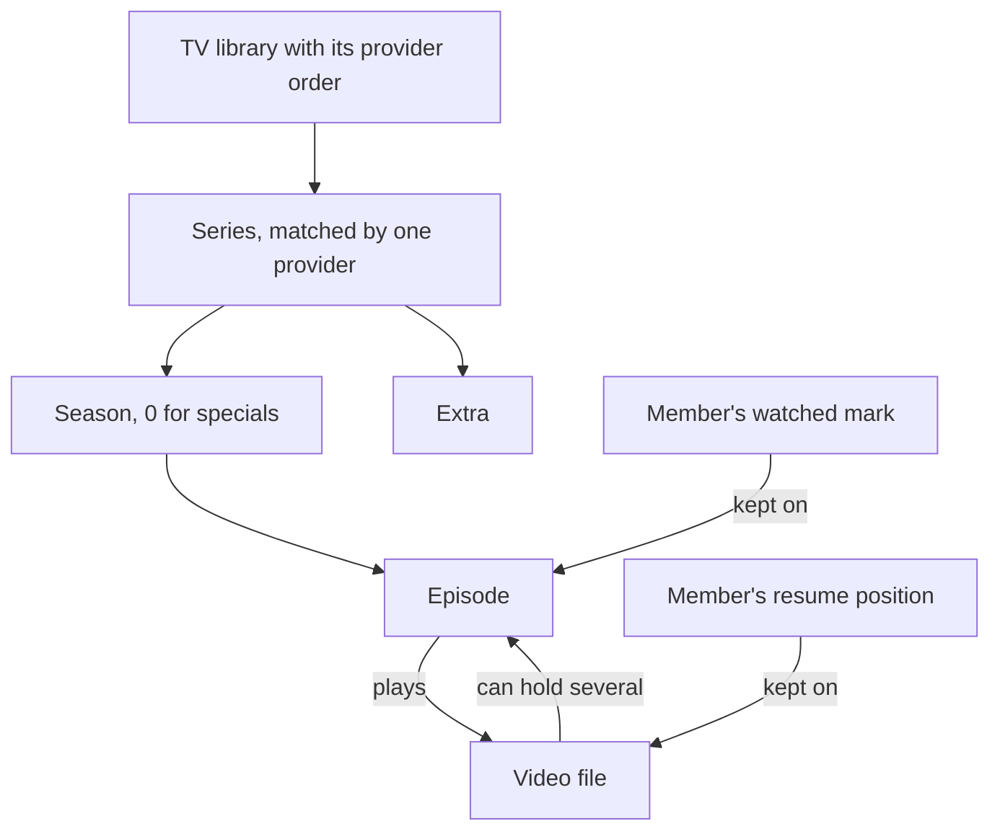
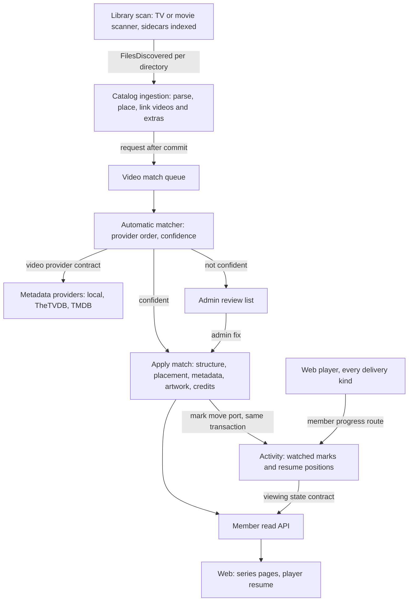
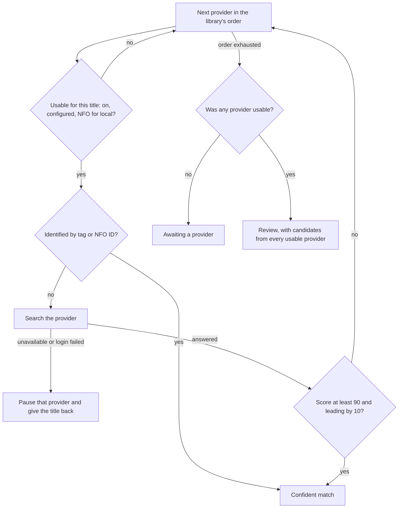
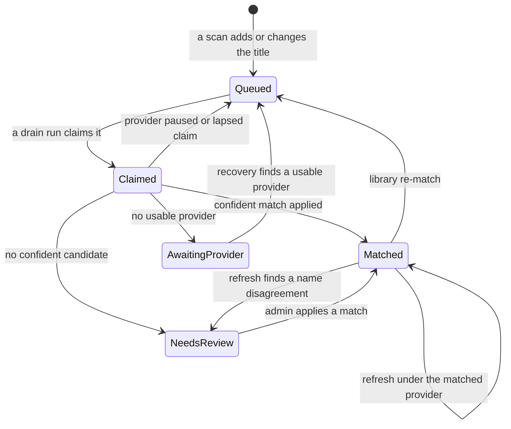
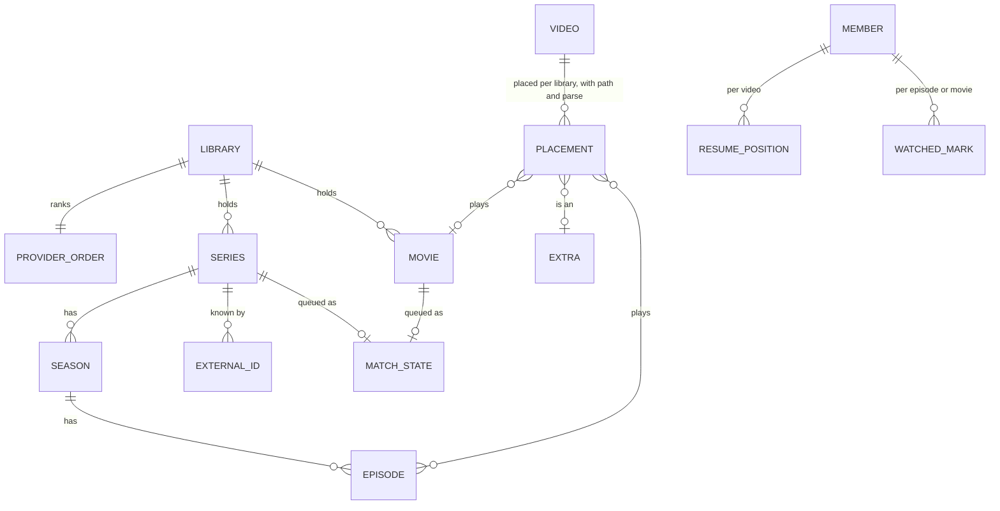

# TV Series Libraries and Video Matching - Plan

## Goal Capsule

- **Objective:** Members browse the series in their TV libraries by season, play any episode and resume it, with watched state of their own; an admin fixes a wrong match from the UI without touching files; movies get the same resume, watched state, matching and review.
- **Means:** extend the album match pattern into a video match queue in Catalog, fed by a provider-neutral metadata contract with local, TheTVDB and TMDB implementations, and record member progress in Activity through a member route the player calls for every delivery (KTD1, KTD4, KTD9).
- **Authority:** AGENTS.md and the rules it names, then this Product Contract, then its Key Technical Decisions. Where code contradicts a requirement, stop and ask; do not reinterpret the requirement.
- **Stop conditions:** stop and ask the owner before removing or narrowing a capability this plan does not name, before changing an API contract beyond the TV read API, the movie resources, the metadata providers routes and the new member and admin routes named in the units, or before running a database reset anywhere but a preview; the owner resets the persistent instance.
- **Execution profile:** one pull request from a branch named after this plan, built in five phases (Implementation Units). Units land as local commits; `ce-simplify-code` runs at each phase boundary and `ce-code-review` before shipping. Schema and query units (U3, U4, U11, U12, U14, U23) go to the [postgres specialist](../../.agents/agents/postgres.md). Push only when the owner asks.
- **Who finishes:** `ce-work` implements and verifies; the owner decides when to push and merge.

---

## Product Contract

### Summary

TV libraries scan into series, seasons and episodes from the naming Sonarr, Plex and Jellyfin use, including anime numbered absolutely and daily shows named by date. Each library tries a local provider, TheTVDB and TMDB in the order its admin sets, and an admin can switch any provider off for the whole server. Confident matches apply on their own, and the rest wait on an admin review list for a fix from the UI. Movies move onto the same name parsing, provider order, review and per-member resume and watched state.

### Problem Frame

Baander is judged against Jellyfin and Plex as a video server, and on both servers most viewing is of series. Today a TV library cannot be used. The `tv_show` library type exists, but library discovery has no scanner for it, and a series or episode enters the catalog only when an admin registers it by TMDB ID from the console. No episode links to a video file, so the TV pages that exist have nothing to play.

Movies scan and play, but stop short of what a primary video server needs. The movie title is the folder name as written, with no year or provider-ID parsing. A wrong match cannot be fixed: the movie edit endpoint changes title, year and summary only, and no list shows what failed to match. Nothing stores a member's resume position or watched state; the only playback position lives on the transcode session and ends with it. A movie whose file is renamed stops playing, because playback opens the path recorded when the file was first imported.

The owner's first real TV library holds all four common naming cases: season folders, folders tagged with provider IDs by a Jellyfin or Plex setup, anime numbered absolutely, and daily shows named by air date. A scanner that handled only season folders would leave hundreds of files for manual matching.

### Actors

- A1. Member: a signed-in user with access to a library, who browses series, watches episodes and marks them watched.
- A2. Admin: sets each library's provider order, switches providers on and off, works the review list and fixes matches.
- A3. Operator: runs the installation and supplies a licensed TheTVDB key and the TMDB token. One person may be both admin and operator.
- A4. Providers: the local provider, which reads NFO files and artwork beside the media, and TheTVDB and TMDB, which supply series structure, episode orderings, titles, air dates, artwork and credits.

### Key Decisions

- **Absolute numbering and date-based episodes are part of this plan, built after the season-folder layout.** Governs R6, R7, R8. (session-settled: user-approved — chosen over a separate follow-up or anime-only: the first library holds both, and every such file would otherwise be matched by hand)
- **TheTVDB and TMDB both supply series, in an order an admin sets per library, with keys the operator supplies.** Sonarr numbers files by TheTVDB, so the order lets an admin match the numbering a library's files use. Governs R12, R13. (session-settled: user-directed — chosen over TMDB only, TMDB with an optional TheTVDB, and TheTVDB as a global primary whenever a key is configured: the owner holds a TheTVDB key, and the right provider differs per library)
- **The local provider is one entry in each library's order.** Governs R12, R44. (session-settled: user-approved — chosen over local values winning field by field while an online provider fills gaps, and over using local data only when no online provider matches: one provider per title keeps the order model)
- **Each operator supplies a licensed TheTVDB v4 key for their installation.** TheTVDB requires a unique subscriber PIN per end user on its user-supported API plan. Baander supports licensed-key login without a PIN. Governs R12. (session-settled: user-directed — the owner approved proceeding with keys supplied by installation operators.) [TheTVDB v4 API key FAQ](https://support.thetvdb.com/kb/faq.php?id=81)
- **Every provider on the admin providers list gets a server-wide switch.** Governs R41. (session-settled: user-approved — chosen over switching only TheTVDB and TMDB, and over disabling a provider per library through the order: the providers list already shows an Enabled column for every provider)
- **Automatic video matching runs whenever a provider in the library's order can be used.** Governs R42. (session-settled: user-approved — chosen over following `metadata.auto_sync` with its off default, and over changing that default to on: a configured key is the operator's opt-in, and without matching the anime and daily-show files stay hidden)
- **Only a switched-off or unconfigured provider is skipped; an outage pauses matching.** Falling through on an outage would pin series to the wrong provider for good under R14. Governs R43.
- **A title keeps the provider that matched it until an admin re-matches it.** Changing the order never moves files between episodes unless an admin asks. Governs R14, R48.
- **Video matching follows the album match pattern.** Confident matches apply on their own, the rest wait for an admin, and a match outlives rescans. Governs R11, R15.
- **A series that parsed but did not match stays visible under its folder name.** Governs R17, R49. (session-settled: user-approved — chosen over holding it until matched: a missing key or a provider outage would hide whole shows)
- **Season tabs list owned episodes under an owned-of-total count.** Governs R24. (session-settled: user-approved — chosen over listing the full season with missing episodes marked, or a per-user setting: the quietest list)
- **Extras are shown in this plan.** Governs R21, R22. (session-settled: user-directed — chosen over skipping known extras folders and over sending every extra to the review list)
- **Watched state belongs to the episode or movie; the resume position belongs to the file.** Governs R28, R32, R50. (session-settled: user-approved — chosen over keeping both on the file and over keeping both on the episode or movie: an upgrade keeps watched state, and a position is never applied to a differently cut file)
- **Credits come from the provider that matched, and join the one Person identity through shared IDs.** A music Artist, a movie Person and a TV Person stay one identity as providers are added. Governs R33, R34, R35, R45. (session-settled: user-directed — chosen over TMDB-only credits through the series' TMDB cross-reference and over two credit sources with TMDB first: credits follow the library's provider order, and identity across music and video must hold for future artist-to-video matching)
- **Movies move onto the same pieces in this plan.** One mechanism serves movies and episodes instead of two to reconcile later. Governs R10, R13, R14, R15, R18, R28, R30, R32. (session-settled: user-directed — chosen over keeping resume, watched state, review, re-match and provider order TV-only as follow-ups)
- **Upgrades convert no existing catalog rows, and the TV migration is rewritten in place.** No installation is hosted, so backward compatibility is not a goal. Governs R53. (session-settled: user-directed — chosen over a forward migration that drops and recreates the TV tables, and over an upgrade that folds, splits and converts legacy movie rows: existing development databases are repaired or reset instead)
- **A moved file's marks are copied to its new episodes, and an old episode keeps its mark only while it still has a file.** Governs R32. (session-settled: user-approved — chosen over always moving the mark, which shows a remaining version as unwatched, and over always copying it, which leaves a wrongly matched episode marked)
- **Movie names are parsed for title, year and provider-ID tags.** Governs R10. (session-settled: user-approved — chosen over keeping folder-name titles: correctly named movies would otherwise fill the review list)
- **Match commands replace the register-by-TMDB-ID console commands.** Governs R38. (session-settled: user-approved — chosen over keeping file-less registration beside them: with owned-only episode lists, a file-less series has nothing to show)
- **Missing files hide; nothing is deleted.** An unmounted disk scans as empty, so deleting on absence would discard every match and member mark on it. Governs R46.
- **Provider attribution is shown.** Both providers' terms require it, and Baander shows none today. Governs R40.
- **The TV catalog's identity, its tables and the `/api/tv` read API change shape without a compatibility layer.** A series no longer depends on one provider's ID, and seasons and per-member progress join the read model, as the pre-release policy in AGENTS.md allows. Governs R1, R14, R28.
- **An episode or movie counts as watched past 90% of its runtime.** Governs R30.

### Requirements

**Library structure**

- R1. A TV library holds series, each with seasons and episodes, and season 0 holds the specials.
- R2. One file can hold several consecutive episodes, named like `S01E01-E02` or `S01E01E02`, and each of those episodes plays that file.
- R3. One episode can have several files, offered as versions the way a movie's versions are.

**Scanning and name parsing**

- R4. The scanner reads season and episode numbers from the `S01E02` and `1x02` forms, inside a `Season 01` or `Specials` folder or directly in the series folder.
- R5. A provider-ID tag in a series or movie folder name, such as `{tvdb-121361}`, `[tvdbid-121361]`, `{tmdb-1399}`, `[tmdbid-1399]` or `{imdb-tt0944947}`, identifies the title without a search, and so does a provider ID in the title's NFO; the library's provider order (R13) still decides which provider's entry the title uses.
- R6. When a file name carries no season and episode, the scanner reads an absolute episode number, and failing that an air date.
- R7. An absolute number maps to a season and episode through the matched provider's absolute ordering, or, where the series has none, by counting episodes across the aired seasons in order.
- R8. A date-named file goes to the episode of its series that aired on that date, and a date with no episode or with several goes to the review list.
- R9. A file whose name yields no season and episode, absolute number or air date, and that R21 does not mark as an extra, goes to the review list and stays hidden from members until an admin assigns it under R20.
- R10. The movie scanner reads the title, the year and provider-ID tags (R5) from movie folder and file names.
- R11. A rescan keeps every match, ordering choice and file assignment an admin made, and the scanner never renames or writes media files.
- R49. Until a series matches, files numbered absolutely or by date appear under the folder name by their number or date; in a matched series, a file whose season and episode the provider does not list yet stays visible by number and goes on the review list until a refresh places it.
- R51. Files with `sample` as a word in their name are ignored.
- R55. A renamed or moved file keeps playing and keeps its matches, assignments and member state.

**Providers and matching**

- R12. TheTVDB, TMDB and the local provider match series and supply their structure. TMDB and the local provider also match movies. TheTVDB uses the licensed key supplied by the installation operator.
- R13. Each TV and movie library has a provider preference order that an admin sets, and matching tries the providers in that order.
- R14. A series or movie records the provider that matched it and keeps it when the library's order changes, until an admin re-matches that title or the whole library.
- R15. Matching applies a confident match on its own and puts every other series, movie or file on the admin review list.
- R16. A matched series takes its titles, overviews, air dates, posters and episode stills from the provider that matched it.
- R17. A series that parsed but found no match is visible and playable under its folder name, with episodes shown by number, until a match fills in its metadata.
- R41. An admin can switch each provider on the admin providers list on or off for the whole server, with a console command. The list holds MusicBrainz, Discogs, Last.fm, Spotify, TasteDive, CoverArtArchive, TheTVDB, TMDB and the local provider. A switched-off provider is never contacted, and what it already supplied stays.
- R42. Matching runs after every scan that adds or changes a series or movie whenever a provider in the library's order can be used, and `metadata.auto_sync` keeps governing albums only.
- R43. Matching skips only a provider that is switched off or has no configured key; an outage, a refused request or a failed login pauses matching and retries later instead of falling through to the next provider.
- R44. The local provider reads Kodi-style NFO files and artwork beside the media, needs no key, and never goes online or writes files; a title with no NFO, or one it cannot read, falls to the next provider.
- R47. When a provider renumbers episodes on refresh, each matched file stays with its provider episode and shows the new number, and a file whose name no longer agrees goes on the review list.

**Review and manual fixes**

- R18. An admin can re-match a series or movie to an entry of any configured provider, chosen from a search in the UI.
- R19. An admin can choose which of the matched provider's episode orderings a series uses, such as aired, absolute or DVD order, as the provider offers them.
- R20. An admin can assign a file to one or more episodes of a series, or to the extras of its series or movie, overriding what the scanner read.
- R48. A library-wide re-match leaves titles an admin matched by hand unless the admin forces it; a re-match resets the series' episode ordering to the new entry's default and returns hand-assigned files to the review list, after a confirmation that states the counts.

**Extras**

- R21. The scanner recognizes extras by the folder names and file suffixes Plex and Jellyfin use, such as `Extras`, `Featurettes`, `Behind The Scenes`, `Trailers`, `Interviews` and `-trailer`, and attaches each to the series or movie it sits beside.
- R22. Extras appear in their own row on the series page and the movie page and play in the movie player, but never count as episodes or toward a season's or series' watched state.

**Browsing**

- R23. Members see a grid of the series in each TV library they can access.
- R24. A series page has one tab per season, with specials after the regular seasons, and each tab lists only episodes that have a file, under a count such as "10 of 12 episodes".
- R25. Each episode row shows the member's watched state and, for a partly watched episode, how far they got.
- R26. A member can mark an episode, a season or a whole series watched or unwatched.
- R46. A series, season, episode or movie whose files are all missing disappears for members and returns with its matches, orderings, assignments and member state when a file comes back; nothing is deleted.

**Playback, resume and watched state**

- R27. Episodes play in the movie player.
- R28. Each member has their own resume position for each file they play, and reopening an episode or movie resumes from the position of the file it opens, with a choice to start over.
- R29. A file that holds several episodes has one resume position, and finishing it marks each of its episodes watched.
- R30. An episode or movie becomes watched for a member once their playback passes 90% of its runtime.
- R31. Marking a season or series watched marks the episodes it has files for, and episodes added later start unwatched.
- R32. Watched state belongs to the member and the episode or movie, so an upgrade that replaces a file keeps it while the resume position starts over; when a fix moves a file to other episodes, the episodes it now plays get the member's marks from its old episodes, and an old episode keeps its mark only while it still has a file.
- R50. Passing 90% clears the member's resume position for that file, marking or unmarking by hand clears it as well, and a rewatch that stops before 90% leaves the episode or movie watched.
- R52. Viewing in a watch party records no resume position and no watched state.
- R54. A file present in two libraries plays for members of either library.

**Credits and Person identity**

- R33. Cast and crew for a series and its episodes come from the provider that matched the series.
- R34. A TheTVDB person ID becomes another kind of Person identifier, and the IMDb and TMDB IDs that TheTVDB lists for that person resolve to the existing Person, so one individual stays one Person across music, movies and TV.
- R35. IDs that point at different Persons are recorded as an identity conflict, as they are today, and a TheTVDB person with no shared ID stays a separate Person until an admin merges the two with `app:person:manage`.
- R45. NFO cast members become credits only when they carry an IMDb, TMDB or TheTVDB ID.

**Existing installations**

- R53. The upgrade converts no existing catalog rows: an existing database is repaired or reset and its libraries rescanned, which rebuilds movies, series, extras and matches under the new rules.

**Access, administration, attribution and console**

- R36. Members see and play series, episodes and extras only in libraries they have access to, as with movies, and admins see every library.
- R37. Provider order, the review list, re-matching, ordering choice and file assignment are admin-only, and each has a console command under the [admin and console rules](../../.agents/rules/admin-cli-parity.md).
- R38. Match commands replace `app:tv:series:register` and `app:tv:episode:register`, and registering a series or episode without a file is removed.
- R39. The operator guide covers TV libraries, the three providers and their keys, provider switches, the naming and NFO forms the scanner reads, extras, provider order, attribution, and the review and match workflow.
- R40. Members who see provider metadata see each provider's required attribution: TMDB's notice "This product uses the TMDB API but is not endorsed or certified by TMDB." with its logo, and a link to TheTVDB.com.

### Key Flows

- F1. Scanning a TV library
  - **Trigger:** An admin starts a scan, or a scheduled scan runs.
  - **Actors:** A2, A4
  - **Steps:** The scanner groups files into series by folder, sets extras aside and ignores sample files. It reads each file's numbers, trying season and episode first, then an absolute number, then an air date. A series tagged in its folder name or NFO is identified directly; an untagged one is searched for at each usable provider in the library's order. A confident match is applied and the file's numbers are mapped through the matched provider's ordering. Everything else goes to the review list.
  - **Outcome:** Matched series and parsed-but-unmatched series are visible to members; files with no readable number wait on the review list.
  - **Covered by:** R4–R9, R12–R17, R21, R42–R44, R49, R51
- F2. Fixing a mismatched anime series
  - **Trigger:** An anime series matched the wrong entry, or its absolute numbers landed in the wrong seasons.
  - **Actors:** A2, A1
  - **Steps:** The admin opens the series from the review list or its page, searches the configured providers and picks the right entry. If the numbering still differs from the files, the admin picks another of the provider's orderings. A file that is still wrong is assigned to its episode by hand.
  - **Outcome:** The series shows the right seasons and episodes, each member's watched marks move with their files, the files are untouched, and the next rescan keeps the fix.
  - **Covered by:** R11, R14, R18, R19, R20, R32
- F3. Watching an episode
  - **Trigger:** A member opens a series in a library they can access.
  - **Actors:** A1
  - **Steps:** The member picks a season tab and then an episode, which plays in the movie player. They stop part way, and the episode row shows their progress. Later they reopen the episode and playback resumes where they stopped. Once playback passes 90%, the episode shows as watched and its resume position clears.
  - **Outcome:** The member's progress and watched state are their own; other members of the library see theirs.
  - **Covered by:** R24, R25, R27, R28, R30, R50

### Acceptance Examples

- AE1. **Covers R1, R4, R24.**
  - **Given:** `Show (2011)/Season 01/Show - S01E02 - Title.mkv` and `Show (2011)/Specials/Show - S00E01.mkv`.
  - **When:** the library scans and the series matches.
  - **Then:** the series page has a Season 1 tab listing episode 2 under an owned-of-total count, and a Specials tab after it listing episode 1.
- AE2. **Covers R2, R29.**
  - **Given:** `Show - S02E01-E02.mkv`.
  - **When:** a member stops it half way, and later finishes it.
  - **Then:** season 2 lists episodes 1 and 2, both playing that file; after the stop both show the same progress, and after the finish both are watched.
- AE3. **Covers R5, R13.**
  - **Given:** a library ordered TheTVDB, then TMDB, and a series folder `Show {tmdb-1399}`.
  - **When:** the library scans.
  - **Then:** the series is identified without a search and uses TheTVDB's entry for the same show; if TheTVDB has no counterpart, it uses TMDB entry 1399.
- AE4. **Covers R6, R7.**
  - **Given:** `Anime/Anime - 137.mkv`, in a series matched to TheTVDB whose absolute episode 137 is S05E12.
  - **Then:** the file plays as S05E12.
  - **Given instead:** a TMDB match with no absolute ordering and three aired seasons of 50 episodes each.
  - **Then:** the file plays as S03E37.
- AE5. **Covers R8.**
  - **Given:** `Daily Show/Daily Show 2024-03-14.mkv`.
  - **When:** the matched series has one episode that aired on 2024-03-14.
  - **Then:** the file plays as that episode.
  - **When instead:** the series has two episodes that aired that day, or none.
  - **Then:** the file goes to the review list.
- AE6. **Covers R9, R17.**
  - **Given:** `New Show/Season 01/New Show - S01E03.mkv`, where no configured provider finds "New Show", and `New Show/Season 01/finale.mkv`.
  - **Then:** members see "New Show" with season 1, episode 3, playable and without artwork; the series is on the review list; `finale.mkv` is on the review list and members do not see it.
- AE7. **Covers R19, R32.**
  - **Given:** a member has watched the first five files of an anime series and stopped part way into the sixth, and an admin then switches the series from aired to absolute order, which gives those files other episode numbers.
  - **Then:** the member's watched marks move to the episodes those five files now play, and the sixth file keeps its resume position.
- AE8. **Covers R14.**
  - **Given:** a library matched under the order TMDB, then TheTVDB, whose admin changes it to TheTVDB, then TMDB.
  - **Then:** existing series keep their TMDB matches, series matched after the change use TheTVDB, and an admin re-match of the whole library moves every series that TheTVDB has an entry for to TheTVDB.
- AE9. **Covers R21, R22.**
  - **Given:** `Show/Extras/Making Of.mkv` and `Movie (1999)/Movie (1999)-trailer.mkv`.
  - **Then:** the series page and the movie page each show an extras row holding that file, playable, and season counts and series watched state ignore it.
- AE10. **Covers R26, R31.**
  - **Given:** a season with 8 of its 10 episodes on disk.
  - **When:** a member marks the season watched, and files for the other 2 episodes are added later.
  - **Then:** the 8 episodes are watched for that member, and the 2 new ones start unwatched.
- AE11. **Covers R34, R35.**
  - **Given:** a TheTVDB-matched series credits an actor whose TheTVDB record lists IMDb ID `nm1234567`, and a Person with that IMDb ID already exists from a movie credit or a linked music Artist.
  - **Then:** the series credit goes to that Person.
  - **Given instead:** the TheTVDB record lists an IMDb ID held by one Person and a TMDB ID held by another.
  - **Then:** the claim is recorded as an identity conflict and no Person is merged.
- AE12. **Covers R10.**
  - **Given:** `The Matrix (1999) {tmdb-603}/The Matrix (1999).mkv` and `Heat (1995)/Heat.mkv` in a movie library.
  - **Then:** the first is identified as TMDB 603 without a search, and the second is searched for as "Heat" from 1995, not as "Heat (1995)".
- AE13. **Covers R36.**
  - **Given:** a member without access to a TV library.
  - **Then:** its series do not appear for that member, and its episodes and extras do not play for them, even from a direct link.
- AE14. **Covers R43.**
  - **Given:** a library ordered TheTVDB, then TMDB, and TheTVDB answering 503 while a new series is matched.
  - **Then:** the series stays unmatched and queued, it is never matched to TMDB, and matching resumes after the pause.
- AE15. **Covers R44, R45.**
  - **Given:** a library ordered local, then TheTVDB, and `Show/tvshow.nfo` carrying a TheTVDB `uniqueid` with an NFO beside each episode file.
  - **Then:** the series matches locally and takes its titles, plots and air dates from the NFO files; a cast member with an `imdbid` becomes a credit and one with only a name does not.
  - **Given instead:** a `tvshow.nfo` that is not well-formed XML.
  - **Then:** the series falls to TheTVDB.
- AE16. **Covers R41.**
  - **Given:** an admin switches MusicBrainz off.
  - **Then:** album match requests wait without any request to MusicBrainz, and matching continues when MusicBrainz is switched back on.
  - **Given instead:** TMDB switched off in a movie library ordered local, then TMDB, with no NFO files.
  - **Then:** new movies wait as awaiting a provider, and existing TMDB matches keep their metadata.
- AE17. **Covers R28, R32, R50.**
  - **Given:** a member watched S01E05 past 90%, and Sonarr then replaces its file with an upgrade.
  - **Then:** S01E05 is still watched, and opening it starts at the beginning.
  - **Given instead:** a member stops version A of an episode at 20 minutes.
  - **Then:** opening the episode again plays version A from 20 minutes.
- AE18. **Covers R46.**
  - **Given:** a TV library whose disk is unmounted when a scan runs, and remounted before the next scan.
  - **Then:** after the first scan its series disappear for members; after the second they return with their matches, assignments and member state.
- AE19. **Covers R54, R55.**
  - **Given:** a matched movie folder an operator renames, and one episode file copied into two TV libraries.
  - **Then:** the movie still plays and keeps its match and member state, and a member who can only see the second library plays the episode.
- AE20. **Covers R49.**
  - **Given:** an unmatched series folder `Anime` holding `Anime - 137.mkv`.
  - **Then:** members see "Anime" with episode 137 listed by number.
  - **Given instead:** a matched series gains `Show - S05E13.mkv`, which the provider does not list yet.
  - **Then:** members see season 5, episode 13 by number, the file is on the review list, and the next refresh that lists the episode places it.
- AE21. **Covers R48.**
  - **Given:** a library re-match in a library where an admin matched 3 series by hand and assigned 12 files by hand.
  - **Then:** the confirmation states those counts, and without forcing it the 3 series keep their matches.
- AE22. **Covers R52.**
  - **Given:** a member watches an episode past 90% in a watch party.
  - **Then:** the episode is not marked watched for that member and no resume position is recorded.

### Success Criteria

- The owner's first TV library, which holds all four naming cases, scans into series, seasons and episodes, and its review list holds only files whose names or provider data leave the episode open.
- With every provider key empty, the server starts, scans a TV library and shows its series under their folder names.

### Scope Boundaries

Deferred for later:

- Up Next and Continue Watching for series, a separate issue.
- Intro detection and Skip Intro, a separate issue.
- Missing or upcoming episodes beyond the owned-of-total count.
- Progress recorded while a member watches in a watch party.
- Libraries that hold both movies and series.
- A third online provider, such as AniDB for anime.
- One review list across albums and videos.
- A version picker for episodes and movies; the player keeps opening the version described in KTD13.
- Title metadata embedded in video files, such as an MKV title tag.
- Credits for NFO cast members with only a name.

Outside this work:

- The React Native app in `ui/rn`, per AGENTS.md.
- Renaming, moving or tagging media files, and writing NFO files.
- Converting existing catalog rows on upgrade (R53).
- Provider keys per Baander user: the operator sets each key once for the installation (R12).

Considered and not built:

- An "ignore this file" action on the review list. Sample files are ignored (R51) and extras are recognized (R21), so junk files should be rare; a review list that stays cluttered after the first library scan would justify it.
- A review flag for series matched by a lower-ranked provider after the higher one adds the show. R14 already keeps the match until an admin re-matches; complaints about stale matches in a library with a changed order would justify it.
- A health alert when TheTVDB or TMDB is unreachable. The queue pause is visible in the job monitor, and a health check inside the Messenger consumer cannot see outages that stop it (`docs/solutions/architecture-patterns/health-checks-run-in-a-messenger-consumer-cannot-see-outages-that-stop-it.md`).
- TheTVDB's `/updates` change feed for refreshes. A periodic refresh of matched series meets R16 at household scale; a library large enough to hit provider limits would justify it.
- Resume positions kept per library for a file present in two libraries. One position per member and file is simpler, and the case is rare.

### Dependencies / Assumptions

- TheTVDB reviews licensed key applications before activating the key. The user-supported API model requires each end user to have a subscription and a unique PIN. [TheTVDB API information](https://thetvdb.com/api-information) · [Key types FAQ](https://support.thetvdb.com/kb/faq.php?id=81)
- TheTVDB offers aired, absolute and DVD orderings directly. TMDB offers them only as episode groups of type 2 (absolute) and 3 (DVD), which not every series has, so R7's count across aired seasons is the fallback. Source: [TMDB episode group details](https://developer.themoviedb.org/reference/tv-episode-group-details).
- TheTVDB lists remote IDs on series, episodes and people, but its character lists lack them, so joining a credit to a Person (R34) costs one person lookup per cast member. TMDB lists external IDs for series and resolves TheTVDB and IMDb IDs through `/find`. Sources: [TheTVDB v4 OpenAPI](https://github.com/thetvdb/v4-api/blob/main/docs/swagger.yml), [TMDB find by ID](https://developer.themoviedb.org/reference/find-by-id).
- TMDB allows roughly 40 requests per second and answers 429 above it; TheTVDB states no limit. Both require attribution (R40). Sources: [TMDB rate limiting](https://developer.themoviedb.org/docs/rate-limiting), [TMDB FAQ](https://developer.themoviedb.org/docs/faq).
- Sonarr names files by TheTVDB numbering, so an anime library Sonarr named matches its file numbers best with TheTVDB above TMDB in its order.

### Sources / Research

- TV catalog today: `src/Catalog/Domain/Model/TvSeriesState.php:12-19` and `src/Catalog/Domain/Model/TvEpisodeState.php:12-21`; the `tv_series`, `tv_seasons` and `tv_episodes` tables in `migrations/Version20261121194700.php:20-44`, unique on library and TMDB ID, with no link to a video file.
- TV registration and sync: `src/Catalog/Interface/Console/TvSeriesRegisterCommand.php:21`, `src/Catalog/Interface/Console/TvEpisodeRegisterCommand.php:22`; `src/Metadata/Application/MessageHandler/SyncTvLibraryHandler.php:24-48` refreshes existing rows only.
- TV read API: `src/Catalog/Interface/Controller/TvReadController.php:26` (`/api/tv`), with routes at lines 89, 124, 191, 228, 295 and 360.
- TMDB TV lookups: `src/Metadata/Infrastructure/Api/Tmdb/TmdbAdapter.php:119` (series) and :130 (episode), with no TV search or season list; the IMDb-to-TMDB person lookup is at :81. TMDB's key is `TMDB_BEARER_TOKEN` (`config/services.yaml:1272`). No TheTVDB code exists in `src/` or `config/`.
- Library discovery: `src/Library/Application/LibraryDiscovery.php:44-53` scans music and movie libraries only; `LibraryType::TvShow` is at `src/Library/Domain/ValueObject/LibraryType.php:13`. No per-library setting exists in `src/Library/Domain/Model/LibraryState.php`, and server settings have only system and user scopes.
- Movie titles from folders: `src/Catalog/Application/CommandHandler/FilesDiscoveredHandler.php:1237` and :1363-1371; `src/Library/Application/MovieScanner.php:63`.
- Movie edits: `src/Catalog/Interface/Controller/MovieController.php:255-265` passes title, year and summary only; write routes are admin-only at :40.
- Per-user activity: `media_activities` in `migrations/Version20261017000000.php:383-398` holds the movie, play count and love, with no position or watched flag. The playback position belongs to the transcode session (CONCEPTS.md, "Transcode session").
- Playback access: `src/Transcode/Infrastructure/Auth/AuthorizedPlayback.php:63-68` checks non-admins through `movie_video` and `user_library_access` only.
- File resolution: `src/Catalog/Infrastructure/VideoService.php:26-51` opens the video's stored path in the first accessible library that holds it, and `src/Catalog/Application/CommandHandler/FilesDiscoveredHandler.php:1218-1233` keeps a known video's old path when its hash appears at a new one.
- Person identity: `src/Catalog/Domain/ValueObject/PersonIdentifierNamespace.php`; `src/Catalog/Infrastructure/Doctrine/Repository/PersonIdentityRepository.php:150-188` records conflicting owners and merges nothing; the music Artist bridge through IMDb to TMDB is in `src/Catalog/Application/MessageHandler/SyncArtistHandler.php:126-141`; admin merge and conflicts are in `docs-book/part-1-operator-guide/commands/app-person-manage.md`.
- Album match pattern: CONCEPTS.md, "MusicBrainz match" and "Album match queue"; `docs-book/part-1-operator-guide/commands/app-metadata-match-reviews.md`.
- Providers list: `docs-book/part-1-operator-guide/commands/app-metadata-providers.md` shows an Enabled column that is `yes` for every provider and lists no video provider.
- Web UI: TV routes in `ui/web/src/features/layout/routes.tsx:91-96`; TV pages in `ui/web/src/features/tv/pages/`; the movie player in `ui/web/src/features/catalog/components/MoviePlayerOverlay.tsx`; the only TMDB reference users see is a "View" link in `ui/web/src/features/catalog/components/MovieMetadata.tsx:140-149`.
- Operator docs: `docs-book/part-1-operator-guide/media/library-management.md:21` (no `tv_show` scanner) and :68-80 (people and credits, TV registration).

---

## Planning Contract

**Product Contract preservation:** changed R9 (placement before a match moved to R49), R12 (the local provider and TheTVDB's PIN; the skip rule moved to R43), R20 (assignment to extras), R28 and R32 (watched state on the episode or movie, resume on the file, the copy rule for moved marks), R39 (new topics), R53 (no upgrade conversion) and AE7 (follows R32), after the owner's answers and planning research on 2026-11-27; R5 (NFO IDs identify titles as folder tags do) after the owner's review decision the same day. Added R40–R52, R54, R55, AE14–AE22 and their Key Decisions. Removed AE23 with the conversion it tested. The Outstanding Questions were answered by KTD10, KTD13, R12, R28 and U17 and removed. The owner later amended R12 to use an operator-supplied licensed key after confirming TheTVDB's PIN restriction.

### Key Technical Decisions

- KTD1. **Catalog owns video matching; Metadata owns the providers behind one provider-neutral port.** Catalog keeps the match queue, file placement and the review list, as it does for albums. A new Metadata contract port searches and identifies series and movies, returns a series' episodes under a named ordering, and returns credits with every person identifier the provider knows. Each answer is one of found, not found, unavailable, disabled or not configured, the outcome shape the MusicBrainz port uses. The port replaces `TvMetadataPortInterface` and the baselined `MovieMetadataEnricher`, so the Deptrac baseline loses entries instead of gaining them. Governs R12, R15, R16, R43.
- KTD2. **Name parsing is a Catalog domain service that reads library-relative paths.** Library Application may not depend on Catalog (`deptrac.yaml:1567-1577`), and `FilesDiscovered` already carries each file's relative path, so the scanner stays name-agnostic. Each file's raw parse is stored on its placement, because incremental scans never present unchanged files again and placement must be recomputed when a match arrives, an ordering changes or a re-match runs. Governs R4–R10, R21, R49, R51.
- KTD3. **The TV schema is rewritten in `Version20261121194700`; matching removes no episode except by a merge.** A series records its library, its current folder path, its matching provider, the provider's entry ID and the external IDs of every provider. Ingestion finds a directory's series through the existing placements of its known videos first, as KTD14 does for movies, and only then by folder path, so a renamed series folder updates the stored path instead of creating a second series. A placement is keyed by library and video, stores the file's library-relative path and raw parse, and links the video to its episodes (spans and versions) or to an extra; movies use placements too. A match attaches provider episode IDs to the existing rows, so episode public IDs survive. Apply, re-match and ordering switches re-key rows and retire a row that loses every placement (R46 hides it). When two rows collapse onto one provider episode, the absorbed row folds into the surviving row with its placements and member marks inside the placement transaction; that merge and a library delete are the only ways an episode row leaves the table. Renumbering must survive an update that swaps two numbers. Governs R1–R3, R11, R14, R46, R47, R53, R55.
- KTD4. **Member progress comes from one member route that the player calls for every delivery.** Original and cached deliveries create no transcode session (`src/Media/Application/Service/DeliveryDecisionService.php:150-161`; `ui/web/src/features/catalog/hooks/useBaanderPlayer.ts:595-601`), so a transcode hook would miss them. The route in Activity takes the video's public ID, the title the member opened (episode or movie), a position and an action. The server checks access through the watchable-title contract (KTD17), clamps the position to the probed duration and ignores reports while the member is in a watch party on that video (R52). One guarded upsert writes only when the position moved 30 seconds or more or the action is pause, seek or end, and the stored reported time only moves forward. Governs R28–R31, R50, R52. (session-settled: user-approved — chosen over keeping watched state on the file and over keeping both on the episode or movie, per the Key Decision; governs R28, R32, R50)
- KTD5. **The per-library provider order lives in Catalog, keyed by library.** Library Application cannot see Metadata's provider registry to validate it, and the settings registry has no library scope. The order ranks every provider that serves the library's type. A library with no stored order uses the default: TheTVDB, TMDB, local for TV and TMDB, local for movies. Online providers come first because the local provider knows only episodes that have files, so a series matched locally would show owned-of-owned counts and send every new episode without an NFO to review. Provider IDs in a title's NFO identify it at the online providers as folder tags do (R5), and an admin moves the local provider up for a curated library. TheTVDB above TMDB fits Sonarr's numbering. Governs R5, R13. (session-settled: user-approved — chosen over a local-first default: NFO-carrying series keep full episode lists from the online providers)
- KTD6. **Provider switches are system settings, enforced inside Metadata Infrastructure.** Each provider gets a boolean setting, `metadata.provider.<id>.enabled`, defaulting to on. Every adapter class checks its switch and answers "disabled" without a request; a decorator would miss the callers that inject the concrete MusicBrainz, Discogs and Last.fm adapters. The album callers sit in Catalog Application, which may not use plain Metadata Application, so the MusicBrainz lookup contract gains the "disabled" outcome and an enabled check that reads the current system setting without contacting the provider. While MusicBrainz is off, the album drain claims nothing and ends its chain, every request keeps its due time, and the album queue's recovery handler restarts the drain once the check passes. The providers route, its command and `app:settings:set` all write the same keys. Workers read each switch from PostgreSQL so a change applies to the next check. The check makes no provider request. Governs R41, R43. (session-settled: user-approved — keep fresh database reads when checking provider availability.)
- KTD7. **TheTVDB is a new adapter on `PublicHttpClient`.** Login sends the licensed API key from `TVDB_API_KEY`. The bearer token is cached in `cache.app` for 25 days and refreshed once on a 401. The host allowlist covers `api4.thetvdb.com` and the artwork host. The key is admitted to the worker environment beside `TMDB_BEARER_TOKEN`, because the match drain runs in the workers and would otherwise see TheTVDB as unconfigured. The client is built lazily, so an empty key never fails a worker (`docs/solutions/runtime-errors/eager-webpush-client-dead-letters-push-without-vapid-keys.md`). The adapter answers with value objects, the MusicBrainz adapter's shape, and does not throw. Governs R12, R34, R43. (session-settled: user-directed — use the licensed key supplied by the operator.)
- KTD8. **The local provider reads sidecars through `LibraryMediaFilesInterface::readSidecar`.** That contract already confines reads to the library root and caps their size (`src/Library/Application/Port/LibraryMediaFilesInterface.php:96-104`), and Metadata Infrastructure may already use it. Catalog classifies sidecars with the U1 parser and passes typed sidecar paths in the port request, so Metadata needs no Catalog Domain class. NFO XML is parsed with network access and entity substitution off, and an unreadable file counts as no NFO. Local artwork is imported into the managed image store on apply, so artwork fields hold either a provider URL or a managed image. Governs R44, R45, R16.
- KTD9. **The video match queue copies the album queue's claim and lease, and pauses per provider.** It keeps one state row per series or movie, with a claim ID and expiry (`docs/solutions/architecture-patterns/state-set-when-work-is-queued-on-swoole-task-must-expire.md`). A drain handler on `async` matches one title per message. An outage or failed login pauses only that provider for 5, 15 and 60 minutes, then hourly. A title whose walk reaches a paused provider is given back, due when the pause ends, without falling through (R43), and the drain goes on with the next title; a refused request gives its title back due later, as the album drain does. A provider is usable for a title when it is switched on and configured, and the local provider only when the title has an NFO sidecar. A title whose order holds no usable provider becomes awaiting a provider, recorded by ingest or by the drain. The recovery handler re-queues those titles on its schedule once a provider is usable, so a switch flipped through `app:settings:set` or a key added at the next worker start is picked up. Ingest requests a match after its commit, best-effort, as album import does. Governs R15, R42, R43.
- KTD10. **Confidence follows the album rule.** A candidate is confident when its score is at least 90 and leads the runner-up by at least 10. The score combines title similarity, year and, for a series, how well the files' numbers fit the candidate's episodes. A tag or an NFO ID is confident by identity. The review reasons are no candidates, low score, close runner-up, duplicate in library, duplicate file, episode collision and name disagreement. Governs R15, R47.
- KTD11. **Playback opens the placement's stored path, checked against the file index's hash at that path.** The placement records each file's library-relative path per library, so a rename updates it (R55) and a file in two libraries has a placement in each (R54). A placement is available only while the file index's available hash at its path equals its video's hash, read through `LibraryMediaFilesInterface::findAvailableHashesByPaths`, so a file replaced in place leaves the old video unavailable. Resolution tries the title's next placement path when the resolver refuses a vanished file. Two available files with one hash in one library keep the existing placement, and the second path goes to review as a duplicate file. Access checks accept a video linked to a movie, an episode or an extra in an accessible library: `AuthorizedPlayback::assertAccess`, the visibility reads of `VideoRepository` and `src/Recommendation/Infrastructure/Projection/RecommendationPublicIdentity.php:53`. A hash lookup on Library's file index was rejected: it needs a new Library contract and makes a video's single stored path flip between libraries. Governs R36, R46, R54, R55.
- KTD12. **Availability is read from placement paths, and nothing is deleted on absence.** A video availability read, modelled on `SongAvailability`, filters every member listing. `VideoRepository::deleteUnlinked` checks every link table, and deleting a movie includes its extras' videos. New link tables reference `videos` with RESTRICT, so a delete racing an import fails instead of cascading through the new link; resume positions cascade with their video. Governs R46.
- KTD13. **Opening an episode or movie plays the version the member played last, else the first by sort order.** No picker is added (Scope Boundaries). Resume uses that file's position (R28). Governs R3, R28.
- KTD14. **A movie is identified by its library and folder path, through its placements, never by title.** Files directly in the library root are each their own movie. An admin's movie PATCH edits are recorded as locked fields, so a re-match cannot overwrite them. No legacy movie rows are converted (R53). Governs R10, R53.
- KTD15. **Watched marks move through a synchronous Activity port inside the placement transaction.** This follows the album merge pattern (`AlbumActivityMergePortInterface`, consumed by `src/Catalog/Infrastructure/AlbumMergeService.php:52`). A Catalog Infrastructure placement service calls the port once per placement transaction, passing the complete before and after episode sets of every affected video. Activity applies them as one simultaneous mapping under R32's copy rule, and combines the marks of episodes merged under KTD3. An outbox event was rejected: the relay gives no per-key ordering, so two fixes to one video can apply out of order, and a replay applies a move twice. Governs R32.
- KTD16. **Web playback reuses `MoviePlayerOverlay`, and `useBaanderPlayer` gains a start position and progress reporting.** The start position goes through the existing restore and tail-landing path. A resume in the last second of a finished presentation needs that path (`docs/solutions/runtime-errors/seek-to-the-end-of-a-finished-hls-presentation-never-completes-on-a-fresh-attachment.md`), and R50 clears positions past 90%, so restores near the end are rare. The player calls the progress route of KTD4 for every delivery kind and stops reporting while it plays in a watch party. Governs R27, R28, R52.
- KTD17. **Every new cross-context dependency goes through a named Deptrac contract layer.** These layers add no baseline entry:
  - 'Metadata Video Provider Contract': the port, `DTO\Video\`, the provider ID enum, the kinds each provider serves and a `usableProviders()` call that reads current settings without contacting providers. Catalog Application may use it.
  - 'Catalog Watchable Title Contract': a video's linked episodes or movie and its duration, a season's or series' episodes with files, and a title's library. Activity Application may use it.
  - 'Activity Viewing State Contract': member progress and marks for listings. Catalog Infrastructure may use it.
  - 'Activity Watched Mark Move Contract': KTD15. Catalog Infrastructure may use it.
  - 'Party Watch Membership Contract': whether a member is in an active watch party on a video. Activity Application may use it.

  The existing 'Activity Album Merge Contract' is the shape to copy. Governs R32, R36, R52.
- KTD18. **An NFO change never re-queues a matched title.** Re-queuing would walk the library's order again and could move the title to another provider (R14); an admin re-match picks up a changed NFO. An unmatched title is queued again when its directory republishes with a new NFO. Governs R14, R44.
- KTD19. **Member state tables have explicit keys.** Watched marks hold separate episode and movie columns with real foreign keys, a check that exactly one is set, and one unique key per target; the foreign keys are declared as cross-context keys per the database naming page. Resume positions are unique per member and video and reference the video. Automatic marking at 90% applies to the episodes or movie the member opened, in that library. Both tables are declared in `tests/Fixtures/LiveUpdates/capture-sources.json` with member scope, so a mark move refreshes open views. Governs R29–R32.

### High-Level Technical Design

Components and data flow, from scan to member view:

One title's provider attempt, per R13, R15, R42 and R43:

Match state of one series or movie:

Data model, conceptually (the postgres specialist names tables and keys per the [database naming page](../../docs-book/part-2-developer-guide/development/database-naming.md)):

### Alternatives Considered

- **Recording progress from the transcode playback controls.** It would reuse reports the server already receives, but original and cached deliveries never create a session, so browser-compatible files and replays from completed artifacts would record nothing. The transcode position is client-reported too, so the hook is no more trustworthy than KTD4's route.
- **The provider order as a Library column.** Library owns the library row, but it would have to validate provider identifiers it may not import, so KTD5 keeps the order beside the match queue in Catalog.
- **A separate TV bounded context.** The catalog, Person credits and the album match pattern already live in Catalog, and a new context would need contracts for all of them, so TV stays in Catalog.
- **Mark moves by outbox event.** Rejected in KTD15 for ordering and replay.

### System-Wide Impact

- **Authorization:** the playback access query, the video visibility reads and the recommendation visibility read change (KTD11). Every caller inherits the change: manifest, signing, jobs, sessions, original delivery and watch parties. The access tests therefore cover episode-only and extra-only videos for non-admins.
- **Music paths:** the provider switches (KTD6) add a "disabled" outcome and an enabled check to the MusicBrainz contract, which stop the album drain while MusicBrainz is off; the other music adapters answer "disabled" on their own.
- **Data lifecycle:** absence hides and never deletes (KTD12), movies included, and matching removes an episode only by a merge (KTD3).
- **Contracts and wiring:** the layers in KTD17 join `deptrac.yaml`. New messages need routing in `config/packages/messenger.php` and payload codec entries, guarded by `tests/Functional/MessagingCodecWiringTest.php` and `tests/Unit/Messenger/MessengerRoutingTest.php`. The new member tables join `tests/Fixtures/LiveUpdates/capture-sources.json`.
- **API and client:** the `/api/tv` read API, the movie resources and the metadata providers routes change shape, a member progress route is added, and `openapi.json` and the Orval client are regenerated together.
- **Outbound requests:** TheTVDB's host joins the outbound allowlist and the dev-qualification transport (`packages/baander-dev-qualification/src/Fixtures/Qualification/MetadataTransport.php:27`).
- **Existing databases:** the rewritten TV migration and the new schema need a reset of each existing development database. The owner resets the persistent instance; previews are recreated.

### Risks & Dependencies

- **TheTVDB key approval.** The operator needs an approved licensed key to enable TheTVDB. The operator guide describes the requirement (U18).
- **Unverified TheTVDB details.** The base host, the remote-ID `sourceName` strings and whether `/search/remoteid` accepts TMDB IDs are not confirmed by official pages. U8 checks them against the published OpenAPI file and one live call with the owner's key before fixing the mapping, and the tests use recorded fixtures.
- **Size of one pull request.** The phases land as one PR because nothing in AGENTS.md requires a split. Phase-boundary simplification and per-unit commits keep the diff reviewable.
- **Hashing cost.** Every scan hashes whole files (`src/Library/Application/MovieScanner.php:73-90`), and a TV library is larger than a movie library. This plan keeps that behaviour; a measured problem would be separate work.
- **Concurrent identity creation.** Directories of one series import in parallel workers. Series, seasons, episodes and Person identifiers are created under sorted advisory locks with race tests (`docs/solutions/architecture-patterns/concurrent-imports-find-or-create-identities-under-sorted-advisory-locks.md`), never by catching unique violations.
- **Cascaded deletes under managed entities.** A library delete removes series under managed children, so it detaches or bulk-deletes them (`docs/solutions/runtime-errors/doctrine-refuses-a-flush-after-the-database-cascaded-a-delete-under-managed-children.md`).
- **Order-dependent mark moves.** Moves are computed from complete before and after sets (KTD15). Moving one file at a time would make a chain, such as E1 to E2 while E2 moves to E3, land marks on the wrong episode.

### Open Questions

Deferred to implementation:

- The exact console command names, following the `app:metadata:match:*` shape and the singular-noun rule in `.agents/rules/admin-cli-parity.md`.
- How the review list groups file-level and title-level entries, settled against the album review table in `ui/web/src/features/admin/components/matching/`.

### Documentation / Operational Notes

- `TVDB_API_KEY` goes into `.env.example` with an empty default and into the operator guide's environment variables page.
- After the merge, the owner resets the persistent instance's database and rescans its libraries (R53); `ROADMAP.md` records the step.

---

## Implementation Units

| U-ID | Title | Key files | Depends on |
|---|---|---|---|
| U20 | Shared video file ingest | `src/Catalog/Application/Service/VideoFileIngest.php`, `FilesDiscoveredHandler.php` | — |
| U1 | Video name parsing | `src/Catalog/Domain/Service/VideoName/` | — |
| U2 | TV scanning and sidecar indexing | `src/Library/Application/TvScanner.php`, `LibraryDiscovery.php`, `MediaFile.php` | — |
| U3 | TV schema, models and retired registration | `Version20261121194700.php`, TV models, `TvCatalogRepository.php` | U1 |
| U21 | TV ingestion | `TvLibraryIngest.php`, `FilesDiscoveredHandler.php` | U2, U3, U20 |
| U4 | Movie ingestion on the parser | `MovieFileIngest.php`, `Movie.php` | U1, U2, U3, U20 |
| U5 | File resolution, availability and access | `VideoService.php`, `VideoRepository.php`, `AuthorizedPlayback.php` | U4, U21 |
| U6 | Provider switches | `MetadataSettingDefinitions.php`, adapters, `DrainAlbumMatchesHandler.php` | — |
| U7 | Video provider contract and TMDB | `src/Metadata/Application/Port/`, `TmdbAdapter.php` | U6 |
| U8 | TheTVDB adapter | `src/Metadata/Infrastructure/Api/Tvdb/` | U7 |
| U9 | Local provider | `src/Metadata/Infrastructure/Local/` | U7 |
| U10 | Library provider order | Catalog provider order model, route and command | U6, U7 |
| U11 | Video match queue | `src/Catalog/Application/Service/VideoMatch/`, drain and recover handlers | U4, U7, U10, U21 |
| U23 | Watched mark storage and move contract | `src/Activity/`, mark move port | U3, U4 |
| U22 | Structure apply and episode placement | `EpisodePlacer.php`, placement service | U8, U11, U23 |
| U12 | Metadata, artwork, credits and retired movie sync | apply handler, Person credit repositories | U9, U22 |
| U13 | Admin match operations | `VideoMatchController.php`, video match commands | U12, U22 |
| U14 | Member progress route and watched actions | `src/Activity/Interface/Controller/`, Party contract | U5, U22, U23 |
| U15 | Member read API | `TvReadController.php`, resources, `openapi.json` | U5, U14, U21 |
| U16 | Web: series browsing, playback and resume | `ui/web/src/features/tv/`, `useBaanderPlayer.ts` | U15 |
| U17 | Web admin: providers, order and video review | `ui/web/src/features/admin/` | U6, U10, U13, U15 |
| U18 | Documentation, concepts and roadmap | `docs-book/`, `CONCEPTS.md`, `ROADMAP.md` | all others |
| U19 | Browser verification | `ui/web/tests/e2e/tv/` | U16, U17 |

**Phase A — Catalog foundations: U20, U1, U2, U3, U21, U4, U5**

### U20. Shared video file ingest

- **Goal:** the hash, probe and lock skeleton of today's movie ingest becomes one service that TV and movie ingestion share, with movie behaviour unchanged.
- **Requirements:** R55 (groundwork); KTD3.
- **Dependencies:** none.
- **Files:** `src/Catalog/Application/Service/VideoFileIngest.php` (new), `src/Catalog/Application/CommandHandler/FilesDiscoveredHandler.php`; tests `tests/Integration/MovieIngestCharacterizationTest.php` (new), `tests/Integration/MovieLibraryIngestQueueTest.php`.
- **Approach:**
  1. Characterize today's movie ingest first: new file, known hash at a new path, re-probe, refused container, file deleted before import, held by a library delete.
  2. Extract the per-batch skeleton of `processMovieFiles` into `VideoFileIngest` without changing results.
- **Execution note:** Add the characterization tests before extracting.
- **Patterns to follow:** `src/Catalog/Application/CommandHandler/FilesDiscoveredHandler.php:1160-1275`.
- **Test scenarios:**
  - A new movie file imports one video with its probe, as before.
  - A refused container marks the file unavailable, as before.
  - A file deleted between scan and import is dropped, as before.
  - A library held by a delete requeues the message, as before.
- **Verification:** the characterization tests pass before and after the extraction.

### U1. Video name parsing

- **Goal:** one pure parser turns a library-relative path into a parse: series folder and provider tags, season and episode list, absolute number, air date, extra kind, sample flag, and for movies the title, year and tags; it also classifies sidecar files.
- **Requirements:** R2, R4, R5, R6, R10, R21, R44, R51; KTD2.
- **Dependencies:** none.
- **Files:** `src/Catalog/Domain/Service/VideoName/EpisodeNameParser.php`, `src/Catalog/Domain/Service/VideoName/MovieNameParser.php`, `src/Catalog/Domain/Service/VideoName/SidecarName.php`, `src/Catalog/Domain/ValueObject/VideoName/` (parse value types, provider tag, extra kind, sidecar kind); tests `tests/Unit/Catalog/Domain/Service/VideoName/EpisodeNameParserTest.php`, `tests/Unit/Catalog/Domain/Service/VideoName/MovieNameParserTest.php`, `tests/Unit/Catalog/Domain/Service/VideoName/SidecarNameTest.php`.
- **Approach:**
  1. Season and episode forms come first: `S01E02`, `S01E01-E02`, `S01E01E02`, `1x02`.
  2. A bare number counts as an absolute number only outside a season folder; inside one it is season-relative.
  3. A name that carries both forms, such as Sonarr's anime naming `S01E05 - 005`, stores both, and placement (U22) chooses by ordering.
  4. Resolution, codec and year tokens such as `1080p`, `x265` and `2049` are never episode numbers.
  5. Only year-first dates are read (`2024-03-14`, `2024.03.14`).
  6. Tags in both Plex and Jellyfin styles are read for TheTVDB, TMDB and IMDb.
  7. Extras folder names and suffixes follow the Plex and Jellyfin lists, and `sample` as a word sets the sample flag.
  8. Sidecar kinds cover `tvshow.nfo`, `season.nfo`, `<video>.nfo`, `movie.nfo` and the artwork names `poster`, `folder`, `fanart`, `backdrop`, `seasonNN-poster`, `season-specials-poster` and `<video>-thumb`.
- **Patterns to follow:** final readonly value types (`.agents/rules/coding-conventions.md`); domain tests build objects by hand.
- **Test scenarios:**
  - Covers AE1. `Show (2011)/Season 01/Show - S01E02 - Title.mkv` parses as series "Show", year 2011, S01E02; `Show (2011)/Specials/Show - S00E01.mkv` as S00E01.
  - Covers AE2. `Show - S02E01-E02.mkv` and `Show - S02E01E02.mkv` both parse as S02E01 and S02E02.
  - `Show - 2x05.mkv` parses as S02E05.
  - Covers AE4. `Anime/Anime - 137.mkv` parses as absolute 137; `Anime/Season 02/Anime - 13.mkv` parses as season 2, episode 13.
  - `Anime - S01E05 - 005.mkv` keeps S01E05 and absolute 5.
  - `Show 1080p x265.mkv` and `Blade Runner 2049 (2017).mkv` yield no episode number.
  - Covers AE5. `Daily Show 2024-03-14.mkv` and `Daily Show 2024.03.14.mkv` parse as that date; `Daily Show 03-04-2024.mkv` yields no date.
  - Covers AE3. `Show {tmdb-1399}`, `Show [tmdbid-1399]`, `Show {tvdb-121361}`, `Show [tvdbid-121361]` and `Show {imdb-tt0944947}` yield the matching tag.
  - Covers AE12. `The Matrix (1999) {tmdb-603}` parses as "The Matrix", 1999, TMDB 603; `Heat (1995)` as "Heat", 1995.
  - Covers AE9. `Show/Extras/Making Of.mkv` is a series extra and `Movie (1999)/Movie (1999)-trailer.mkv` a movie trailer.
  - `Show.S01E01.sample.mkv` sets the sample flag; `Sampler - S01E01.mkv` does not.
  - Covers AE15. `tvshow.nfo`, `Show - S01E01.nfo`, `season01-poster.jpg` and `Show - S01E01-thumb.jpg` are classified as their sidecar kinds.
- **Verification:** every form in R4–R6, R10, R21 and R51 has a passing case, and the parser has no I/O.

### U2. TV scanning and sidecar indexing

- **Goal:** TV libraries scan, and TV and movie libraries index their NFO and artwork sidecars beside the videos.
- **Requirements:** R1, R4, R10, R21, R44; KTD2.
- **Dependencies:** none.
- **Files:** `src/Library/Infrastructure/Scanner/MediaFile.php` (moved to a Library Application DTO), `src/Library/Application/MusicScanner.php`, `src/Library/Application/MovieScanner.php`, `src/Library/Application/Port/DirectoryScannerPortInterface.php`, `src/Library/Application/TvScanner.php` (new), `src/Library/Application/LibraryDiscovery.php`, `deptrac.baseline.yaml`; tests `tests/Unit/Library/Application/TvScannerTest.php`, `tests/Integration/Library/TvLibraryScanTest.php`, `tests/Integration/Library/LibraryDiscoveryObservationTest.php`.
- **Approach:**
  1. Move `MediaFile` to a Library Application DTO and update its three users, which removes three baseline entries (`deptrac.baseline.yaml:100-105`), so the new scanner adds none.
  2. `LibraryDiscovery::discover` gains the `TvShow` arm.
  3. The TV scanner publishes one `FilesDiscovered` per directory, as the movie scanner does; the handler resolves the series from the first-level folder.
  4. It reuses the scan lease, renewing it during traversal and hashing, and guarding each directory transaction and missing-path batch (`docs/solutions/architecture-patterns/state-set-when-work-is-queued-on-swoole-task-must-expire.md`).
  5. Sidecars (`.nfo`, `.jpg`, `.jpeg`, `.png`, `.webp`) are indexed in TV and movie libraries only, so a changed NFO republishes its directory.
- **Patterns to follow:** `src/Library/Application/MovieScanner.php` (per-directory transaction plus outbox publication, missing paths in batches of 1000).
- **Test scenarios:**
  - A TV library with `Show/Season 01/` and `Show/Specials/` publishes one message per directory, each carrying relative paths under `Show/`.
  - A sidecar `tvshow.nfo` is indexed and published with its directory; a changed NFO with unchanged videos republishes that directory on an incremental scan.
  - A music library still indexes no `.nfo` or image files.
  - A file removed between scans is marked unavailable, and nothing else changes.
  - A scan that loses its lease stops writing.
- **Verification:** a TV library scans end to end into the file index with the lease held, movie scans keep their results apart from the indexed sidecars, and Deptrac reports three fewer baseline entries.

### U3. TV schema, models and retired registration

- **Goal:** the TV tables, models and repository take the new shape, and the register-by-TMDB-ID path is removed.
- **Requirements:** R1, R2, R3, R38, R53; KTD3.
- **Dependencies:** U1.
- **Files:** `migrations/Version20261121194700.php` (rewritten), `src/Catalog/Domain/Model/TvSeries.php`, `src/Catalog/Domain/Model/TvSeriesState.php`, `src/Catalog/Domain/Model/TvSeason.php` (new), `src/Catalog/Domain/Model/TvSeasonState.php` (new), `src/Catalog/Domain/Model/TvEpisode.php`, `src/Catalog/Domain/Model/TvEpisodeState.php`, `src/Catalog/Domain/Model/VideoPlacement.php` (new), `src/Catalog/Infrastructure/Doctrine/Entity/` (TV and placement entities), `src/Catalog/Infrastructure/Doctrine/Repository/TvCatalogRepository.php`, `src/Catalog/Interface/Controller/TvReadController.php` (kept working on the new tables until U15); removed: `src/Catalog/Application/Command/Tv/`, `src/Catalog/Application/CommandHandler/Tv/`, `src/Catalog/Interface/Console/TvSeriesRegisterCommand.php`, `src/Catalog/Interface/Console/TvEpisodeRegisterCommand.php`, `src/Metadata/Application/MessageHandler/SyncTvLibraryHandler.php` with its message, codec entries (`src/Metadata/Infrastructure/Messaging/MetadataMessagePayloadCodec.php`), routing (`config/packages/messenger.php`) and dispatch (`src/Metadata/Application/MessageHandler/SyncLibraryHandler.php:73`), `src/Metadata/Infrastructure/Tv/TvMetadataProvider.php`, `TvMetadataPortInterface`, `TvTitleMetadata` and its service alias, `docs-book/part-1-operator-guide/commands/app-tv-series-register.md`, `docs-book/part-1-operator-guide/commands/app-tv-episode-register.md` and their index rows; `deptrac.yaml` ('Catalog TV Contract', 'Metadata Person Provider Contract'); `tests/Fixtures/LiveUpdates/capture-sources.json` (TV entries); tests `tests/Unit/Catalog/Domain/Model/TvSeriesTest.php`, `tests/Integration/TvCatalogPersistenceTest.php`, `tests/Integration/InitialSchemaMigrationTest.php`, and the messaging tests that named the removed message (`tests/Functional/MessagingCodecWiringTest.php`, `tests/Functional/MessengerJsonDeliveryTest.php`, `tests/Unit/Messenger/MessengerRoutingTest.php`, the `SyncLibraryHandler` and JSON codec tests).
- **Approach:**
  1. The postgres specialist designs the tables (KTD3) with names from the database naming page and the remediation checklist applied. Placements serve episodes, movies and extras.
  2. Registered TV rows and their scoped credits are not carried over (R53); Person rows and identifiers are untouched.
  3. The register commands, their docs pages and the TV sync path are removed in this unit, so no handler, codec or route is left dangling (R38); the match commands arrive in U13.
  4. Correct the four one-to-one associations that Doctrine ORM 3.8 rejects as sole many-to-one identifiers. The preview's `doctrine:schema:validate` reports the mappings on `EmailVerificationTokenEntity::user`, `PasswordResetTokenEntity::user`, `AlbumMatchStateEntity::album` and `PersonArtistLinkEntity::artist`. Keep their existing primary and foreign keys. (session-settled: user-approved)
  5. Keep the repair migration’s temporary table statement in one format string. The pool-safe SQL test scans each PHP literal separately, so it missed the existing `ON COMMIT DROP` clause in `Version20261126212434.php`.
- **Patterns to follow:** `src/Catalog/Domain/Model/Album.php` with `AlbumState.php` (state objects); `migrations/Version20261121194500.php` (migration shape).
- **Test scenarios:**
  - The rewritten migration creates the new tables on a fresh database, and `doctrine:schema:validate` and `tests/Integration/DatabaseNamingConventionTest.php` pass.
  - A series, two seasons and an episode with two placements persist and reload with their public IDs.
  - A placement links one video to two episodes.
  - The removed commands no longer exist, `tests/Unit/Docs/CommandDocsCoverageTest.php` passes without their pages, and the messaging wiring tests pass without the TV sync message.
- **Verification:** the TV model persists in its new shape, nothing references the removed registration path, and Deptrac passes with the TV contract layers updated.

### U21. TV ingestion

- **Goal:** TV files become series, seasons, episodes, placements and extras, created safely by parallel imports, with provisional placement before any match.
- **Requirements:** R1, R2, R3, R9, R11, R17, R21, R49, R51, R55; KTD2, KTD3.
- **Dependencies:** U2, U3, U20.
- **Files:** `src/Catalog/Application/Service/TvLibraryIngest.php` (new), `src/Catalog/Application/CommandHandler/FilesDiscoveredHandler.php`; tests `tests/Integration/TvLibraryIngestTest.php`, `tests/Integration/TvIdentityRaceTest.php` with `tests/Fixtures/Catalog/TvIdentityRace.php`.
- **Approach:**
  1. `FilesDiscoveredHandler` gains the `tv_show` branch, delegating to `TvLibraryIngest`.
  2. A directory's series is found through the existing placements of its known videos first, then by folder path, so a renamed series folder updates the stored path (KTD3).
  3. Series, season and episode identities are created under sorted advisory locks whose key prefixes sort after the existing import keys.
  4. Placement follows a fixed precedence: an admin assignment, then a tag or NFO, then the parse.
  5. Before a match, season and episode files place by number, and absolute and date files appear under the series by number or date (R49). Files with no number go to review.
  6. Two files that land on one episode by different routes go to review instead of becoming versions.
  7. A known hash at a new path updates its placement's path in that library (R55). When a path's hash changes and no available file with the old hash remains in the library, the old placement's admin assignment carries to the new video in the same transaction.
  8. Absence never deletes a placement.
  9. Sample files are skipped.
- **Execution note:** Start with the identity race test failing, then build the locks.
- **Patterns to follow:** `tests/Integration/ArtistImportIdentityRaceTest.php`; `src/Catalog/Application/CommandHandler/FilesDiscoveredHandler.php` (hold requeue, missing files).
- **Test scenarios:**
  - Covers AE1. A season folder and a specials folder import into Season 1 and Season 0 of one series.
  - Covers AE2. `S02E01-E02` links one video to two episodes of season 2.
  - Two files parsed as S01E05 under one series become two versions of one episode.
  - A file parsed as S01E05 and another placed on S01E05 by date go to review as a collision.
  - Covers AE6. An unmatched series shows S01E03 by number, and `finale.mkv` is on the review list with no member-visible episode.
  - Covers AE20. An unmatched `Anime - 137.mkv` appears as episode 137 by number.
  - Two workers importing `Season 01` and `Season 02` of one new series at the same time create one series.
  - A renamed episode file (same hash, new path) keeps its placement and episode link, with the new path.
  - Renaming `Show` to `Show (2011)` and then adding `Show (2011)/Season 01/Show - S01E07.mkv` keeps one matched series with the new folder path, and the new file joins it.
  - A hand-assigned file replaced in place by an upgrade keeps its assignment on the new video.
  - `Show.S01E01.sample.mkv` creates nothing.
- **Verification:** a fresh TV library imports into the new model with races covered.

### U4. Movie ingestion on the parser

- **Goal:** movies use parsed titles, keep one identity per folder through placements, and gain extras.
- **Requirements:** R10, R21, R22, R53, R55; KTD14.
- **Dependencies:** U1, U2, U3, U20.
- **Files:** `src/Catalog/Application/Service/MovieFileIngest.php` (new), `src/Catalog/Application/CommandHandler/FilesDiscoveredHandler.php`, `src/Catalog/Domain/Model/Movie.php`, `src/Catalog/Domain/Model/MovieState.php`, `src/Catalog/Infrastructure/Doctrine/Repository/MovieRepository.php`, `src/Catalog/Application/CommandHandler/Movie/UpdateMovieHandler.php` (locked fields), a new schema migration under `migrations/`; tests `tests/Integration/MovieIngestParsingTest.php`, `tests/Integration/MovieIdentityRaceTest.php`, `tests/Unit/Catalog/Domain/Model/MovieTest.php`.
- **Approach:**
  1. A movie is identified by its library and folder path through its placements (KTD14), and created under the same sorted advisory locks as series, keyed by library and folder path. Files directly in the library root are each their own movie.
  2. Trailer-suffixed files and extras folders attach as extras instead of versions.
  3. A PATCH of title, year or summary records a locked field.
  4. The migration only changes the schema; it converts no rows (R53).
- **Patterns to follow:** `src/Catalog/Domain/Model/LockedFields.php`; `tests/Integration/MovieLibraryIngestQueueTest.php`.
- **Test scenarios:**
  - Covers AE12. `Heat (1995)/Heat.mkv` imports as "Heat", 1995, and a full rescan keeps one movie.
  - Covers AE9. `Movie (1999)/Movie (1999)-trailer.mkv` becomes an extra of "Movie (1999)", and the Play button's first version is the feature.
  - `Movie (1999)/Trailers/Trailer 1.mkv` becomes an extra of "Movie (1999)", and no movie is titled "Trailers".
  - Covers AE19. Renaming `Heat (1995)` to `Heat (1995) [Remastered]` keeps one movie with the new path.
  - Two files in the library root import as two movies.
  - Importing `Movie (1999)/` and `Movie (1999)/Trailers/` in parallel creates one movie.
  - An admin PATCH of the title survives a later automatic match.
- **Verification:** the movie test suites pass with the new identity rules on a fresh database.

### U5. File resolution, availability and access

- **Goal:** members play episodes, extras and moved files from any library they can access, and listings hide what is missing.
- **Requirements:** R36, R46, R54, R55; KTD11, KTD12.
- **Dependencies:** U4, U21.
- **Files:** `src/Catalog/Infrastructure/VideoService.php`, `src/Catalog/Infrastructure/VideoPlaybackInformationService.php`, `src/Media/Application/Service/DeliveryDecisionService.php`, `src/Media/Interface/Controller/OriginalMediaController.php`, `src/Catalog/Infrastructure/Doctrine/Repository/VideoRepository.php`, `src/Catalog/Application/CommandHandler/Movie/DeleteMovieHandler.php`, `src/Transcode/Infrastructure/Auth/AuthorizedPlayback.php`, `src/Recommendation/Infrastructure/Projection/RecommendationPublicIdentity.php`, `src/Catalog/Infrastructure/VideoAvailability.php` (new) with its port; tests `tests/Functional/Transcode/EpisodePlaybackAccessTest.php`, `tests/Integration/VideoFileResolutionTest.php`, `tests/Functional/Catalog/Infrastructure/Doctrine/Repository/VideoDeleteUnlinkedTest.php`, `tests/Integration/VideoDeleteImportRaceTest.php`.
- **Approach:**
  1. Resolution opens the placement path in each library the member can access. A path is available only while the indexed hash at that path matches the video, and resolution tries the next placement path when the resolver refuses a vanished file (KTD11).
  2. The access checks named in KTD11 accept all three link kinds.
  3. The availability read backs every member listing in U15.
  4. `deleteUnlinked` checks every link table, and the movie delete includes its extras' videos (KTD12).
  5. If a movie or TV scan cannot open the library root, it records the indexed files as unavailable. A failure partway through traversal preserves their availability. Music scans retain their existing error handling. (session-settled: user-approved)
- **Patterns to follow:** `src/Catalog/Infrastructure/SongAvailability.php`; the existing non-admin branch of `AuthorizedPlayback::assertAccess`.
- **Test scenarios:**
  - Covers AE13. A non-admin without access to the TV library is refused on manifest, signing, session start and original delivery for an episode video; with access, all succeed.
  - An extra-only video plays for a member of its library.
  - Covers AE19. A movie folder renamed between scans resolves to the new path and plays.
  - Covers AE19. One file present in libraries A and B plays for a member of B only.
  - Covers AE18. With a library's root unreadable during a scan, its episodes and movies report unavailable; after a scan with the root back, they report available.
  - Deleting a movie whose video an episode also plays keeps the video.
  - After S01E05's file is replaced in place, the episode lists one available version, the new video, and it opens from the start.
  - A movie delete racing an import that links the same video fails rather than removing the new link.
- **Verification:** the access, resolution and deletion tests pass, and the existing movie playback tests are unchanged.

**Phase B — Providers: U6, U7, U8, U9**

### U6. Provider switches

- **Goal:** every provider has a real server-wide switch, the providers list includes the video providers, and a switched-off provider is never contacted.
- **Requirements:** R40, R41, R43; KTD6.
- **Dependencies:** none.
- **Files:** `src/Metadata/Application/Settings/MetadataSettingDefinitions.php`, `src/Metadata/Interface/Controller/MetadataAdminController.php`, `src/Metadata/Interface/Console/MetadataProvidersCommand.php`, a new provider switch command under `src/Metadata/Interface/Console/`, the MusicBrainz, Discogs, Last.fm, Spotify, TasteDive and CoverArtArchive adapter classes under `src/Metadata/Infrastructure/Api/`, `src/Metadata/Application/Port/MusicBrainzLookupInterface.php` ("disabled" outcome and enabled check), `src/Catalog/Application/MessageHandler/DrainAlbumMatchesHandler.php`, `src/Catalog/Application/MessageHandler/RecoverAlbumMatchQueueHandler.php`, `src/Catalog/Application/Service/MusicBrainzMatch/AutomaticAlbumMatcher.php`; docs `docs-book/part-1-operator-guide/commands/app-metadata-providers.md` and a page for the switch command; tests `tests/Unit/Metadata/Infrastructure/Api/ProviderSwitchTest.php`, `tests/Unit/Catalog/Application/MessageHandler/DrainAlbumMatchesHandlerTest.php`, `tests/Functional/Metadata/Interface/Controller/MetadataProvidersControllerTest.php`, `tests/Integration/AdminCliParityTest.php`.
- **Approach:**
  1. One boolean system setting per provider, defaulting to on (KTD6).
  2. The providers route and command report the name, enabled flag, configured flag and attribution text and link of every provider, TheTVDB, TMDB and the local provider included.
  3. A switch route on the providers list carries `#[CliCounterpart]`.
  4. Each adapter class answers "disabled" without a request while switched off. While MusicBrainz is off, the album drain claims nothing and ends its chain, and its recovery handler restarts the drain once the enabled check passes (KTD6).
- **Patterns to follow:** `src/Transcode/Application/Settings/TranscodeSettingDefinitions.php` (system setting definitions); `src/Shared/Interface/Console/AdminCommandSupport.php`.
- **Test scenarios:**
  - Covers AE16. With MusicBrainz switched off, the album drain claims nothing, sends no HTTP request and queues no further run; switching it on lets the recovery handler restart matching.
  - Switching Discogs off makes its lookups answer "disabled" without a request.
  - A switch changed through `app:settings:set` takes effect the same way.
  - The providers list shows all nine providers with enabled and configured flags.
  - The switch route requires an admin, and its console counterpart changes the same setting.
- **Verification:** every provider answers "disabled" while switched off, and the parity and docs coverage tests pass.

### U7. Video provider contract and TMDB

- **Goal:** Catalog reaches every video provider through one contract, and TMDB implements it with search, seasons, episode groups and external IDs.
- **Requirements:** R5, R7, R12, R16, R19, R33, R43; KTD1, KTD17.
- **Dependencies:** U6.
- **Files:** `src/Metadata/Application/Port/VideoMetadataPortInterface.php` (new), `src/Metadata/Application/DTO/Video/` (new, including the provider ID enum), `src/Metadata/Infrastructure/Video/VideoMetadataProviders.php` (dispatch by provider), `src/Metadata/Infrastructure/Video/TmdbVideoMetadata.php`, `src/Metadata/Infrastructure/Api/Tmdb/TmdbAdapter.php`, `config/services.yaml`, `deptrac.yaml` ('Metadata Video Provider Contract'); tests `tests/Unit/Metadata/Infrastructure/Video/TmdbVideoMetadataTest.php`, `tests/Unit/Metadata/Infrastructure/Api/Tmdb/TmdbTvSearchTest.php`.
- **Approach:**
  1. The contract carries the provider IDs, the kinds each serves and `usableProviders()`, which reads the current switches from PostgreSQL and the configured keys without contacting providers (KTD17).
  2. TMDB orderings are the aired seasons plus its episode groups of type 2 (absolute) and 3 (DVD), each walked by group order and then episode order.
  3. One 429 retry is honoured, as today; a 5xx, a timeout or a 401 then answers unavailable.
  4. Credits carry TMDB person IDs and, where TMDB returns them, IMDb IDs.
- **Patterns to follow:** `src/Metadata/Application/Port/MusicBrainzLookupInterface.php` ("No method throws"); `tests/Unit/Metadata/Infrastructure/Api/Tmdb/TmdbPersonLookupTest.php` (MockHttpClient).
- **Test scenarios:**
  - Searching "Show" with year 2011 returns candidates with first air year and ID.
  - A series with episode groups of types 2 and 3 offers aired, absolute and DVD orderings, and the absolute ordering lists episodes in group order.
  - A series with no episode groups offers the aired ordering only.
  - `/find` with a TheTVDB ID resolves the TMDB series.
  - A 503 answers unavailable, and a switched-off TMDB answers disabled without a request.
  - `usableProviders()` lists TMDB only when it is switched on and its token is set.
- **Verification:** the contract and its TMDB implementation pass with recorded fixtures, and Deptrac allows the new layer only from Catalog Application.

### U8. TheTVDB adapter

- **Goal:** TheTVDB v4 implements the video provider contract for series.
- **Requirements:** R12, R16, R19, R33, R34, R43; KTD7.
- **Dependencies:** U7.
- **Files:** `src/Metadata/Infrastructure/Api/Tvdb/TvdbAdapter.php` (new), `src/Metadata/Infrastructure/Api/Tvdb/DTO/` (new), `src/Metadata/Infrastructure/Video/TvdbVideoMetadata.php` (new), `.env.example`, `config/services.yaml`, `packages/baander-dev-qualification/src/Fixtures/Qualification/MetadataTransport.php`, the worker environment admission beside `TMDB_BEARER_TOKEN` in `packages/baander-core/src/EnvironmentVariable.php`, `src/Shared/Infrastructure/Worker/DeploymentRuntimeEnvironment.php`, `packages/baander-dev-environment/src/Worker/WorkerDeployment.php`, `packages/baander-deployment/src/Presets/Renderer.php` and `docs-book/part-1-operator-guide/configuration/README.md`; tests `tests/Unit/Metadata/Infrastructure/Api/Tvdb/TvdbAdapterTest.php`, the deployment runtime environment, development workers and preset deployment tests, `tests/Unit/Metadata/Infrastructure/Api/ProviderDestinationAdapterTest.php`, `tests/Functional/Metadata/ProviderKeysEmptyKernelTest.php`.
- **Approach:**
  1. Login, token cache and re-login follow KTD7.
  2. Search uses `type=series` and `year`. Series details come from the extended record, and episodes from the season-type endpoints, following `links.next`.
  3. Person remote IDs come from the people extended record, cached for 24 hours.
  4. Before fixing the mapping, check the base host, the remote-ID `sourceName` strings and remote-ID search against the published OpenAPI file and one live call with the owner's key. The tests use recorded fixtures.
  5. `TVDB_API_KEY` is admitted to the worker environment at every site that admits `TMDB_BEARER_TOKEN` (KTD7).
- **Execution note:** Start with the kernel test that resolves the adapter with `TVDB_API_KEY` empty in `$_ENV`, `$_SERVER` and the process environment.
- **Live check, 2026-11-28.** The operator's licensed key authenticated at `https://api4.thetvdb.com/v4/login`. A lookup at `/v4/search/remoteid/1399` returned one series, *Game of Thrones*, with `series.id` 121361. The search result omitted `remoteIds`. A follow-up read of `/v4/series/121361/extended` returned `IMDB` (type 2, ID `tt0944947`) and `TheMovieDB.com` (type 12, ID `1399`).
- **Patterns to follow:** `src/Metadata/Infrastructure/Api/Tmdb/TmdbAdapter.php` (allowlist, bounded body, 429); `src/Metadata/Infrastructure/Api/MusicBrainz/MusicBrainzAdapter.php` (outcome value objects).
- **Test scenarios:**
  - Login sends only the licensed API key.
  - A cached token is reused, and a 401 triggers one re-login and one retry.
  - Covers AE4. The absolute season type maps absolute episode 137 to S05E12 in a recorded series.
  - A person's extended record yields IMDb and TMDB IDs.
  - Covers AE14. A 503 answers unavailable and is never treated as no match.
  - With an empty key the adapter answers not configured and the worker starts.
  - A worker built from the admitted environment reports TheTVDB as configured when the web container does.
  - Requests go only to the allowlisted hosts.
- **Verification:** the adapter passes with fixtures, the empty-key kernel test passes, and the destination contract test covers TheTVDB.

### U9. Local provider

- **Goal:** NFO files and local artwork match and describe series, seasons, episodes and movies.
- **Requirements:** R12, R16, R33, R44, R45; KTD8.
- **Dependencies:** U7.
- **Files:** `src/Metadata/Infrastructure/Local/LocalVideoMetadata.php` (new), `src/Metadata/Infrastructure/Local/NfoReader.php` (new); tests `tests/Unit/Metadata/Infrastructure/Local/NfoReaderTest.php`, `tests/Unit/Metadata/Infrastructure/Local/LocalVideoMetadataTest.php`, fixtures under `tests/Fixtures/Metadata/Local/`.
- **Approach:**
  1. Read `tvshow.nfo`, `season.nfo`, episode NFOs (several `episodedetails` roots for a multi-episode file) and `movie.nfo` through `readSidecar` (KTD8).
  2. Take title, plot, premiere or air date, season, episode, `uniqueid` by type, and actors with role, order and any provider IDs.
  3. Artwork paths arrive typed in the request; the provider returns them for the apply step to import.
  4. The provider identifies a title only from an NFO beside it and has no search.
- **Patterns to follow:** `src/Library/Application/Port/LibraryMediaFilesInterface.php:96-104` (`readSidecar`).
- **Test scenarios:**
  - Covers AE15. A `tvshow.nfo` with a TheTVDB `uniqueid` and episode NFOs yields the series, its episodes and their plots and air dates.
  - Covers AE15. An actor with an `imdbid` becomes a credit; an actor with only a name does not.
  - Covers AE15. A `tvshow.nfo` that is not well-formed answers as no NFO.
  - An NFO declaring an external entity is read without resolving it.
  - An NFO over the size cap answers as no NFO.
  - A multi-episode NFO with two `episodedetails` roots describes both episodes.
  - `movie.nfo` with a TMDB `uniqueid` identifies the movie.
- **Verification:** the local provider passes its fixture tests and needs no key or network.

**Phase C — Matching: U10, U11, U23, U22, U12, U13**

### U10. Library provider order

- **Goal:** each TV and movie library has an admin-set provider order with a default.
- **Requirements:** R13, R37; KTD5.
- **Dependencies:** U6, U7.
- **Files:** `src/Catalog/Domain/Model/LibraryProviderOrder.php` (new) with its repository, a new migration under `migrations/`, a route in `src/Catalog/Interface/Controller/VideoMatchController.php` (new), a console command under `src/Catalog/Interface/Console/`, its docs page; tests `tests/Unit/Catalog/Domain/Model/LibraryProviderOrderTest.php`, `tests/Functional/Catalog/Interface/Controller/LibraryProviderOrderTest.php`.
- **Approach:**
  1. The order ranks every provider that serves the library's type, as the contract reports (KTD5).
  2. A switched-off or unconfigured provider stays in the order and is skipped at match time (R43).
  3. A library with no stored order reads the default.
  4. An order that leaves out a provider, repeats one or names one that does not serve the type is refused with 422.
- **Patterns to follow:** `src/Library/Interface/Console/LibraryUpdateCommand.php`; route parity in `.agents/rules/admin-cli-parity.md`.
- **Test scenarios:**
  - A new TV library reports TheTVDB, TMDB, local and a new movie library TMDB, local.
  - An admin reorders a TV library to TMDB, local, TheTVDB.
  - An order that names TheTVDB for a movie library is refused.
  - A non-admin is refused, and the console command changes the same order.
- **Verification:** the order is stored, read and edited through both entry points.

### U11. Video match queue

- **Goal:** series and movies queue for matching, walk the library's order, and handle confidence, outages and missing providers.
- **Requirements:** R12–R15, R42, R43; KTD9, KTD10.
- **Dependencies:** U4, U7, U10, U21.
- **Files:** `src/Catalog/Domain/Model/VideoMatchState.php` (new) with a read-only entity and DBAL repository, a new migration under `migrations/`, `src/Catalog/Application/Service/VideoMatch/VideoMatchRequester.php`, `src/Catalog/Application/Service/VideoMatch/AutomaticVideoMatcher.php`, `src/Catalog/Application/Service/VideoMatch/VideoMatchConfidence.php` (all new), `src/Catalog/Application/MessageHandler/DrainVideoMatchesHandler.php` (new), `src/Catalog/Application/MessageHandler/RecoverVideoMatchQueueHandler.php` (new), `src/Catalog/Infrastructure/Messaging/CatalogMessagePayloadCodec.php`, `config/packages/messenger.php`; tests `tests/Unit/Catalog/Application/Service/VideoMatch/VideoMatchConfidenceTest.php`, `tests/Unit/Catalog/Application/MessageHandler/DrainVideoMatchesHandlerTest.php`, `tests/Integration/VideoMatchClaimRaceTest.php`, `tests/Integration/VideoMatchQueueTest.php`.
- **Approach:**
  1. Ingest requests a match after its commit (R42); when no provider in the library's order is usable for the title, it records the title as awaiting a provider (KTD9).
  2. Each drain run claims one title and walks the attempt shown in the High-Level Technical Design.
  3. A folder tag or a provider ID in the title's NFO, read through the local provider, resolves through the cross-reference of the provider the order prefers. A failed cross-reference lookup counts as unavailable, not "no counterpart".
  4. Outages and failed logins pause only the failing provider, and the recovery handler re-queues awaiting-provider titles once a provider is usable (KTD9).
- **Execution note:** Implement `VideoMatchConfidence` test-first.
- **Patterns to follow:** `src/Catalog/Application/MessageHandler/DrainAlbumMatchesHandler.php`, `src/Catalog/Application/Service/MusicBrainzMatch/MatchConfidence.php`, `src/Catalog/Infrastructure/Doctrine/Repository/AlbumMatchStateRepository.php` (DBAL upsert), `tests/Integration/AlbumMatchClaimRaceTest.php`, `tests/Integration/NewAlbumMetadataSyncTest.php` (handling queued messages).
- **Test scenarios:**
  - Covers AE14. TheTVDB answering 503 leaves the series queued and not matched to TMDB, and pauses TheTVDB only.
  - While TheTVDB is paused after a failed login, a movie library ordered local, then TMDB keeps matching.
  - Covers AE16. A movie library ordered local, then TMDB, with TMDB switched off and no NFO files, leaves new movies awaiting a provider, and the recovery run queues them once TMDB is switched on.
  - A candidate scoring 92 with a runner-up at 82 is confident. With a runner-up at 85 or 88 it goes to review as a close runner-up. (session-settled: user-approved — keep the album rule’s ten-point minimum lead.)
  - A tagged folder is confident without a search.
  - Two drain runs never claim the same title.
- **Verification:** the queue claims, pauses and recovers as the state diagram shows, and the race test passes.

### U23. Watched mark storage and move contract

- **Goal:** watched marks are stored per member and episode or movie, and Catalog moves them through a synchronous port.
- **Requirements:** R32; KTD15, KTD17, KTD19.
- **Dependencies:** U3, U4.
- **Files:** `src/Activity/Domain/Model/WatchedMark.php` (new) with a read-only entity and DBAL repository, `src/Activity/Application/Port/WatchedMarkMovePortInterface.php` (new) with its implementation, a new migration under `migrations/`, `deptrac.yaml` ('Activity Watched Mark Move Contract'), `tests/Fixtures/LiveUpdates/capture-sources.json`; tests `tests/Unit/Activity/Application/WatchedMarkMoveTest.php`, `tests/Integration/WatchedMarkMoveTest.php`.
- **Approach:**
  1. The table follows KTD19.
  2. The port takes the complete before and after episode sets of every affected video and applies them as one simultaneous mapping, under R32's copy rule: new episodes get the marks; an old episode keeps its mark only while it still has a file.
  3. Merged episodes combine their marks.
  4. The port runs inside the caller's transaction and is idempotent for a repeated identical call.
- **Patterns to follow:** `AlbumActivityMergePortInterface` and `src/Catalog/Infrastructure/AlbumMergeService.php:52`.
- **Test scenarios:**
  - Covers AE7. Moving five watched files from aired to absolute episode numbers marks the five new episodes and unmarks the old ones that lost their last file.
  - An old episode that keeps another version keeps its mark, and the moved file's new episode gains it.
  - A chain in one switch, file A from E1 to E2 and file B from E2 to E3, leaves the marks where each file now plays.
  - Two episodes merged onto one provider episode leave one mark.
  - Repeating an identical call changes nothing.
- **Verification:** the mapping tests pass, and Deptrac allows the port only from Catalog Infrastructure.

### U22. Structure apply and episode placement

- **Goal:** a match writes the provider's structure onto the existing rows, files are placed under the chosen ordering, and refreshes keep files on their provider episodes.
- **Requirements:** R5–R8, R14, R17, R47, R49; KTD3, KTD15, KTD18.
- **Dependencies:** U8, U11, U23.
- **Files:** `src/Catalog/Application/Service/VideoMatch/EpisodePlacer.php` (new), `src/Catalog/Infrastructure/VideoPlacementService.php` (new; calls the mark move port), `src/Catalog/Application/CommandHandler/VideoMatch/ApplyVideoMatchStructureHandler.php` (new), a Catalog refresh schedule through the existing Scheduler contract, `src/Metadata/Application/MessageHandler/SyncLibraryHandler.php` (requests the Catalog refresh of a movie or TV library's matched titles through a Catalog contract port, in place of its movie dispatch); tests `tests/Unit/Catalog/Application/Service/VideoMatch/EpisodePlacerTest.php`, `tests/Integration/VideoMatchApplyStructureTest.php`.
- **Approach:**
  1. Provider episode IDs attach to existing rows; rows are re-keyed, retired or merged, never deleted (KTD3).
  2. `EpisodePlacer` re-places every stored placement of the title, available or not, from its stored parse under the chosen ordering. Absolute numbers count across aired seasons without season 0; dates use air dates; unlisted season and episode numbers stay visible and go on review (R49).
  3. A refresh that renumbers keeps files on their provider episodes and sends name disagreements to review (R47). If the chosen ordering disappears, the last mapping is kept and the series goes on review.
  4. An NFO change does not re-queue a matched title (KTD18).
  5. Each placement transaction ends with one mark move call (KTD15).
- **Execution note:** Implement `EpisodePlacer` test-first.
- **Patterns to follow:** `src/Catalog/Application/CommandHandler/MusicBrainzMatch/ApplyMatchHandler.php` (provider calls before the transaction, fixed lock order).
- **Test scenarios:**
  - Covers AE3. A TheTVDB-first library resolves `{tmdb-1399}` to TheTVDB's entry; with no counterpart it uses TMDB 1399.
  - Covers AE4. A match arriving after the scan places `Anime - 137.mkv` without a rescan, by TheTVDB's absolute ordering or by TMDB's count.
  - Covers AE5. A date file is placed on the episode aired that day, and goes to review when two aired that day.
  - Covers AE20. A matched series with a new S05E13 the provider does not list keeps it visible and on review; the next refresh that lists it places it.
  - A refresh that swaps the numbers of two episodes keeps each file on its provider episode.
  - A match while the library's disk is unmounted keeps the unavailable placements, and a remount brings them back placed.
  - A changed NFO on a TMDB-matched movie leaves its match and provider unchanged.
  - `app:metadata:sync` on a TV library refreshes its matched series.
- **Verification:** structure and placement apply for each provider, and no episode row is removed except one absorbed by a merge.

### U12. Metadata, artwork, credits and retired movie sync

- **Goal:** a match writes metadata, artwork and credits, and the old movie enricher is retired.
- **Requirements:** R14, R16, R33, R34, R35, R45; KTD1, KTD8, KTD14.
- **Dependencies:** U9, U22.
- **Files:** `src/Catalog/Application/CommandHandler/VideoMatch/ApplyVideoMatchHandler.php` (new), `src/Catalog/Domain/ValueObject/PersonIdentifierNamespace.php` (TheTVDB person case), `src/Catalog/Application/Port/PersonCreditInput.php` (provider-neutral), `src/Catalog/Infrastructure/Doctrine/Repository/PersonCreditRepository.php`, `src/Catalog/Infrastructure/Doctrine/Repository/PersonIdentityRepository.php`, the managed image import for local artwork, a migration that widens `chk_person_external_ids_namespace` for the TheTVDB person namespace; removed `src/Metadata/Application/MovieMetadataEnricher.php`, `src/Metadata/Application/MessageHandler/SyncMovieHandler.php` with its message, codec and routing entries; `deptrac.yaml`, `deptrac.baseline.yaml`; tests `tests/Unit/Catalog/Application/CommandHandler/VideoMatch/ApplyVideoMatchHandlerTest.php`, `tests/Integration/VideoMatchApplyTest.php`, `tests/Integration/TvdbPersonIdentityRaceTest.php`.
- **Approach:**
  1. An automatic match fills empty fields; an admin's apply replaces them, except locked ones.
  2. Credits go through `PersonIdentityRepository::resolve` with every identifier the provider gave, so shared IDs join Persons and disagreements record conflicts.
  3. Local credits without an identifier are skipped (R45).
- **Patterns to follow:** `PersonIdentityRepository::enrichTmdbPerson`; `src/Catalog/Application/CommandHandler/MusicBrainzMatch/ApplyMatchHandler.php`.
- **Test scenarios:**
  - Covers AE11. A TheTVDB credit with an IMDb ID already held by a Person joins that Person.
  - Covers AE11. A TheTVDB credit whose IMDb and TMDB IDs belong to two Persons records a conflict and merges nothing.
  - Covers AE15. A local match imports `poster.jpg` as a managed image and credits only the actor with an ID.
  - An automatic movie match fills an empty overview and leaves a locked title alone.
  - Two workers applying credits that share a TheTVDB person create one Person.
  - The Deptrac baseline no longer lists `MovieMetadataEnricher`.
- **Verification:** matches apply metadata and credits for each provider, and the Person identity tests pass.

### U13. Admin match operations

- **Goal:** admins work the video review list and fix matches from the API and the console.
- **Requirements:** R14, R18, R19, R20, R37, R48; KTD10.
- **Dependencies:** U12, U22.
- **Files:** `src/Catalog/Interface/Controller/VideoMatchController.php`, `src/Catalog/Application/Query/VideoMatch/` (review page, candidates), `src/Catalog/Application/CommandHandler/VideoMatch/` (re-match title, re-match library, set ordering, assign file), console commands under `src/Catalog/Interface/Console/`, their docs pages under `docs-book/part-1-operator-guide/commands/`; tests `tests/Functional/Catalog/Interface/Controller/VideoMatchControllerTest.php`, `tests/Functional/Catalog/Interface/Console/VideoMatchCliParityTest.php`, `tests/Integration/AdminCliParityTest.php`.
- **Approach:**
  1. The review list pages by checked time with a keyset cursor and refuses out-of-range limits with 400. Each entry names its kind (series, movie or file), library and review reason. The response also reports each paused provider with its next retry and last failure kind, so a failed TheTVDB login shows on the list.
  2. Candidate search spans every usable provider.
  3. Re-matching a title records an admin match.
  4. A library re-match first answers a preview with the counts of hand-matched titles and hand-assigned files, and applies only on confirmation, skipping hand-matched titles unless forced (R48).
  5. Setting an ordering and assigning a file go through the placement service, so marks move with them.
  6. Every route carries `#[CliCounterpart]`.
- **Patterns to follow:** `src/Catalog/Interface/Controller/MusicBrainzMatchController.php`; `src/Catalog/Interface/Console/MusicBrainzMatchApplyCommand.php`.
- **Test scenarios:**
  - Covers AE21. A library re-match preview reports 3 hand-matched series and 12 hand-assigned files; applying without force keeps the 3.
  - Covers AE8. A forced library re-match moves every series TheTVDB has an entry for.
  - Covers AE7. Switching an anime series to absolute order re-places its scanner-placed files and leaves hand-assigned ones.
  - Assigning `finale.mkv` to S01E10 makes it visible as that episode, and a full rescan keeps the assignment.
  - Assigning a file to the series' extras moves it to the extras row.
  - A non-admin is refused on every route, and each console command matches its route's result.
- **Verification:** the review and fix flows pass through both entry points, and the parity and docs coverage tests pass.

**Phase D — Members and admins: U14, U15, U16, U17**

### U14. Member progress route and watched actions

- **Goal:** members' resume positions are recorded for every delivery, and members mark episodes, seasons, series and movies watched or unwatched.
- **Requirements:** R25, R26, R28–R31, R50, R52; KTD4, KTD17, KTD19.
- **Dependencies:** U5, U22, U23.
- **Files:** `src/Activity/Domain/Model/ResumePosition.php` (new) with a read-only entity and DBAL repository, `src/Activity/Application/Command/` and `src/Activity/Application/CommandHandler/` (record progress, mark and unmark watched), `src/Activity/Application/Port/` (viewing state contract), `src/Activity/Interface/Controller/WatchedController.php` (new), `src/Catalog/Application/Port/WatchableTitlePortInterface.php` (new) with its Catalog Infrastructure implementation, a Party read port under `src/Party/Application/Port/` with its implementation, a new migration under `migrations/`, `deptrac.yaml`, `tests/Fixtures/LiveUpdates/capture-sources.json`; tests `tests/Unit/Activity/Application/CommandHandler/RecordVideoProgressHandlerTest.php`, `tests/Functional/Activity/WatchedControllerTest.php`, `tests/Integration/VideoProgressUpsertTest.php`.
- **Approach:**
  1. The progress route follows KTD4, and its table KTD19.
  2. A position past 90% of the video's probed duration marks the episodes or movie the member opened, in that library, and clears the position. A video with no duration is never marked automatically.
  3. Marking or unmarking by hand clears the positions of the title's files.
  4. A report while the member is in a watch party on that video is ignored (R52).
  5. Episode rows show progress between 2% and 90%.
  6. Member routes are not admin routes and need no console command.
- **Patterns to follow:** `src/Catalog/Infrastructure/Doctrine/Repository/AlbumMatchStateRepository.php` (DBAL upsert); `.agents/rules/ddd-repositories.md` (tables outside the ORM).
- **Test scenarios:**
  - Covers AE2. Stopping a two-episode file half way records one position, and finishing it marks both episodes.
  - Covers AE17. After an upgrade replaces S01E05's file, S01E05 stays watched and the new file has no position.
  - Covers AE17. Stopping version A at 20 minutes keeps that position for version A only.
  - Covers AE10. Marking a season with 8 of 10 episodes on disk marks 8; episodes added later are unwatched.
  - Covers AE22. A report from a member in a watch party on that video records nothing.
  - A rewatch stopped at 40% leaves the episode watched and records the 40% position.
  - Unmarking E02 of an `S01E01-E02` file leaves E01 watched.
  - A late report with an older reported time does not overwrite a newer position.
  - A position beyond the probed duration is clamped.
  - A member cannot record progress or mark an episode in a library they cannot access.
- **Verification:** progress and marks behave as the Acceptance Examples state for original, cached, copy and encoded deliveries.

### U15. Member read API

- **Goal:** the API serves series, seasons, episodes, extras and movies with availability, counts, member progress and attribution.
- **Requirements:** R22–R25, R36, R40, R46, R49; KTD12.
- **Dependencies:** U5, U14, U21.
- **Files:** `src/Catalog/Interface/Controller/TvReadController.php`, `src/Catalog/Interface/Resource/TvSeriesResource.php`, `src/Catalog/Interface/Resource/TvSeasonResource.php` (new), `src/Catalog/Interface/Resource/TvEpisodeResource.php`, `src/Catalog/Interface/Resource/VideoExtraResource.php` (new), `src/Catalog/Interface/Resource/MovieResource.php`, `src/Catalog/Interface/Controller/MovieController.php`, a TV read query under `src/Catalog/Infrastructure/Doctrine/Query/`, `deptrac.yaml` ('Activity Viewing State Contract' allowed from Catalog Infrastructure), `openapi.json`, `ui/web/src/shared/api-client/gen/endpoints/index.ts`; tests `tests/Functional/Catalog/Interface/Controller/TvReadControllerTest.php`, `tests/Functional/Catalog/Interface/Controller/MovieControllerTest.php`.
- **Approach:**
  1. The series list and season episode lists use page-number pagination, state their limits in OpenAPI and refuse out-of-range values with 400.
  2. A season carries its owned and total counts, and specials sort last.
  3. Episode rows carry watched state and progress, read through the viewing state contract.
  4. Movie videos and extras become typed schemas.
  5. Each title carries its metadata source for attribution.
  6. Unavailable items are filtered out (R46).
- **Patterns to follow:** `docs-book/part-2-developer-guide/development/api-reference.md` (pagination, limits); `src/Catalog/Interface/Resource/MovieResource.php`.
- **Test scenarios:**
  - Covers AE1. A series detail lists Season 1 before Specials, with owned and total counts.
  - Covers AE13. A member without access gets 404 for the series and its episodes.
  - Covers AE18. A series whose files are all unavailable is absent from the list.
  - Episode rows show the requesting member's progress and not another member's.
  - A limit of 101 answers 400.
  - The OpenAPI check passes, and the generated client matches.
- **Verification:** the TV and movie read endpoints pass their functional tests, and `openapi.json` and the Orval client are regenerated together.

### U16. Web: series browsing, playback and resume

- **Goal:** members browse series by season, see their progress, mark episodes watched, play and resume episodes and movies, and see provider attribution.
- **Requirements:** R22–R28, R40, R46, R52; KTD13, KTD16.
- **Dependencies:** U15.
- **Files:** `ui/web/src/features/tv/pages/TVSeriesPage.tsx`, `ui/web/src/features/tv/pages/TVDetailPage.tsx`, `ui/web/src/features/tv/components/SeasonTabs.tsx` (new), `ui/web/src/features/tv/components/EpisodeRow.tsx` (new), `ui/web/src/features/catalog/components/ExtrasRow.tsx` (new), `ui/web/src/features/catalog/components/MoviePlayerOverlay.tsx`, `ui/web/src/features/catalog/pages/MovieDetailPage.tsx`, `ui/web/src/features/catalog/hooks/useBaanderPlayer.ts`, `ui/web/src/features/layout/routes.tsx`, `ui/web/src/features/layout/schemas/tv-sidebar.ts`, an attribution component shown on title pages and in settings; tests beside each in `__tests__/`.
- **Approach:**
  1. Read `ui/DESIGN.md` and `.agents/rules/frontend.md` in full first.
  2. Season tabs use `ui/web/src/shared/components/ui/tabs.tsx`, and progress uses `ui/web/src/shared/components/progress-bar.tsx`.
  3. Mark actions sit in the episode row's context menu and its visible overflow button, the season tab's menu and the series header's menu, so each is reachable by keyboard and touch.
  4. `useBaanderPlayer` gains a start position through the restore path and reports progress to the member route for every delivery kind, except in a watch party (KTD16). Playback starts from the saved position, and the overlay shows a dismissible start-over control.
  5. The overlay's movie-specific copy becomes neutral.
  6. Pages show layout-matching skeletons while loading, an empty state for a library or season with no available episodes and an error state with retry. An unmatched series shows a placeholder poster with episodes titled by number, and a failed mark rolls its row back with a toast.
  7. Sidebar links with no route are removed.
- **Patterns to follow:** `ui/web/src/features/catalog/components/MovieGridItem.tsx`, `ui/web/src/features/catalog/components/ListRow.tsx`; `ui/web/src/features/catalog/components/__tests__/MoviePlayerOverlay.test.tsx`.
- **Test scenarios:**
  - A series page renders one tab per season with Specials last and the owned-of-total count.
  - An episode row shows a progress bar for a partly watched episode and a watched mark for a finished one.
  - Marking a season watched from the context menu updates every row in the tab.
  - Opening an episode with a saved position starts the player there, and the start-over control restarts it from zero.
  - Marking a season watched from the overflow button works without right-click.
  - An unmatched series renders a placeholder poster and episodes titled by number.
  - An original delivery reports progress on pause and every 30 seconds of playback.
  - The player sends no progress while it plays in a watch party.
  - The movie page shows an extras row and plays the version the member played last.
  - The TMDB notice and logo show on a TMDB-matched title, and a TheTVDB link on a TheTVDB-matched one.
- **Verification:** `yarn --cwd ui/web typecheck`, `lint` and `test` pass, and U19 checks the pages in a real browser.

### U17. Web admin: providers, order and video review

- **Goal:** admins switch providers, order each library's providers and work the video review list from the web app.
- **Requirements:** R13, R18–R20, R41, R48.
- **Dependencies:** U6, U10, U13, U15.
- **Files:** `ui/web/src/features/admin/pages/MetadataPage.tsx`, `ui/web/src/features/admin/pages/AdminLibraryPage.tsx`, `ui/web/src/features/admin/components/matching/VideoMatchReviewTable.tsx` (new), `ui/web/src/features/admin/components/matching/VideoMatchDialog.tsx` (new), `ui/web/src/features/admin/api/metadata-admin-api.ts`, `ui/web/src/features/admin/hooks/use-metadata-admin.ts`; tests beside each in `__tests__/`.
- **Approach:**
  1. The providers table gains switches.
  2. The library page gains an order editor.
  3. The video review list sits beside the album review on the metadata page.
  4. The match dialog searches, applies, sets the ordering and assigns files.
  5. A library re-match shows the preview counts before it applies.
  6. The order editor offers move-up and move-down buttons as its keyboard path and marks switched-off or unconfigured providers. The match dialog has search, ordering and files steps, assigns a file to several episodes by multi-select, and shows searching, no-results, provider-unavailable and apply-failed states. A provider switch states what waits while it is off.
  7. The review table shows each entry's kind, library and reason, filters by them, and shows a banner naming any paused provider.
- **Patterns to follow:** `ui/web/src/features/admin/components/matching/__tests__/MatchReviewTable.test.tsx`.
- **Test scenarios:**
  - Switching TheTVDB off in the providers table calls the switch route and shows it off.
  - Reordering a library's providers saves the new order.
  - The review table lists a series needing review and opens the match dialog.
  - Applying a candidate removes the row.
  - A library re-match shows the counts and applies only after confirmation.
  - The review table shows each entry's reason, and a banner names a paused provider.
- **Verification:** the admin web tests pass, and U19 checks the review flow in a real browser.

**Phase E — Documentation and verification: U18, U19**

### U18. Documentation, concepts and roadmap

- **Goal:** operators can run TV libraries and the three providers from the guide, and the vocabulary and roadmap record the work.
- **Requirements:** R39, R40, R53; R37 (command pages).
- **Dependencies:** all other units.
- **Files:** `docs-book/part-1-operator-guide/media/library-management.md`, `docs-book/part-1-operator-guide/media/external-apis.md`, `docs-book/part-1-operator-guide/media/video-matching.md` (new), `docs-book/part-1-operator-guide/media/README.md`, `docs-book/part-1-operator-guide/configuration/environment-variables.md`, `docs-book/part-1-operator-guide/maintenance/outbound-provider-security.md`, the command pages and index rows under `docs-book/part-1-operator-guide/commands/`, `docs-book/part-2-developer-guide/contexts/` (library, catalog imports, catalog matching, metadata), `CONCEPTS.md`, `ROADMAP.md`.
- **Approach:**
  1. The video matching page covers the naming and NFO forms, extras, provider order, switches, the review workflow and how to configure a licensed TheTVDB key.
  2. The external APIs table gains TheTVDB with its environment variables and degradation, and the attribution rules.
  3. `CONCEPTS.md` updates the "Video library" entries to the delivered rules.
  4. `ROADMAP.md` records the delivery with its verification checkpoint and the database reset of the persistent instance (R53).
  5. All prose goes through `prose-fix`.
- **Test expectation:** none -- documentation; `tests/Unit/Docs/CommandDocsCoverageTest.php` already covers the command pages.
- **Verification:** every new command has a page and index row, and the removed commands have neither.

### U19. Browser verification

- **Goal:** a real browser proves series browsing, playback, resume and the review flow.
- **Requirements:** R23–R28, R30, R50; F3.
- **Dependencies:** U16, U17.
- **Files:** `ui/web/tests/e2e/tv/series-playback.spec.ts` (new), `ui/web/tests/e2e/tv/video-review.spec.ts` (new), fixtures built from the existing generated video fixtures.
- **Approach:**
  1. Run against `make preview-up` with `E2E_BASE_URL` set from `make preview-url`.
  2. Use a small TV library with a season folder, a specials folder, a multi-episode file and an extra, including one browser-compatible file that plays by original delivery.
  3. Steps assert the state the next action depends on, never a timing (`docs/solutions/best-practices/a-browser-gate-that-passes-by-where-a-server-tick-falls-proves-nothing.md`).
  4. Run in Chromium and Firefox.
- **Test scenarios:**
  - Covers F3. A member opens the series, plays S01E01, stops part way, reloads, reopens the episode and resumes at the saved position.
  - The original-delivery file resumes the same way.
  - Playing past 90% shows the episode as watched and clears its resume offer.
  - The extras row plays its file.
  - An admin fixes a series on the review list, and the member page shows the matched title.
  - A member marks a season watched from its menu, and the rows show it after a reload.
  - A TMDB-matched title shows the required notice and logo.
- **Verification:** both specs pass in Chromium and Firefox against a fresh preview.

---

## Verification Contract

| Gate | Command | Applies to |
|---|---|---|
| Backend static gates and suites | `make ci` (Composer validation and normalize, PHPStan, Deptrac, `check:imports`, tooling checks, PHPUnit in the CI image) | every unit with PHP changes |
| PHPStan on a subset | `make phpstan PHPSTAN_OPTIONS="<paths>"` | during each unit |
| Backend subsets | `bash scripts/test-backend-container.sh --testsuite Unit,StaticAnalysisRules`; `bash scripts/test-functional-container.sh <test file>` | during each unit |
| Fresh install | the migration chain on a fresh database, with `doctrine:schema:validate` | end of each phase |
| OpenAPI drift | `php bin/console app:export-openapi-spec --env=test --no-debug --check` | U6, U10, U13–U15 |
| Generated client | `yarn --cwd ui/web generate:check` | U15–U17 |
| Web | `yarn --cwd ui/web typecheck`, `yarn --cwd ui/web lint`, `yarn --cwd ui/web test` | U16, U17 |
| Browser | Playwright in Chromium and Firefox with `E2E_BASE_URL="$(make preview-url)"` after `make preview-up` | U19 |
| Tooling format | `composer format:tooling` on the packages U8 touches that `.php-cs-fixer.tooling.php` lists | U8 |
| Whitespace | `git diff --check` | every commit |

The authoritative gates run in the CI image, as the [testing guide](../../docs-book/part-2-developer-guide/testing/README.md) states. `ROADMAP.md` records the suite counts and static gate results of the final run.

## Definition of Done

- Every requirement R1–R55 is implemented, and every Acceptance Example AE1–AE22 has a test that names it.
- The gates in the Verification Contract pass, and the browser specs pass in both engines.
- `ce-simplify-code` ran at each phase boundary and `ce-code-review` before shipping, with its justified findings applied.
- The operator guide, command pages, `CONCEPTS.md` and `ROADMAP.md` are updated (U18), and no source file, test or comment cites a plan ID.
- No code from an abandoned approach remains in the diff, and the Deptrac baseline has no new entries.
- Each unit is done when its Verification line holds and its tests pass in the CI image.
